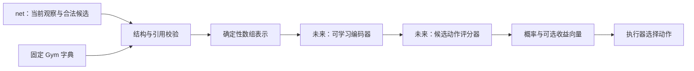

# ai-the-spire 可扩展编码器设计与首阶段任务

文档类型：参考（Reference）。## 1. 架构决策及边界

先实现不含可训练参数的结构化输入层，再按资源预算选择可学习编码器。模型接收当前观察，玩家此前获知且当前仍有效的信息直接属于观察。输入表示保留实体、具名字段、关系和已知顺序，候选动作通过引用关联这些实体；编码器不额外记录公开历史或维护独立游戏知识状态。

编码流程与字典结构可跨 Gym 复用；内容字典和模型权重属于固定 Gym。添加注册项意味着新的字典版本及必要的重新训练，不保证已有模型能理解新增内容。

以下名称都是拟议的数据约定，不是当前 C# 类型或已经实现的 API。[net 公开协议](../../net/reference/protocol.md)负责 wire 数据及公开声明，本文件只规范 AI 字典、规范化和数组。首阶段允许用该协议的公开 fixtures 实现，真实协议适配必须另行验证。



观察提供方负责可见性边界及当前已知变量的更新，`net` 暴露一致的当前观察；数组层负责类型、索引与补齐；可学习编码器负责表示学习；评分器负责候选概率。编码器不能查询内核、回放事件或读取先前快照来补全当前观察，也不能执行规则来获得未选动作的结果。

依赖范围：正确产生当前已知位置、过滤隐藏排列、把后端动作适配为外部候选，属于观察/动作提供方。它们是实际联调及训练前的依赖，不阻塞使用公开输入 fixtures 开发编码器约定。编码器检查当前输入的结构一致性，不验证一局游戏是否按规则产生了这些事实。

## 2. GymManifest：固定训练环境的字典

Manifest 包含 `tensor_layout_version`、`gym_id`、`dictionary_version`、`environment_identity`（net 的 protocol_version/ruleset_id/catalog_id/backend_profile_id）、`scenario_profile`、编码配置与数值精度策略，以及内容类型、实体类型、字段类型、关系类型、动作类型、序列/组类型和类别值字典。本文早期的 schema_version/ruleset_version 称呼由这些具名版本取代，不保留双重别名。字典保存为可检查的文件，加载顺序不应改变索引。

提供方的 PublicCatalog 是公开语义声明的权威；AI 读取它，分配类别索引并附加 offset/scale，不创造动作语义或更改可见性。测试用目录需明确标为 fixture，不从 core 反射生成。net 快照携带 environment_identity，不携带 AI dictionary_version；编码时校验环境标识，再将 AI 本地字典标识放入 TensorizedObservation.metadata。

Python contracts 读取/校验[统一规范资产](../../net/spec/contract-artifacts.md)，不在 encoding 内另定义镜像 DTO。pile_types 通过唯一 kind_id 保留牌堆语义，互斥作用域是已声明的 entity_ref 字段；terminal_reasons 仅校验结果事实，不把终局 reason 变成决策输入。新增目录声明同步修改 Manifest 与 fixtures；按[相关规格](../../../specs/project.md)，首阶段 A-01 依赖 C-01 的 P-01 资产/Python 检查部分，不等待 N-01 的 C# 复核或游戏后端。

- 名称使用命名空间，如 `base:headbutt`、`modA:charge`。实体种类与卡牌等内容类型分开注册。
- 索引 0 保留给补齐。首次构建各字典时按完整名称确定性排序，显式保存映射；恢复训练时读取原映射，不按新注册顺序重建。
- 内容集合或声明发生变化时，本阶段选择构建新的 Manifest，允许排序后的索引改变，并要求新 `dictionary_version`。已有字典按原样保存、加载；新快照配旧字典或模型才报版本错误，不禁止加载一份有效的旧 Gym 字典。首阶段不实现增量扩表和旧权重迁移。
- 内容索引和字段索引是类别标识，未来交给 embedding 使用，不作为连续数值输入。
- 字段值类型、适用域、必需性及公开条件继承 PublicCatalog；动作引用与参数统一为具名字段。AI 编码配置额外保存数值变换 `encoded = (raw - offset) / scale`，scale 为有限正数；未声明则 offset=0、scale=1，不静默裁剪，不以未来评估数据拟合变换。精度容差与所有变换一起持久化。
- 注册新的公开字段可以改变记录数量，不改变单条字段记录的格式。字段声明公开并不允许消费端读取隐藏变量；输入仍须来自外部协议的可见投影。
- 未注册类型、值类型冲突或版本不匹配返回显式错误。首版不把所有新类型混入一个 UNK 类型，也不在推理中自动扩充 embedding。

首阶段对字段值类型支持 `number`、`boolean`、`category`、`entity_ref`。集合、顺序和关系有独立结构；任意插件对象、任意嵌套 JSON 或代码不得隐式序列化后充当数值特征。

## 3. PublicSnapshot：观察数据结构

| 对象 | 必要信息 | 语义 |
| --- | --- | --- |
| 快照头 | 会话 ID、观察版本、环境标识、decision/terminal 状态 | 将当前可观测字段、候选及编码绑定到同一个决策点；字典标识仅在 AI 输出中 |
| 全局实体 | 实体种类、字段 | 表达回合、资源、场景等无其他所属实体的信息 |
| Entity | `instance_id`、实体种类、可选内容类型、字段列表 | 卡牌、敌人、Power、药水、场景、选项等通用实体 |
| Field | 字段类型、知识状态、类型对应的值 | 类型和所属实体不能丢失 |
| Relation | 关系类型、来源实体、目标实体、可选语义位置 | 如 Power 持有者、牌区成员、地图连接 |
| KnownCardPosition | 牌堆引用、公开卡牌实例引用、当前已知绝对位置 | 表达顶部、底部或有空洞的已知位置，不另存顶部摘要 |
| ObservedSequence | 序列类型、元素引用、公开序位 | 其他确有顺序语义的当前观察结构 |
| UnorderedGroup | 集合类型、公开成员描述及数量 | 保留重复数量，不带隐藏顺序 |
| LegalAction | candidate_id、action_type、fields | 打牌、选牌、确认、路线或事件选项；引用和参数均用目录声明的具名字段 |

字段知识状态为 `known`、`unknown`、`unavailable`。`known` 必须带有效值；其余两种不带可解释值。补齐由独立 mask 表示。字段省略只表示 absent，不能区分不适用与可选未提供，不创建 unknown/not_applicable 值行；适用但后端无法提供时显式标为 `unavailable`。required 且适用的字段省略为错误。

实体的内容类型独立使用 `content_state = known | unknown | unavailable | not_applicable`；只有 known 具有有效内容索引，并令 `content_mask = true`。全局实体等没有内容类型的真实行使用 not_applicable，实体 mask 仍为 true。补齐行由实体 mask 区分，不把“无内容类型”视为不存在的实体。若观察提供方表达可见槽位，样例可使用带 `slot_index`、`occupied` 字段的槽位实体，空槽没有虚构药水内容；AI 不从 C# 的 null 自动推断其游戏含义。

候选 ID 是当前快照内唯一的不透明句柄，只用于输出对齐与执行关联，不作为模型特征。重排同一快照的候选时句柄随候选保持；新快照不要求沿用旧句柄。把 HandIndex、PotionIndex 等后端参数转成具名引用和分配句柄是适配器职责，不要求编码器改写核心动作类型。

实例 ID 是当前会话内的引用，不要求跨对局相同，也不把 ID 的字符串或大小当作模型特征。卡牌定义类型与卡牌实例分开：同名牌可以有不同升级、费用和公开动态字段。Power 作为实体通过持有关系连接玩家或敌人，避免同名变量混淆所有者。

手牌、弃牌、消耗牌及未知顺序的抽牌部分按公开语义处理为多重集合。敌人有游戏含义的槽位需显式字段或关系位置。场景、待选牌、选项同样使用实体和引用，不为每个具体内容编写一套独立编码器。

首版不要求效果文字、自然语言说明、效果标签或 DSL 作为输入。公开费用、升级、实例修改等可纳入字段；它们提供可区分的观察事实，不等于向模型预写效果知识。

## 4. 抽牌堆与已知变量：当前观察的一部分

公开历史的有效影响由当前观察中的字段、关系和位置反映，不单独定义 PublicKnowledge 输入或 AI 侧历史维护器。抽牌堆直接给出当前可观测状况：总数量、可知的卡牌成员及 `(card_ref, position)` 记录；known_top 被统一的位置表示替代。

牌堆结构为 `pile_ref`、`total_count`、`visible_members`、`members_complete`、`known_positions`。卡牌编号使用观察内实体引用；实体的内容类型编号另存，不能用同一种卡牌的内容编号代替实例。`visible_members` 是没有隐藏排列的公开成员列表；`members_complete` 表明成员是否完整可知，为 false 时列表缺项不代表牌堆为空。位置记录仅描述同一批成员的位置，不增加卡牌数。未知的卡牌和位置不由编码器补齐。

例如当前五张牌的公开成员都已知，其中 C 在顶部、D 在第 4 个位置：

```json
{
  "pile_ref": "draw",
  "total_count": 5,
  "visible_members": ["A", "B", "C", "D", "E"],
  "members_complete": true,
  "known_positions": [
    {"card_ref": "C", "position": 0},
    {"card_ref": "D", "position": 3}
  ]
}
```

抽牌堆位置从 0 起，0 是顶部，`total_count - 1` 是底部；允许已知位置有空洞，不要求已知前缀连续。未出现在 known_positions 的成员位置未知，不能把 visible_members 的数组下标当作实际位置。wire position 与张量 absolute_position 同义，满足 `0 <= position < total_count`，即使成员不完整也使用真实总数；数量、子集和唯一性按协议第2节四条不变量检查。

数组化时 total_count 与 members_complete 派生为牌堆实体字段 net:pile_total_count/net:pile_members_complete，visible_members 派生为 net:pile_member 关系，known_positions 进入 pile_positions。目录须声明这三个保留类型；wire 不重复填这些事实。它们均来自这一份当前观察，不构成需要更新的额外缓存。同一卡牌的牌区与长期牌组关系按不同语义处理，不能用一个全局“只能出现一次”规则拒绝正常观察。

实体 C 等在 Entity 表中具有各自的内容类型和公开状态。编码器只需编码这份当前快照，不需要知道此前打出了头槌、C 原先在哪个区域或经历了哪些移动事件。该快照可以作为第一次输入直接编码，结果应与此前已编码过同一局多份快照时相同。

下面的场景规定观察提供方应如何表达当前可知事实，不要求 AI 编码器执行相应状态更新：

| 游戏变化 | 新观察应表达的当前信息 | 编码器职责 |
| --- | --- | --- |
| 卡牌置顶 | 该牌的当前位置为 0，公开其他区域和数量一致 | 保留当前的位置、引用和计数 |
| 从顶部抽牌 | 当前成员及仍已知的位置已更新 | 编码新快照，不保留旧位置 |
| 随机插牌或洗牌 | 失效的已知顺序已取消，仍可知的成员和数量保留 | 编码当前 known/unknown 状态，不推断内部排列 |
| 查看或重排 | 当前已知位置及最终顺序 | 保留观察明确给出的顺序 |
| 本回合出牌或公开触发 | 当前计数、触发标志或剩余次数变量 | 编码具名字段及其所有者 |

首阶段即可表达已知顶部、底部和离散位置，因为它们都使用同一位置字段。概率位置分布或其他复杂约束未纳入本阶段；遇到未支持的可观测结构返回明确能力错误，不静默丢弃。是否发生过复杂部分洗牌不需要输入编码器，它只处理最终观察实际声明的结构。

观察提供方有责任确保快照中所有已知变量有效、区域无重复计数、候选与快照一致；编码器校验能够从当前输入发现的类型、引用、数量或位置矛盾。若当前观察缺少玩家已知信息，这是观察约定或提供方的问题，不能要求编码器靠历史缓存修复。环境及真实适配器内部如何产生观察需独立设计，本阶段不新增事件流、事件序号或同步恢复协议。

## 5. TensorizedObservation：确定性编码输出

首阶段输出未经过 embedding 的数组或等价列表；支持以后转换为训练框架张量，当前不依赖深度学习框架。

| 输出块 | 内容 |
| --- | --- |
| metadata | 会话、快照、Manifest 标识与数值变换版本 |
| entities | 类型索引、内容索引、content_state、content_mask 及实体 mask |
| fields | 所属实体行、字段索引、值类型、知识状态、数值/类别/引用通道及有效 mask |
| relations | 关系索引、来源行、目标行、语义位置及有效 mask |
| pile_positions / sequences / groups | 卡牌与牌堆引用、已知绝对位置，其他观察序位或无序成员计数，以及有效 mask |
| candidates | 候选类型、具名引用和参数的分组数组及有效 mask |
| reference_map | 会话实例 ID 到实体行、当前候选 ID 到候选行的映射，仅用于关联 |

所有引用先校验，再转换为局部行索引。来源、目标等引用角色必须注册具名字段，不能通过位置约定混淆。未引用实体由引用 mask 表达，不能与实体行 0 混为一谈。

各记录只启用与值类型匹配的通道：number 使用变换后的数值，boolean 使用 0/1，category 使用类别索引，entity_ref 使用实体行索引和引用 mask；其他通道补零并由类型/知识状态屏蔽。unknown/unavailable 不能因补零而被解释为 known。批处理中的引用使用批内样本各自的局部索引，不跨样本连接。

规范化排序：实体按 instance_id，字段按所属实体行及字段名，关系按类型名、来源行、目标行及语义位置，无序成员按公开引用或完整描述，已知位置按牌堆行及绝对位置排序。字符串采用 UTF-8 字节序，与规范资产一致；字段归属内的同名重复声明报错。相同卡牌类型的不同实例及组内 multiplicity 必须保留。该排序用于确定性输出，没有游戏语义，网络不能使用任意行号作为位置特征。合规 wire 的候选按公开动作语义键排序；编码器保留其顺序与映射，重排测试用于等变验证，不放宽提供方排序要求。真正的观察序列保留顺序。

输入 ID 不变而无序行重排时，规范化后的特征数组逐元素相等。实例 ID 一致重命名可能改变规范排序，验收通过引用映射对齐后比较，不能要求原始行顺序仍逐元素相同。候选重排也按候选句柄对齐比较，不把该场景误写成整块数组不变。

批处理按本批实际长度补齐，提供独立 mask。数据增长改变行数，不要求总字段数对应一个固定宽向量。若设置资源上限，超限返回显式错误，不能静默截断实体、候选或已知牌序。

数值源记录保留原始精度，数组转换精度另行配置并记录；首阶段建议数值通道采用 float64，并检查非有限值及转换误差。这是待用户评审的实现建议，不要求内核改变 decimal 语义，也不将可训练网络精度预定为 float64。

`metadata` 和字符串 `reference_map` 是校验/组装侧信息，不作为网络特征；Manifest 中的 offset/scale 与字典一同保存并版本化。实体、候选和引用的整数行号仅用于 gather 和连接，不作为连续标量特征。当前实体类型、公开位置及数值/类别状态才是可学习输入。

### 5.1 批处理布局

本阶段使用每个样本独立补齐的 B 轴布局。每个块的最大行数按本批确定；同一块内各列形状一致。引用索引属于同一 B 样本，不引入可学习的 sample_id。

| 块 | 各列形状 | 列及有效性 |
| --- | --- | --- |
| entities | `[B, Emax]` | kind_id、content_id、content_state、content_mask、entity_mask |
| fields | `[B, Fmax]` | owner_entity、field_id、value_type、knowledge_state、值通道、field_mask |
| relations | `[B, Rmax]` | type_id、source、target、可选 position、position_mask、relation_mask |
| pile_positions | `[B, Pmax]` | pile_entity、card_entity、absolute_position、position_record_mask |
| sequences | `[B, Smax]` | sequence_type、owner、element、ordinal、sequence_record_mask |
| groups | `[B, Gmax]` | group_type、owner、member、multiplicity、group_record_mask |
| candidates | `[B, Amax]` | action_type、candidate_mask；候选句柄保存在侧信息 |
| candidate_fields | `[B, AFmax]` | owner_candidate、field_id、value_type、knowledge_state、值通道、field_mask |

类型、状态、行索引、计数和位置通道使用 int64，布尔值及 masks 使用 bool，number 通道使用上述建议的 float64。字段值通道沿用第 5 节的类型屏蔽规则，category 和 entity_ref 不转成连续浮点特征。补齐位置值可为 0，但 mask=false；不得把它解释成顶部位置 0。第一批是 Python 列表及 dtype 描述，后续张量框架需验证转换后等价，不要求首阶段安装张量库。

固定枚举：value_type 为 pad=0/number=1/boolean=2/category=3/entity_ref=4；knowledge_state 为 pad=0/known=1/unknown=2/unavailable=3；content_state 为 pad=0/known=1/unknown=2/unavailable=3/not_applicable=4。类别字典索引 0 是补齐；实体局部行号 0 是有效实体，不能共用类别字典的补齐含义。

fields/candidate_fields 的完整值列为 number_value、boolean_value、category_id、reference_entity、reference_mask；未启用通道填零，reference_mask 仅在 known entity_ref 时为 true。owner_entity/owner_candidate 必须有效；行 padding 用 field_mask=false。relations 的 position 用独立 position_mask；sequences/groups 的 owner/element/member 均必须有效，空集合不造成员行。每个真实实体按字段定义保留未知状态，而非删除整行。

wire 的十进制字符串先用精确解析保留源值，再用 Manifest 固定变换转 float64；检查有限值与配置的 absolute/relative tolerance，转换误差超限报 numeric_precision_loss。整数字段可先解析为精确整数；不将 int64 类别/位置当浮点特征。不能先 float(value) 再声称保留源 decimal 精度。

ObservedSequence 的 ordinal 从 0 起且同一序列连续；KnownCardPosition 的 absolute_position 从 0 起且允许空洞。Relation 的 position 只有关系声明包含该语义时有效，单位、范围与起点由 Manifest 的该关系声明给出，不把所有关系位置都解释为抽牌位置。

### 5.2 最小错误结果

错误对象为 `{code, path, related_ids, message}`；path 指向当前输入或 Manifest 的具体位置，related_ids 可为空。失败不返回可供评分的部分编码。代码至少包括：`unknown_type`、`unregistered_field`、`value_type_mismatch`、`dangling_reference`、`duplicate_identity`、`count_mismatch`、`invalid_position`、`version_mismatch`、`capacity_exceeded`、`non_finite_value`、`unsupported_structure`、`empty_candidates_non_terminal`。数值转换误差超出已配置精度策略时使用 `numeric_precision_loss`。重复内容类型合法，duplicate_identity 针对重复实体/候选标识、字段归属键或同一牌堆成员实例，不禁止多张同名牌。

## 6. 可学习编码器与评分器的解耦

未来接口为 `Encode(TensorizedObservation) -> EncodedObservation`，后者保留局面向量、实体向量、观察内序列与关系的表示、引用映射及 masks。评分器使用局面向量与每个候选关联的实体向量产生 logits，再只在有效候选上归一化。

编码器不能只返回一个整体向量，否则评分器难以取得具体卡牌、目标和选项的表示。候选特征可以在评分器侧由类型、引用及参数构建；首阶段只负责它们的确定性表示。

接口解耦不保证权重任意兼容。未来模型包应绑定 Manifest、编码器配置/输出维度、数值变换、评分器配置及对应权重；不兼容时拒绝加载。端到端训练允许梯度从评分器流回编码器。独立预训练或固定编码器需另定学习目标，不把随机初始化向量称为有效表示。

策略主要返回 candidate_id + probability，绑定输入快照。具体输出与模型包以 [policy-contract.md](policy-contract.md)为准；本文件不定义另一套返回格式。可选收益头可关闭。终止状态空候选不进行 softmax；非终止状态空候选为输入错误。

## 7. 成本与网络选择

目前只确认部署成本优先，没有批准具体参数量、延迟或内存阈值。旧论文储备里的“无 GPU、约 8 GB、5 秒”是历史讨论条件，需用户重新确认，不直接用作本次编码器验收阈值。

候选方案包括 embedding 加简单数值投影与集合聚合、窄的共享 MLP，以及少量局部注意力。已知序列可以比较小型 GRU 或其他序列编码；完整 Transformer 保留为实验方案。以上均不属于首阶段必做项。

全连接层参数为 `din × dout + dout`，embedding 为 `类型数 × 维度`。共享权重控制参数增长，但实体和字段数量增加仍会提高计算量与中间内存。把所有字段展平成不断加宽的输入会让首层参数随规模增长，首版避免这种表示。

任何“轻量”结论需分别报告总参数量（包括字典 embedding）、权重文件大小、CPU 决策延迟、峰值内存和下游效果。首阶段只报告结构化编码与补齐成本，不能代替神经网络推理或训练基准。

候选数 A 同样影响编码、评分与归一化成本。打牌加目标只是其中一种组合，实际候选规模由外部合法列表决定；首阶段记录 A 及 candidate_fields 的数量，不自行枚举或缩减动作。是否采用因子化评分在后续测量后讨论，不要求此阶段改变外部动作约定。

## 8. 首阶段实现任务

以下是供用户评审后交给实现者的任务，不是本次已经执行的工作。建议使用 Python 3 标准库，包位于 `ai-the-spire/ai_the_spire/encoding/`，样例和检查位于 `ai-the-spire/tests/`；语言与布局由用户评审确认。先不安装 PyTorch、Gymnasium 或其他训练依赖。

1. **约定与样例**：P-01 完成后读取/校验同一规范生成的 contracts，实现 Manifest 与编码专用模型；提供战斗、待选牌、场景选项与扩展变量 fixtures，不另定义 wire DTO，不宣称已经接通后端；N-01 完成 C-01 的双端要求。
2. **字典与校验**：实现确定性字典构建/保存/加载、版本比对、类型与引用校验、明确错误结果。
3. **可观测牌区表示**：实现第 4 节的公开成员、卡牌引用及已知位置、计数与可见性校验，只处理当前快照。不硬编码头槌效果，不维护历史，不处理事件，不查询 core。
4. **数组化与批处理**：实现第 5 节的数组、引用映射、数值变换、补齐及 mask；每条样例可检查编码前后对应关系。
5. **验收检查与运行说明**：执行第 9 节场景，输出编码规模与耗时；记录覆盖的公开机制和未支持的输入。首阶段不实现收益函数、神经网络、训练、策略评分或真实动作执行。

接口边界：实现者负责 `ai-the-spire` 与必要的该模块文档；不修改 core、内容 DSL 或 base-spire。[net 协议](../../net/reference/protocol.md)同时待评审，以公开样例消费该约定；不得新增直接读取内核的捷径。完整阶段及依赖见[实施计划](../../../meta/roadmap.md)，本节仅细化第一批任务。

建议验证方式为在 `ai-the-spire` 目录执行 `python -m unittest discover -s tests -v`。这是后续实现的建议命令，本次未执行，也不是当前已存在的测试项目。

建议最小调用面为 `build_manifest(public_catalog, encoding_config)`、`save_manifest(manifest, path)`、`load_manifest(path, expected_identity=None)`、`validate_snapshot(snapshot, manifest)`、`tensorize(snapshot, manifest)`、`collate(encoded_samples)`。单次编码不依赖其他快照，重复编码同一输入不积累状态。校验与编码需完整成功或明确失败；错误带种类和输入路径，失败不返回可供评分的部分编码。collate 拒绝不同 Manifest/布局/数值配置混批，并在补齐前核对资源上限；可以混合 decision 和 terminal，后者 candidate_mask 全 false。新增真实传输、事件流、异步调用与重试策略不属于此阶段。

## 9. 验收场景与预期

| 场景与初始条件 | 操作 | 必须观察到的结果 |
| --- | --- | --- |
| Manifest 含同一批类型，注册顺序不同 | 构建、保存并重载字典 | 所有类型索引及数值变换逐项相等 |
| 新增内容生成新版本 Manifest，另有旧版本文件 | 分别加载，再将新快照交给旧字典 | 旧文件仍保持原映射；版本混用报 version_mismatch，不返回编码 |
| 两个 mod 都声明 `charge`，玩家和敌人各持有变量 | 编码字段 | 完整字段类型及所有者均可区分 |
| 同名卡两实例，一张升级且改费 | 编码并引用其中一张 | 实例状态不同；候选关联准确 |
| 三张相同牌的无序集合，实例 ID 不变 | 重排成员再编码 | 特征数组逐元素相等，数量仍为三；不能被聚合为一张 |
| 已知零、未知、不可提供、补齐记录 | 编码 | 状态与 masks 可区分，不都被当作零值 |
| 首次输入即是头槌结算后的观察，C 位置 0、总数五 | 直接编码当前快照，不提供历史或事件 | C 的位置为 0，总数五；位置记录不增加成员数 |
| 五张牌中 C 位置 0、D 位置 3，其余未知，与第4节及 V-03 相同 fixture | 编码已知位置及无序成员 | 0、3 均保留；位置 1、2、4 不被推断；成员重排不改变结果 |
| 五张牌有越界、重复位置或重复卡牌定位记录 | 编码 | 报 invalid_position 或 duplicate_identity，附具体输入路径 |
| 一份观察含已知顶部，另一份观察只含洗牌后的未知顺序 | 先编码前者再编码后者，与单独编码后者比较 | 后者结果相同，没有残留已知顶部 |
| 隐藏顺序不同，当前可观测成员、ID 和已知位置相同 | 编码两份当前观察样例 | 特征数组逐元素相等，不含内部排列或 RNG |
| 当前快照含本回合出牌计数及公开触发标志 | 不提供任何历史直接编码 | 字段及其所有者正确保留 |
| 相同当前快照，先前编码调用的会话和内容不同 | 重复编码并比较 | 结果一致，不读取或积累游戏历史状态 |
| 现有实例 ID 被一致重命名 | 连同所有引用一起编码 | 引用仍正确，数值与类型语义等价 |
| 候选重排；来源和目标不变 | 编码并检查映射 | 候选特征对应重排，不改变动作语义 |
| 同一 batch 含不同字段、实体和候选数量 | 补齐 | 有效记录不丢失，padding 被 mask，无引用误连 |
| 路线选择观察中含已揭示节点、未知内容节点及合法选项 | 编码当前样例并补齐 | 节点、关系和候选关联正确；unknown/not_applicable 与 padding 可区分 |
| 空槽位实体及有效内容实体同时存在 | 编码 | 两行 entity_mask 为 true；空槽 content_mask 为 false，真实内容为 true |
| 未注册类型、悬空引用、非法值或版本错配 | 编码 | 拒绝该输入，给出字段路径和错误种类，无部分有效结果 |
| 实体或候选超出配置上限 | 编码 | 显式超限错误，不截断后继续执行 |
| 新会话、终止快照及非终止空候选 | 直接编码各自快照 | 无其他会话残留；终止空候选可表示；非终止空候选报错 |

这些场景验证信息与约定，不证明学习效果或原版规则一致性。真实 net 适配需要另测可见性、当前已知变量和牌序的充分性、候选与快照同步；神经网络上线前另测集合重排、候选重排和补齐不改变有效概率。

## 10. 评审决策与后续风险

| 待决项 | 影响及验证 | 需要确定的时点 |
| --- | --- | --- |
| Python 标准库、目录和数值通道精度建议 | 决定首阶段代码布局；以数值和引用场景检查 | 首阶段实施前 |
| 真实后端当前可观测字段及能力声明 | 决定是否完整反映玩家已知信息；不能从内核或历史补缺 | 真实适配前 |
| 部署机器与资源预算 | 决定可学习模型规模；CPU 基准比较 | 网络选型前 |
| 当前观察是否充分、哪些结构暂未支持 | 防止不同可决策局面被合并；逐机制对照观察字段 | 扩大训练内容前 |
| 奖励向量、目标取舍、时间范围 | 决定策略训练；事实记录不自动提供偏好 | 策略训练前 |
| 算法与训练分布 | 固定 Gym 下比较样本效率和保留种子效果 | 训练实验前 |

所有待决项由项目维护者负责；首阶段约定批准不等于这些后续问题已经解决。保持实现状态为“结构化编码通过约定检查”，直至有独立验证记录支持“可学习表示有效”“真实内容可接入”或“部署预算满足”。
