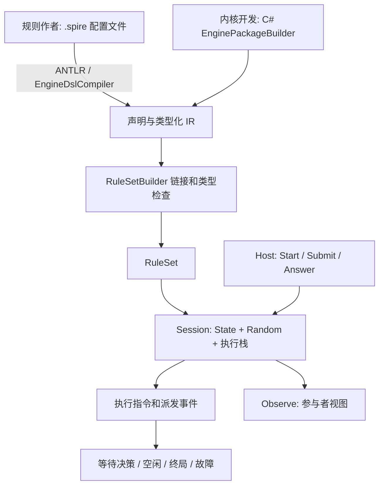
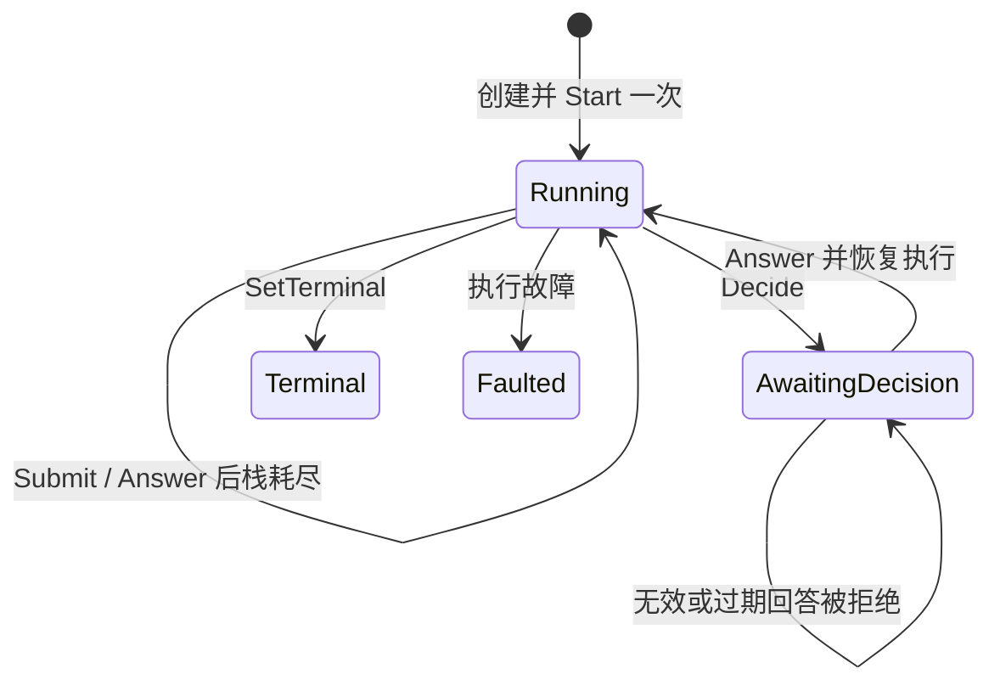

# core-the-spire 引擎开发者指南

文档类型：参考（Reference）。本文面向 Host 开发者及内核维护者，供你按主题查询构建器、扩展和内核细节。

根据接入任务选择入口：

- 第一次写宿主：先做[宿主教程](../../../start/first-host.md)。
- 提交带参数的动作：查[参数提交操作指南](../how-to/submit-parameters.md)。
- 查询交互字段与约束：查[API参考](session-api.md)。
- 理解各部分的关系：读[规则与宿主](../../../understand/rules-and-host.md)。
- 第一次编写规则：从[第一次写规则](../../../start/first-rule.md)开始。

版本与加载入口核对：2026-10-15。本文说明活动 `Core.TheSpire/Engine/` 的接口与执行行为，主要面向 Host 开发者及内核维护者。普通规则作者应通过配置式 `.spire` 文件使用引擎，入口见[规则作者说明](../../../reference/dsl/README.md)；`core/0.3` 统一提供基础声明、规则库配置、同包绑定与具名调用。本文 C# 片段说明宿主与底层接口。目标边界见[模块 spec](../../../specs/core/game-model.md)，后续调整以[架构决定](../../../understand/decisions/core.md)为准。

## 0. 规则作者写文件，宿主调用 SDK

正式使用应是：作者编辑规则配置文件 → 通用 DSL 编译器生成 IR → 链接成 RuleSet → 宿主创建并驱动 Session。规则文件描述类型、初始状态、动作、条件、事件、选择与终局；宿主负责加载文件、提供运行配置以及提交/回答。

配置式 DSL 不局限于静态数值，它也可以用结构化规则块表达顺序、分支和状态变化，由引擎解释执行。一般游戏规则不应因为有行为就转回手写 C#；确需新通用原语、编译扩展或宿主集成时才涉及底层代码。

文本入口是 `EngineDslCompiler.Compile` / `LoadFiles`，C# 入口是 `EnginePackageBuilder`。两者生成同一种规则表示。基础文本语言见[原语参考](../../../reference/dsl/0.3/language-reference.md)；[core/0.3 规则库配置](../../../reference/dsl/0.3/authoring-guide.md)先展开模板，再走相同绑定/链接/执行。[core/0.3](../../../reference/dsl/0.3/authoring-reference.md)还可通过 `BindInto` 将文本绑定到宿主已有的包构建器；STS 内容语言仍属于 base。

## 1. 先理解引擎在执行什么

引擎执行的是**规则包声明的类型化程序**。包声明有哪些实体、字段、动作和事件，再用 IR 表达查询、条件和状态修改。引擎负责检查这些声明，维护实例，并依次执行指令。抽牌、能量、伤害、回合、胜负都由游戏包定义；内核不预设这些概念。

开发者需要区分三个对象：

| 对象 | 保存什么 | 生命周期 |
| --- | --- | --- |
| `RuleSet` | 链接后的类型、程序、动作、订阅、投影和规则标识 | 一套规则，可供多个 Session 使用 |
| `SessionState` | 实体实例、字段值、作用域、集合成员和关系 | 一局游戏的可变状态 |
| Session 执行帧 | 程序参数、局部槽位、当前作用域、下一条指令位置 | 一次调用；决策暂停时保留 |

规则包描述“怎样运行”，State 保存“现在是什么”，执行帧保存“运行到哪里”。局部变量不会自动进入观察，普通实体字段也不会自动成为合法动作。



活动包版本与运行语义标识分别见[项目配置](../../../../core-the-spire/Core.TheSpire/Core.TheSpire.csproj)与 [RuleSetBuilder.EngineVersion](../../../../core-the-spire/Core.TheSpire/Engine/RuleSet.cs)。当前职责和兼容要求见[核心约定](../../../specs/core-engine-baseline.md)，升级验收见[行为要求](../../../specs/environment.md#core-author-04)。

当前入口及能力边界：

| 项目 | 当前状态 |
| --- | --- |
| C# 构建器、IR、链接检查、Session | 可运行；与文本入口共用链接器/执行器 |
| 通用文本 DSL | 仅接受 core/0.3；基础声明、imports/template/use、同包绑定与具名调用共用 IR 和 Session |
| base 的 STS 内容 DSL | 属于游戏前端，生成通用引擎可执行内容；覆盖范围由 base 的验证记录说明 |
| ANTLR、编辑器/LSP 插件 | ANTLR 4.13.1 已接入；具体编辑器插件尚未交付 |
| 差异测试专用调试模式、内核职责拆分 | 同一 Session 按职责拆分；可选有界轨迹已接入 tools |
| 规则深固定 | 作者对象及子集合在 Build 后拒绝写入，IR/Value 集合复制并只读发布，链接结果独立 |

## 2. 从规则配置文件跑通执行与续接

### 2.1 默认作者入口：规则库加参数

默认入口是 [game.spire](../../../examples/core-choice-counter/game.spire)，导入 [规则库](../../../examples/core-choice-counter/rules/score-race.spire)，只填写 target 和 increments。仓库根运行：

```powershell
dotnet run --project docs/examples/core-choice-counter/CoreChoiceCounter.csproj
```

实际是 Score=0 → 2 → 3、Running → Running → Terminal。+1/+2 是 Add 动作的两个有限参数绑定，默认下标 1,0，无需额外动作内决策。仅修改参数即可改变合法操作、合法性条件和终局；作者不必操作低层 IR。规则库本身仍是 DSL，其中 procedure 复用运行时函数，template 复用编译时声明。

`LoadFiles` 递归处理相对 imports 并去重。`Compile` 不读取文件，只接受显式包依赖。

需要游戏自定义声明扩展时，按输入选择以下入口。签名来源为 [EngineDslCompiler.cs](../../../../core-the-spire/Core.TheSpire/Engine/Compilation/EngineDslCompiler.cs)：

| 入口 | 输入与结果 | 使用条件 |
| --- | --- | --- |
| `Compile(source, sourceName, dependencies, extensions)` | 编译单份文本，返回 `EnginePackage` | 显式传入包依赖；不读取 imports 文件，之后由 `RuleSetBuilder` 链接 |
| `LoadFiles(params string[] paths)` | 递归加载入口及相对 imports，返回 `RuleSet` | 不需要注册扩展时使用 |
| `LoadFiles(paths, extensions, dependencies)` | 扩展感知的文件加载，返回 `RuleSet` | `paths` 为 `IEnumerable<string>`；`extensions` 必填，`dependencies` 可省略 |
| `BindInto(source, package, sourceName, dependencies, extensions)` | 绑定到已有 `EnginePackageBuilder`，返回 `void` | 文本 namespace 与目标包 `PackageId` 相同；完成所有绑定后再调用一次 `Build()` |

`extensions` 中的每项实现 `IEngineDslExtension`。扩展和编译器标识进入规则标识；不要用旧产物标识标记重建结果。模板展开后的参数错误定位到配置源，规则绑定错误定位到库源并附 use 位置。具体约束见[规则库指南](../../../reference/dsl/0.3/authoring-guide.md)与[同包绑定参考](../../../reference/dsl/0.3/authoring-reference.md)。

### 2.2 进阶例子：动作内选择、暂停及事件

游戏规则在 [counter.spire](../../../examples/core-choice-counter/counter.spire)，通用宿主在 [Program.cs](../../../examples/core-choice-counter/Program.cs)，工程在 [CoreChoiceCounter.csproj](../../../examples/core-choice-counter/CoreChoiceCounter.csproj)。宿主没有手写 BuildRules；从文件读取类型、初始实例、动作、事件、选择、投影和终局。无需 base/net 或外部游戏，不加入主 solution。

从仓库根执行，需要 [global.json](../../../../global.json) 指定的 .NET SDK `9.0.306`：

```powershell
dotnet run --project docs/examples/core-choice-counter/CoreChoiceCounter.csproj -- docs/examples/core-choice-counter/counter.spire "1,0"
```

游戏每次选择加 1 或加 2，总分到达 3 后结束。实际输出中的 Counter 字段为：

| 命令边界 | 状态 | Score | Attempts | Applied |
| --- | --- | --- | --- | --- |
| start | Running | 0 | 0 | 0 |
| submit | AwaitingDecision | 0 | 1 | 0 |
| answer（+2） | Running | 2 | 1 | 1 |
| submit | AwaitingDecision | 2 | 2 | 1 |
| answer（+1） | Terminal | 3 | 2 | 2 |

按文件里的声明读：Counter/Option 描述字段形状；Setup 创建 Game 作用域、计分器和选项；CountApplied 监听 Increased；Advance 增加尝试计数、decide 暂停、回答后增加分数并发事件、最后设置终局；PlayerView 发布两种实体。

第一次 submit 的分数还是 0，但尝试次数已是 1，说明暂停保留前序效果。回答不重放这些效果；监听器先完成，动作再继续检查终局。把文件中的 Delta=2 改为 4，使用 `--no-build` 加文件路径运行，第一次回答就以 Score=4 结束，这是显式选择旧进阶文件的行为，默认作者入口使用上节的模板配置。

示例只有一个玩家，其 ID 为 ParticipantId(1)。多玩家包应把行动者/当前玩家编码为参数或权威字段。宿主演示选择首个动作，且对多个投影/自由参数等场景要求明确配置；不是完整游戏的自动推进器。

Host 加载最小形式：

```csharp
var rules = EngineDslCompiler.LoadFiles("game.spire");
var session = new Session(rules, 42, ["player"]);
session.Start();
```

游戏扩展使用 `Compile(..., extensions: ...)` 后仍由 `RuleSetBuilder` 链接；从文件加载时可使用上表的扩展感知 `LoadFiles` 重载。定义与执行源码位置贯通，不另建文本解释器。

## 3. 底层构建器怎样表达规则包

本节解释构建器与 IR 的对应关系，供内核/编译器开发者参考。文本前端已自动完成这些步骤；普通作者不手动创建 Symbol、槽位或 IR 节点。

### 3.1 声明、定义与实例

`EnginePackageBuilder("tutorial", "1.0.0")` 创建作者阶段的包。`EntityType`、`ScopeType`、`Collection`、`Procedure`、`Action`、`Event`、`TerminalResult`、`Projection` 返回作者对象。名称在链接后成为 `tutorial:Counter` 等限定 ID。

| 名称 | 含义 | 使用位置 |
| --- | --- | --- |
| `EntityTypeSymbol`、`FieldSymbol` 等 | 作者持有的声明 | 规则包构建与构建 IR |
| `EntityTypeDefinition`、`ActionDefinition` 等 | 链接后分配内部编号的定义 | RuleSet 与运行时 API |
| `InstanceId` | 一份实体实例的引用 | 字段、查询结果、决策候选 |
| `ScopeId` | 一份生命周期作用域的引用 | 创建实体、程序执行上下文 |
| `ParticipantId` | 本 Session 内的参与者 ID | 决策、角色和投影 |

同一种卡牌的两个副本应是两个实例；类型 ID 描述定义，实例 ID 描述其中一个对象。内部稠密编号不应作为跨 RuleSet 的稳定内容 ID。对外协议引用转换由 net 负责。

### 3.2 字段和引用

使用 `AddField` 声明字段的类型、范围、默认值、可见性及是否允许缺省引用。数值类型包括整数与固定精度小数；引用类型可以约束目标实体类型。运行时值通过 `Value.Of(1L)`、`Value.Of(true)`、`Value.OfRef(instance)` 等构造。

```csharp
var unit = package.EntityType("Unit");
var health = unit.AddField("Health", FieldTypeSchema.Int(0, 100));
var target = unit.AddField("Target", FieldTypeSchema.RefTo(unit), optional: true);
var owner = unit.AddField("Owner", FieldTypeSchema.Participant());
unit.OwnerFieldName = "Owner";
```

非 optional 引用是构造义务。可以先创建实例，再在同一构造过程内赋值，但不得带着未赋值的必需引用到达决策、终局、观察、状态哈希或命令结束边界。确实允许“没有目标”的字段应明确 `optional: true`。销毁被必需引用指向的对象也不能留下无效状态。

实体玩法字段当前只支持 `Persistent` 生命周期。临时算术、选择结果、查询迭代变量应存放在执行帧局部槽位；`ExecutionOnly` 用于帧、事件载荷、终局载荷和 compute 输入输出，而非不可观察的实体字段。

### 3.3 作用域、集合与关系

作用域控制实例的生命周期。State 自带根作用域，包可以创建游戏、战斗、房间等作用域，并声明父子类型。销毁作用域会处理其子作用域与实体，同时执行引用一致性检查。

集合表示同类实体的成员及可选顺序。`Capacity` 限制成员数；`MembershipGroup` 使同组集合的成员资格互斥，适合用来表示不同区域。关系保存一个实体到其他实体的边。

**当前集合存储按集合定义组织，并非每个作用域自动拥有一个独立副本。** 同一规则中有多个房间、玩家或战斗时，需通过字段、关系和查询作用域筛选区分；不能仅创建新 Scope 就假设集合隔离了。

把牌从手牌移到弃牌堆通常只改变集合成员资格，不销毁牌实例。生命周期结束才使用 `Destroy`/`DestroyScope`。具体清理行为见 [StateStore.cs](../../../../core-the-spire/Core.TheSpire/Engine/StateStore.cs)。

### 3.4 IR 是程序描述，C# 是构建工具

`IrScope` 提供表达式、查询和指令辅助方法。调用 `SetField` 会得到一条指令；将它放入 `Body` 或嵌套 Block 才会运行。作者 C# 的 `if` 和 lambda 在规则包构建时执行，不能替代游戏运行时条件。

```csharp
var body = package.ActionBody(package.Action("Heal"));
var selected = body.Param("Unit", FieldTypeSchema.RefTo(unit));
// 参数先声明，再声明局部量；槽位布局是参数在前、局部量在后。
body.Candidates("Unit", body.Type(unit));
var refExpr = body.Param(selected.DeclarationIndex);
body.Body(body.If(body.Less(body.Field(refExpr, health), body.Const(100L)),
    body.SetField(refExpr, health,
        body.Add(body.Field(refExpr, health), body.Const(1L)))));
```

这段里的 `Less` 在执行时读取血量；`body.If` 构造一个条件节点。`Where(query, item => ...)` 的 lambda 构造谓词 IR，也是在规则包构建时调用。

常用入口如下；准确签名以 [PackageBuilder.cs](../../../../core-the-spire/Core.TheSpire/Engine/PackageBuilder.cs) 与 [Ir.cs](../../../../core-the-spire/Core.TheSpire/Engine/Ir.cs) 为准：

| 类别 | 方法/节点 | 作用 |
| --- | --- | --- |
| 读取与算术 | `Const`、`Field`、`Param`、`LocalRef`、`Add`、`Subtract`、比较与布尔运算 | 计算一个值；本身不写状态 |
| 查询源 | `Type`、`Collection`、`Relation` | 查询实例 |
| 查询组合 | `Where`、`Sort`、`Take`、`Skip`、`First`、`Count`、`Exists` | 筛选、排序或归约 |
| 帧与状态 | `SetLocal`、`SetField`、`CreateEntity`、`CreateScope`、`Destroy` | 更新局部量或持久状态 |
| 成员与关系 | `AddToCollection`、`RemoveFromCollection`、`MoveInCollection`、`AddRelation`、`RemoveRelation` | 改变成员、顺序或连接 |
| 控制流 | `If`、`IfElse`、`Repeat`、`ForEach`、`Call`、`Return` | 组织程序执行 |
| 事件与交互 | `Emit`、`Decide` | 派发反应或等待外部回答 |
| 随机 | `SampleInt`、`SamplePick`、`ShuffleCollection` | 使用指定命名流 |
| 外部计算 | `Compute` | 调用配置的 compute 后端 |
| 停止 | `SetTerminal`、`Fail` | 宣告规则终局或执行故障 |

纯程序通过 `Procedure(...).Pure().Result(...)` 声明。合法性守卫、查询谓词等只能使用允许的纯计算；不能借此抽随机数、修改 State 或发出决策。

### 3.5 动作与动作内决策是两层交互

`Action` 是 Host 可以提交的入口。用 `Role` 限制角色，用 `Requires` 声明守卫，用 `Candidates` 为一个引用参数提供候选查询，用多次 `Choose` 为参数声明可枚举取值。

`Decide` 则发生在动作或程序已经执行的过程中。比如“打出牌”是动作，“从弃牌堆选一张牌”是该动作内部的决策。不能在等待此决策时再提交另一个普通动作。

动作参数域决定 `LegalActions` 可以枚举的范围。**守卫只能读取有已声明域的参数**，链接检查会验证这一点。没有域的参数由 Host 填入，不能假设引擎已枚举其全部合法值。

`LegalAction.Bindings` 只含参数槽位，已排除局部量。无域参数可能仍为 `Value.None`，Host 必须填好后提交；参数数量等于 `Definition.Program.Parameters.Count`。没有自由参数的绑定可直接提交；默认 Add 例子从 Bindings 中选一个 delta，进阶 Advance 例子无参数，传 `[]`。

面向 AI 的环境应由包/适配层提供明确、有限且可提交的候选，不把未补全的 Binding 当作公开动作。策略输出与公开动作协议由 net/AI 约定约束，不能从开发者内部接口直接推导。

### 3.6 链接、标识与规则固定

```csharp
var rules = new RuleSetBuilder()
    .Add(package.Build())
    .Build();
var session = new Session(rules, 42, ["player"]);
```

多包通过 `Dependencies`、`Overrides`、`Extends` 与限定引用表达关系，交给统一链接器处理。不要在 Host 里另外拼一套名称解析/覆盖规则。跨包的实际例子见 [EngineChecks.cs](../../../../core-the-spire/Core.TheSpire.Engine.Tests/EngineChecks.cs)。

链接阶段解析名称、分配 ID、检查字段形状和程序约束，并计算 `RuleSet.Identity`。`Session.Identity` 还结合种子指纹、随机算法/profile 和角色配置。保存回放/差异测试验证记录时应同时记录这些配置及动作序列；标识字符串不替代输入记录。

`EnginePackageBuilder.Build()` 只能调用一次，并通过 `EnginePackage.Freeze` 发布构建产物。构建后的声明、IR子集合、包与链接表按[版本基线](../../../specs/core-engine-baseline.md)只读发布。规则产物固定不限制 SessionState 在游戏中的正常变化。

## 4. Host 怎样驱动 Session

### 4.1 命令执行到哪里才返回

`Start`、`Submit`、`Answer` 都会同步执行到当前栈耗尽、遇到决策、终局或故障才返回。`Step()` 同样推进执行栈，**不是执行一条微指令**。普通 Host 不需要每次 Submit 后再循环 Step。



这张图是简化控制流程：Answer 恢复后也可以立即再次等待决策、终局或故障。`Running` 同时表示空闲与正在执行；构造 Session 后、Start 前状态也是 Running。当前没有强制一次性 Start 的标志，驱动程序负责只调用一次。

推荐驱动顺序：

1. 创建 Session，配置角色、种子、预算、compute 后端与随机 profile；配置命名流种子后 Start 一次。
2. 状态为 Running 时，为当前游戏规则指定的参与者查询 `LegalActions`，构造并提交参数。
3. 状态为 AwaitingDecision 时，读取 `PendingDecision`，让它指定的参与者回答。
4. 读取 `Observe` 更新参与者界面/代理输入。
5. Terminal 读取 `Terminal`；Faulted 读取 `Fault`，结束该局处理。

Running 但没有合法动作不等于自动胜负。包必须安排推进规则或声明终局；Host 不应自行补出游戏结果。开发者 API 也不替包推断“当前玩家”。

### 4.2 提交、回答与过期检查

`Submit(action, participant, arguments)` 重新检查角色、参数数量、参数域与守卫，之前读取的合法列表不能保证现在仍然有效。调用方应使用本 Session 的 RuleSet 定义。

`DecisionRequest` 包含 `RequestId`、`StateVersion`、指定参与者、回答种类、提示、候选及数量/值界限。`DecisionAnswer` 根据种类填写 `Instances`、`Number`、`Flag`、`EnumOrdinal` 或 `Participant`。

```csharp
var request = session.PendingDecision!;
session.Answer(new DecisionAnswer(request.RequestId,
    Instances: [chosenInstance]));
```

Answer 检查当前请求 ID、状态版本、候选与回答约束。重复/过期回答被拒绝，暂停栈继续保留。当前直接 Session API 不校验“调用者是否为请求指定的回答者”；`DecisionAnswer.Participant` 在 Participant 类决策里表示被选中的参与者，其他种类不会因此鉴别调用者。Host 应将请求交给指定参与者，对外标识校验由适配层处理。Enum 决策的结果槽须声明具体非空 Enum 类型，默认合法范围 0..成员数-1，min/max 可缩小范围；越界回答在续接前拒绝并保留请求。

开发者手动修改 State 会改变版本，可能使待回答决策过期；直接消耗 Random 则会改变后续随机结果。两者都是真实操作。

### 4.3 初始化顺序与续接

engine/ir@0.3 的 `OnSessionStart` 按包链接顺序及包内登记顺序逐个执行，文本 start 列表同样按声明顺序推进。启动游标保留在同一个执行栈；某入口暂停时，回答后先完成它，再执行剩余入口，不重放前序初始化。待执行同级入口不占嵌套调用深度。也可使用单个 Setup 顺序 Call；旧 0.2 的反序安排须迁移，见 [版本基线](../../../specs/core-engine-baseline.md)。

## 5. 执行栈、事件与暂停续接

Session 只有一套执行栈。调用帧保存参数/局部槽位、作用域与 Block 游标；事件派发帧保存一次事件的载荷、监听器快照和下一个监听器位置。

`Emit` 会压入事件派发帧。当前监听器按 **Priority 升序，再按链接后的 DeclarationOrder** 执行；数值小的优先。事件监听器按载荷位置接收参数，不靠参数名字匹配。可选 `recheck` 在每个监听器开始前重新求值，能反映前一个监听器造成的状态变化。

监听器执行完才回到发出事件的程序。如果监听器又发事件，会沿同一栈继续嵌套派发。如果监听器请求决策，则整个调用链一起暂停，回答后先完成它再继续外层动作。`scopePayloadField` 可以用载荷中的实体引用决定监听器的作用域；普通情况继承当前作用域。

`Decide` 在暂停前已经推进程序位置，保存待写入的结果槽位。Answer 把回答写进该槽位，从下一条指令继续执行，不重放前面的写入和事件。

`Repeat` 复用循环游标，迭代次数不会直接变成调用深度。`ForEach` 使用进入循环时得到的查询结果快照；循环中移动集合成员不改变这次遍历的对象列表。

`SetTerminal` 立即停止推进栈。其后的动作尾部、尚未执行的监听器不会继续结算。需要“处理完死亡反应后再宣告战斗结束”的游戏包，必须把终局检查放在合适阶段，不能假设引擎自动清空所有反应。

## 6. 状态、观察与已知信息

`Session.State` 是开发者可直接访问的权威状态存储，提供 `CreateInstance`、`CreateScope`、`GetField`、`SetField`、集合/关系操作、`Clone` 与 `StateHash` 等 API。正式玩法通常由规则程序更新它；调试与实验可以直接操作，不引入额外限权 facade。

`Observe(participant, projectionId)` 返回当前参与者视图，不消费随机数、不推进 StateVersion。游戏包必须显式登记类型投影，字段按 Public/OwnerPrivate/Hidden 规则筛选。OwnerPrivate 使用声明的 Owner 字段识别拥有者。集合标识、顺序、数量分别可见；隐藏顺序时返回的稳定 ID 顺序不表示实际顺序。

已知信息由包维护为**当前状态事实**。例如抽牌堆中已知卡牌及对应位置，应由包声明并更新这些事实，再通过投影发布。引擎不会扫描历史推断玩家知识。`Reveal` 可以授权特定参与者识别原本隐藏成员中的部分实例，授权识别也不会自动解除字段可见性限制。

**隐藏成员得到授权后，`RevealedMembers` 仍不保证表达牌堆位置。** 已知位置须另有权威事实和投影；不能把内部 State 中的完整牌序直接传给玩家。

`State.Clone()` 克隆状态存储，`Random.Capture()` 保存随机服务；它们都不是完整 Session 快照，不包含全部执行帧/待决策恢复信息。`StateHash()` 也不覆盖 RNG 与执行栈。差异测试时单独比较状态哈希不能证明随机进度与暂停位置一致。

## 7. 随机、数值与 compute

### 7.1 随机由包决定用途，引擎负责执行

使用命名流，例如 `SampleInt("events", min, max, resultSlot)`。不同流隔离各自的消费序列。`SampleInt`/`DrawInt` 的上界是排他的，即 `[min, max)`；打乱使用同一随机服务。

默认算法为 `xoshiro256ss/splitmix64@1`，默认抽样 profile 为 `rejection-uniform@1`。保留已有兼容 profile；游戏还可注入 `IRandomProfile`，提供版本化 AlgorithmId/DrawProfileId、流生成器及取样映射。base 已有自己的 VanillaRandomProfile。具体游戏从统一 Session 工厂配置，避免不同 Host 配置漂移。

`Random.SeedStream(name, seed)` 必须在该流第一次创建/抽取前调用。游戏种子转换、流布局、候选排序及原版特殊算法策略属于 mod/base。内核无需分成“逻辑随机”和“游戏随机”两套作者 API。

`SamplePick` 按 query 的现有序列抽索引，不再隐式排序。需要按实例 ID 等键排序的规则必须显式 Sort，base 既有受控开发场景已这样表达。Decide 也使用其查询候选顺序。该语义变更随 `engine/ir@0.2` 标记，不能复用旧版本资产标识。

随机流诊断与快照入口见 [RandomService.cs](../../../../core-the-spire/Core.TheSpire/Engine/RandomService.cs)。正式动作/观察协议没有因此获得存读档回退能力。

### 7.2 数值有明确语义

`NumericProfile.Default` 使用固定精度小数 2 位、`MidpointRounding.ToEven`，整数算术检查溢出。引擎不隐式使用 binary64 浮点计算。字段上下界、除零和不兼容值按各自检查产生故障；规则作者不能依赖静默截断来保持合法值。

### 7.3 compute 是后端接口

`ComputeAsset` 声明输入、输出与后端标识；Session 可以注入 `IComputeBackend`。执行时交付显式输入值，并接回类型化输出；不安装所需后端时是 Unsupported 故障。

这不意味着仓库已经交付通用生产级 Lua 执行器。通常的状态修改仍由 IR 指令完成；compute 后端负责其自己的确定性与资源约束，不应该另建一套动作调度器。不要在后端执行期间重入当前 Session 命令。

## 8. 故障、原子性与现有诊断能力

区分提交前的输入拒绝与执行中的故障。无效动作/过期回答通常在修改前抛出 `EngineFaultException`；执行过程发生引擎故障时，Session 记录 `Fault` 并进入 Faulted，不能继续提交、回答或 Step。不要仅根据“捕获到异常”就假设这一局仍能继续，检查 Status。

当前恢复粒度是指令，不是整次动作事务：State 指令在日志事务中执行，随机指令失败时恢复其随机快照。**较早成功指令的修改可能留在故障状态中**。`Decide` 也不代表事务回滚边界。开发者直接使用 `State.RunAtomic(...)` 时可以组合状态修改，但它不自动囊括 Random 或 Session 的所有执行信息。

默认预算：每条顶层命令最多 100,000 条计数指令，调用深度 64，事件深度 32；每个动作枚举参数组合上限 256。合法动作查询也受预算限制，超限可能使 Session Faulted，不能把只读查询误解为完全不会失败。预算是当前计数语义，不等价于运行时间或内存的绝对上限。

现有诊断包括 Fault、命令预算、待决策/终局、标识、状态版本/哈希和随机流诊断。新增调试模式默认关闭：

```csharp
var session = new Session(rules, 42, ["player"],
    debug: new SessionDebugOptions(MaxRecords: 10_000, IncludeInstructions: true));
session.Start();
var records = session.Debug!.Capture();
var dropped = session.Debug.DroppedRecords;
var firstFault = session.Debug.FirstFault;
```

轨迹记录命令、过程、事件/监听器、决策、逐次随机调用、终局和首故障，可选逐指令记录。记录包含源码位置、状态版本和指令计数；C# 生成 IR 可以没有位置。数量/文本长度有界，溢出增加 DroppedRecords，首故障另行保留。只提供拉取与只读快照，执行期间不调用输出接收器；Host 在命令后自行写文件。因此接收器失败或重入不会污染调度。

`RandomCall` 的 `Random` 字段保存操作、上下界、实际结果，以及流和总原始字数的调用前后游标。一次 API 调用可能消费多个原始字；洗牌为每次交换各记一条，候选是交换前的有效前缀，`pick` 保存实际查询顺序。候选实例为只读副本，默认最多 256 项，可通过 `SessionDebugOptions.MaxCandidates` 调整；`CandidateCount` 保留完整数量，截断由 `CandidatesTruncated` 明示。候选截断或记录丢失时，工具不能宣称对应诊断维度一致。

`sampleFloat32` 在同一条 `RandomCallDetails.Float32` 中保存已求值的 `MinimumBits`、`MaximumBits` 和最终 `ResultBits`。三个字段均为 Int 承载的无符号 binary32 位型；原 `double` 操作、`[0,1)` 上下界、原始结果与游标仍保留。直接调用 `Random.DrawDouble` 和其他随机指令没有该附加数据。相等浮点边界仍消费一次，无效边界在取样前失败；附加数据不增加记录数量，容量耗尽时不回写旧记录或已拉取快照。比较 `sampleFloat32` 的实际参数和结果时，缺少该数据必须报告缺维度。

需要在临时实体销毁后读取事件载荷或随机候选字段时，显式设置 `CaptureValues: true`。当前 Core.TheSpire 0.9.4 提供浮点附加诊断、候选的一层引用与出关系复制、该诊断选项及下列只读记录，执行语义标识保持 `engine/ir@0.9`；原调试调用默认不复制这些值。

```csharp
var options = new SessionDebugOptions(CaptureValues: true,
    MaxSnapshotEntities: 256, MaxSnapshotValues: 4096);
var session = new Session(rules, 42, ["player"], debug: options);
session.Start();
foreach (var record in session.Debug!.Capture())
{
    if (record.Snapshot is { Complete: true } snapshot)
    {
        // Values 保存事件的类型化载荷；Entities 保存直接载荷引用或随机候选的类型和字段。
        // 引用仍是本 Session 的实例编号，跨后端比较需另建语义实例对应。
    }
}
```

`Snapshot` 在事件发出、监听器开始前复制载荷及直接引用实体；随机候选在实际取样后、交换或后续规则修改前复制。字段包括内部字段，引用字段只复制编号，不递归遍历对象图。记录保存发生时的字段，之后的修改和销毁不影响它；记录不能用于恢复或回写游戏状态。

候选通过字段引用另一个定义实体时，可同时设置 `CaptureCandidateReferences: true`。随机记录先按候选原顺序复制根实体，再复制这些根字段中的一层 `Ref` 或已复制 `RefList` 前缀所指向的实体。共享引用去重，循环不扩张，引用实体中的字段仍只保存编号，不再继续跟随。事件载荷的复制规则保持不变；`CaptureValues` 关闭时该选项不创建快照。

`Snapshot.ReferenceDepth` 为 1 表示本条随机候选请求复制一层字段引用，0 表示仅复制原根实体。它说明所请求的边界；完整性仍须检查 `Complete`，不能据此宣称完整对象图。根与一层引用共用实体、值和文本预算，没有额外容量；缺实体或超限仍明确不完整。需要读取间接定义的消费者必须拒绝深度不足、定义副本缺失或不完整的记录，不能用后续边界上的定义值替代取样时的值。

候选定义通过关系连接标签等实体时，可设置 `CaptureCandidateRelations: true`。随机记录先完成根及请求的一层字段引用复制，再保存这些实体当时的非空出关系及关系目标字段。仅展开这一次出关系；新增目标的字段引用和关系不会继续展开，共享目标仍去重。该选项不自动开启字段引用复制，不扩展事件快照；`CaptureValues` 关闭或随机调用没有候选时也不展开关系。

`Snapshot.RelationsCaptured` 表明本条记录请求了关系复制；值为 true、`RelationCount` 为 0 且 `Complete` 为 true 时，所请求实体的出关系确实为空。每个 `Relations` 条目保存 Owner、Relation、原顺序 Targets、原 TargetCount 和关系名称截断标记。`RelationCount` 保存复制前的非空关系组数，记录缺失或目标前缀不完整均使 `Truncated` 为 true。关系目标副本缺失时消费者须失败，不能回查当前关系补齐历史。

每条记录的实体数由 `MaxSnapshotEntities` 限制，默认 256。`MaxSnapshotValues` 默认 4096，是载荷值、实体字段值、列表元素、关系组和目标编号共用的复制数量上限；每项各占一个。根与字段引用优先，再复制关系及其目标；没有额外容量。字符串和关系名称使用 `MaxTextLength` 上限。复制前检查剩余容量；记录容量耗尽后不再创建值快照。

值记录保留 `ValueKind`；标量使用 invariant 文本，实体／参与者／作用域引用和枚举保存数值编号，列表通过只读 `Items` 保存整数或引用编号。`OriginalLength` 保留字符串或列表的原长度，`ValueCount` 和 `FieldCount` 保留原载荷值数和字段数；`Truncated` 明确指出文本、列表、字段、载荷、实体或关系截断。记录的 `Subject`／`Detail` 截断另由 `TextTruncated` 标记。实际不存在的候选实体标记 `Missing`。`Complete` 仅表示本条所请求复制边界完整，不代表完整对象图、语义对应或玩法比较完成；缺 `Snapshot`、文本截断、缺实体或 `DroppedRecords > 0` 时，对应比较继续失败。

加载文本包时使用 `package.CreateSession(seed, roles, gameSeed, debug: new SessionDebugOptions())`，保持原包的随机配置。诊断沿每会话的拉取式轨迹保存，不使用全局回调。直接调用 `session.Random` 也记录调用；只有在 DSL 指令执行期间才有指令来源与执行上下文。失败指令可能留下已执行抽取的诊断，随机状态仍按指令的原子性规则恢复；故障后的记录不能充当成功边界。

tools/differential 的 `normal-compare-self-test` 在正常首战中读取已销毁候选、候选间接定义和伤害结果的字段，确认敌人 `[0,2)` 与奖励 `[0,1)` 的实际浮点取样范围，逐步核对关闭快照时的状态、随机和完整公开观察，并拒绝缺浮点附加数据、缺间接定义或复制深度、缺快照、截断、丢失及零执行。正常比较也检查这些历史记录的完整性。复制结果只在诊断输出目录保存一次。真实轨迹写入本侧 case 产物；参考事件规范化与全量一致性仍需后续验收。Debug 不进公开观察、不改变状态/RNG/候选/规则标识，也不是给 AI 的额外公开历史。没有独立日志系统。

## 9. 维护内核时修改哪里

执行代码已按职责分成 partial 文件，仍共享一个 Session、执行栈及调度器：

| 文件 | 主要职责 |
| --- | --- |
| [Schema.cs](../../../../core-the-spire/Core.TheSpire/Engine/Schema.cs) | 作者声明、字段形状、链接后定义 |
| [PackageBuilder.cs](../../../../core-the-spire/Core.TheSpire/Engine/PackageBuilder.cs) | 构建器、作者 IR 辅助方法、规则包构建产物 |
| [Ir.cs](../../../../core-the-spire/Core.TheSpire/Engine/Ir.cs) | 表达式、查询、指令、原语签名 |
| [RuleSet.cs](../../../../core-the-spire/Core.TheSpire/Engine/RuleSet.cs) | 名称链接、ID、引用解析、IR dump 与标识摘要 |
| [RuleSetData.cs](../../../../core-the-spire/Core.TheSpire/Engine/RuleSetData.cs) | RuleSet 查询接口 |
| [IrTypeChecker.cs](../../../../core-the-spire/Core.TheSpire/Engine/IrTypeChecker.cs) | 类型、纯性、参数域、引用及程序结构检查 |
| [StateStore.cs](../../../../core-the-spire/Core.TheSpire/Engine/StateStore.cs) | 权威状态、成员/引用约束、事务日志、克隆与哈希 |
| [Scheduler.cs](../../../../core-the-spire/Core.TheSpire/Engine/Scheduler.cs) | Session 公共命令、配置、命令边界与输入检查 |
| [Session.Execution.cs](../../../../core-the-spire/Core.TheSpire/Engine/Session.Execution.cs)、[Session.Frames.cs](../../../../core-the-spire/Core.TheSpire/Engine/Session.Frames.cs) | 唯一 Drain、执行游标、调用/事件帧与预算 |
| [Session.Instructions.cs](../../../../core-the-spire/Core.TheSpire/Engine/Session.Instructions.cs) | 指令解释与现有原子单位 |
| [Session.Expressions.cs](../../../../core-the-spire/Core.TheSpire/Engine/Session.Expressions.cs)、[Session.Queries.cs](../../../../core-the-spire/Core.TheSpire/Engine/Session.Queries.cs) | 纯求值与查询 |
| [Session.Events.cs](../../../../core-the-spire/Core.TheSpire/Engine/Session.Events.cs)、[Session.Resolution.cs](../../../../core-the-spire/Core.TheSpire/Engine/Session.Resolution.cs) | 事件/决策续接与链接引用访问 |
| [Session.Debug.cs](../../../../core-the-spire/Core.TheSpire/Engine/Session.Debug.cs) | 可选有界调试轨迹 |
| [RandomService.cs](../../../../core-the-spire/Core.TheSpire/Engine/RandomService.cs)、[RandomProfile.cs](../../../../core-the-spire/Core.TheSpire/Engine/RandomProfile.cs) | 流管理、可注入版本化随机、消费计数及快照 |
| [Projection.cs](../../../../core-the-spire/Core.TheSpire/Engine/Projection.cs) | 参与者投影、标识隐藏与授权识别 |
| [DslSource.cs](../../../../core-the-spire/Core.TheSpire/Engine/DslSource.cs) | 公共 AST 与 base 现有解析器 |
| [Compilation](../../../../core-the-spire/Core.TheSpire/Engine/Compilation/EngineDslCompiler.cs) | core/0.3 ANTLR、语义绑定、游戏扩展及来源定位 |
| [AuthoringCollections.cs](../../../../core-the-spire/Core.TheSpire/Engine/AuthoringCollections.cs) | 作者对象与子集合固定 |

新增通用原语需要一起考虑：IR 节点/签名、构建接口、链接与类型检查、解释执行、内容标识/dump，以及能区分错误行为的检查。游戏专用效果先在包内用现有原语组合；确实存在通用表达缺口时再扩内核。新增文本语法最终仍应生成同一套 IR。

正式游戏的包组成、种子转换与运行配置由游戏包工厂拥有；net 负责交互适配与公开引用；AI 只消费公开接口。开发者可以直接创建 Session，正式环境则应复用游戏包的统一工厂，避免示例的默认随机配置进入原版运行路径。

## 10. 验证范围和进一步阅读

本文最小示例于 2026-10-04 实际运行并产生第 2 节输出，验证了初始化、合法动作、选择暂停/续接、事件、公开投影与终局这一条完整链。它不证明完整 STS 内容、所有 IR 组合或原版随机一致性。

例子实际执行，修改配置后使用 --no-build 也得到不同结果。检查数量只描述当前受控覆盖，不代表完整原版或所有 IR 组合。

内核修改按以下入口验证；base 规则变化再增加对应 Slice 检查：

```powershell
dotnet build AutoTheSpire.sln
dotnet run --project core-the-spire/Core.TheSpire.Engine.Tests
dotnet run --project mod-the-spire/base-spire/BaseSpire.Slice.Tests
```

其他示例见 [FixturePackages.cs](../../../../core-the-spire/Core.TheSpire.Engine.Tests/FixturePackages.cs)，包含棋盘与隐藏卡牌区域。继续阅读[作者入口](../../../reference/dsl/README.md)、[运行态设计](../../../understand/runtime-state-model.md)、[架构决定](../../../understand/decisions/core.md)、[ENV 实现约束](../../../specs/environment-constraints.md)和[GitHub 任务清单](https://github.com/QingXiang22/auto-the-spire/issues/28)。设计文档里的目标语言示例不自动属于当前可执行语法。
