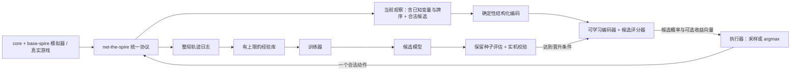

# AI 架构与设计边界

本文说明公开观察、编码、候选评分和模型发布的职责。当前实现范围以模块代码与检查为准；训练与真实后端接入按[总任务](https://github.com/QingXiang22/auto-the-spire/issues/28)中的恢复条件安排。具体算法和资源预算仍须在对应工单确定。

## 1. 目标与核心假设

长期目标是控制单人整局的战斗、选牌、路线、事件、商店、营火和奖励选择。一次训练针对固定 Gym：规则集、内容注册、观察定义和动作语义固定，种子和局面变化。可从一个角色及卡池起步，也可用明确覆盖的训练开发场景验证学习，不宣称开发场景等于原版整局。

模型只经 `net-the-spire` 接受当前观察及当下合法候选，输入为 `(Observation, LegalActions)`。此前公开且当前仍有效的信息直接属于 Observation，由变量、关系或已知序列表达；AI 侧不另行保存知识摘要，不通过历史重放还原观察，不访问 `GameState`、真实牌序或随机数状态。

**NoSL 与输出边界：**实际游玩不通过存读档回退重试。策略输出全部合法候选的选择概率及可选收益评估；执行器负责采样或 argmax 并提交一个动作。轨迹经验重放不属于游戏回退。首版不依赖决策时的搜索或状态复制，训练时分叉权限仍待另定。

**待验证的学习假设：**固定 Gym 下，内容类型及公开实例状态可以支持从环境反馈学习卡牌与机制含义，不要求输入效果文字、标签或 DSL。规则不预写到编码器内；这属于强化学习，辅助预测可采用自监督目标。模拟器作为主要样本来源、真实游戏持续经验及模型按整局固定的发布方式仍是后续工程候选。

相关依据：在 Dominion 中，集合式牌组表示和可变动作集合的 Soft Actor-Critic 已被用于整局策略学习；非法动作屏蔽有独立研究支持。这些结果是设计起点，不是对本游戏效果的保证。[Dominion 论文](https://ojs.aaai.org/index.php/AIIDE/article/view/27518)、[动作屏蔽论文](https://arxiv.org/abs/2006.14171)。

## 2. 数据流与模块

`ai-the-spire` 内隔离确定性输入层、可学习编码器、候选评分器、执行器及后续记录/训练/评估模块。观察提供方负责更新当前可知变量，编码器不维护游戏知识。训练器和编码器都不能从内核私有状态补齐观察。同一可观测语义由统一编码约定表示；不同后端缺少字段时声明能力，不以隐藏数据或 AI 历史缓存填充。

## 3. 观察和动作表示

一条输入由三部分组成：

1. **整局上下文**：角色、层数、生命、金币、牌组中可见的卡牌实例及修改、遗物、药水、已揭示地图和运行修饰器。
2. **当前场景**：战斗的手牌、敌人、意图、状态与资源；或当前商店、路线、事件、营火和奖励的可见信息。
3. **合法动作列表**：每个动作有动作类型、具名参数，以及被引用的卡牌实例、目标、商品、地图节点或选项 ID。评分器返回与候选一一对应的概率；执行器再选其中一项。

输入采用实体、具名字段、关系、无序多重集合与已知序列的组合。卡牌、敌人、Power、待选牌、场景和选项均保留实体标识；字段记录类型、值、知识状态及所有者。实例 ID 用于引用，内容 ID 用于固定 Gym 的类别字典。新增内容或字段扩展字典和记录数量，不通过不断加宽固定输入来兼容。

先执行 `T = Tensorize(Observation, Manifest)`，再由未来的 `Encoded = Encoder(T)` 保留局面、实体与观察内序列的向量；`logit_i = Scorer(Encoded, candidate_i)`，在有效候选上 softmax。解码器指候选评分器，不要求自回归生成命令。战斗中打出某卡并指定目标是完整候选；效果中途需要选牌时进入下一个决策点。类似的候选编码和评分见 [Dominion](https://ojs.aaai.org/index.php/AIIDE/article/view/27518) 与 [DouZero](https://proceedings.mlr.press/v139/zha21a.html)，不能直接外推本项目效果。

确定性结构化输入层可以独立实现。可学习编码器与评分器接口可替换，但权重、字典及输出维度需要一起版本化；端到端训练仍可共同优化。编码器不能只输出一个全局向量，否则会丢掉候选需要引用的实体表示。

抽牌堆当前观察给出可知卡牌成员、数量及 `(card_ref, position)`。位置从顶部 0 起，允许不连续；同一表示覆盖顶部、底部和离散已知位置，不另设 known_top。成员列表顺序不表示隐藏牌序。洗牌后提供方取消失效位置，编码器直接编码新快照，不需要知道此前打过头槌或发生过洗牌。公开出牌次数、触发状态等通过当前变量表达。观察充分性和产生正确位置属于提供方联调责任，AI 负责表示约定及结构校验。

部署成本优先。后续比较 embedding 加简单投影与集合聚合、窄的共享 MLP、局部注意力等方案；不提前锁定 MLP、GRU 或 Transformer。共享参数不消除随记录数量增长的计算与内存成本。集合编码依据见 [Deep Sets](https://papers.neurips.cc/paper_files/paper/2017/hash/f22e4747da1aa27e363d86d40ff442fe-Abstract.html) 与 [Set Transformer](https://arxiv.org/abs/1810.00825)；最终选择需下游效果及 CPU 资源测量。

## 4. 目标、奖励与归因

先把三件事分开：**事实记录**保存游戏发生了什么，**奖励分量**从事实中计算想衡量的结果，**训练效用**决定 AI 怎样在不同结果之间取舍。改变效用权重时，可以重算已走过轨迹的奖励，却不能知道未选动作会带来什么结果。

本轮保留向量奖励及向量收益接口，不确定正式分量、权重、约束、折扣或预测时间范围。层数和通关结果继续记录，生命、药水、金币、伤害、牌组变化等保存为事实；是否成为奖励需明确决定，不能将事实字段都自动加入优化目标。

层数、通关率的取舍及初期任务目标须在训练工单中确定，未确认的示例权重不作为默认配置。

可选动作收益表示 `Q^π(o,a)`：现在执行 a、后续遵循指定策略时，对明确时间范围内收益向量的估计。它不同于选择概率，初期不要求输出已校准的整局通关概率。某维度没有学习依据时可以关闭收益头，不输出伪精确值。

向量化保留多项结果，但不自动决定哪个候选更好。输出一套动作概率前仍需选择加权、优先级、约束或偏好条件化等取舍规则。改变奖励可以重算已观察轨迹的分量，不能得到所有未采取动作的真实结果。

受控战斗任务或后续公开状态预测可以提供较近的学习信号，是否改善样本效率需实测。辅助预测学习环境关系，不意味着策略应该最大化伤害或生命变化。卡牌效果说明不输入模型，会把更多学习负担转移到探索、罕见组合覆盖及长期归因。

任意密集奖励可能改变原目标；势函数塑形只有满足其条件时才保留相应最优策略。[奖励塑形](https://ai.stanford.edu/~ang/papers/shaping-icml99.pdf)、[RUDDER](https://papers.neurips.cc/paper_files/paper/2019/hash/16105fb9cc614fc29e1bda00dab60d41-Abstract.html)是后续候选依据，首阶段不实现奖励函数。

## 5. 训练方案：先有基线，再比较算法

**正式算法尚未批准。** 首个训练与评价流程建议以近期策略 PPO 验证，理由及配置要求见[训练设计](../../areas/ai/spec/training.md)。旧稿的离散 Soft Actor-Critic 保留为后续比较候选；首批不据此要求实现双 Q 或旧经验学习。轨迹存储与算法是否使用重放分开，不需要从一开始搭完整经验库。

**对照基线：**随机合法策略、可选的明确规则策略与已训练短任务策略。PPO 先验证表示和端到端流程，不承担长期旧经验重放方案；需要复用旧策略数据时再比较 SAC 等异策略方法。[Retrace](https://arxiv.org/abs/1606.02647)是可参考的工具。算法名称不规定训练框架或部署格式。

实现与训练按以下阶段推进：

1. **确定性编码层**：独立完成当前观察、字典、实体/字段/关系、已知牌序、动作引用、数组化和 masks。使用公开样例验收，不维护历史、不训练网络、不接入 core 私有状态。
2. **训练与评价流程验证**：确定训练目标及预算，在已验证开发场景上接入可学习编码器和候选评分器；记录轨迹、从反馈学习、在独立局面上评估。
3. **完整整局训练**：规则和内容覆盖达到可验证验收条件后，对固定角色或固定 Gym 的不同种子训练；可选示范不是必须输入的效果语义，也不是最优标签保证。
4. **真实游戏持续学习**：协议可见性及语义差分验证后再接入真实经验；记录完整候选、所选动作、行为概率、策略与规则版本。候选经独立评估后发布，当前整局固定策略版本。[持续学习经验重放](https://arxiv.org/abs/1811.11682)是后续研究依据。

实际游戏对局数量通常不足以单独支撑从头学习；部署期数据主要用于校正和增量改进，模拟器仍是主要样本来源。这是当前项目的工程判断，需要用对局数和学习曲线验证。

## 6. 评估和发布

- 按规则版本、角色、难度和策略版本记录结果；训练种子、调参种子与最终报告种子分开。
- 用相同起始种子比较候选和已发布策略，分别报告平均到达层数、通关率、置信区间及场景失败与资源使用；主指标及晋升取舍须与届时训练目标一致。反复调参的测试集之外另留最终测试集。
- 一次训练更新可以很频繁；发布新模型必须经过独立的目标任务评估。短任务仅有该任务的发布范围，整局部署才要求完整对局。测试局数由改善幅度和实测方差决定，不固定为 200。
- 每次晋升核对对应环境的观察、动作和规则验证记录；真实部署另需模拟/真实差分，不让真实适配阻塞 E0/E1。模型不得因模拟器错误获得虚假优势。[强化学习实验设计](https://www.jmlr.org/papers/v25/23-0183.html)、[程序生成环境的泛化研究](https://arxiv.org/abs/1912.01588)。

## 7. 当前最重要的架构决策

1. **首阶段接口**：评审编码约定、实现语言及数值精度建议，再交给实现者处理确定性层。任务和验收见 [encoder-design.md](../../areas/ai/spec/encoder.md)。
2. **观察充分性**：net 提供的当前观察能否表达玩家已知牌序及机制变量？缺失哪些字段、能力或语义？真实后端不能暴露隐藏状态，AI 编码器不额外维护历史补缺。
3. **部署成本**：确认实际机器、延迟、内存和参数预算，再比较可学习编码方案。现阶段没有“MLP 已够轻”或“Transformer 必须采用”的验证记录。
4. **训练目标与算法**：收益向量的分量、时间范围、取舍规则和样本分布需确定后再比较算法；不沿用旧稿示例权重为默认。
5. **内容与发布**：原版覆盖验收条件、真实部署的探索规则、模型晋升指标仍待定义。

当前稿可供架构评审，不宣称设计已批准或 AI 已实现。首阶段交付仅证明结构化编码满足约定；网络效果、规则覆盖及部署预算需要各自验证记录。

## 8. 可实施的模块布局

建议 AI 使用 Python，确定性阶段仅标准库；学习阶段再依据维护者批准的框架增加依赖。`ai-the-spire/ai_the_spire/` 下的 contracts 负责从[统一规范资产](../../areas/net/spec/contract-artifacts.md)生成/校验的纯 wire 类型与 codec；encoding 负责 Manifest/校验/数组/批处理；client 负责传输与请求状态；models 负责可学习 encoder/scorer；policy 负责概率约定；execution 负责选择与 NoSL；data 负责公开轨迹；training/evaluation 负责实验与晋升。tests/fixtures 与 tests 放在模块目录，不放进 core。

依赖方向为 encoding/policy/client/data → contracts，models/policy → encoding；execution → policy + client；collector → execution + data；training → models + data；evaluation → execution。contracts 不依赖传输、活动会话、core 或 AI 张量；encoding 不依赖 client 的活动会话。部署无需导入优化器和全部数据处理依赖，先只创建当前阶段必要部分。

## 9. 低部署成本学习基线提案

先测一种共享 embedding、分组聚合、少量稀疏关系传播和候选打分的方案。它有明确的计算路径供实现和消融，不声称已证明最优；维度 d、传播轮数 L 和数值精度由 ModelConfig 提供，不把历史 8GB/5秒写成预算。

1. 将字段 ID、类别/知识状态和所属类型嵌入；数值只经共享小投影，引用字段用被引用实体表示参与关系传播。实体初值由 kind/content、数值及非引用字段的 masked 聚合组成，保留所有者。
2. 成员关系、Power 持有者、地图连接等作为稀疏边，按具名关系和方向汇总邻居；有限轮的共享残差更新形成实体向量。引用图有循环也只运行固定 L 轮，不递归到收敛。实例行号不参与网络特征。
3. 已知位置、公开关系 position 与序列 ordinal 经注册的数值/位置通道参与表示；无序输入不加任意行位置。仅平均池化不能保留顺序：先把位置与对应实体配对变换再聚合，必要时比较局部序列模块。
4. 按实体种类、场景/牌区等公开关系做 masked sum/mean 与 count 聚合，形成 global；保留实体表。count 显式参与，避免 mean 把一张与三张同名牌合并。
5. 每个候选使用 action_type、具名参数及带角色的实体引用聚合成候选向量 c_i；可用共享小层和 global 的点积/双线性交互生成 logit_i。所有候选共享评分参数，输入候选顺序没有位置 embedding。
6. 只在有效候选上 softmax，返回概率。训练状态价值头从 global 输出奖励分量的 V；首版不增加动作 Q 头，未来按输出约定增设。

最简单的加法或纯 dot 评分可能不足以学复杂组合；因此实验顺序先比较共享窄层与关系轮数，再决定是否需要局部注意力。不要因为是 MLP 就默认廉价，也不要因为 Transformer 能表达交互就预先支付全量成本。

该基线的 embedding 参数约为各字典 `V_j × d_j` 总和，共享小层约随维度平方增长；稀疏传播计算随边数及 L 增长，评分随 A 增长。参数与记录行数可解耦，运行内存仍随实体/字段/候选数增长。必须测完整字典规模、极端候选量与 CPU 推理；低参数不等于低延迟。聚合的设计依据参见 [Deep Sets](https://arxiv.org/abs/1703.06114)，这不保证当前稀疏网络足够表达所有尖塔规则。

## 10. 可替换边界与版本

固定 PublicCatalog 决定公开含义；GymManifest 决定 AI 索引/变换；ModelConfig 决定可学习结构；Training/Reward/ExecutorProfile 决定优化和使用方法。每层独立版本化但模型包绑定 exact identity。增加字段、内容或后端能力是新的 Gym 配置，不热加载进旧 embedding。具体规则修改由 core/mod 负责，对 net 和 AI 的影响必须在目录/数据标识上反映。

全目录 exact identity 的代价是新增与当前角色无关的内容也可能使旧模型拒绝接入，需要新 Gym 的评估/重训。E3 按固定内容批次安排数据与训练预算，报告这项成本；不会因只匹配声明子集就推定新规则/内容不影响局面分布。场景闭包子目录可以以后另行设计，首版不自动忽略新增声明。评估的种子配对、公共随机数和固定动作重放分开定义，采用[训练设计第5节](../../areas/ai/spec/training.md#5-训练恢复与发布)的口径。

相同模型包可替换执行器的采样方式做评估，但实际行为变化必须记录，收益头的后续策略声明也相应变更。学习 checkpoint 恢复不要求中途游戏回退。部署一局锁定包，新增晋升只作用于新局。

## 11. 运行与失效视图

正常路径：describe/get_catalog → 核对模型包 → start/attach → observe → encode/predict/select → step → 记录结果 → 下一个决策点/终止。第一阶段只覆盖 encode，第二阶段可用随机合法分布替代模型验证接口，第三阶段接入学习。

结构/概率错误在执行前停止；stale_observation 刷新后重新预测；结果 unknown 查询原请求并暂停；提供方进程丢失按后端和 NoSL 能力处理。无有效快照不得评分，终止无候选不得 softmax。完整失效规则以[协议](../../areas/net/reference/protocol.md)及[运行约束](../../specs/ai-net/operations.md)为准，AI 不另写自动回退策略。

## 12. 设计决策记录

| 决策 | 驱动/替代方案 | 后果与验证 |
| --- | --- | --- |
| D-01 当前快照包含有效公开知识，AI 无历史缓存 | 用户确认；替代为 RNN/事件重放 | 提供方承担充分性；置顶/洗牌首输入测试 |
| D-02 公开目录与模型字典分离 | 可扩展且保持责任边界；替代为 AI 自创字段 | 版本更明确；跨语言目录与错配测试 |
| D-03 完整候选共享评分并输出概率 | 用户输出需求；替代为命令生成/固定动作槽 | 候选成本随 A 增长；重排与容量测试 |
| D-04 先确定性层，再共享稀疏/集合基线实验 | 部署成本和小模型编码；替代为全量 Transformer | 先验证低成本路径；学习效果/CPU 基准决定扩容 |
| D-05 初始 PPO/短任务，Q 可关闭 | 工程可验证性；替代为直接整局 SAC/通关预测 | 不承诺样本最省；目标批准后才开始实验 |
| D-06 完整模型包、一局固定版本 | 数据标识与 NoSL；替代为游戏中热更新 | 恢复和评估清晰；包错配和晋升测试 |

D-01/D-03 是产品约束；其余结构与具体算法属于待验证设计，不能作为已经实现或效果达标的结论。
