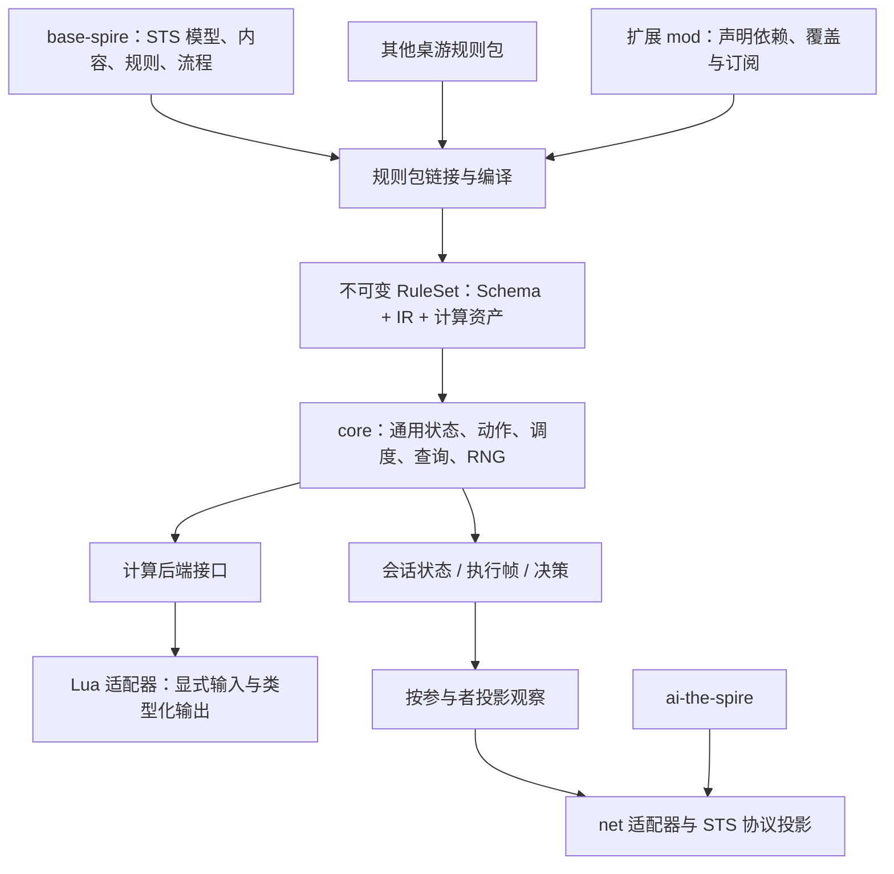

# 通用桌游规则引擎设计稿

2026-10-04 最新决定：旧后端已移到[代码归档](../../../archive/legacy-sts/README.md)，正式工程不再依赖它。随机取样保留候选 Query 的顺序，游戏特定策略由 mod 拥有；保留开发者 Session API，尽早按职责拆分，为对拍提供按需调试模式。core/0.1 基础文本编译与 core/0.2 DSL 规则库/作者配置已实现，完整语言覆盖与 Lua 仍需独立验收；最新约束见[core 架构决定](core-architecture-decisions.md)。

> 2026-10-04当前实施范围：遵守[ENV任务](../environment-completion-and-differential-v1.md)和[实现约束](../environment-implementation-constraints.md)。本文G阶段、Lua及恢复方案保留原设计时点，不能作为执行者重新派单依据；现有Engine/H能力直接复用，只为冻结原版完整环境补必要通用能力。生产落点和状态权威按实现约束，不迁回Legacy或另写STS内核。

| 项目 | 内容 |
| --- | --- |
| 状态 | PROPOSED；修订 5，2026-10-03；观看者授权揭示已有H/N/J证据，整体目标仍分阶段实现 |
| 已确认需求 | core 是能描述多类桌游的通用引擎；STS 是优先实现的游戏包；允许用指定 Lua 脚本处理复杂计算 |
| 本稿建议 | 类型化状态与规则 IR、唯一调度器、游戏包定义领域模型、Lua 首版作为纯计算后端 |
| 权威边界 | 用户确认的是目标与 Lua 扩展需求；本文的具体 API、语法、数值与预算方案是实现提案 |
| 当前实现 | Legacy为冻结的STS兼容后端；Engine为通用机制默认落点；已有C#构建入口、非STS夹具、STS受控切片、观看者授权揭示及作者原型。正式0.0.1到Engine、整局/完整内容与Lua仍有待交付范围；2026-10-03未重跑实现验收 |

## 1. 目标与判断

这个方向合理，但“壳子”应理解为**具有稳定规则执行语义的通用运行时**。它必须处理类型、状态所有权、合法动作、顺序、选择暂停、随机数、观察、版本与故障，而游戏包定义这些机制所执行的具体规则。

core 不预定义卡牌、怪物、生命、能量、格挡、Power、战斗、地图、房间、幕、回合阵营或胜负条件。它也不预设“生命为零即死亡”“对象被使用后进入弃牌堆”“每回合重置某种资源”。这些都是 STS 或其他游戏的规则。

目标是以同一引擎支持牌类、棋盘走子、资源/工人放置、骰子与阶段驱动等有限离散状态游戏。“大部分桌游”是扩展方向，不是本轮可以承诺的已验证覆盖率。实时物理、自然语言自由裁决以及未完成的同时决策协议不作为首个里程碑的能力声明。

Lua 是复杂算法的表达与执行入口。**允许 Lua 不等于认定 Lua 比 C# 或编译后的 DSL 更快**；应比较输入准备、跨语言传递、计算与返回的总成本。DSL 局部变量也不能被实现成持久游戏字段，否则会人为制造使用 Lua 才能解决的开销。

## 2. 三层架构与依赖方向



| 层 | 职责 | 不承担的领域规则 |
| --- | --- | --- |
| 通用引擎 core | Schema、实例存储、集合与关系、纯查询、动作验证、执行帧、事件调度、RNG、观察投影、快照格式、预算与故障 | Card/Monster/Combat 等 STS 类型与具体算法 |
| 游戏包 base-spire 等 | 定义实体类型、字段、作用域、动作、事件、流程、规则管线、内容模板、观察政策与终局结果 | 直接操作 core 内部存储或自行推进引擎调度器 |
| 计算扩展 | 对显式输入计算一个结果；可选 Lua 后端；复杂生成器也可返回类型化结构 | 隐式改变会话、消费隐式 RNG、直接发起玩家选择 |

`core-the-spire` 名称可以暂时保留；公共类型名使用通用语义。core 不引用 base-spire 或 Lua 具体实现。Lua 适配器引用 core 的计算接口，宿主负责注册。可以先在少量项目中建立逻辑边界，是否拆成独立程序集以依赖检查和实际部署需要为准。

游戏包可附带语法扩展/规则库，把 `card`、`attack`、`draw` 等作者术语编译成通用 IR；core 编译器提供扩展注册接口，不在自身写死这些关键字。共同需求成熟后可以提炼可选牌区、图拓扑等库，但它们不是加载每个游戏都必须依赖的核心模型。

## 3. core 的最小状态模型

### 3.1 定义与实例

规则包声明 `EntityType`、`Field`、`Collection`、`Relation`、`ScopeType`、`ActionType`、`EventType`、`Procedure`、`Projection` 与 `ComputeAsset`；这些名称是提案中的概念，并非现有解析器声明。

规则集链接后名称映射到稠密内部 ID。实例使用稳定、会话内唯一的 ID；创建顺序和计数器进入快照。配置数据只读共享；可变字段由会话保存，不在共享定义、Lua 模块或全局 handler 中保存局内状态。

| 概念 | core 语义 | 游戏包赋予的含义 |
| --- | --- | --- |
| 实体 | 具有类型和字段的稳定实例 | 角色、棋子、卡、地块、商店、状态效果 |
| 字段 | 类型、默认值、可选性、生命周期、访问和观察政策 | hp、energy、block、gold、位置、阵营等 |
| 集合 | 有序序列或具有稳定遍历规则的集合；可声明数量和成员约束 | 手牌、牌库、棋盘占位、可用工人、奖励池 |
| 关系 | 类型化实例引用或引用集合 | 所有者、施加者、邻接、附着、所在区域 |
| 作用域 | 游戏包声明的生命周期树，销毁时执行明确退出流程 | 一局、一次战斗、一个阶段、一次投票 |
| 参与者 | 不透明身份，动作权限与观察接收者 | 人类、AI、玩家席位、系统控制者 |
| 终局结果 | 游戏包声明的类型化结果 | 胜负、多人积分、平局、资源耗尽 |

core 内部状态字段不使用逐实例 `Dictionary<string, object>` 作为默认热路径。Schema 在加载时确定布局；常用字段使用类型化存储或分页缓冲区，稀疏扩展字段按需保存。实例字段的组织方式不要求采用完整 ECS 框架。

类型首批建议为 `Bool`、检查溢出的 `Int64`、明确精度/取整的定点数、包定义枚举、字符串、实体引用以及有界列表/记录。定点乘除的中间宽度、舍入、溢出与转换必须由数值配置完整定义；未经验证不承诺与现有 decimal 行为等价。表达特定小数规则时可以保留独立 decimal 数值配置，不能无说明地改成 binary64。

### 3.2 集合、拓扑与所有权

有序集合显式支持首/末/位置插入、移动、洗牌与抽取。无序集合用于集合语义，但查询结果进入规则执行前必须指定稳定顺序；不能依赖哈希表遍历。

“一个对象只能在一个牌区”由游戏包声明某些集合属于同一独占成员组；关系集合不默认独占。core 检查成员类型、引用有效性、声明的独占与容量约束。对象离开某个集合后如何变化由程序定义。

棋盘和路线可以用位置字段、邻接关系与图集合表达；网格坐标工具可作为可选规则库。core 没有 `MapPointType`、`Boss` 或 `Act`。

### 3.3 三类存储必须分开

- **持久玩法状态：** Schema 字段、集合、关系、作用域、规则必需的历史摘要。进入快照与状态哈希。
- **可暂停执行上下文：** 程序位置、参数、局部槽、所选实例、迭代位置和已取得的计算结果。只在暂停/恢复时保存必需值。
- **一次性计算空间：** DSL 表达式临时槽与 Lua 局部数组；调用结束后释放或复用，不注册为玩法字段，也不逐步产生玩法事件。

大型临时缓冲区受计算预算控制；有大量中间变量不是必须使用脚本的充分理由。使用 Lua 的主要依据是算法表达更合适，并且总成本可接受。

本轮 R-CORE 决策：首批实例玩法字段仅支持 Persistent；ExecutionOnly 字段暂拒绝，临时计算使用帧槽。非可选实体引用可在同一构造过程中暂未赋值，但首次稳定决策/终局边界前必须赋有效引用，否则明确故障。此为下一批实现要求，尚未验证完成；专项反例与接管要求见[评审处置](../../review/records/2026-10-01/review-followup-2026-10-01.md)。

暂停时保留当前进程中的帧，不等同于完整会话可持久化恢复。N-03 的请求账本、查询或停止和新局种子重放均不要求整体快照；内部快照作为后续独立能力，不扩为首版NoSL公开load/fork。

## 4. DSL、规则 IR 与游戏包语言

### 4.1 前端与运行时分开

```text
通用声明 / 游戏包 DSL / 旧 .spire 兼容前端
    → 名称解析与类型检查
    → 规范规则 IR
    → 包链接、约束与依赖校验
    → 稳定 ID、字段布局、订阅索引和执行计划
    → core 调度器
```

core 对运行时 IR 提供有限通用指令，而 STS 的“伤害”“消耗”“回合末”是游戏包程序和事件的名字。

| 类别 | 首批能力 | 约束 |
| --- | --- | --- |
| 纯表达式 | 常量、局部/字段读取、算术、比较、布尔组合、计数、归约 | 不改变状态，不消费随机数 |
| 纯查询 | 类型与字段过滤、关系遍历、稳定排序、有限集合选择 | 保留候选域和成员顺序 |
| 状态命令 | 创建/销毁实例、写字段、修改集合/关系 | 由调度器执行，检查 Schema 约束 |
| 流程 | 顺序、分支、调用、有限重复、遍历快照 | 使用显式帧；预算限制不可静默截断 |
| 交互 | 请求类型化决策、绑定响应、继续程序 | 暂停时保存 IR 位置和局部数据 |
| 事件 | 发出类型化事件、调度反应程序 | 事件顺序、监听快照与绑定时点明确 |
| 随机 | 从声明的命名流采样、抽取或洗牌 | 是显式指令，结果写入局部槽 |
| 计算 | 调用注册 ComputeAsset，验证并绑定返回值 | 无脚本语言特例进入游戏程序语义 |

原语签名集中声明字段、必需项、类型、默认值与能力；由同一签名支持前端验证、IR 构建和文档。不同游戏术语通过注册的编译扩展或程序库获得，不在 core 增加 `AttackUsingBlockEffect` 一类游戏专用节点。

### 4.2 示例是提案，尚不能由 0.0.1 解析

以下仅表达目标模型；具体关键字、路径语法、局部绑定和扩展声明方式待原型固化，不能作为现有 `.spire` 作者规范：

```text
using namespace base-spire;

schema Combatant {
    hp = { type = Int64 min = 0 }
    block = { type = Int64 min = 0 }
    strength = { type = Int64 default = 0 }
}

procedure DealDamage {
    parameters = { source = Combatant target = Combatant baseAmount = Int64 }
    locals = {
        amount = { max = { left = 0 right = { add = { left = baseAmount right = source.strength } } } }
    }
    body = {
        # 调用游戏包定义的修正管线，之后计算格挡和生命变化。
        call = { procedure = DamageModifiers input = { source target amount } output = modified }
        call = { procedure = ApplyBlockAndHpLoss input = { source target modified } }
        call = { procedure = ResolveDeathIfNeeded input = { target } }
    }
}
```

core 只识别 schema、表达式和 call；`Combatant`、`DamageModifiers`、`ApplyBlockAndHpLoss` 与死亡规则由 base-spire 提供。该简例不是完整 STS 伤害实现；其各阶段、精度、Hook 和取整仍须按照恢复源码逐项迁移。

现有 `card` 声明可以作为 base-spire 作者语言继续使用完整 normal/upgraded 块。包编译器将它展开为游戏包声明的实体模板、动作及版本规则；core 不识别 CardType 或“升级”。两个版本分别完整编译，不在运行时隐式继承空钩子。配置后写覆盖/执行保序的既有作者约定可以保留，并增加重复配置诊断。

### 4.3 目标和修正规则

选择契约保存候选查询、参与者、数量范围与响应类型，不能把 allies/opponents 的信息丢成一个 SelectedTarget 枚举。生成动作候选和执行前验证使用同一个查询计划。

游戏包定义数值管线的阶段，例如 STS 的基础值、加法修正、乘法修正、上限、格挡、生命损失、反应。只读修正规则接收类型化输入并返回变换；如果某阶段需要产生游戏效果，则显式调用反应程序并等待其子帧完成。core 不预定义这些阶段，也不把修改游戏状态的 Hook 混入 Observe。

多个规则对同一管线值的冲突由声明的归约/组合方式解决。包加载顺序不能替代“覆盖、相乘、求和、最小上限”等组合语义。

### 4.4 可检查的语言契约与迁移

每条原语签名还声明读/写能力、求值时点、错误和预算计费。表达式读取的是执行到该指令时的状态；需要捕获旧值时用显式局部绑定，随后只读这个绑定。读取累计量是纯查询，清零/消费累计量另用命令。不得因优化而把实时读取移到动作开始，也不得重复求值一个有副作用的表达式。

包编译扩展先展开领域语法，再由 core 校验通用 IR 的类型、引用域和能力。纯程序的调用图不能到达状态写入、决策、事件或随机指令；注册到查询路径的 native/计算函数只获得显式只读输入。编译扩展属于加载期宿主代码，版本和摘要进入规则集身份；它不能绕过链接校验产生任意运行时回调。

配置重复赋值保持已有“后写覆盖”语义，但给出包含两处源码位置的诊断；显式覆盖标记可以确认意图。执行块重复出现的命令仍按顺序保留。normal/upgraded、目标候选域、X 费捕获与保留时点等属于 STS 包作者契约，迁移时必须分别核对编译结果与行为，不能仅以解析成功判定完成。

通用 IR 使用自己的版本，不把它命名为已发布的 DSL 0.0.1。兼容前端保留旧输入，输出同一 IR；每批迁移公布语法、输出节点形状、运行语义、引用/RNG 影响及受影响内容。效果树包装变化的结构断言和实际行为断言分别检查，不能通过放宽所有断言掩盖规则回归。

## 5. 唯一调度器、动作与事件

每个会话在同一时刻只有一个状态写入者。IR 调用、事件反应与计算结果处理都提交帧给调度器；扩展代码不调用 Drain/Step，也不直接改底层存储。

每个帧至少包含程序 ID、下一指令、类型化参数/局部槽、父帧以及选择和遍历绑定。调度器推进到等待决策、终局或显式故障；对子程序先执行其帧，返回后继续父帧。事件处理也采用这一顺序，不在 native/Lua 调用栈里保存玩法 continuation。

通用会话状态可以是 Created、Running、AwaitingDecision、Terminal、Faulted；回合、阵营和房间阶段是游戏包字段/流程。胜利、失败、平局由包产生终局结果，引擎故障不算游戏失败。

事件类型与负载由包声明；core 自身只保留必要的通用生命周期/诊断事件。注册时固定依赖拓扑和声明顺序；订阅可声明显式阶段与优先级，平级按确定的包/声明/实例顺序排列。发出事件时固定监听候选快照，执行时按声明检查实例仍存在、监听仍有效；删除实例是否允许执行剩余回调也必须显式声明。

规则事件与诊断日志分开。规则所需计数和历史由字段/摘要/明确历史结构表达，关闭日志不能改变结算。Trace 可以记录程序、来源、局部摘要和事件因果 ID。

动作声明参数 Schema、权限、guard、候选查询及程序入口；引擎没有 PlayCard/EndTurn。决策句柄绑定会话和状态版本，过期响应拒绝。单动作验证不要求先分配全部合法动作对象；对大候选域支持有界查询或结构化决策，不能因遍历上限悄悄丢掉合法动作。

首个实现支持按顺序发生的单参与者决策。多参与者身份、字段所有权和观察政策从模型上保留；拍卖等同时私密决策需要独立的收集/提交/统一揭示协议，属于后续能力，不能用顺序动作冒充等价实现。

### 5.1 结算预算与生命周期

有限循环以迭代帧推进，不预先为所有次数展开待执行帧。每次 advance 的预算覆盖 IR 指令、调用深度、事件反应、实例创建与候选生成；Lua 另有计算预算，不能通过来回调用逃避总预算。事件级联也可能无限，不能仅靠禁用 while 保证终止。超限产生带程序/事件因果链的明确故障，不静默丢弃剩余效果；墙钟监督停止属于基础设施中断，不生成不同的游戏输赢。

advance 超限可以进入 Faulted；纯查询/观察/候选枚举超限只返回分类错误，不修改会话状态或 RNG。宿主/net 可以停止该控制配置，不能为了记一次查询失败而违反查询纯读契约。

监听索引在注册/撤销时更新，发出事件固定本次候选与排序，执行时按声明重新检查有效性；本次新增监听是否参与本次事件固定为“不参与”，嵌套新事件重新取快照。内部实现可以优化索引，但必须保留这些时序。规则必须消费的事件不得被诊断过滤器关闭。

销毁实例/作用域前检查关系、集合和执行帧引用。每种引用声明限制销毁、解除引用或级联销毁策略；帧需要的值先捕获，不能悬挂引用后由 CLR 异常决定规则。未声明的失效决策返回错误；受控的规则变更若需要刷新决策，必须发布新状态版本及新候选，不沿用旧句柄。

## 6. Lua 计算扩展契约

### 6.1 首版使用 Compute，而非直接执行玩法

```text
ComputeAsset
  id / source_hash / source_path / entry
  backend_profile
  input_schema / output_schema
  numeric_profile
  limits: input_size / output_size / instructions / heap / call_depth

ComputeCall
  asset_id + 显式输入值 + 输入状态版本
    → Lua 计算
    → 类型、范围、引用和尺寸校验
    → 绑定帧局部结果
    → DSL 后续程序决定如何改变玩法状态
```

例如一张卡需要根据手牌费用和协同得分求最优组合。base-spire 查询一次所需输入，Lua 使用本地数组求解，再返回得分；卡牌规则将得分送入它自己的伤害程序。脚本局部 dp 数组不是游戏状态。

提案示例：

```text
compute BestScore {
    backend = lua
    source = "scripts/best-score.lua"
    input = { capacity = Int64 weights = List<Int64> values = List<Int64> }
    output = { score = Int64 }
    # 边界属于 ComputeAsset Schema，而不是靠 Lua 作者自行遵守。
    constraints = { capacity = 0..512 count = 0..64 weight = 1..512 value = 0..1000000 }
}

# 某个游戏包程序中的计算步骤；后续使用 score，不在脚本内施加伤害。
compute = {
    asset = BestScore
    input = { capacity = budget weights = costs values = contributions }
    output = scoreResult
}
call = { procedure = DealDamage input = { source target baseAmount = scoreResult.score } }
```

相应 Lua 计算函数示意如下。输入保证两个数组等长且连续；得分最多为 64,000,000，示例整数计算不接近 64 位溢出边界。它是算法例子，不是原版卡牌，也未执行 Lua 验证：

```lua
return function(input)
    local dp = {}
    for capacity = 0, input.capacity do
        dp[capacity] = 0
    end
    for i = 1, #input.weights do
        local weight = input.weights[i]
        local value = input.values[i]
        for capacity = input.capacity, weight, -1 do
            local candidate = dp[capacity - weight] + value
            if candidate > dp[capacity] then
                dp[capacity] = candidate
            end
        end
    end
    return { score = dp[input.capacity] }
end
```

### 6.2 输入、输出与执行权限

脚本只取得声明的值、记录、有界数组或调用期有效的只读缓冲区视图；不能取得可变 GameSession、整个世界存储、C# 对象任意反射或状态写接口。读取大型数组时避免整局 JSON 序列化，也避免循环中逐元素跨语言回调；具体复制/视图方案通过绑定原型测量选择。

返回值只允许 Schema 中的数值、布尔、字符串、稳定引用和有界记录/数组。循环表、函数、线程、未声明字段、无效引用、数值超界与非有限浮点结果拒绝。返回引用也要检查游戏包声明的目标域，不能用输出绕开动作权限。

Lua 首版不暂停、不发起玩家选择、不直接发事件、不修改持久状态。若未来允许返回命令计划，计划仍应是可验证 IR，由调度器执行；计算一个计划和执行计划时读到的新状态并不等价，必须显式定义读取/捕获时点。本稿不把此扩展作为首批要求。

### 6.3 可复现执行与生命周期

规则集锁定 Lua 实现、精确版本/构建、ABI、数值配置、脚本及依赖哈希，不能在执行过程中自动切换后端。参考资料确认 Lua 的默认数值类型与溢出行为、表遍历顺序等需要宿主明确约束，不能仅凭固定游戏种子保证脚本确定性。[Lua 官方手册：值与类型](https://www.lua.org/manual/5.5/manual.html#2.1)、[表遍历](https://www.lua.org/manual/5.5/manual.html#pdf-next)。

本项目建议首个计算配置为：

- 输入输出使用约束范围的整数；需要完整 Int64 溢出检查时使用宿主检查算术，或者通过已验证的界限证明中间值安全，不能把 Lua 默认整数运算当作 core 的 checked 运算。
- 普通定点/decimal 不自动变成浮点。浮点计算作为单独能力配置，明确平台与数值一致性范围；涉及 libm 等复杂函数时不承诺跨平台逐位一致。
- 以显式数组顺序遍历；对影响结果的排序要求完整稳定比较规则。移除默认 pairs/next 的不确定顺序入口，提供稳定 keys/迭代帮助函数。
- 随机数由 DSL 显式采样后作为输入传入；不开放 math.random/randomseed。需要可变次数随机算法时以后单独设计 RNG 计算调用契约。
- 不开放时钟、文件、网络、动态加载任意模块、debug/FFI 与 coroutine 控制入口。白名单库及宿主函数版本固定；这既限定计算能力，也排除玩法状态之外的结果来源。

缓存脚本编译结果，复用 worker 的 VM，不在每次调用重新启动解释器。首个可验证实现每次建立独立调用环境和新模块闭包，不跨调用保留可变全局、upvalue 或 registry 引用；**只清空 Lua 栈或只换 `_ENV` 不足以证明没有跨调用记忆**。错误后复位/重建相应 VM，并清理调用期输入引用。并行会话不能同时进入同一个可变 VM。

不跨玩家选择保存 Lua 协程栈：Compute 运行完后，将需要的结果写入引擎帧。暂停后恢复直接使用保存结果，不因重建 VM 而重新计算。这样状态恢复不依赖序列化 Lua VM。

### 6.4 预算、错误与提交边界

每个计算资产声明最大输入/输出、Lua 指令、内存和调用深度。采用所选后端支持的计数/配额机制；官方 C API 的 count hook 和自定义 allocator 是可研究的实现基础，不代表任何 .NET 绑定自动提供完整配额。宿主回调与库函数内部工作量还要单独约束。[Lua 官方手册：lua_sethook](https://www.lua.org/manual/5.5/manual.html#lua_sethook)、[lua_newstate](https://www.lua.org/manual/5.5/manual.html#lua_newstate)。

普通 Lua 错误通过受保护调用转成结构化 ComputeFault。指令耗尽必须采用脚本不能反复捕获并继续执行的终止方案；墙钟超时作为外部监督信号，不作为决定不同游戏结果的规则。[Lua 官方手册：lua_pcall](https://www.lua.org/manual/5.5/manual.html#lua_pcall)。

Compute 成功并通过验证前不提交任何游戏状态变更；其本身没有随机消费。失败不能按零值、跳过效果或默认值继续游戏。会话按诊断策略进入 Faulted；不伪装成玩家输了。

这一局部保证不等于“整次玩家动作自动回滚”：若动作此前已提交其它指令，发生故障时停止在可诊断状态。非法动作在执行前拒绝且不改变状态/RNG。首批命令对自身变更使用校验/局部写日志，保证单命令不留下违反 Schema 的半写入。完整动作事务与恢复由后续能力显式提供，不能由纯 Compute 推导出已实现。

### 6.5 后端选择与性能验证

接口可以保持为 `IComputeBackend`，首个适配器实现 Lua。具体选择原生 Lua、某个 .NET 绑定或其它兼容实现前，需要一个小原型验证：数值语义、配额、环境隔离、Windows/Linux 部署、缓冲区传递和诊断。本文不直接指定依赖包，也不宣称 LuaJIT/某绑定满足这些契约。

同一算法分别测 DSL 原型、Lua 与必要时的宿主基准实现；报告输入规模、marshal 成本、执行时间、累计分配、Lua 内存、首次编译与稳态成本。小计算留在 IR，复杂算法按可维护性与总成本选择 Lua。避免每次伤害加法、每个字段读取或每个循环元素都跨语言调用。

## 7. 规则包注册、组合与版本

规则包 manifest 声明包 ID/版本、引擎/IR 兼容范围、依赖、Schemas、程序、动作/事件、观察定义、脚本资产和显式覆盖目标。依赖按稳定拓扑排序；无依赖的顺序由启动配置指定并记录。循环依赖、同 ID 重复声明、未声明覆盖或不兼容 Schema 失败。

修改字段类型、引用域、实例布局或指令语义属于契约变更，不能把“配置后读覆盖前值”套到跨包 Schema 合并。游戏包公开它允许 mod 扩展的字段、集合、事件、修正阶段与程序替换点；替换完整规则程序应显式声明。

规则集身份至少包含：引擎/IR 版本、包顺序与内容哈希、运行配置、编译扩展版本、脚本/依赖哈希和计算后端配置。仅拼接 `base-spire@0.1.0` 不足以区分难度和脚本变化。构建后的定义冻结，局中不热换规则。

## 8. 观察、恢复与训练入口

core 根据游戏包的 Projection 为指定参与者生成观察。完整内部状态、公开信息、私有信息和参与者已知信息必须区分；公开知识需要存成游戏包状态或明确知识结构，不能靠消费者读诊断日志推断。

实体字段、集合身份、集合大小和顺序可分别声明可见性。例如允许知道牌库大小、某张公开牌及其已知位置，不代表公开整个牌库顺序。结果相关的动作候选只提供给有权限参与者；错误与 trace 也不能通过公开通道泄露隐藏值。

2026-10-02补充契约：游戏包可声明**按观看者授权揭示的实例引用集合/当前事实**；通用投影据此公开身份隐藏集合中该观看者获授权的成员子集，同时遵守字段权限。默认隐藏规则仍适用于未授权实例；不能以处于任一隐藏集合为由抹掉合法的显式授权，也不能由一个全局布尔字段对所有观看者开放实例。声明必须可类型检查、纯查询且进入规则身份；具体API由实现者结合现有Schema确定，不引入STS专用节点。私有性/所有权与揭示授权的组合必须在声明中明确，不能顺带公开其他私有字段。

游戏包维护当前可知的实例/位置及有效期，公开位置不可由隐藏集合的实时索引替代已经失效的知识。身份可知但位置不可知时只公开成员身份；位置可知时同时公开真实实例及该位置。引用只指向授权实例，不从内容定义ID造实例。两观看者、重复内容实例、部分成员、离散位置、知识更新/撤销及仅隐藏部分置换的反例由[H-01](../implementation-kickoff.md#122-首批必须收口的任务)验收。2026-10-03按H/N/J证据关闭[已知位置冲突](../../review/archived/known-position-protocol-conflict-2026-10-01.md)；公开实例ID隔离仍归W-02，不从此修复推导整体观察无泄漏。

状态推进不强制生成所有观察。提供推进到稳定边界、按投影读取、写入调用方缓冲区、单动作验证与诊断日志配置。观察和合法动作查询纯读且无 RNG 消费；候选预算是接口控制，不改变实际合法动作集合。

引擎内部快照格式最终包含玩法字段、集合/关系、作用域、实例计数器、执行帧、已取得计算结果、pending decision、RNG 状态和规则集身份；没有原生对象指针或 Lua VM 栈。内部恢复用于测试/运维，不自动成为 AI 可调用接口。

**保持现有 AI/net 约束：** 首版公开协议不增加 rollback/load/fork；实际游玩 NoSL 不变；训练是否允许状态分叉仍另行决定，首阶段不依赖它。通用引擎拥有能力和外部产品开放该能力是两件事。

STS 的现有公开字段由 net 的游戏适配器从通用实体/Schema 投影生成。AI 不需要理解 Lua、IR 或内部字段布局；它继续消费公开目录、候选和观察。本文不修改 AI 模型/网络方案。

### 8.1 公开投影的可验证边界

无序成员、关系、字段和合法候选在公开协议中按公开语义键规范排序；键不能来自隐藏内部排列。真实有序集合的顺序与已知绝对位置单独表达，不用数组下标暗示。公开引用只在玩家可识别的生命周期内稳定，不能直接公开 core 的内部创建计数器。会话 ID/候选句柄属于控制元数据，不进入模型或重放语义比较。

游戏包/提供方维护“机制 → 决策相关公开事实 → 字段/关系/位置 → 来源 → 场景与证据”覆盖表，同时检查不泄漏与不遗漏公开事实。仅从 fixtures 得到正确张量不能证明来源正确；当前快照也不因此成为严格 Markov 状态。需要信念状态的隐藏信息游戏仍可能部分可观测，不能用充分性审计为读取隐藏状态辩护。

core、游戏包与 net 分别声明确定性及能力范围：种子控制、相同种子与动作序列重放、执行帧暂停、内部快照恢复。它们是独立能力，不从“可暂停”推导“可恢复”，不从“可恢复”推导公开 load/fork。重放固定规则集、场景、数值/计算后端与 PRNG/种子派生算法；观察与合法动作多读几次不改变状态哈希或 RNG 游标。对外契约和规范化产物见 [net 契约资产设计](../net-the-spire/contract-artifacts.md)。

## 9. 现有代码迁移归属

| 当前职责/文件 | 目标归属 | 迁移方法 |
| --- | --- | --- |
| CardDefinition、PowerDefinition、EnemyDefinition、CardKeywords | base-spire 或其 STS 规则库 | 声明实体/模板/程序；兼容前端保留作者术语 |
| CombatCardPlay、CombatCardRules、CombatCardEvents、Generation | STS 规则程序与编译扩展 | 逐条表示生命周期、费用与牌区规则，不移成 core 的另一批专用类 |
| CalculateDamage、Power 生命周期、回合清理 | base-spire 的伤害/修正/阶段程序 | 对照 STS 来源、取整和事件时序迁移 |
| CombatEnvironment 回合阶段、Runs 房间/奖励流程 | base-spire 的流程模型；net STS 适配层 | core 保留通用会话/调度，STS 包定义全部阶段 |
| DslSource 与原语签名 | 通用前端基础加游戏包语言扩展 | 新旧前端汇入通用 IR；避免 core 的关键字/类型倒依赖 STS |
| 状态容器、PendingEffects、选择续接 | core 通用存储、帧与决策 | 去掉领域字段，同时保留确定顺序和暂停语义 |
| RNG PRNG 实现与状态导出 | core RNG 服务 | STS 命名流与种子派生/调用位置由 base-spire 定义 |
| 地图、遭遇与奖励池 | base-spire 数据/规则/Lua 计算资产 | 生成结果是通用图/集合；不引入 core Map/Boss 枚举 |
| STS 行为检查 | 游戏包检查 | core 检查通用语义；STS 检查原版一致性；依赖方向各自清楚 |

迁移过程中保留现有实现作为旧后端，不在同一批次同时重写所有状态和内容。用相同夹具/动作输入比较游戏状态、事件和 RNG；观察投影差异分开记录。旧核心类暂时隔离不代表目标架构已经实现。

### 9.1 STS 保真证据与参考后端

base-spire 的规则依据是仓库 `sts2/` 恢复工程，并记录目标游戏版本、源码定位和来源摘要；`reference/sts2-sim` 是辅助对照，不能作为原版权威或默认替代品。旧 core 和参考模拟器一致也可能共享缺陷，差分结果必须按“源规则确认、后端一致、来源缺失、有意偏离”分开记。

golden 夹具保存游戏/源码版本、规则集身份、开局配置、动作语义序列及 RNG 流的算法/调用序列；无版本客户端归档不能作为新版本精确随机结果的硬基准。遇到冲突先定位内容顺序、稀有度分桶、种子派生、随机消费和事件时序，不为让检查通过直接重录期望。修正期望需引用独立依据并保留旧基线与差异；“源码未找到”不等于证明内容不存在，待排查钩子差异也不等于已确认缺陷。

PRNG、每条流的种子派生、候选池顺序和调用位置由游戏包数值/随机配置固定并进入规则集身份。core 不统一替换为另一种“更好”的随机算法后仍宣称原版种子等价。注册数量、元数据一致、行为一致分别报告；覆盖表列出基础/升级、目标、触发时点、随机和有意偏离范围。

## 10. 分阶段交付与验收

| 阶段 | 交付 | 区分预期行为的验收 |
| --- | --- | --- |
| G0 | 更新架构契约与归属清单，本稿 | 已确认目标、提案、旧实现和旧 DSL 边界可区分 |
| G1 | 最小 Schema/实例/局部槽/执行帧/决策/RNG | 嵌套调用顺序、暂停续接、非法动作无写入、查询纯读；core 不依赖 STS 类型 |
| G2 | 非 STS 的确定性网格走子游戏包 | 类型、位置、轮流行动、合法移动和终局均在包里；原样 core 可加载 |
| G3 | 有私有手牌、公共区域和资源的微型游戏包 | 隐藏身份/顺序、稳定候选、知识更新、有序集合和反应；不借用 STS 类型 |
| G4 | Lua Compute 原型及同契约调用 | 两次/跨会话相同输入同结果；无跨调用上值污染；预算终止、数值/输出校验和失败不提交；与基准算法结果一致 |
| G5 | STS Strike/Defend/Bash、力量/易伤、选牌与多敌切片 | 无 core 专用类型/分支；基础/升级行为、取整、事件、RNG 与旧后端/来源对照 |
| G6 | 扩展 STS 内容、完整流程与训练入口 | 每批内容实际加载及规则检查；真实差分与代表性性能基线；随后按证据扩大游戏机制范围 |

G2/G3 是小规模架构测试夹具，不是另开完整游戏产品。它们的意义是证明通用性，而非增加待实现内容量。同时决策、任意顺序中断等后续机制分别设能力测试，不提前宣称支持。

G4与普通G5/G6内容迁移可独立推进；只有依赖Compute的机制才要求相应计算后端通过。当前连续任务顺序与冻结范围以[开工清单第12至17节](../implementation-kickoff.md#12-h-00长任务起点先关闭-m1-缺口)为准。

性能验收记录纯推进、投影、marshal、Lua 和日志的独立成本，并以旧切片作为有限对照。性能目标应在原型数据上确定；通用抽象可能付出成本，不能承诺本次设计自动提速。

G1 增加可重复探针：有序子调用得到 `[1,2,20]`；多次 Observe/LegalActions 不写状态、不消费 RNG；大次数循环的常驻执行帧随嵌套深度而非次数增长；循环事件耗尽预算明确 Faulted。G5 另检查 allies/opponents 候选域、升级空 hooks 不回退、X 费与保留时点。规则检查入口逐项登记和汇报实际执行/跳过/失败数量，防止声明的检查未被入口调用。

性能场景至少覆盖小切片、反应级联、待选牌暂停、大候选域和复杂 Compute；报告 Release/运行时/机器/输入/暖机/日志配置、吞吐、分位数、分配与峰值内存。现有单敌空过回合数据仅是小切片基线，不能推断高复杂度或整局训练效率。先按测量减少观察复制、候选重复生成和订阅扫描，不以引入 ECS、JIT 或 COW 作为未经测量的前提。

## 11. 待原型决定的问题与文档状态

具体 Lua 绑定/版本、字段存储布局、数值配置、候选域表达式拼写、包编译扩展接口，以及预算默认值，留给 G1/G4 原型；不是阻止设计交付的权限问题，也不是已选择的依赖。

本文示例的新增文本声明和Lua API仍是**设计目标**。Engine已有C#构建入口、受控规则切片和观看者授权揭示，Legacy仍承载当前原版内容的兼容路径；两者与文本解析器能力分别报告。不能用已有切片通过证明本稿全部语法、完整内容迁移、所有投影边界或Lua已实现。当前里程碑和下一批见[开工清单第19节](../implementation-kickoff.md#19-2026-10-03整体完成度与当前任务清单)。

相关入口：[项目 spec](../spec.md)、[core spec](spec.md)、[mod spec](../mod-the-spire/spec.md)、[现有运行态模型](runtime-state-model.md)、[DSL 0.0.1](../../dsl/0.0.1/dsl-usage.md)、[AI NoSL 约束](../ai-the-spire/spec.md)、[现有 net 协议](../net-the-spire/protocol.md)。
