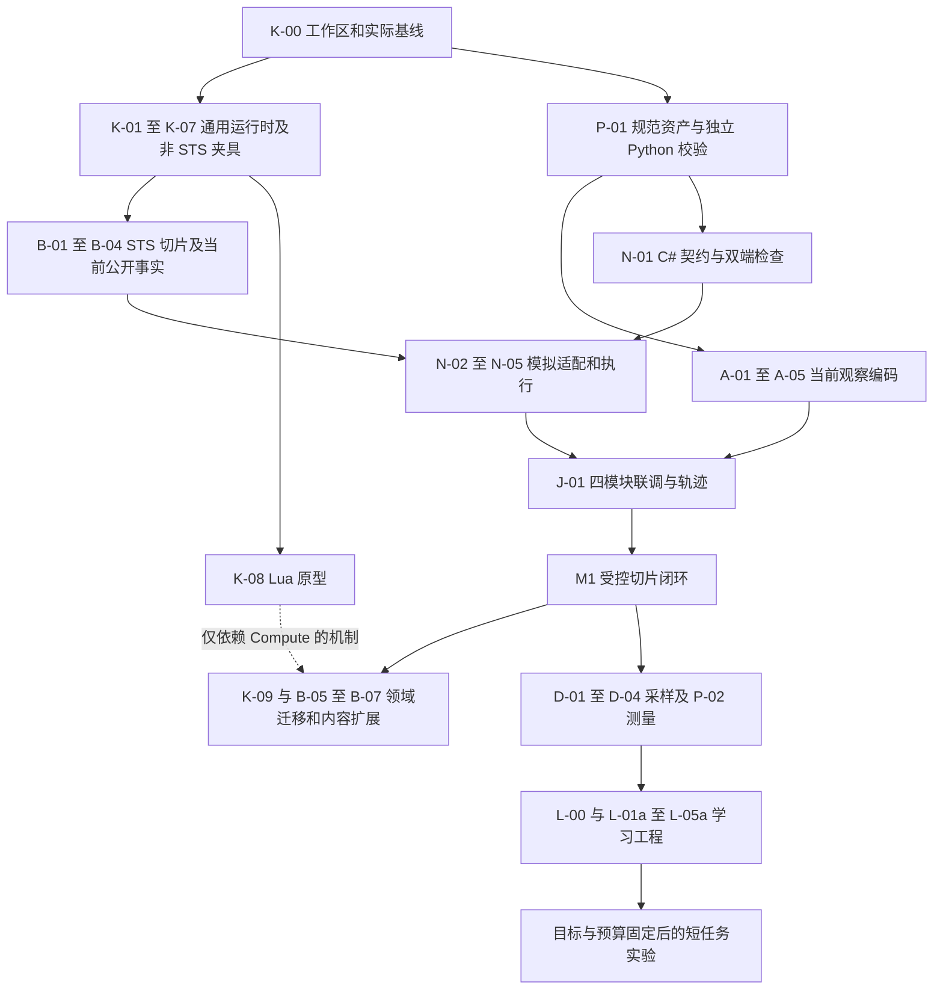

# 四模块编码开工清单

2026-10-05 当前派单以第25节及 [A/base、B/对拍、C/net 分工](post-core-agent-assignments.md)为准。core 已冻结为 engine/ir@0.3，不再执行旧核心开发批次；[独立提示词](agent-goals.md)可直接分配，状态只更新[唯一清单](../review/tofix/README.md#01-core冻结后的分派与下一步)。

| 项目 | 内容 |
| --- | --- |
| 状态与版本 | 实施任务 v1.1；2026-10-05；当前分派按第25节，ENV范围按v1.3，完整W范围保留第19节 |
| 负责人、读者 | 项目维护者；负责 core、base-spire、net、AI 的编码模型与验收者 |
| 首批目标 | 通用运行时经非 STS 夹具验证，base-spire 迁移受控战斗切片，net 提供公开交互，AI 完成确定性编码和随机合法执行记录 |
| 当前证据 | 最新独立build0/0、D1 192/D1.1 57/D2 69/AI604/J219通过。默认战斗工程及故障预算收口已验收；学习效果仍未成立，完整整局未完成 |
| 权威边界 | 产品边界以[项目 spec](spec.md)及用户最新要求为准；本清单组织编码批次，不宣称批准全部设计稿或模块已经完成 |
| 下一步 | 按第24节优先完整core/base单人环境与源规则对拍，必要net出口集成；AI实验待验收，用户协调执行者 |

**当前先读第24节及[ENV任务包](environment-completion-and-differential-v1.md)。** 第20/21节已有工程验收，第22节D3退出当前、第23节D4暂缓；第19节完整W范围保留，当前环境/正式内容/整局优先于新AI学习实验。

2026-10-01 进展：K-00及K-01至K-07已有受控验收，B-01至B-04切片通过；不要求执行 agent 重写这些实现。当前开放风险和下一批任务见[评审处置](../review/records/2026-10-01/review-followup-2026-10-01.md)。N-03 的请求账本/查询或停止不依赖 core 整体快照；当前不扩公开恢复/fork。

2026-10-02 补充：当前入口是第12节及之后的长任务路线。参考[监督台账](../review/records/2026-10-01/supervision-ledger-2026-10-01.md)与最新单项报告，报告之间的时点不同，不能据旧“AI/net为空”或旧检查数量重写现有实现。A/N是否完成以当前工作区验收证据为准；报告自述通过不等于本轮复核。第18节提供可直接交给小模型的连续执行指令。

2026-10-03整体评审：以上段落保留历史时点。**此前整体评审先读第19节及第12至17节；本轮当前交付以第20节/D1为准；不把章节排列当作必须串行完成所有内容后才能做AI的依赖。**当前评估见[整体完成度评审](../review/records/2026-10-03/project-readiness-review-2026-10-03.md)。已有工具和通过项复用，后续以能运行的跨模块成果推进，不以原语/测试/报告数量代替里程碑。

2026-10-03报告整理：当前认领/状态/未结项只维护[review整改清单](../review/tofix/README.md)的W-01至W-08；本清单定义工程范围、依赖与验收，原报告移至records作证据，不增加另一套派单。

2026-10-03最新实测复核：[完成度审查](../review/records/2026-10-03/project-completion-review-2026-10-03.md)取代此前恢复清单时点的完成结论。新增模型/学习器、药水/作者Gym、持久ID及两房间成果复用；当前Slice失败、真实学习衔接和完整整局缺口按唯一review清单接续。

## 1. 本轮完成到哪里

第一批完成到 M1：**同一个已验证的受控 STS 战斗切片可以从通用 core 经 base-spire/net 被 Python 客户端运行，AI 能正确编码当前公开快照，输出随机合法候选概率并记录实际转移。**随机策略只证明管道，不证明学习效果。M1 必须走新的通用运行时；只包装旧 CombatEnvironment 不能当作通用化完成。

M1 后分别推进数据/测量、STS 作者前端与领域迁移、单人整局、低成本学习工程；具体依赖和退出证据见第13至17节。Lua 是独立计算扩展，只阻塞需要它的机制；真实学习实验另需固定目标和预算。真实接入、任意 mod 泛化、同时私密决策不纳入这次长任务。

每个可运行小批次分别验证、记录，再继续依赖已满足的下一项；第18节允许在固定范围内连续执行，不要求每批重新派单。当前改动可能来自其他工作，必须先检查，已经完成的任务按验收认领，不重新从空目录覆盖。

## 2. 先读这些文件

| 承担模块 | 必读与边界 |
| --- | --- |
| 全部 | 根 AGENTS、目标目录 AGENTS、[项目 spec](spec.md)；问题报告是证据，不能覆盖用户要求 |
| core | [core spec](core-the-spire/spec.md)、[通用引擎设计](core-the-spire/generic-tabletop-engine-design.md)；Card/Power/Combat/Map 等由游戏包定义 |
| base-spire | [mod spec](mod-the-spire/spec.md)、[DSL 0.0.1 作者约定](../dsl/0.0.1/dsl-usage.md)、[现有覆盖](mod-the-spire/ironclad-dsl-coverage.md)；规则依据来自 sts2 恢复工程 |
| net | [net spec](net-the-spire/spec.md)、[架构](net-the-spire/design.md)、[协议](net-the-spire/protocol.md)、[规范资产设计](net-the-spire/contract-artifacts.md) |
| AI | [AI spec](ai-the-spire/spec.md)、[编码 v0.4](ai-the-spire/encoder-design.md)、[输出契约](ai-the-spire/policy-contract.md)、[训练设计](ai-the-spire/training-design.md) |
| 联调 | [共同验收](ai-net-verification.md)、[运行约束](ai-net-operations.md)、[评审处置](../review/records/2026-10-01/design-review-disposition-2026-10-01.md) |

## 3. 执行顺序



图中的独立工作可由不同实现任务分别开展；不要求自动创建多 agent。同一 solution/公共文件修改和 .NET 构建由任务负责人串行协调。P/A 不等 core 或真实后端；N 的模拟运行依赖经过验证的 B 切片。

本清单细化并调整旧 AI/net 计划的 C-01：P-01 先交付共用规范资产及 Python 验证，N-01 再完成 C# 与双端检查。**独立编码不以 C# 原型先完成为条件。**两个阶段合起来完成原 C-01 的跨端要求；共同规范始终只有一份。其余 A/N/L 的详细行为继续按原文，不另建第二套协议。

## 4. K-00：所有模块的开工基线

- [ ] 读取 `git status --short`、相关文件和 AGENTS；记录已有改动。不得 reset、删除、重录或提交他人的工作。
- [ ] 运行根目录构建和现有规则检查，分别保存返回码、实际执行数量、首个失败与覆盖。失败不隐瞒，不把零测试记为通过。
- [ ] 清点 `core-the-spire/Core.TheSpire/Engine/` 的已有六份源码：Value、Schema、Ir、PackageBuilder、RuleSet、RuleSetData；检查构建/引用与真实可用范围。已有初稿先修补复用，不另写同名平行系统。
- [ ] 清点 base-spire 实际内容加载、旧 DSL 和规则测试，保存带规则/来源版本的旧后端基线；它是回归对照，不是原版正确性的唯一证明。
- [ ] 给每项既有失败指定所属模块。当前任务需要的依赖失败先定位并修复；无关旧失败报告为残余问题，不能通过放宽所有断言“修好”。

产物：`docs/review/tofix/implementation-baseline-日期.md`，列出实际完成/缺失的任务。此步骤由一个负责人执行，其他模块复用该记录，不并行构建同一 obj/bin。

## 5. core-the-spire：通用运行时批次

首批负责 `core-the-spire/Core.TheSpire/Engine/`、必要测试及项目注册。保留旧 STS 后端作迁移对照，不立即删除 Content/State/Environment/Runs。新 Engine 不引用 base-spire、旧 Card/Power/Combat 类型、Godot 或恢复工程。

| 任务 | 前置 | 编码交付 | 验收判据 |
| --- | --- | --- | --- |
| K-01 定义与链接 | K-00 | 复用现有 Schema/IR/RuleSet；补类型、作用域、引用域、依赖拓扑、显式覆盖、冻结和身份校验 | 缺引用/环依赖/非法覆盖/纯程序调用到副作用拒绝；注册遍历稳定；修改相关语义改变身份 |
| K-02 实例与存储 | K-01 | 类型化字段、集合/关系、作用域、稳定内部实例ID；局部槽和玩法字段分开 | 两会话状态不共享；集合互斥/容量/引用校验；非法单命令不留下半写入；销毁策略可判定 |
| K-03 唯一调度器 | K-02 | 显式调用/返回/分支/迭代帧、局部变量、事件监听快照、预算和 Faulted | 嵌套执行次序正确；循环帧数随深度而非迭代次数增长；事件级联超限明确故障；扩展不能重入 Step/Drain |
| K-04 动作和选择 | K-03 | 通用动作权限/guard/候选查询、单参与者决策、版本核对、暂停续接 | 非法/过期选择不改状态或RNG；选择后父帧从暂停点续接，不重复已结算效果；同一候选查询参与合法性与执行验证 |
| K-05 RNG和数值 | K-03 | 具名随机服务、算法/种子派生配置、计数/状态诊断；数值精度/取整/溢出契约 | 固定配置/seed/动作可重放；查询不消费RNG；检查除零/溢出/取整；不以 System.Random 替代原版算法后仍称 seed 等价 |
| K-06 参与者投影 | K-04、K-05 | 游戏包声明的公开/私有/已知投影、纯读查询和稳定边界接口 | 多次观察与合法查询不改状态/游标；完整内部身份/隐藏顺序不自动成为公开数据；终局和故障分开 |
| K-07 通用性验收 | K-01至K-06 | 一个小型网格走子包，一个私有手牌/公共区域的微型包；置于测试夹具，不做完整新游戏 | 同一运行时不加游戏专用分支即可加载两包；走子/资源/胜负由包定义；记录实际执行检查数与结果 |

K-05 的首个 STS 切片使用能保持来源行为的数值配置；不要在未验证时将 decimal 切换成另一取整策略。定义检查与运行故障分开，预算是明确配置，不靠静默截断“完成”程序。

`core-the-spire/Core.TheSpire.Engine.Tests/` 已有可执行检查，用于证明新运行时独立性，不重新创建同名项目。原 STS 检查入口保留。第一阶段可以程序化构建 RuleSet，不需要先创造完整新 DSL 文本语法。

## 6. base-spire：先迁规则切片，再扩大内容

负责 `mod-the-spire/base-spire/` 及必要 STS 测试。内容、伤害、费用、阶段、敌人行为、胜负和当前已知牌序在游戏包实现。core 缺通用能力时给出具体请求，不把 STS 专用节点塞回 Engine。

首个配置建议命名为 `base-spire:combat-slice-v1`：StrikeIronclad、DefendIronclad、Bash、Headbutt 的基础/升级，Strength、Vulnerable 和可对照的 DampCultist 行为。另有重复实例、两敌目标、选牌续接、置顶/抽牌/洗牌样例。测试起始手牌/弃牌可以受控设置，但必须标为测试场景，不冒充完整原版开局或遭遇。实际 ID 和数值从现有内容及 `sts2/` 核对，不复制本文示例文字作为规则。

| 任务 | 前置 | 编码交付 | 验收判据 |
| --- | --- | --- | --- |
| B-01 STS包声明 | K-01；运行需K-07 | 声明玩家/敌人/牌/Power/区域/资源/流程与动作/事件；冻结切片 manifest/来源清单 | core无STS分支；不同同名牌实例可区分；包引用与版本可检查 |
| B-02 基础战斗 | B-01、K-07 | 费用、能量、伤害修正/取整/格挡/HP、Power、阶段、敌人行为、胜负 | 基础/升级与来源逐项对照；Bash/Strength/Vulnerable正确组合；多敌目标无串对象；动作与自动结算保序 |
| B-03 选择与牌生命周期 | B-02 | Headbutt 的伤害后选弃牌并置顶、抽牌/洗牌、出牌堆至最终区域；重复实例与父帧续接 | 选择期间只结算已完成部分；选后不重复伤害/费用；实例身份保留；区域/计数一致 |
| B-04 当前公开事实 | B-03、K-06 | 可观测资源/意图/Power/实例变量、公开身份、当前可知成员及绝对位置；机制覆盖表 | 第一份输入就能表示置顶后位置0；抽牌/洗牌更新或撤销位置；不透传内部牌序；V-02/V-03/V-15有来源及真实模拟证据 |

这些任务可以先用包构建 API/通用 IR 表达，再用同一行为夹具验证作者前端；不能把“所有规则写回 C#专用宿主回调”当成完成包定义。一个临时后端最多用于标注的对照实验，不作为 M1 主实现。

## 7. 规范、net-the-spire 与 ai-the-spire

### 7.1 P-01：统一协议资产，立即可做

负责 `docs/contracts/net/0.1/`、公开 codec 参考实现/检查及必要文档。交付 wire.schema.json、跨结构不变量清单、decimal/规范字节/摘要参考算法和正反例。遵守 protocol/contract-artifacts 的精确键、类型、排序与身份规则；这是编码任务，不再只补一篇散文。

必须有独立期望的例子：未知键、重复JSON键、非规范decimal、类型/身份错配、悬空引用、候选重复、牌堆越界/计数/定位冲突。结构解析、目录引用和提供方规则真实性分层校验。schema 不要求 AI 执行规则。资产实现选用的库/版本应记录；AI 确定性编码主体保持标准库，外部 schema 检查可用独立开发工具，不能自行写半个不完整的 JSON Schema 引擎。

完成判据：Python 参考校验与规范化通过这些正反例，固定字节/摘要可复核，机器资产覆盖所有协议对象。C# 复核移至 N-01，不阻塞 A 的独立工作。

### 7.2 AI：沿用 A-01 至 A-05

负责 `ai-the-spire/`；contracts 为纯协议类型，encoding 不导入活动 client 或 core。

- [ ] A-01：读取同一规范，建立 Python contracts 和战斗/选牌/场景/扩展变量 fixtures。
- [ ] A-02：实现 build/save/load Manifest，固定名称排序、类别索引、变换及 exact identity；旧文件能照常加载，新输入混旧字典拒绝。
- [ ] A-03：校验字段/内容状态、适用域、引用、牌堆四条不变量、候选与资源上限，给错误代码和路径。
- [ ] A-04：实现 tensorize/collate、typed通道、reference_map、local索引和masks，确保跨样本无误连。
- [ ] A-05：执行[编码第9节](ai-the-spire/encoder-design.md#9-验收场景与预期)和共同验收的样例侧；模块 README 写命令、范围和未验证项目。

编码不维护历史、不理解效果DSL、不保存 known_top、不读取隐藏状态；数值变换/误差容差和容量作为显式 EncodingConfig。首批不安装训练框架、不加随机初始化网络来冒充有效编码器。terminal可编码但不进行softmax。

### 7.3 net：沿用 N-01 至 N-05

负责 `net-the-spire/`、必要 solution 注册和 Python client。contracts 与运行适配分离；net 不结算卡牌规则。

- [ ] N-01，依赖P-01：C# DTO/目录/能力/严格codec，使用同一正反例；比较两端规范字节与摘要。此时可在没有游戏后端时完成。
- [ ] N-02，依赖B-04：从通用运行时的游戏包投影创建 PublicSnapshot，不直接透传旧 CombatObservation；完成机制→字段→来源→检查→证据覆盖表。
- [ ] N-03，依赖N-02：会话、当前版本/候选绑定、请求账本和uncertain；过期不推进、原样重发只执行一次、不确定结果查询或停止。
- [ ] N-04，依赖N-03：.NET stdio Host、Python client、完整公开快照记录；stdout只协议，stderr诊断，限额/断开/close行为明确。
- [ ] N-05：C#/Python集成及V-01至V-10/V-15适用项；公开动作到通用决策响应的适配准确，声明的重放能力经检查。

真实游戏后端暂不写；observe/query必须纯读。NoSL不开放rollback/load/fork，底层内部恢复能力不成为公开操作。超限报错不截断，候选按公开语义键排序，不透明句柄不参与模型特征。

## 8. J-01：首批联调验收

使用 B 的同一受控配置，先只接随机合法基线，再跑确定动作脚本。基线直接产生均匀候选概率，不要求可学习 encoder/scorer 已存在；概率返回遵循 policy-contract。

- [ ] describe/get_catalog → 启动新局 → observe → 校验/编码 → 概率返回 → 采样/选择 → step → 当前快照，运行至确认终局或明确测试截断。
- [ ] Headbutt 中途选择正确续接；第一次编码其结算后的快照可直接得到已知位置，不需要历史；重复卡牌实例/两个目标引用准确。
- [ ] 改变隐藏顺序不改变公开输入；改变玩家已知事实不被编码合并；投影/编码/规则检查各有独立判定依据。
- [ ] 候选重排和句柄换名后，同概率/执行RNG按规范键选择相同动作语义；概率只覆盖真实候选，内部padding为0。
- [ ] 保存完整公开轨迹、实际行为概率、request_id、规则/模型/字典身份、终止/截断/故障。无神经网络时模型身份显式为随机基线，不能称作训练模型。
- [ ] 重发/过期/断开/超限/终止无候选等失败路径按规范处理；不得假装游戏失败或自动重试真实结果。

M1 交接分别说明：通用引擎通过哪些夹具；STS哪些基础/升级规则有来源证据；net哪些操作实测；AI哪些编码不变量通过。某项失败保持未完成，不以一场随机游戏跑完代替全部验收。

## 9. 后续批次：Lua、迁移、完整内容与学习

### 9.1 K-08：Lua计算扩展

依赖通用IR/帧和数值契约，独立于 M1 战斗切片能否使用 Lua。交付 IComputeBackend/ComputeAsset、类型化输入/输出校验、Lua纯计算适配、预算、调用隔离及诊断；结果绑定帧槽后由IR使用。

历史 `tools/LuaBackendProbe/` 已于2026-10-15退出跟踪，仅保留本地与Git历史；它曾是候选验证工具，所引用的 MoonSharp 不因项目文件存在就成为已批准/已满足约束的后端。先复核数值、指令/内存配额、可捕获错误能否逃逸预算、跨调用上值隔离、输入输出传递与部署；满足契约再接入。不能满足就报告具体缺口，保留通用接口，不硬接生产规则。

检查：相同输入两次/跨会话相同结果；无可变全局/upvalue残留；无玩法写/RNG/调度接口；输出错型/超限/异常不提交计算结果；玩家选择恢复不重算已保存结果。使用设计中的有界计算夹具和宿主独立结果对照，不为每次伤害加法跨Lua调用。版本/脚本/后端配置进入身份；不承诺Lua提速。

### 9.2 K-09与B-05至B-07：领域抽离和作者前端

| 任务 | 交付与禁止捷径 | 验收 |
| --- | --- | --- |
| B-05 STS作者前端 | 在base-spire或其STS规则库注册领域编译扩展，把现有normal/upgraded、效果、目标、hook展开为通用IR；新语法另有版本 | 解析→IR→实际注册→基础/升级行为分层核对；升级空hooks不隐式继承；X费捕获/目标域/保留时点有独立检查 |
| K-09 旧职责迁移 | 按通用设计第9节逐项把旧Card/Power/Enemy/Combat/Run等定义/流程移向STS包；更新测试和TestHookMod引用 | core最终无STS依赖/专用公共契约；迁移期间旧后端有明确位置；不会出现base↔core循环依赖 |
| B-06 内容批次 | 按已支持IR/规则迁移现有卡牌/Power/药水/敌人，批次冻结；先补原语或流程再声明内容支持 | 实际加载/声明/卡池数量可核对；代表性基础/升级/随机/钩子有行为证据；不把注册数当规则覆盖 |
| B-07 整局流程 | 地图/房间/奖励/商店/事件/营火等由包定义；公开状态及终局对齐net | 来源与随机流/候选池/消费顺序核对；逐机制覆盖及端到端场景；只有实测范围宣称支持 |

不一次物理搬走所有旧文件造成循环依赖。先迁切片需要的职责、确保新运行时真实使用，再分批抽离其余；使用项目/命名空间/依赖检查证明边界，不能只给旧类型换个目录。旧DSL0.0.1保持兼容，新的Schema/Procedure示意不是现有语法。

### 9.3 AI L-01至L-05：可学习短任务

M1完成后按第16.1节实现共享表示、候选评分/内部价值头、Collector与奖励向量接口、近期PPO、checkpoint、评估和ModelBundle工程。第16.2节要求训练目标/偏好/资源配置明确后才启动真实STS学习实验；未定配置不阻塞工程或独立内容迁移。沿用[AI/net详细计划](ai-net-implementation-plan.md#4-第三批学习闭环)；不在编码时自行填入STS奖励权重、部署预算或通关概率目标。

模型输出全部合法候选概率，可选Q头先关闭。随机/规则基线、有效轨迹与技术中断分开统计；量化/导出/蒸馏后按V-16重评。真实部署在真实字段/动作/完成信号和目标机器预算核对后，才作为独立批次执行。

## 10. 验收命令与交接格式

现有命令从根目录执行：

```powershell
dotnet build AutoTheSpire.sln
dotnet run --project core-the-spire/Core.TheSpire.Tests
python tools/doc-check/check_docs.py .
python tools/doc-check/check_trace.py .
git diff --check
```

新增检查入口现已有交付，执行 agent 从根目录使用实际入口，保存当前结果；不以旧数字代替本次运行：

```powershell
dotnet run --project core-the-spire/Core.TheSpire.Engine.Tests
dotnet run --project mod-the-spire/base-spire/BaseSpire.Slice.Tests
dotnet run --project net-the-spire/Net.TheSpire.Tests
python tools/contract-check/check_contracts.py
python ai-the-spire/tests/run_checks.py
python ai-the-spire/tests/j01_episode.py
python ai-the-spire/tests/d01_records.py
python ai-the-spire/tests/d02_collector.py
python ai-the-spire/tests/d03_audit.py
python ai-the-spire/tests/p02_measure.py
python ai-the-spire/tests/d04_longrun.py
python net-the-spire/client/test_client.py
```

AI检查入口需保证从根目录能导入其包；如采用模块目录命令，在README说明目录与命令。新.net项目注册solution后验证构建；规则/DSL/注册变化另运行规则检查和实际内容加载。fixture检查和实际后端检查分开，不报告零测试通过。

每阶段综合交接先提交到 `docs/review/tofix/主题-日期.md`：负责范围、修改文件、完成任务ID、契约变化与迁移、运行命令/返回码/执行数、实际内容/行为范围、失败/残余风险、下一批依赖。同阶段小批次追加同一报告。负责人把开放项并入tofix/README，原交付/审计转records，已修缺陷有关闭依据再转archived；不自动移动其他人报告或提交共享工作区。

## 11. 可直接复制给编码模型的指令

```text
执行 docs/design/implementation-kickoff.md 的【填写批次和任务ID】。
先读取根/目标目录 AGENTS.md、相关上位规范、git status和已有源码。
保留未提交工作；已有实现先核对验收，不另写同名平行实现。
只完成该批次及必要依赖修复，不顺带重写其他模块。
按本清单的前置条件、目录边界和验收判据实现；常规可逆实现选择自行判断并记录。
core不内置STS规则；base-spire定义STS模型/规则/流程；net只投影和控制；AI只消费当前公开快照。
不得用历史缓存、隐藏状态、静默截断、随机兜底或放宽测试掩盖错误。
没有依据的规则/资源阈值/奖励偏好不能猜；先完成独立任务，记录具体未定项和阻断范围。
执行适用构建/规则/内容加载/契约检查，区分已有基线失败和本批新增失败。
提交到docs/review/tofix的交接报告，含文件、任务ID、命令/结果、未验证项和下一批依赖。
不自动git提交、清理或移动他人文件。
```

本节保留单批指令；长任务改用第18节。当前状态和顺序以第19节为准，已有K/R/A/N/H/D实现复核并认领，不按最初开工顺序重复实现。每批以证据完成为准，不以“代码写完”作为下一批依赖已满足。

## 12. H-00：长任务起点，先关闭 M1 缺口

本轮用户授权把既有任务之后的工作安排为连续编码任务。第12至17节只规划后续交付，不宣称它们已实现；执行者可以在通过前置后继续下一项，无需每项等待规划者重新派单。实现和架构评审角色仍分开。

### 12.1 复核已交付内容

- [ ] H-00：读取当前 AGENTS、git status、监督台账与 R/A/N 单项报告；运行第10节适用入口，保存当前返回码、实际执行数量和覆盖。
- [ ] 建立任务状态表：未开始/进行中/实现已验证/阻塞；已通过的已有任务只认领，不另建重复实现。检查数允许因合理重组变化，必须说明覆盖增减；数量增加和全绿都不能代替判据成立。
- [ ] 清点未挂入入口的检查、临时关闭的检查组和仅有 TODO 的功能，不能把被跳过的检查当成通过。各报告时点冲突按当前实现和证据裁定。

### 12.2 首批必须收口的任务

| ID | 负责目录与前置 | 交付及退出条件 |
| --- | --- | --- |
| H-01 当前已知成员投影 | Engine、base-spire、net；现有 B-04/N-02 | 按下述决策补公开实例及部分成员投影；Headbutt 后第一份合法 wire 快照含正确已知位置；未知成员/顺序仍隐藏，重复同定义实例无混淆 |
| H-02 目录与覆盖表 | base-spire/net；H-01 | 补牌堆实体、pile_types与保留派生声明；entity_ref目标种类和动作/终局字段必需性来自包/profile明确声明；对所选切片逐机制闭合，不以“记录了跳过原因”代替 V-15 成立 |
| H-03 请求与故障证据 | net；N-03/N-04 | 核对跨worker/重启session_id不复用；覆盖延迟应答、断开、超时后completed/pending/not_found/unknown、账本满额及关闭。可用有明确状态的测试后端/延迟管道注入，不必为测试改造整个Engine为异步；这种证据标为故障注入，不冒充真实游戏 |
| N-05 接口验收 | net及共享检查；H-01至H-03 | V-01至V-10/V-15适用项逐条有独立判据，区分资产/夹具/真实模拟/故障注入。未支持真实attach可声明不支持；不能把首批必须保留的已知牌事实也宣布不支持后称M1完成 |
| J-01 / M1联通 | AI/net；A-05、N-05 | 同一通用切片经真实stdio执行describe→catalog→start→snapshot→编码→候选概率→step→公开轨迹。均匀策略及确定脚本均有证据；终止、截断、故障分开；完整轨迹离线可校验和重编码 |

H-01 的架构决策：保留 `known_positions.card_ref ⊆ visible_members ⊆ entities` 和实例引用语义，不改成内容ID引用，也不由net凭内容ID造假牌实例。游戏包声明**按观看者授权揭示实例的当前事实/集合**；通用投影支持该观看者可见的成员子集。处于身份隐藏集合不能抹掉另一个显式、针对该观看者的合法揭示授权；授权只公开该实例与允许字段，不公开整个隐藏集合或实际顺序。无授权仍保持原隐藏规则。

base-spire 的已知事实须绑定确切卡牌实例及牌堆，位置是包维护的当前可知绝对位置。抽牌、移动、洗牌更新或撤销；不能在知识已失效时重新读取实际隐藏位置并输出。一个全局Revealed布尔值若会对所有观看者生效，不满足这项契约。net只映射已授权事实；AI只接收当前快照。新增通用投影声明进入规则身份，旧隐藏检查保留，并增加两观看者、重复实例、多个离散位置、授权撤销和隐藏置换反例。

牌堆实例由base-spire声明；core仅提供通用实体/集合/查询能力。成员已知但位置未知可以进visible_members而不进known_positions；只知道数量不能伪造成员身份。隐藏置换反例只改变不可知部分，不能同时改变一张真正已知的牌的位置后还要求观察完全相同。

此决策原先处理[已知位置冲突](../review/archived/known-position-protocol-conflict-2026-10-01.md)的设计选择。2026-10-03按H/N/J后续证据关闭该缺陷；公开ID映射风险另归W-02，保持开放。以下M1后任务仍以当前第19节状态与依赖执行，不重做已交付项。

## 13. M1后阶段一：可持续采样与测量，不等待训练偏好

| ID | 前置/范围 | 编码交付 | 退出证据 |
| --- | --- | --- | --- |
| D-01 轨迹格式及数据索引 | M1；AI数据模块/公开产物目录 | 版本化EpisodeRecord、transition、公开快照存储、实际行为概率、结束分类、身份、来源与索引；先保存完整快照 | 一个记录可独立重读、验摘要/引用并重编码；重复request不重复计样本；未知结果不会被补造为失败或下一状态 |
| D-02 有界Collector | D-01；AI/client | 固定局内策略，独立会话/worker、种子派生、步数/局数/磁盘/内存/时间限额、停止与清理；随机/明确规则基线 | 重复seed+动作的重放按声明能力成立；worker不串状态；达到限额有明确原因；确认转移不丢失；中断局不混入普通终止 |
| D-03 数据审计与划分 | D-02；AI/data | 冻结场景与训练/调参/最终评估split；原始事实与奖励分开；完整性/可用性/异常及偏移检查 | 无悬空快照、身份混用或跨split同场景簇泄漏；总尝试/有效/中断局数均报告；没有未选动作收益标签 |
| P-02 模块和端到端测量 | M1；工具及必要计数接口 | 分别测规则推进、投影、codec、编码、采样、轨迹写入；记录机器/配置/状态与候选规模、延迟分布/峰值内存 | 最小/典型/大候选/长结算等可重复负载；诊断不入模型特征，开启诊断不消费RNG；没有预算时只报告测量，不称部署达标 |
| D-04 长跑检查与入口 | D-02、P-02；跨模块tools入口 | 一条从配置启动有界采样/审计/汇报的命令；进度、checkpoint索引、失败分类及可重启监督入口 | 单会话长跑、多worker交错和进程丢失场景可复现；恢复的是采样进度，新开中断局，不恢复NoSL游戏中途状态 |

开发用限额由执行者选为显式、保守的配置并记录理由，只用于检查；不把它们写成产品性能门槛。大规模持续采样不自动启动；长任务只跑验证所需的有限实验。数据/模型产物进配置目录，不将巨量日志或二进制写入源码树。先同步learner/collector周期即可，不预设分布式训练服务、云部署或远程监听。

## 14. M1后阶段二：STS作者前端与内容迁移

本阶段细化原B-05/K-09/B-06/B-07，沿用原任务ID和四态验收。Lua仅阻塞实际需要Compute的规则，不阻塞纯IR切片/普通内容的迁移。

| 子任务 | 前置及负责范围 | 必须交付 | 完成判据 |
| --- | --- | --- | --- |
| B-05a 内容与原语清单 | M1；base-spire及来源文档 | 从当前实际注册结果冻结迁移manifest：声明ID/源文件与摘要/normal-upgraded/依赖原语-hook/来源/已有检查/未支持项；明确首个单人Ironclad范围 | 总声明数、实际注册数、卡池数分别列出；不可达或多人内容显式分组，不能静默删掉难项使分母变小 |
| B-05b 切片前端 | B-05a；base-spire作者前端及检查 | 将Strike/Defend/Bash/Headbutt、切片Power/敌人的作者表示编译为通用IR，与已有程序化包使用同一运行时 | 解析→IR→链接→实际加载→基础/升级行为分别有证据；Headbutt续接、身份与牌序事实不回归；不能只是包住旧EffectExecutor |
| B-05c 完整前端覆盖 | B-05b；base-spire及必要通用原语 | 分批迁normal/upgraded、目标、X费、hooks、选择、批处理、实例变量、生成/升级/变形、Power/敌人/药水及run作者表示；保留0.0.1兼容入口 | 每项有语法/编译结果/运行语义/检查；升级空hooks不隐式继承；随机候选顺序和消费点有来源；缺能力先补Engine通用能力，不加STS节点 |
| B-06a 基础战斗内容批 | B-05b、R-DAMAGE；base-spire | 基础/升级牌、常用Power、典型多敌、药水、能量/费用、牌区域、死亡/胜负；逐机制更新net profile/coverage | 来源对照和生命周期场景成立，partial pipeline与固定种子脚本保持；Unpowered、修正/取整与触发时序不靠旧golden盲选 |
| B-06b 复杂组合批 | B-05c、B-06a；base-spire/必要Engine | 自动打牌、replay、X费、嵌套选择、生成/变形、耗尽回调、敌人召唤/复活、随机选择、持久实例变量；按依赖分批 | 有能区分重复扣费/重复伤害/错误父槽/实例复制/监听变化的反例；自定义测试场景有来源标识，不宣称覆盖整个原版 |
| B-06c 冻结范围收口 | B-06b；manifest中剩余内容 | 把B-05a冻结的支持范围全部迁入新路径，按机制合并合理检查，输出四态覆盖和差异清单 | manifest每个纳入项都实际注册且有对应行为证据；unsupported保留为未完成，不计支持。存在缺口时可以推进独立项，不能宣称本阶段已全部完成 |
| K-09a 依赖抽离 | B-05b后可逐步；core/base-spire/消费者 | 新通用路径不引用Legacy；STS领域编译/规则由base-spire拥有。先画项目依赖，再迁文件/引用/测试与工具 | 无base↔core环，Engine不依赖STS；旧消费者保持显式兼容，不把新路径偷偷回退Legacy；公共变化有迁移说明 |
| K-09b 兼容隔离与切换 | B-06c及所选run范围有证据 | base-spire默认入口转新后端；旧兼容入口显式命名/配置。将旧STS实现从通用生产程序集隔离到游戏侧兼容项目，并同步引用 | 新默认构建/注册/运行不需Legacy；非STS包检查仍成立；旧测试与对照工具显式依赖兼容项目。移路径不能充当职责迁移；保留必要回归，不自行删除历史代码 |

迁移分母来自**当前工作区实际加载的冻结清单**，不硬编码历史122张牌/89敌人等数字。以后加入内容是新批次，不在长任务中无限扩张“全部”的含义。STS规则以版本化`sts2/`来源为准，旧后端和reference只作对照；取不到来源的项明确标记，不能编造规则完成manifest。

作者前端优先复用现有通用词法/AST能力，领域lowering归base-spire；是否抽公共语法库按真实依赖需要决定。新完整DSL若与0.0.1不兼容，明确语言版本及迁移，不单方面改变旧文件含义。新增多动态候选域只在出现不能用现有选择协议表达的明确语义需求时给规划者具体案例；不为方便训练提前改动作粒度。

### K-08 Lua单独批次

- [ ] K-08a：复核既有probe，冻结候选后端、数值档位和宿主接口；有界纯计算、输入输出校验、指令/内存预算、不可捕获逃逸、上下值隔离、确定性及诊断分别检查。
- [ ] K-08b：只有后端符合约束时接入一个有独立期望的通用计算夹具，再接一个确实需要复杂计算的STS算法；结果随帧保存，中途选择后不重算。相同输入跨调用/会话一致，失败不提交结果。
- [ ] K-08c：测输入准备、跨语言传递、执行/返回总成本，记录后端/脚本/配置身份；不能只测Lua函数时间就称提速。

Lua候选无法满足硬约束时交具体失败证据，保留Compute接口，标记K-08阻塞，继续不依赖Lua的任务。不允许取消隔离/预算让测试通过，也不要求所有普通规则改为Lua。

## 15. M1后阶段三：从战斗到单角色单人整局

下表细化B-07；先用受控、有限内容的完整流程验证玩法连接，再扩大到B-05a/整局清单冻结的范围。贯通一局与原版保真是不同验收。

B-07开始前先冻结整局manifest：从当前base-spire已有单人Ironclad内容/流程声明及贯通所需机制清点地图、遭遇、奖励、商店、营火、事件/古代人、遗物、药水和终局；逐项记来源与支持边界。当前未实现项也列入缺口，不能只统计已成功注册的项。以此作为J-03的有限分母，不将sts2恢复源码中的所有角色/模式自动加入长任务；来源或范围冲突交规划者处理，继续独立项。

| 子任务 | 前置与范围 | 编码交付 | 验收 |
| --- | --- | --- | --- |
| B-07a Run状态及卡牌归属 | B-06a；base-spire | 长期牌组、战斗克隆/生成牌、升级/移除/变形、玩家HP/最大HP/金币/药水/遗物与跨房间写回 | 战斗临时牌不误写长期牌组；相同内容实例分别升级/移除；房间结算写回一次；结束/故障不重复奖励 |
| B-07b 路线与房间框架 | B-07a；base-spire | 地图/节点/路线选择、普通/精英/Boss遭遇池、房间状态与父子流程、幕转换 | 固定配置/seed/路线可按声明重放；不同区域候选池/次数约束有来源；隐藏房间/随机结果不提前进观察 |
| B-07c 经济与选择 | B-07b、对应内容；base-spire | 卡牌/药水/金币/遗物奖励、商店买卖/移牌、营火、事件/古代人及明确支持选项 | 候选/价格/容量/资源与来源一致；选择期间可暂停、取消仅在规则允许时作为合法动作；费用/奖励不重复结算 |
| B-07d 遗物与跨阶段机制 | B-07c及B-06b；base-spire | 生命周期、战斗开始/结束、房间/地图/奖励修正、永久实例数据；依赖机制先实现再载入内容 | 显式事件优先级、监听快照/失效、随机流顺序及可见变量有检查；native回调不绕开唯一调度器 |
| N-06 整局公开规范 | 每批B-07有来源后；net/shared资产/AI fixtures | 声明房间/路线/待选牌/商店/事件/选项/遗物与公共资源；必要时用现有Sequence/Group投影语义，类型声明由游戏包/profile提供 | 全部所需当前已知事实进wire并可编码；来源→字段→更新/失效→检查覆盖闭合；新增目录/规则/Profile/Manifest身份同步，旧Gym仍可按旧资产加载 |
| J-02 有限整局闭环 | B-07a至d支持的有限配置、N-06 | 用脚本及随机合法策略完成开始→路线→战斗→奖励→商店/营火/事件→Boss→跨幕→确认终局；可采用明确标注的少量内容测试配置 | 每种已支持流程至少有能区分错误的场景；失败与基础设施截断分别记录；不把受控流程宣称原版所有内容支持 |
| J-03 冻结整局范围 | J-02、B-06c、整局内容manifest | 单角色单人目标范围逐机制补齐、固定来源与内容版本；完整覆盖/差异报告及保留种子回归 | 范围内全部必需流程/内容有来源、注册和行为证据；缺失或有意偏离逐项保留，不把一场随机通关当原版一致性证明 |

N-06必须随着内容批次维护，不等所有规则写完才暴露观察缺口。对其他角色、多人、OriMod和任意mod零样本泛化不做本轮完成承诺；它们另有范围清单和语义评审。核心通用性保持非STS夹具验证，而非把其他完整游戏也放进此长任务。

## 16. M1后独立路线：低成本模型与学习工程

本路线不等待完整原版内容/整局迁移；每个训练配置仍固定Gym。沿用L-01至L-05及[训练设计](ai-the-spire/training-design.md)，下面区分可连续实现的工程和需要明确目标的实验。

### 16.1 可以立即实现的工程

| 子任务 | 前置及目录 | 交付 | 验收 |
| --- | --- | --- | --- |
| L-00 配置/依赖/基准 | M1、D-01、P-02；AI | Training/Reward/Preference/Model/Executor/CapacityProfile可序列化、identity与校验；训练依赖单独锁定，编码主体仍标准库；实际机器与参数/内存/延迟测量入口 | 缺必需目标/偏好/预算时拒绝真实训练；例子明确是测试Profile。框架实现选择记录版本/理由，不因框架存在宣称学习有效 |
| L-01a 首个可学习基线 | L-00工程；AI/models | 按下述低成本结构接入确定性编码、共享encoder/scorer和内部V头；ModelConfig全记录；可选Q头关闭 | 候选/实例重排对齐后等价；mask及typed引用正确；terminal不softmax；统计embedding/共享投影/头部各参数与峰值开销，禁止padding行号/句柄进特征 |
| L-02a 策略采样 | D-02、L-01a；AI | 从π到实际μ的执行器、logμ(a)、局内策略锁定、rollout批次/版本；向量事实/奖励计算接口 | μ对应真正执行的策略变换，不把π当μ；记录不足不进入训练；请求重发不双记；跨worker策略版本和数据身份可核对 |
| L-03a 学习器工程 | L-02a；AI | 近期PPO、内部V、联合梯度、优势/终止/截断处理、学习checkpoint与恢复 | 使用小型可判定测试环境/数据检查mask、梯度、更新、策略版本、终止bootstrap和中断处理；恢复学习RNG/优化器/游标，不恢复游戏状态；不能用故意固定成功标签自证策略能玩STS |
| L-04a 评估工程 | L-03a；AI | 随机/明确规则/模型基线、隔离场景簇/种子、实验统计和资源报告 | 初始条件配对不冒充随机流消费相同；重复replicate不增加独立场景数；报告尝试/有效/中断样本和不确定性，最终集不反复选参 |
| L-05a 模型包工程 | L-01a至L-04a工程；AI | 不可变ModelBundle、版本/依赖/字典/数值适配配置、加载/发布前检查、CPU推理入口 | 规则/目录/后端/Manifest错配拒绝；一局固定模型；重新导出或量化触发V-16评估；不把未经训练权重标为有效模型 |

首个可学习结构采用共享的小维度类别/内容embedding、按字段owner与真实引用聚合的实体表示、各语义块的sum/mean/count聚合，再用共享小评分器逐候选打分；涉及卡牌/目标的候选从其引用实体gather表示。已知位置与那张卡/牌堆的关联必须保留，不能只分别池化卡牌与位置后丢掉配对。公开Sequence保留真实ordinal；无序集合不使用规范行号作特征。

不将整个padding张量展平后接巨型MLP，不把Transformer设为默认，不为每种牌或每个候选配置一套大网络。维度、层数、数值从float64编码到模型计算dtype的适配和误差规则全在ModelConfig；先给参数分项与CPU测量，再按目标预算选规模。CPU/训练框架的常规实现选择由执行者记录，不自行把产品预算或收益偏好变成默认常量。

工程检查允许用有完整配置、有限样本的合成小任务证明梯度及训练链路；其奖励/权重是测试定义，只用于该检查，不继承为STS奖励。它不构成战斗学习、通关概率或部署性能结论。

首版PPO训练直接采样masked π，要求μ=π；执行器的温度/均匀混合/argmax仍可用于其他配置，但不将其数据冒充本训练分布。按[训练设计第5节](ai-the-spire/training-design.md#5-训练恢复与发布)同步采样轮次，核对版本与新旧log-prob定义；旧策略未结束局显式完成或截断/关闭，不在更新后混作新策略数据。L-03a须有拒绝错版本及错执行配置的检查。

### 16.2 真实学习实验的进入条件

- [ ] L-00b：用户与规划者明确初始任务（优先固定战斗/选择切片）、场景分布、奖励向量及单位、偏好/标量化、折扣/决策时间单位；不要求首次就预测整局通关概率。
- [ ] 明确目标机器、CPU延迟/内存/参数预算、采样/训练步数或时间/磁盘限额、种子拆分、评估和晋升判据。记录于实际Profile，未填写不启动无限训练。
- [ ] L-01至L-05真实实验：通过V-15后，在固定Gym和冻结偏好下跑有限近期PPO实验，对照随机/规则基线，报告学习曲线、成本、故障与不确定性；没有改善也算实验交付，不能算模型晋升。
- [ ] 一次诊断只改有理由的场景难度/表示/探索/优化配置，另记实验身份；固定预算到达后停止，不无限调参或看最终集后改门槛。

策略仍输出全部合法候选概率，概率不是Q标签；可选Q头和向量critic以后按验证需求引入。奖励接口保留向量；首个训练可用明确固定偏好的内部标量V，不把这个实现当作通用收益偏好。训练从当前公开快照决策，不加入历史RNN/隐藏状态/效果文本来掩盖公开表示缺口。

目标/预算尚未确定时，长任务完成16.1及配置模板，并继续第14/15节独立工程；在进展报告列出缺少的决策字段。不要为了“长任务全部完成”替用户猜奖励取舍，或因此停掉所有不相关任务。

## 17. 长任务完成标准、持久交接与远期边界

### 17.1 有限完成标准

本轮长任务的自动工程范围是H-00至M1、D/P设施、B-05/K-09/B-06冻结内容迁移、B-07/N-06/J-02/J-03冻结的单人范围，以及L-00/L-01a至L-05a工程。K-08按独立约束交付或明确阻塞；真实学习实验只在16.2必需配置明确后执行。真实游戏控制/发布、其他角色/多人、未冻结的新内容或mod不自动纳入。

“全部完成”必须附任务状态表和证据索引。所有约定范围的必需项通过，才能报告该范围完成；未知来源、硬约束未满足和外部配置缺失保持阻塞/未完成，不能用unsupported状态隐去分母。若任务受阻，继续不依赖它的项；最终交接明确哪些完成、哪些未完成及其具体原因。

### 17.2 长任务进度协议

- [ ] 每个可运行小批次落盘代码及检查，再写报告骨架；不累积到全模块写完才第一次构建，也不只读文档耗尽上下文后留零产物。
- [ ] 按 `docs/review/tofix/README.md` 登记认领/状态/下一交付；每个产品阶段只维护一份综合进度交接，包含当前工作区、文档版本、冻结manifest/Profile、真实命令/覆盖、首个失败和未定字段。同阶段小批次追加，不按原语新增待修报告；负责人整理后放records并链接清单。
- [ ] checkpoint记录任务/数据/模型身份和下一条具体动作。恢复时先看现有文件与状态，不重复实现，也不假定未报告的代码已通过。
- [ ] 同一solution只由一位执行者构建；用户协调多agent目录/公共资产/时段，本长任务不自行创建新的执行agent。公共契约改动同步双方与检查，不能只改一边期望。
- [ ] 同一阻断反复出现且没有新证据时不无限重试。记录复现/已尝试措施/受影响任务，转做独立项；不能禁用检查、放宽类型、静默截断或删掉难场景让数字全绿。
- [ ] 每个重要阶段复验受影响的构建/规则/实际加载/契约/联调；已通过且没有新变化的检查不机械反复跑。源码计数、注册、行为、学习有效、资源达标和真实部署分别报告。
- [ ] 执行者写实现报告到tofix；归档由用户/规划者依据关闭证据处理，执行者不自动归档他人报告或把后续未完成项称为已修。本轮未授权git提交/清理/合并或对外发布。

### 17.3 之后再规划的真实部署

训练模型达到模拟目标/资源预算后，再列真实后端公开字段与动作完成信号对照、只读观测、有限受控运行及NoSL检验；没有真实游戏/接入能力则产出缺口表，不能用fake后端声称真实接入。部署控制由用户另行安排，不在本轮长任务里自动启动游戏操作。

跨进程恢复、内部全量快照、规划搜索、旧权重自动热迁移、Transformer、向量Q、蒸馏/量化、分布式采样等仅在具体需要/测量与新评审支持时增加。量化/导出若采用，必须按V-16重新核对策略行为、误差和预算，不能只看包大小。

## 18. 可直接给小模型的长任务指令

```text
当前执行implementation-kickoff.md v0.6第20节及battle-learning-delivery-v1.md，不继续旧全项目宽goal；当前状态只看review/tofix/README.md的D1-A/B/C与R1。
复用默认Host、runner/models/learning/bundle/evaluation/data，先交根目录可运行demo与可读对局，再交固定工程Profile的有限采样更新及模型包/checkpoint，最后交三策略对照、加载候选demo与smoke停止恢复。
命令、种子、奖励、PPO/回报、资源限额、产物、退出和封板验收按D1任务包，不猜参数、不无限调参；该小预算模拟更新不等待W-07产品实验决策。
R1只复核/最小修当前Bully回归；不新增卡牌/Power/场景开关、不迁完整正式源、不扩整局。W范围保留作后续，D1完成后停止，下一版本由用户/规划者另派。
一个集成负责人负责可用版本，支持agent由用户安排；协调文件/构建，保留他人工作，不自行创建agent/提交清理Git/操作真实游戏发布。按三个产品检查点交一份综合证据，不按内部原语新增报告。
```

此前全项目长任务授权保留为历史。按用户最新要求，本轮仅连续推进D1-A/B/C及必要R1，完成即停止；不自动开始后续内容迁移或整局任务，其余权限边界仍适用。

## 19. 2026-10-03整体完成度与当前任务清单

本节保留完整W目标、工程范围及验收。**当前派单只取第20节D1子集**，正式源Host、作者扩面、多场景及整局后续待排；认领与未结状态只维护[review整改清单](../review/tofix/README.md)，不重复维护另一套活动状态表。旧章节保留任务定义与历史证据。完成度按产品能力评估，不将354条旧后端注册、186条切片检查或报告篇数换算成项目完成百分比。本轮依据独立构建、11项运行检查和关键接线核对；完整证据、范围与首错见[全项目完成度复核](../review/records/2026-10-03/project-completion-review-2026-10-03.md)。

### 19.1 当前成果与缺口

当前已交付受控模拟接口、结构化编码、小模型/学习器零件、作者Gym及两房间纵向闭环；不能继续按“模型未开始、UsePotion不可用、连续房间未完成”派单。新正式卡牌/能力源可以沿游戏侧前端进入Engine，领域行为检查与真实Host覆盖须分开。

当前Slice回归存在Bully零易伤伤害失败；其余本轮适用检查通过。端到端学习还缺公开摘要充分性、权重身份、真实样本/更新编排及同一Gym有效数据划分。完整单人整局仍缺大量内容、永久状态与地图/房间/奖励/商店/营火/事件/遗物流程。分层完成度及数值范围见复核，不按卡牌或检查数量换算全项目百分比。

完整路线的验收成果仍为可信学习与单人整局；本轮只交第20节D1的可运行战斗学习版本，先让用户操作、观察和比较。原型.author与正式0.0.1源、受控句柄修复与所有新机制可信、两房间与完整整局、合成学习与游戏学习分别验收。

### 19.2 负责人决策与依赖

下列为完整路线技术约束；当前执行范围及小预算工程演示例外以第20节/D1为准，不能把全部约束展开成当期工作。

- 后续内容扩面成果是**可配置战斗Gym**：内容、场景、公开Profile、字典与策略可明确选择，扩展内容从同一个stdio/Collector入口真实运行。保留原受控切片作回归，不把全部宿主/数据固定在它上面。
- 模型工程现在就推进。先做共享低成本encoder/scorer与内部V头，再把策略接入Runner/Collector；不用等完整原版或整局。真实学习有效性仍需W-07，合成任务只证明更新链路。
- `.spire` 0.0.1仍是正式作者约定；`.author`定位为受控原型/夹具入口，可暂用于明确标注的Gym，但不成为默认mod语言。正式迁移应复用0.0.1解析/AST并在游戏侧lower到Engine；不再长期手写两份内容。保留旧后端能加载只证明兼容并存。
- 公开实体引用不得透传内部创建序号。映射归net会话/观看者的引用绑定，授权事实归游戏包；它不是AI历史记忆。隐藏创建/顺序不能影响可推断编号、规范排序或默认选择。
- 引用必须跨状态持久绑定，不能每份快照按可变字段重新编号；受伤、升级和其他实例增删不能让旧句柄换绑。首次公开分配不透明句柄，同实例撤销后再授权恢复原句柄，销毁后不把旧句柄分给其他实例；排序不得借用原始ref或net已Skip字段。跨会话允许一致换名后比较，不能以强求字节相同替代生命周期稳定。
- 药水栏、可用次数/容量、目标与影响决策的玩家可见变量必须纳入有该机制的Gym。优先以现有实体/字段/关系表达药水及槽位；不要为方便借用只适用于卡牌的Pile语义。没有药水的旧目录仍可作为旧Gym存在；新增声明更新identity/Manifest，属于既有扩展机制，不重新询问是否要观察玩家可见信息。
- 作者Profile独立于默认切片；药水Rarity/Target按Category词表发布，不再次作为产品待决。逐项发布集合、kind、动作及所需槽位/Run/长期牌组事实，不为保留旧golden而省略已承诺公开信息。
- 历史公开信息的有效摘要由提供方当前变量表达。LostHpThisTurn影响已迁移Spite的分支，不能以“可由过去HP变化推导”为理由Skip；作者Profile应提供布尔摘要，不要求AI重放历史。
- 整局用持久Run及其长期牌组，战斗是临时子流程。战斗完成先提交一次结果并退出战斗，随后仍可进入下一房间；不把每场战斗胜利直接当作整局终止。写回幂等性按战斗/房间实例区分，一个不重置的全局BattleSettled布尔不能代表所有房间。
- BodySlam、cardsWithTag、FlexPotion等来源或语义问题按受影响内容登记和查证，不阻塞模型工程或整局框架。U-11错误路径格式和检查归属等常规工程选择由实现者与共享资产对齐并记录；不能据旧missing清单认定后续检查不存在，更不能取消已承诺不变量。

复用W-01作者Gym及W-02受控句柄修复，补公开摘要与正式源宿主；W-03在选定固定Gym内补有效多场景划分，W-04补身份和真实学习编排，由用户安排执行者。W-05与W-06保持独立路线。W-07等待具体实验配置和运行证据，W-08随所有阶段维护；这不是授权自行创建新agent。

### 19.3 可连续执行的工作包

| ID / 优先级 | 负责范围及既有任务 | 必须交付 | 完成判据 |
| --- | --- | --- | --- |
| W-01 / 首先：内容进入真实环境 | base-spire、net宿主/Profile、AI Runner；B-05/B-06/N-06的战斗部分 | 可版本化选择规则包、公开Profile与场景的宿主入口；Runner不再硬编码唯一Gym/scenario；先接已有行为证据的作者内容子集 | 从干净配置describe→catalog→start→实际出牌/药水→终局→离线重编码，有扩展卡与药水的真实stdio证据；新目录字段/合法动作/候选引用闭合；规则/场景变更改变身份；旧M1回归仍成立。原型Gym明确标注，不称正式DSL迁移完成 |
| W-02 / 首先：公开引用与投影可信 | core公开视图、net会话绑定、base-spire覆盖表；H/N验收续项 | 观看者/会话内的公开实例映射与一致引用；扩展Gym逐机制检查公开事实未泄漏、未遗漏 | 成对场景只增删/重排不可见内部实例，公开结构及对齐后的编码/动作概率等价；引用稳定性覆盖公开可识别生命周期、撤销/再揭示和重复同定义实例。允许一致的不透明句柄换名，不从内部计数器排序公开事实。未通过前不批准对应Gym真实训练 |
| W-03 / 接着：可用战斗任务与数据 | base-spire场景、net、AI data/Collector；D-02/D-03/P-02增量 | 场景包覆盖资源、目标、牌堆/已知位置及短长任务差异；在同一个固定Gym身份内固定簇/seed划分，训练/调参/最终组非空；新Gym有界采样和成本报告 | 每个场景有配置来源及真实执行轨迹；簇隔离不靠只换seed或改标签；身份错配、截断和故障统计齐备。检查数/多worker标签不当作多样性或并行性能证据；资源上限约束实际运行，报告预算外溢和停止原因。大规模训练仍不自动启动 |
| W-04 / 现在推进：模型与学习工程 | AI；L-00/L-01a至L-05a，复用A/D设施 | 共享小embedding/实体与语义块聚合/候选scorer/内部V；注入真实PolicyEvaluation的Runner/Collector；事实记录与版本化奖励派生层分开；真实轨迹的回报/优势估计与近期PPO编排、评估、checkpoint、更新后身份一致的不可变模型包 | 公开引用/位置关联保留、mask/重排/精度检查成立；记录实际π/μ/model_id及样本来源，更新后摘要/ID与实际权重一致；区分终止/截断/故障，完整采样→更新→重新采样且拒绝不合本轮来源的数据。有限合成任务有有效梯度及学习恢复证据，模型能在真实战斗Gym推理并完成有界rollout；报告参数分项/CPU成本，未经训练权重不标有效STS策略。工程不以真实奖励预算已定为前置 |
| W-05 / 独立推进：整局纵向闭环 | base-spire、net；B-07a/b/c、N-06、J-02先行部分 | 持久Run/长期牌组与临时战斗实例边界；先接通两个连续战斗房间及中间卡牌奖励/升级选择，再扩地图/商店/营火/事件等 | 第一战结果恰好写回，重复结算不重复奖励，第二战正确继承HP/最大HP及适用永久资源/牌组，最后击杀和出牌尾部效果在结算/终局前正确完成，临时生成牌不误入长期组，同定义实例分别升级；战斗结束不终止整局，整局公开快照可由AI编码。事件来源缺失逐项登记，受控测试事件不计为原版已支持 |
| W-06 / 持续推进：正式作者入口与范围收口 | base-spire作者编译、必要Engine、覆盖工具；B-05c/B-06a至c/K-09 | 将0.0.1实际内容片段编译到通用IR；逐机制扩面至冻结清单，统一定义已声明/已加载/行为已验证/host可用；范围闭合后隔离兼容程序集和切换默认入口 | 同一正式作者源在新路径解析、链接、加载与基础/升级行为有证据；两解析器互相拒绝不计此项通过。机器覆盖与文字分子分母一致，原版来源缺口不隐去；归属无循环/无STS core节点。K-09b等新路径覆盖及整局范围闭合，保留显式旧兼容与回归 |
| W-07 / 配置就绪后：有限真实学习实验 | 用户/规划者定Profile，AI执行；L-00b和L-01至L-05 | 固定初始战斗任务、奖励向量/单位/偏好/时间尺度、目标机器、采样/训练资源上限、split与评估/晋升指标；近期PPO对照实验 | 真实Gym通过W-02/V-15并可用，实验身份冻结；随机/规则/模型有同条件对照、学习曲线、故障和不确定性报告。μ=π训练配置不混其他分布；无改善照实交付，不晋升。未定字段只阻塞此包的实验，不阻塞W-04工程 |
| W-08 / 随阶段：唯一状态与交接 | docs及各模块README；复用现有报告 | 以本节记录里程碑，长任务进度表只汇总当前状态/证据/下一成果；历史小批报告保留日期和范围，完成缺陷按证据归档 | 新批次不复制过期待决/完成表，不把Run声明称整局或D/P设施称训练就绪；具体失败交执行者处理，负责人只接架构/范围/目标决策。每个可运行小批次及时验证，每个产品阶段汇总一次完成度，不以报告篇数考核 |

### 19.4 当前停止条件与负责人保留项

W-01/W-02阻塞对应扩展Gym的真实数据/实验，不阻塞测试任务上的模型工程；W-05阻塞整局闭环，不阻塞战斗学习。单卡来源不明仅阻塞该卡与依赖场景；Lua后端不足仅阻塞Compute消费者。执行者需复核当前工作区，报告中的B-07故障与静态接线可能时点不同，不照抄旧实验方向或把未验收的新代码算完成。

产品目标、收益偏好、真实实验预算/晋升标准仍由用户和规划者决定；常规语言lowering、公开声明映射、检查挂接及有界测试配置由执行者处理。本次负责人验收D1的可复制使用命令、可读对局、实际更新/模型身份、三策略比较/恢复和适用封板回归；完整Run资源/流程验收属于后续阶段。D1收口前，不把Transformer、分布式训练、内部快照恢复、更多mod或真实部署列为当前主线。

## 20. 当前交付D1：可运行战斗学习版本

[完整D1任务包](battle-learning-delivery-v1.md)定义使用命令、固定参数、产物、错误/预算及验收，[goal](agent-goals.md)可复制派单，任务认领/状态只在[review清单](../review/tofix/README.md)。本节记录原D1交付范围；入口现在已可运行，最新验收和接续按第21节，不再重复派实现。

交付顺序：**D1-A看一局 → D1-B有限训练 → D1-C三策略比较/加载/恢复**。A成立即可交用户试用，不等内部所有工作完成。一个集成负责人负责完整路径，用户可安排base支持R1；资源有限时同一执行者可最小处理R1，不自行创建agent。

本轮固定已有默认单战斗Gym，无author/headbutt开关；ModelConfig/EncodingConfig复用，身份从公开接口冻结。工程Profile明确奖励`−0.01×HP损失+胜利−失败`、gamma0.99、有限PPO、8轮×4局、train/validation/final不重叠seed、动作/时间/存储限额；详细参数以D1任务包为唯一来源。允许这个有限模拟工程演示，无需等待正式产品收益/晋升决策；不声称多场景泛化或有效强策略，不因未改善无限扩预算。

封板前关闭当前Bully回归R1并执行适用检查。先交可用入口，过程中只处理阻塞用户命令或使结果不可信的缺陷；不新增内容、迁完整正式源、扩整局/GUI/服务或重选模型。后续需求不删除，仍归W-01～W-08待排。D1全部使用场景及封板通过后goal完成并停止，用户/规划者再决定下一版本。

## 21. 当前接续：D1.1收口与D2学习诊断

本节为此前派单记录，D1.1/D2现已验收完成，不再派修/诊断；当前任务见第24节。

2026-10-04负责人认可D1正常产品路径：可看对局、32局/765动作真实训练及8轮更新、三策略比较、候选加载与正常停止后恢复。R1/Bully独立切片244项通过并归档。默认Gym工程可试用，学习有效与完整STS产品尚未交付。

先按[接续任务](battle-learning-next-step-v1.md)第2节，一包补齐故障当前局事实落盘、实际采样与跨resume累计预算、作者v2适用回归、动作数描述口径。该包关闭实际D1契约缺口，不重写正常路径或通用架构。

随后交diagnose：规则参考/均匀/初始/候选同8个诊断seed对照、可读获胜过程、同局面概率探针和学习信号/成本报告。最多32局/180秒，仅评估不训练；提出一个可区分假设的实验建议后停止。负责人已用公开规则策略8/8获胜，但32局训练及final对照全部失败，模型同202局面平均TV约1%；下一步是定位学习瓶颈，不能据此重选Transformer或无限加训练量。

当前[goal](agent-goals.md)按一个AI集成负责人顺序派发，状态仅在[review清单](../review/tofix/README.md)。完整W范围保留第19节：后续单假设学习实验→丰富战斗场景及正式源Host→完整Run，具体预算/收益/晋升逐阶段冻结；不得从旧RESUME HERE恢复全项目长任务。

## 22. 当前派单：D3敌方HP进度学习对照

> 历史规划：D3未启动，2026-10-04主线重评后退出当前派单。下文保留原决定，当前执行只看第23节。

[D1.1/D2负责人复核](../review/records/2026-10-04/battle-learning-stage-review-2026-10-04.md)确认默认工程可用，故障/预算/作者v2/评估口径已收口；D2规则参考8/8胜而模型0/8胜。旧修复和诊断不再派。下一份成果是两个可加载训练模型及共同原目标下的真实对照。

按[D3任务包](battle-progress-learning-experiment-v1.md)顺序交离线奖励审计→control/treatment双组各8轮×4局→冻结两模型后启用50000～50007一次性最终评价。唯一算法变化是敌方HP净减少权重0→0.01；γ/PPO/模型/Gym/种子/每组预算均保持D1。每组4096实际确认训练动作/900秒，合计64局/8192动作/1800秒；共同评估5策略×8局/5120动作/180秒，整个experiment2100秒/1536MiB。工程实验明确授权于此范围，正式产品晋升仍未批准。

共同评价胜负与原三分量回报；不以新训练奖励增大自证学会。γ=1在旧765条失败轨迹上仍使G仅由当前HP决定，负责人没有照抄其为唯一瓶颈；D3旨在获得失败轨迹中的攻击进度信号，不是宣称保证获胜。任一技术故障停止，预算内无改善如实完成对照，不自动调参、追加训练或扩大内容。

当前仅AI主责，core/base/net无新任务；一个负责人负责用户experiment命令、两组模型/轨迹和可读比较，精确验收见任务包，[goal](agent-goals.md)可复制。完整W-01～W-08保留第19节；D3之后由用户/规划者按证据定下一学习实验或丰富战斗/正式源Host，完整Run另排。

## 23. 当前派单：D4公开后果学习与正式内容接入

> 历史未执行方案：用户要求完整环境优先，D4于2026-10-04暂缓；本节不是当前编码授权，当前见第24节。

保留低成本共享编码器/候选表示，加仅训练时使用的公开后果预测头，先检验表示学习，再检验是否帮助策略。预测阶段无游戏奖励，策略对照另用共同终局±1目标；部署策略仍只输出合法候选概率，内部V不当通关概率。未启动D3奖励塑形退出当前，不写成已修复。

完整执行规范见[D4任务包](public-transition-learning-v1.md)，顺序A公开数据→B预测及基线→C三对策略迁移→D作者Gym复用→E四牌正式源Host。每阶段有可直接查看的真实产物；无需等阶段许可，硬错阻断依赖实验，负结果可结算并继续内容接入。CLI、split/seed、超参、预算和停止条件都已冻结，执行者不另造奖励、加量或扩全部内容。

AI负责学习与用户报告，base拥有正式内容组合/领域语义，net负责适用Profile/身份/公开投影，core只补场景必需通用能力。默认/作者/正式场景严格分开，算法复用不意味着字典/权重跨Gym兼容。正式小场景明确四牌及依赖Power来源，敌人/流程可原型，不能把此交付称为完整原版。

整个实际实验最多7200秒/48128动作/512MiB产物/1536MiB进程树RSS；不自动重复最终集。一个集成执行者负责连续交付，[当前goal](agent-goals.md)可复制；[review清单](../review/tofix/README.md)唯一维护状态。完整Run/永久MaxHp/剩余内容及真实部署仍保留W-05/W-06/W-08，本goal完成后停止，负责人按收益和成本决定下一阶段。

## 24. 当前派单：完整单人环境与源规则对拍

2026-10-04详细执行约束见[实现约束](environment-implementation-constraints.md)。SinglePlayer统一工厂与RunConfiguration、角色/范围身份、状态归属及永久写回、源码/ID/变体记账、trace和严格case/产物都按该文档落实；新生产路径不引用Legacy，不维护第二套Run状态/调度器。正式Host的字符串seed按[协议0.2](net-the-spire/protocol.md#7-env正式环境的02扩展)扩展，旧0.1数字seed不改义。实现者可处理必要局部API/DSL新增，但不得自行改变目标/矩阵/失败门槛或恢复AI学习；具体进度只在唯一清单。

用户明确可靠完整环境优先。新主线为[ENV任务包](environment-completion-and-differential-v1.md)：ENV-00版本/完整分母/比较骨架→01原版顺序随机及数值→02完整战斗/正式DSL→03Ironclad完整Run→04五角色全单人内容→05完整公开出口→06覆盖/首差/整局/性能与真实性结算。core/base按机制族纵向实现，通用能力进Engine、STS规则和语法进base，参考依赖隔离在诊断工具；无需等未来所有桌游能力，也不能把四牌或Ironclad交付冒充全量。

原版依据为冻结sts2源码，reference/sts2-sim是辅助裁决参照。当前Engine随机模式尚非原版兼容，参考普通报告也不足以严格实例/牌区对拍；必须先解决算法/调用顺序及诊断抽取。对拍比较同一语义动作的合法集合、决策点、规则状态、事件/余效和随机流首差，参考错登记源依据，不让base模仿错行为。

D1/D1.1/D2/R1保留，D3/D4未执行计划退出当前/暂缓，不写成已解决或归archived。W-05/W-06是核心执行主线，W-01/W-02/W-03/W-08服务完整环境与公开出口，W-04正式学习待环境验收，W-07先冻结环境候选。所有八项定义保留，状态仅[review清单](../review/tofix/README.md)，[新goal](agent-goals.md)可复制。

每阶段交可实际运行的工具/正式内容/完整对局，不以构建通过、声明数或报告数抵保真。完整源码分母未闭合不解禁AI；最终120对矩阵上限14400活动秒，每case有限保护，失败/参考偏离/客户端缺证据明示。负责人审查候选后重新规划AI任务、奖励/数据和预算，旧D4不会在ENV后自动启动。

2026-10-04用户加强验收：取消三房间阶段交付，近期要求完整Ironclad四幕胜利/真实死亡及同构建公开Host；当前长任务继续到五角色/全量环境。对拍纳入自动测试，复用tools/differential补`test --suite regression`/`ironclad-run`/`full-singleplayer`（当前待实现），严格拒绝缺case、unsupported、异常、超时和首差；新增机制与实际内容同批进入两侧case，不留到事后对拍。参考错误仅允许可执行且精确限定的源码裁决回归。定向case→机制族regression→整局suite分层执行，复用已有比较器和检查，减少重复全量运行与报告；具体失败契约、固定矩阵和下一步以[ENV v1.1](environment-completion-and-differential-v1.md#64-对拍作为必过测试)和唯一清单为准。

## 25. 2026-10-05 core冻结后的分派

core 基线为提交 `92ccd34` / 标签 `core-engine-ir-0.3`，当前语义 engine/ir@0.3；旧核心任务和Legacy兼容说明保留历史，不重新执行。接续当前含下游改动的工作区，不用标签覆盖工作。

当前先分配三个执行者：A认领BASE-01/02/03，负责正式SinglePlayer工厂、DSL规则与完整Ironclad到五角色环境；B认领DIFF-01/02，负责严格日常对拍、正常Run与完整候选结算；C认领NET-01/02，负责同工厂的协议0.2和全流程公开出口。B/C可以先用现有能力接执行/契约，A工厂交付后共用正式构建；内容与公开出口、对拍同批交付，不等全内容写完才集成。

每线的文件所有权、接口约束、可见交付、固定seed/比较维度和验收写在 [分工文档](post-core-agent-assignments.md)，[goal](agent-goals.md)第3～5节可直接复制。完成度先看公开入口与正常Run实际走到哪里、哪些新增行为取得双侧证据，不看测试/声明数量。任务认领/状态只在 [主清单0.1](../review/tofix/README.md#01-core冻结后的分派与下一步)维护，不把本节变成第二张状态表。

原版候选稳定后单独分配CLIENT-01真实客户端核对；用户指定mod/版本后再派MOD-01内容包及加载该mod的真实游戏对拍。AI正式学习继续暂缓，通用核心缺口附最小复现交负责人决定。
