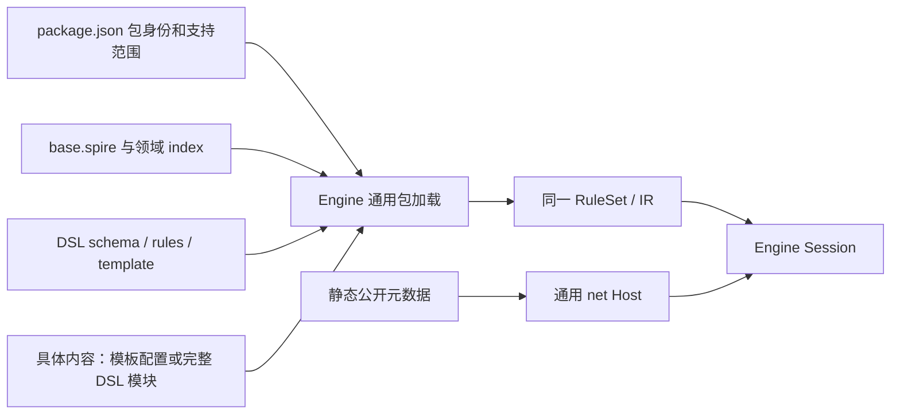

# base-spire 的 DSL 规则组织

文档类型：解释（Explanation）。base 是 Engine 执行的规则包，目录按游戏领域与具体内容组织。它没有 C# 工厂、效果解释器或独立执行后端。本文描述 `0.6.1-dsl.39` 的当前职责；后续结构变化见[内容与行为重构目标](content-behavior-refactor-goals.md)，修改内容见[开发手册](../../development/base-spire/README.md)。

Engine 负责类型、状态、事件、随机、编译与唯一 IR 执行。共享游戏机制和具体内容均由 DSL 描述。简单内容使用模板配置；复杂内容可在所属模块声明独有过程、监听和私有状态。卡牌、Power 和遗物各有领域目录；实体模型在 `schema.spire`，真正共享的过程与模板在 `rules/`，具名内容按来源组一项一文件。

`base.spire` 显式包含各领域索引并持有唯一启动顺序。同包片段先合并声明再绑定，保留文件定位；跨包库通过 imports 组合。catalog 的 definition 已允许完整 DSL 内容模块，根入口仍独占 start／imports／包版本等顶层配置。完整模块准入不表示可以绕过显式装配、同包命名空间、纯 JSON 或未引用文件检查。

静态 JSON 保存来源身份、池顺序、包信息和公开说明。`catalog.json` 中 `definition: null` 明确表示尚未迁移；完整源分母不会变成当前可执行目录。包加载拒绝执行型 JSON、未知字段、包外引用和未声明文件。

当前已有统一出牌、牌区、永久牌／战斗副本、Power 定义生命周期和实例修正等可复用 DSL。准确入口与限制见[当前控制流程](control-flow-modules.md)和[操作参考](../../development/base-spire/reference/operations.md)。部分卡牌主效果仍靠事件订阅组合，攻击缺独立生命周期，复制仍有公共专属字段；完整模块准入没有自动解决这些行为边界。

包 manifest 目前只开放开发 scope；显式 Ironclad 初态与开发战斗不代表包含 Neow、地图、事件往返和跨幕的正常 Run。旧 C# 与检查只在[迁移对照](../../../tools/base-migration-baseline/README.md)保存，生产与默认 Host 不回退。后续恢复与认领按[当前清单](../../review/tofix/README.md)执行。
