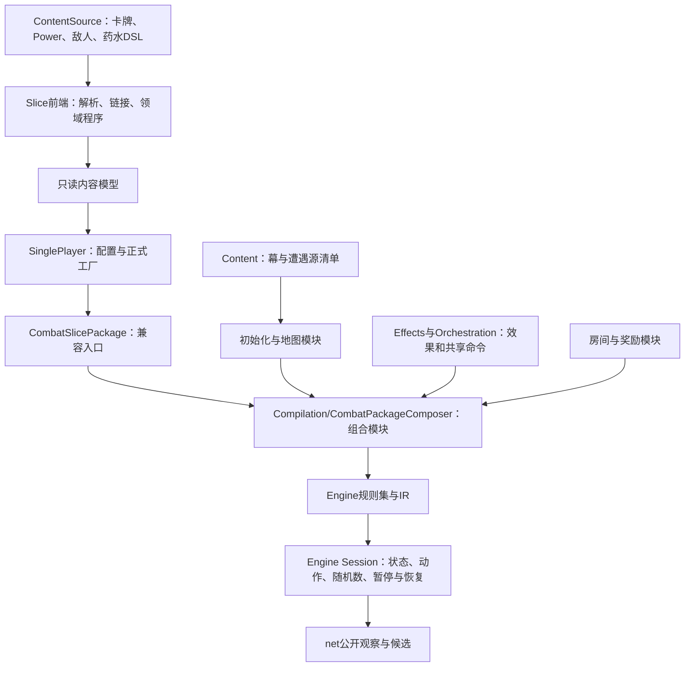

# base-spire 如何组织规则和整局流程

文档类型：解释（Explanation）。本页解释基于base-spire修改游戏时，各层负责什么、一次修改怎样到达运行时。目录实际名称是`mod-the-spire/base-spire`。

## 内容、编译与运行

base不是另一个游戏引擎。它把原版内容和流程编译成通用Engine规则，再由Engine Session执行。卡牌伤害、房间阶段、长期牌组和随机流的运行状态都存在Engine中。



图中前端、房间模块和组包器主要在构建规则时工作。它们生成读写状态的指令，不保存一份额外的C#游戏状态。`RoomCompileContext`和`CardPlayContext`也是编译期绑定；名称里的context不表示运行中的Session。

## 目录分工

以下路径相对`mod-the-spire/base-spire/`：

```text
BaseSpire/
  ContentSource/          .spire内容定义
  Content/                幕、遭遇、源顺序与池资格清单
  Slice/
    Spire*Source.cs        各内容域的解析和降级入口
    Effects/              类型化效果、数值表达式、校验与IR生成
    Orchestration/        付款、目标、出牌、牌区、历史和生命周期
    *RoomWiring.cs         地图、营火、宝箱等房间接线
    RewardWiring.cs        奖励、长期获得与奖励关闭
    RunInitializationWiring.cs  真实新Run库存初始化
    CombatSlicePackage.cs  保留公开Build签名，转交编译组装
    Compilation/          分组符号、伤害/能力/敌人/回合/Run编译与根组装
  SinglePlayer/           内容加载、配置、正式工厂、公开语义、构建描述
BaseSpire.Slice.Tests/    可按机制选择的行为检查
workpacks/                尚未正式集成的隔离工作包
```

`Slice`是历史名称；这里已经有正式整局生产代码，不应把它理解为仅供测试的切片。`workpacks`在正式项目源码目录之外，放进去的模块不会自动进入游戏。

`ContentSource`与`Content`也有不同用途：前者定义可以执行的行为，后者记录完整源池和资格。某个敌人身份出现在完整遭遇池中，不代表它的能力已经实现。规则运行到未支持身份时应明确报告，不能偷偷缩小随机池。

## 修改沿哪条链传播

一张使用已有效果的卡，经过`SpireCardSource`降级为类型化程序。`CardEffectCompiler`把程序编译为IR；出牌、费用、选目标及结果区由共享模块处理。卡作者只写内容，不复制这些流程。

新增共享机制时，才需要跨越内容前端、领域表示、校验、IR编译及状态绑定。比如新增需要读取战斗计数的效果，应先绑定该计数的生命周期，再让内容引用它。能解析新写法只是这条链的第一段。

房间则消费同一Run的长期资源。`MapRoomWiring`选择节点并进入房间，房间拥有访问状态、合法操作与资源提交，最后恢复旅行阶段。奖励关闭、房间关闭和整局终局各有自己的流程，不能互相替代。

正式整局从`BaseSpireRuntimeFactory`进入。它按`RunConfiguration`建规则，`CreateSession(seed)`只配置尚未启动的会话，`Start()`才执行开局。公开Host和严格对拍都消费这个工厂，不能各自重新造一套开局。

## 基于base新增东西需要触及哪里

| 修改目标 | 通常需要改动 | 验证入口 |
| --- | --- | --- |
| 调整数值、组合已有卡牌效果 | `ContentSource`中的目标文件 | [首次卡牌教程](first-base-card.md)，外部文件探针可先验证 |
| 使用已有行为的新Power | Power声明及引用它的内容 | [作者工具参考](../../../tools/base-spire-dev/README.md)，随后验证触发时序 |
| 新效果或Power机制 | 对应前端、`Effects`或`Orchestration`模块；必要状态绑定 | [base开发指南](base-development-guide.md#按修改类型定位文件) |
| 新房间或房间操作 | 目标房间叶、地图入口、根注册、公开语义；需要计算资产时再接后端 | [首次房间教程](first-base-room.md)、[正式接入指南](how-to-add-a-room.md) |
| 新Run配置、幕转换、终局 | `SinglePlayer`与相关初始化/地图/结算模块 | 主清单中的完整流程包及正常公开轨迹 |

独立命名空间卡牌工具能验证组合，但没有把外部文件自动安装进正式Run。正式base卡文件还要符合`SpireCardSource.CardResources()`的资源发现规则，卡池资格也要单独维护。具体步骤见[内容操作指南](modding-guide.md)。

## 组包器如何解耦

原来的`Build`把状态声明和多个领域的局部函数放在同一作用域。局部函数直接捕获玩家字段、牌区和程序句柄，参数表没有显示这些依赖；读取一个函数时，还要追溯外层声明和调用时机。这就是“集中在一个方法里”形成的负担。

`CombatSlicePackage.Build(...)`保留调用兼容性，转交[CombatPackageComposer](../../../mod-the-spire/base-spire/BaseSpire/Slice/Compilation/CombatPackageComposer.cs)。根组装只安排声明、程序体接线和动作注册；伤害、Power、敌人行动、换房和新Run的IR生成分别由`Compilation/`中的领域模块拥有。按修改目标查[编译模块参考](package-compilation-reference.md)，无需逐段检索一个巨型方法。

[CompilationBindings](../../../mod-the-spire/base-spire/BaseSpire/Slice/Compilation/CompilationBindings.cs)把玩家、敌人、卡牌、牌区、Run资源、遭遇池和房间服务等符号分别组成有类型的返回值。每个编译方法在参数表中列出所用分组和回调，没有一个包含全包变量的通用上下文。已有分组增加字段时，变化落在声明者、对应Bindings及实际消费者；初始化和重置由字段寿命决定。只有引入另一组依赖或改变模块顺序时才调整根组装。具体修改步骤见[新增共享状态字段](base-development-guide.md#新增共享状态字段)。

程序声明和程序体接线分开，是因为伤害、反击、格挡和回合触发会引用共同的程序句柄。根组装先取得句柄，再编译引用它的程序体，保留原有声明、IR和随机调用顺序。根方法末尾的短适配函数只向领域模块转发参数；具体规则在相应模块中。

这些分组保存编译期符号，`CompilationSlots`只为生成IR分配局部量名称。实际生命、金币、访问计数和随机状态仍在Engine里。卡牌和怪物按资源规则自动发现；地图房型通过`Rooms/MapRoomEntry`组合，事件通过`EventRoomCatalog`登记。普通事件继承`ChoiceEventModule`，提供自己的初始化、选项和领域效果；共享编译器生成动作守卫、关闭和死亡尾。源池选择和执行目录分开，未实现身份保持显式失败。

`Domain/Run`按状态领域提供RunResources、RunRelics、RunDeck。`RoomCompilation.RoomServices`创建同一组操作，奖励/宝箱/商店/营火/事件只接入所需能力：资源命令拥有金币/生命规则，遗物命令拥有创建/袋移除/获得效果，永久牌组命令拥有实例获得/移除。价格、抽取、选项资格与房间收尾仍由来源模块拥有，支持边界见[整局公共操作契约](run-domain/spec.md)。

卡牌前端将短写与完整组合编译为同一个类型化程序。选择/随机选择绑定当前牌，然后执行可组合的升级、复制、移动等子程序；它们复用牌区和定义模块。条件、循环和快照同样是组合节点，普通卡牌不新增按ID的执行分支。特殊源伤害预览等能力的边界见[原语契约](card-primitives/spec.md)，作者从[选牌指南](base-development-guide.md#用通用选牌编写卡牌)接手。

营火与宝箱使用的`RoomCompileContext`统一Run字段、长期牌组、访问守卫和关闭操作。[RoomCompilation.RoomServices](../../../mod-the-spire/base-spire/BaseSpire/Slice/Compilation/RoomCompilation.cs)创建这些编译服务，`RoomCompilation.Rooms`集中登记地图和房间叶；奖励声明和Boss奖励关闭回调在`RewardCompilation`。新增房型仍需协调地图进入和公开语义，具体步骤见[房间接入指南](how-to-add-a-room.md)。
