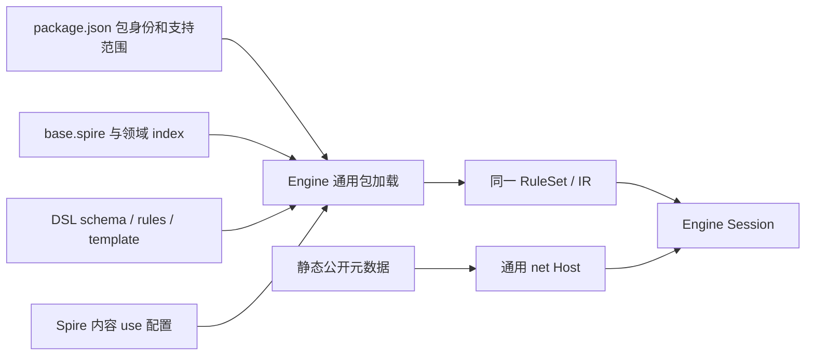

# base-spire 的 DSL 规则组织

文档类型：解释（Explanation）。base 是 Engine 执行的规则包，目录按游戏领域与具体内容组织。它没有 C# 工厂、效果解释器或独立执行后端。目录与接口的规范定义在[迁移设计](engine-dsl-migration/plan.md)，实际修改步骤见[开发指南](base-development-guide.md)。

Engine 负责类型、状态、事件、随机、编译与唯一 IR 执行；共享游戏机制由完整 DSL 描述，Spire 内容使用这些 DSL 模板的受限配置写法。卡牌、Power 和遗物分别拥有自己的领域目录；实体模型在 `schema.spire`，共享过程与模板在 `rules/`，具名内容位于来源组下的一项一文件中。

`base.spire` 显式包含各领域索引并持有唯一启动顺序。同包片段先合并声明再绑定，保留文件定位；跨包库通过 imports 组合。具体内容文件只允许 `use`，越出子集在加载时拒绝，共享规则可以使用完整 DSL。

静态 JSON 保存来源身份、池顺序、包信息和公开说明。`catalog.json` 中 `definition: null` 明确表示尚未迁移；完整源分母不会变成当前可执行目录。包加载拒绝执行型 JSON、未知字段、包外引用和未声明文件。

当前首链是开发牌堆的真实抽取／重洗、遗物获得／移除、AfterShuffle 事件与 TheAbacus 6 点无加成格挡。该开发 scope 不代表原版开局或完整游戏。旧 C# 与检查只在[迁移对照](../../../tools/base-migration-baseline/README.md)保存，生产依赖和默认 Host 均不回退。后续恢复按[当前清单](../../review/tofix/README.md)执行。
