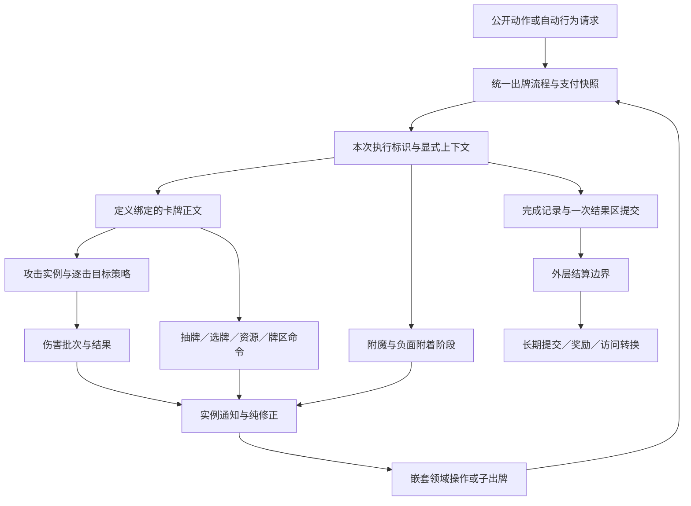

# base 内容与行为重构目标

本文供 base 规则维护者决定下一轮重构范围，并据此拆出可验证的机制包。2026-10-19，Codex `/root` 根据当前 DSL、锁定的 sts2-sim 与原版源码重新梳理。**本文保存目标设计与当时的代码基线观察。用户随后要求实施，当前接口与限制见[实施约定](content-behavior-migration.md)，目标本身不等于全部验收通过。** 排期、认领和暂停项仍只维护在[GitHub 任务清单](https://github.com/QingXiang22/auto-the-spire/issues/28)。

目标是让内容作者能够在所属模块中表达完整行为，通过稳定领域操作复用公共规则。一次出牌、一次攻击、一次命中和一次伤害结果各有明确标识与寿命；费用、选牌、牌区、复制、附着、Power、回合和 Run 按各自职责接入。新增内容不再依赖扩充中心字符串分支、公共专属字段或事件声明顺序来拼接自己的主效果。

## 依据与设计起点（2026-10-19）

本次读取基线为本仓库 `45c34c5`，base `0.6.1-dsl.39`、语言 `core/0.3`、执行语义 `engine/ir@0.6`。参考为[锁定清单](../../../reference/baselines/sts2-sim.json)中的 `2089659bd07920088b93226136c72b6b6ee590ad`，tree 为 `8eb770da4e87677c54799801488b71a8ccba687b`；已核对本地 HEAD、tree 与干净工作树，未更新参考。原版行为以本地 `sts2/` 对应方法为裁决依据。

当前已经具备完整 DSL 内容模块、定义驱动的 Power 施加与移除、内容私有实体、实例通知与 pure 修正监听、普通攻击数值的单一读取入口。**这些作为保留基础，不重新立项。** 正常 Run 与独立适配器仍未恢复，开发 scope 的行为检查不能证明完整原版一致性。

以下是目标文档形成时直接读代码得到的基线观察；已经实施的部分以迁移约定与验证记录为准，旧 review 的建议不作为当前缺陷的验证记录。

| 领域 | 基线实现与具体缺口 | 直接依据 |
| --- | --- | --- |
| 卡牌主效果 | 多个效果订阅 `CardPlayed` 或 `CardPlayedOnTarget`，分别按定义 ID 过滤；无目标效果整体先于目标效果。卡牌正文的顺序同时受事件阶段和订阅声明顺序影响 | [effects](../../../mod-the-spire/base-spire/cards/rules/effects.spire)、[IronWave](../../../mod-the-spire/base-spire/cards/ironclad/iron-wave.spire)、[Offering](../../../mod-the-spire/base-spire/cards/ironclad/offering.spire) |
| 出牌上下文 | 每次重复已有 `CardPlayRecord`，嵌套前后保存／恢复 `CurrentPlay` 和 `CurrentCard`；通知只传 owner／card，资源和结果区信息散落在 Card 字段及局部变量 | [play](../../../mod-the-spire/base-spire/cards/rules/play.spire)、[Card schema](../../../mod-the-spire/base-spire/cards/schema.spire) |
| 攻击 | 普通多段直接 repeat 伤害；`AttackAllEnemiesEffect` 按目标再按段数遍历，另一群攻模板按段数再按目标遍历。没有独立攻击实例与统一 Before／AfterAttack | [effects](../../../mod-the-spire/base-spire/cards/rules/effects.spire)、[ironclad-effects](../../../mod-the-spire/base-spire/cards/rules/ironclad-effects.spire) |
| 伤害 | 玩家、敌人、有加成、无加成路径分别结算；`PlayerHpLost` 仅携带 owner，`EnemyDied` 仅携带 target，不能提供来源和实际结果 | [damage](../../../mod-the-spire/base-spire/combat/damage.spire)、[enemy-turn](../../../mod-the-spire/base-spire/combat/enemy-turn.spire) |
| 自动打出 | `AutoplayTopEffect` 取一张立即打出，再取下一张；源 `AutoPlayFromDrawPile` 先收集并移入打出区，再执行整个批次 | [ironclad-effects](../../../mod-the-spire/base-spire/cards/rules/ironclad-effects.spire)、`sts2/src/Core/Commands/CardPileCmd.cs::AutoPlayFromDrawPile` |
| 费用与变量 | X 已区分捕获值和效果修正，但捕获值仍在 Card 上；费用有多个修改／复原字段，`CardBaseDamage` 仍枚举 DamageScale 字符串 | [operations](../../../mod-the-spire/base-spire/cards/rules/operations.spire)、[Card schema](../../../mod-the-spire/base-spire/cards/schema.spire) |
| 复制与私有状态 | Stomp 和回合末从消耗堆自动打出的开关仍在公共 Card；克隆与永久牌→战斗副本分别手抄字段，缺少附属能力的复制协议 | [operations](../../../mod-the-spire/base-spire/cards/rules/operations.spire)、[permanent-deck](../../../mod-the-spire/base-spire/cards/rules/permanent-deck.spire)、[旧 reactions 快照](https://github.com/QingXiang22/auto-the-spire/blob/54bf08a/mod-the-spire/base-spire/cards/rules/reactions.spire) |
| Power | 定义边界已建立，但实例按定义＋持有者查找；缺 applier／cardSource 和完整实例策略。Rupture 私有状态已归位，仍通过 EnemyPhase／CurrentPlay 判断来源 | [Power lifecycle](../../../mod-the-spire/base-spire/powers/rules/lifecycle.spire)、[Rupture](../../../mod-the-spire/base-spire/powers/shared/rupture-power.spire) |
| 资源与访问 | GainGold／Heal 主要是字段修改；房间与奖励状态混在 Player。营火和奖励仅为开发入口，没有正常地图／事件访问生命周期 | [resources](../../../mod-the-spire/base-spire/combat/resources.spire)、[Player schema](../../../mod-the-spire/base-spire/combat/schema.spire)、[rest-site](../../../mod-the-spire/base-spire/rooms/rest-site.spire)、[manifest](../../../mod-the-spire/base-spire/package.json) |
| 登记 | index、catalog、公开 content_ids 仍手工联动；原来源／池顺序与已执行执行结果需要分别维护 | [base 入口](../../../mod-the-spire/base-spire/base.spire)、[公开元数据](../../../mod-the-spire/base-spire/public/metadata.json) |

这次只做静态走查，没有把上述结构观察升级为运行时反例。具体行为修复须用本页验收场景先复现，再实施；源码存在、旧测试通过和实际独立比较分别记证。

## 总体职责

图表示职责依赖，不代替精确调用序：Before 通知、修正、正文、附着、完成通知及中断条件由对应约定规定。所有状态、集合、挂起点和续接仍属于同一 Engine Session；图中不引入第二个运行时、C# 玩法对象或客户端调度器。

| 标识 | 拥有的事实 | 生命周期与关联 |
| --- | --- | --- |
| 内容定义 | ID、变量、正文、资格和能力声明 | 随规则产物固定；不保存局内可变状态 |
| 卡牌／能力实例 | 升级、成长、费用修改、附着和私有计数 | 按永久、战斗、回合或持有寿命管理；同定义实例隔离 |
| 一次出牌序列 | 实际支付、原始 X、自动策略、目标及结果区快照 | 一次入口；包含多次执行，结果区通常提交一次 |
| 一次执行 | play index／count、来源序列、父执行、开始／完成事实 | 每次重复分别拥有；嵌套不会覆盖父上下文 |
| 一次攻击 | 攻击者、来源模型／卡、执行引用、伤害属性、目标策略及段数 | 可含零至多段命中；与某次卡牌执行是不同标识 |
| 一次命中与伤害结果 | 当前目标批次、各目标计算／格挡／失血／超杀／死亡事实 | 归属于本次攻击或直接伤害操作；不从最终 HP 倒推 |
| 一次访问 | 房间／事件标识、页面、奖励、子战斗和返回位置 | 归 Run；不借卡牌执行或战斗结束字段保存 |

这里给出的是概念模型，字段是否合并、过程名称及 DSL 表达方式在机制包设计时确定，不能把表中名称当作已经可调用的接口。

## 重构目标与完成判据

### G01：卡牌正文拥有自己的完整执行顺序

每个可执行定义绑定唯一正文入口。内容用普通 DSL 顺序调用领域操作，表达“格挡→攻击”“攻击→格挡”“失血→能量→抽牌”以及分支、循环和原生选择。正文可同时使用所选目标和其他上下文，不再为了获得 target 把一部分效果拆到另一事件。

共享模板可以生成正文；多个效果组合最终仍应成为定义内的一段有序行为。外部反应继续使用统一监听。用于通知其他内容“开始／结束出牌”的事件，不能兼任向所有内容广播并寻找正文的分派器。缺正文、重复正文及未知定义在执行前明确失败。

**完成判据**：在隔离包中交换同一牌的攻击与格挡顺序，实际结果随正文变化；无需改变公共 play 流程、通知优先级或其他内容。Offering 的失血、回能、抽牌及其监听中发生的暂停，仍按正文与领域命令各自的中断条件执行。

### G02：手动、自动、重复和嵌套共用一条出牌流程

保留现有统一出牌基础，补出牌序列与单次执行的显式上下文。至少能追到 owner、card、target、实际资源、原始 X、自动策略、结果区、play index／count 和父执行。Before／After 与领域操作收到本次执行引用；`CurrentPlay` 可作为受控兼容入口，但新内容不能靠它猜来源。

付款和结果区策略在源规定时点捕获；每次重复有独立开始／完成记录，不重复付款，也不能把同卡实例的旧执行当成本次。正文→附魔→负面附着→完成通知的顺序按源核对，每阶段区分玩家死亡、战斗正在结束和继续执行条件。

可打资格与目标资格由共享规则提供给真实提交、合法候选和预览。目标策略表达无目标、自身、指定敌人、全体与随机等实际需求；不再把 `Targeted` 布尔值当作完整 TargetType。手动选择、自动选择、目标失效和被禁止打出分别有明确结果，不能因自动路径绕过必要门禁。

自动打出明确免费、实际付费、已支付等已需要的策略，复用同一管线；不是“自动”就统一免除所有资源与资格。批量自动打出先按源规则固定／移出候选，再执行；每个嵌套批次有自己的成员和进度。暂停后恢复当前阶段，不重取批次、重付费或重放已完成通知。

**完成判据**：Cascade／Havoc 的第一张牌发生抽牌、重洗或嵌套自动出牌时，不改变父批次已经选好的后续成员；重复与嵌套 X 牌各自保留自己的捕获值；外层末杀后只在约定边界提交战斗结算。

### G03：攻击从伤害循环提升为完整领域操作

攻击拥有独立标识与 BeforeAttack／AfterAttack 边界，并在统一位置处理段数修正、逐击目标资格、随机目标抽取和结果归集。单体、全体、随机、多段及特殊直接伤害分组使用同一约定。段数与目标必须按源顺序嵌套，不能因模板不同变成“一个敌人打完所有段，再打下一个”。动态目标集合每击是否刷新、固定目标是否失效，分别由目标策略决定。

攻击者、来源卡、来源执行和伤害属性分开保存。攻击不等于“有加成伤害”：原版允许 Unpowered 的真正攻击，也有不构成攻击的直接伤害／失血。BeforeAttack 和 AfterAttack 的次数按攻击命令计，不按出牌或目标计。零段、攻击者死亡、无目标及提前结束后的收尾遵循源方法，不自行补一次攻击或随机抽取。

**完成判据**：Whirlwind 多目标多段只有一个攻击边界，逐击目标与结果顺序正确；Vigor 记录攻击开始时层数，攻击后只扣该快照；同一牌的两个攻击命令不能被合并成一次出牌反应。

### G04：伤害返回权威结果，死亡与结算有独立边界

伤害命令统一接收明确来源、属性、目标批次和上下文，返回每个受击者的实际结果。至少区分计算伤害、格挡、未阻挡伤害、超杀、破格挡、全阻挡和本次致死事实；请求值、实际失血与含超杀量不能互相替代。修正、阻止伤害、失血、反击、Fatal 和死亡消费者读取同一结果。

每次命中的目标处理分为“按目标执行修正及状态提交”和“按结果发布伤害后通知／统一死亡处理”；具体站点按原版 CreatureCmd 核对。不能在群体伤害刚打死第一个目标时，提前发全部死亡反应并改变其余目标的同批结算。普通伤害、不可阻挡失血、无加成伤害共享必要底层步骤，各自保留正确通知资格。

胜负、永久写回与奖励由外层动作／效果结算边界负责。HP 到零的事实、死亡防止、真正死亡和战斗结束分别建模；本轮不因此恢复已暂停的召唤／复活内容。

**完成判据**：Feed 的收益能关联实际致死结果；Rupture 能识别真正的来源，SelfFormingClay 能读取实际正失血；全阻挡、超杀、反击杀死攻击者、群体同时击杀各有明确结果，且查询不触发这些效果。

### G05：变量、预览、费用与支付各有单一事实来源

普通／升级的伤害、格挡、张数等按内容拥有的具名变量维护。动态值由内容提供纯计算入口，实际执行与预览／其他效果读取同一公式和同一修正链。读取上下文包含目标及必要来源；按目标计算的值不得强制降成一个全局 BaseDamage。移除公共 `CardBaseDamage` 对新 DamageScale 字符串的持续扩张。

明确区分声明值、当前计算值和按源时点捕获的快照。多段期间重新计算还是沿用开始值，由实际命令约定决定；“同一公式”不代表“永远同一时点求值”。保留原数值精度、乘法次序和取整位置，不以方便复用为由沿用未经校准的四位定点近似。

费用修改独立表达来源、操作、顺序和到期条件，覆盖回合内、直到打出及战斗内等真实需求；避免继续增加互相覆盖的 Bool 字段。候选、预览和支付共用只读费用解析。实际扣除资源、原始 X、效果 X 与临时费用清理分开，资源重置与额外获得继续保持不同语义。

**完成判据**：新增一种动态伤害不改公共字符串分派；改一个变量同时改变效果与读取结果；费用修改按源叠加与失效；连续观察不改变状态／随机／计数，不能用创建临时实体实现只读预览。

### G06：牌区与选牌是完整操作

抽牌、弃牌、消耗、移除、生成、移动、变换和获得分别有完整操作，不以裸集合增删互相替代。命令拥有原位置、插入位置、容量、有效性、来源和相关通知。抽牌统一处理阻止、容量、重洗及真实抽取通知；生成入手不能冒充抽牌，回合末弃牌不能冒充主动弃牌。

选择使用原生 decide，领域层声明候选、数量、顺序、空域与取消语义，随后调用对应操作。单候选是否自动选择依具体源策略，不建立普遍代选规则。批次按源确定快照，选择回调中新抽到的牌不混入已固定集合。暂停保存局部结果与进度，续接不重做已完成的移动／触发。

动态关键词由卡牌及附属能力查询得到，并由对应流程执行：Innate 参与起手，Retain 决定留手，Ethereal 决定相应回合末消耗，Exhaust／离场参与结果区，Unplayable 参与资格。回合末这些步骤的顺序、手动弃牌与回合末弃牌通知、弃后触发和空手检查各有唯一归属；不为每个关键词再创建第二份结束流程。

**完成判据**：FiendFire 消耗原手牌后，消耗反应抽到的新牌不被追加消耗，也不增加原段数；有序多选、取消、空域、满手和嵌套选择都能通过真实公开回答继续，失效回答不产生副作用。

### G07：实例能力拥有复制、升级、附着与清理协议

将 Stomp、回合末自动打出和后续附着的私有状态放回所属内容能力；公共 Card 只保留真正共享事实。建立明确的创建／初始化、升级、战斗克隆、永久牌→战斗副本、移除与销毁接缝，私有能力分别声明保留、重置及引用重映射。避免每新增能力就修改两份共享复制字段清单。

复制新实例、生成新定义和原位变换分开。永久来源、克隆来源、成长、临时费用和附着是否保留分别按源规定；不能用一个 `copyAll` 开关覆盖不同语义。附魔／负面附着各自持有标识、层数、资格和状态，接入 G02 的明确阶段及相同监听设施；升级和战斗内变化不得意外写回永久牌。

所有私有状态仍在 Engine 中可追踪，移除／换战后无悬空引用或残留监听。这里只规定状态所有权及生命周期，不把任意会话 fork／search 扩为本轮目标。

**完成判据**：新增一种有私有计数的卡牌能力无需扩公共 Card 与复制列表；Sown 的永久实例、两场战斗副本和战斗克隆分别保持源规定状态；同定义两张牌不串状态，升级后能力和查询一致。

### G08：补齐 Power 与其他能力的来源和实例策略

复用已实现的定义驱动生命周期，增补实际所需的 applier、来源 card／play、施加前后修正、被阻止结果及实例匹配策略。共享单例、每施加者实例和每次独立实例不能都按“定义＋持有者”合并；InstanceType、StackType、负值、零量及 duration 各自依据源规则，现有 SingleStack 标志不是完整策略。

Power、遗物、药水和附着均使用统一实例监听；公共命令不根据具体内容 ID 选择效果。私有状态响应创建／改量／移除，领域层承担一致的解绑与清理；Rupture 不再用 EnemyPhase 猜伤害来自卡牌，Vigor 不用 AfterCardPlayed 近似 AfterAttack。

**完成判据**：同持有者、不同 applier 的实例按定义策略正确合并／隔离；施加被阻止或结果为零时不遗留空实例；移除后私有状态清理，暂停续接不重复施加。

### G09：回合、资源、房间和 Run 消费稳定领域命令

战斗与回合流程明确拥有状态转换、手牌结束处理、持续状态衰减和历史清理；具体内容只订阅相应阶段。跨战保存的遗物计数与回合／战斗状态分开，不因一次重建牌组而统一清零。

金币、治疗、失血、最大生命、遗物获得／移除、永久牌获得／删除／升级、奖励提出／领取／关闭各自成为包含资格、修正、来源及通知的完整操作。选择、支付和获得不能被叶内容拆成几个裸字段写入；也不要求先建一套无实际消费者的通用 Creature 继承体系。

恢复正常 Run 时，访问拥有进入、选项、奖励、子战斗挂起／恢复、退出和跨幕的转换。普通事件只定义自身页面、资格与效果；调用完整领域命令请求转换，不直接修改地图或其他房间的 phase。Run 持久数据从 Player 的战斗临时字段中按拥有者分离，运行态仍在 Engine。Host 继续只转发公开动作／选择与观察。

**完成判据**：第二个使用已有操作的普通事件只改本文件、显式登记与自身执行结果；商店、奖励、事件共用获得／资源操作；事件战斗返回原页面，奖励关闭只推进一次。正常 Run 是否恢复仍按原 ENV 合同单独验收。

### G10：执行定义、来源池、公开投影与执行结果分工明确

保留显式 includes 的确定装配顺序与 catalog 的完整来源条目总数。执行定义产生可执行 ID／类型信息，构建工具可确定性派生公开目录并检查漂移；公开可见性／隐藏信息政策仍显式维护，不能从“已加载”推断“全部公开”。池成员、资格和源顺序独立，不由可执行定义集合替代。

执行结果从实际执行中登记标识，支持名单不再手抄到 C#；行为期望继续来自独立依据。普通新内容无需修改 Host／Engine 的按 ID 分派或多个硬编码支持列表。该改动应复用现有编译／包产物，先补通用元信息缺口的最小复现，不为减少几个登记文件引入运行时目录扫描。

**完成判据**：缺装配、重复定义、错误 catalog 映射、公开漏登及缺执行结果分别具名失败；新增定义不改变原池顺序或把未支持项变成支持；隐藏定义和私有状态不会因派生而公开。

## 借鉴范围与取舍

sts2-sim 在这里提供职责分工样本：`reference/sts2-sim/src/Sts2Sim.Core/Models/CardModel.cs` 的出牌总控、`reference/sts2-sim/src/Sts2Sim.Core/Commands/Builders/AttackCommand.cs` 的攻击边界、`reference/sts2-sim/src/Sts2Sim.Core/Commands/CreatureCmd.cs` 的结果批次、`reference/sts2-sim/src/Sts2Sim.Core/Commands/AutoPlayCmd.cs` 的自动路径、`reference/sts2-sim/src/Sts2Sim.Core/Commands/PowerCmd.cs` 的领域生命周期、`reference/sts2-sim/src/Sts2Sim.Core/Commands/CardCmd.cs` 的实例操作、`reference/sts2-sim/src/Sts2Sim.Core/Models/EventModel.cs` 的页面状态、`reference/sts2-sim/src/Sts2Sim.Core/Content/ContentRegistry.cs` 的单一执行定义来源。

这些职责用 DSL 的类型、过程、局部变量、事件、实例订阅和 decide 表达。过程／类型参数、定义正文绑定或只读定义确实超出现有语言时，先给最小语言复现，按 core 维护边界决定通用支持；不能在方案中把尚不支持的 callback 配置写成可运行语法。当前 [PowerLibrary](../../../mod-the-spire/base-spire/powers/schema.spire) 由初始化构造的隐藏实体实现定义索引，仍需检查未来只读保证，不能因此宣称已有不可变定义设施。

| 可选做法 | 本轮判断与原因 |
| --- | --- |
| 每出现新特例继续扩万能模板、布尔字段与 kind／scale 分支 | 不采用为长期方向；修改面随内容增长，无法隔离私有行为 |
| 只拆文件而保留所有中心字段、广播主效果与多套循环 | 不足以完成目标；验收要看真实行为归属及修改面 |
| 恢复 C# 内容对象、async 玩法与第二份 RunState | 不采用；违反纯 DSL 与单一 Engine 状态边界 |
| 把攻击／Power 执行器加入 core | 不采用；游戏领域留在 base，core 只处理有实际复现的通用语言缺口 |
| 一次设计全量插件、全 Creature 框架和所有未来 hook | 不采用；按当前消费者证明接缝，防止先付出整套抽象成本 |
| 直接复制参考判断 | 不采用；结构可以借鉴，具体行为仍从原版裁决 |

本次已经发现不能直接复制参考的实例：锁定 sim 的 PenNib 按 CardPlay 引用判断翻倍，而本地原版使用 AttackToDouble 卡引用并有预览分支；Vigor 的源规则检查来源模型／卡，参考的加法修正未保留对应来源卡检查。重构须保留足够标识表达源规则，不能为了引入 play 标识就擅自把所有基于卡引用的资格改成 play 引用相等。

关键原版定位如下；这些文件只在本地恢复工程中查阅，不随本文分发源码。表内方法用于确定开发场景的源时序，不能用参考模型的简化实现覆盖它们。

| 目标 | 原版直接定位（sts2/src/Core 下） |
| --- | --- |
| G01、G02：正文、重复与附着 | `Models/CardModel.cs::OnPlayWrapper`、`GeneratePlayCount` |
| G03：攻击与逐击目标 | `Commands/Builders/AttackCommand.cs::Execute`、`TargetingAllOpponents`、`TargetingRandomOpponents`；`Commands/Builders/AttackContext.cs` |
| G04：伤害结果与死亡批次 | `Commands/CreatureCmd.cs::Damage`、`Kill`；`Entities/Creatures/DamageResult.cs` |
| G02、G06：自动批次 | `Commands/CardPileCmd.cs::AutoPlayFromDrawPile`；`Models/Cards/Cascade.cs::OnPlay` |
| G03、G05：多段与 X | `Models/Cards/Whirlwind.cs::OnPlay` |
| G03、G08：资格和消耗 | `Models/Powers/VigorPower.cs::BeforeAttack`、`ModifyDamageAdditive`、`AfterAttack`；`Models/Relics/PenNib.cs::BeforeCardPlayed`、`ModifyDamageMultiplicative`、`AfterCardPlayed` |
| G08：Power 实例与来源 | `Commands/PowerCmd.cs::Apply`、`ModifyAmount` 及其实例查找路径 |

精确的 hook 相位、优先级、数值规则及引用比较语义在所属约定维护。本文不复制一套完整 Hook 表；已有[统一监听约定](effect-listeners.md)继续适用，新增阶段和来源载荷在对应机制包中补齐。

## 迁移顺序与边界

下面是依赖顺序建议，不是新的任务认领或当前排期。采用一个共享机制加真实消费者的完整开发场景，先记录现有行为和源差异，再迁调用方；暂未支持范围继续显式失败，不保留双执行后端。

| 开发场景 | 对应目标与消费者 | 可以结束的验证记录 |
| --- | --- | --- |
| 1. 出牌上下文与正文 | G01、G02；Strike、IronWave、Offering，再接一个原生选牌消费者 | 正文只有一个绑定；目标／支付／重复／嵌套／死亡／暂停可区分，公共通知不再承担正文组合 |
| 2. 攻击与伤害 | G03、G04；Whirlwind、FiendFire、一个敌方攻击；再接 PenNib 与 Akabeko／Vigor | 卡／执行／攻击／命中／结果标识独立；群体次序和来源可核对，私有状态不扩共享 schema |
| 3. 非攻击卡牌基础 | G05、G06；BodySlam 动态值、ChemicalX、Cascade／Havoc 与消耗选择 | 纯值、费用快照、批次固定和选择续接成立；已有 X 与随机流回归不倒退 |
| 4. 实例能力与附着 | G07、G08；Stomp、回合末自动能力、Rupture，再接 Sown | 复制／升级／入战／移除协议成立，源策略与未知范围明确；不恢复其他角色批量补卡或暂停机制 |
| 5. 正常来源与访问 | G09；至少两个事件及商店／奖励消费者，接回原 M01 路径 | 共享获得与提交操作实际复用，正常公开往返和独立比较逐项恢复，开发动作不冒充正常 Run |
| 配套登记 | G10 随以上开发场景处理真实重复名单 | 装配、公开政策、来源、执行执行结果分工成立；不在玩法尚未确定前先造独立代码生成框架 |

若当前遗物包只需要开发场景 2 的一部分，应先确定其最小 G02 上下文依赖，而不是先重写全部卡牌。反之，没有攻击边界不能把 Vigor 临时挂在出牌结束后并宣称已完成。完整 Creature、多人、召唤／复活、训练、fork／search 和性能优化的原触发条件保持。

兼容迁移需同时检查规则产物标识、公开构建标识、元数据和旧回放。行为或状态结构改变时生成新标识，旧输入按现有版本检查拒绝，不能修改固定期望掩盖行为差异。正常 scope 仍在 manifest 的明确支持边界内；新增概念模型不自动开放原五个正常游戏 scope。

## 验收场景

这些是实施的判别要求，**目标文档阶段没有运行**；已运行范围查。优先复用能区分该错误的现有用例，缺判别才补；不为每张同数值模板牌复制整套测试。

| ID／目标 | 初态与刺激 | 应观察到的结果与禁止结果 |
| --- | --- | --- |
| A01／G01 | 隔离内容正文分别声明格挡→攻击与攻击→格挡，使用能区分顺序的受击反应 | 事件轨迹和实际状态遵循正文；公共事件优先级及其他内容不变 |
| A02／G02 | 手动重复出牌，在某次效果中触发嵌套自动牌与选择暂停 | 仅一次付款，每次执行独立开始／完成；回答后继续原阶段，父上下文恢复，无重复扣费／通知 |
| A03／G03 | 一个两段全体攻击，对两个带不同受击反应的敌人 | 顺序是第一击的本批目标，再第二击；只有一对攻击边界，结果按 hit／target 可追踪 |
| A04／G03、G08 | 有 Vigor 的多段攻击，攻击过程中新增层数并触发其他来源伤害 | 本攻击结束只消耗开始快照；新增层数保留，来源资格按源执行，不用整张牌结束代替攻击结束 |
| A05／G02、G03 | PenNib 第十次攻击牌，包含多段、重复与嵌套；另作纯预览 | 计数／翻倍／清理按源引用及阶段；不能仅用“当前牌类型”或只比较 play 引用决定全部资格，预览无副作用 |
| A06／G04 | 全阻挡、超杀、不可阻挡失血及带非卡来源的伤害 | 结果区分格挡、实际失血与超杀；Rupture／Clay 等只在自身资格下触发 |
| A07／G04 | 一击杀死多个目标，死亡反应影响存活者；另让反击杀死攻击者 | 同批结果通知、死亡处理和剩余攻击的顺序与源一致；无过早胜利或重复奖励 |
| A08／G04、G09 | Feed 末杀，后续效果涉及永久增长，外层效果仍未退出 | 致死归属明确、增长及出牌收尾按源完成，永久写回和结算恰好一次 |
| A09／G05 | 改一处伤害变量；再新增按目标计算的动态值 | 实际效果及公开读取使用同一来源；目标不同可得到不同值，不改公共 DamageScale 分支 |
| A10／G02、G05 | X 牌付费后触发 ChemicalX、重复和嵌套 X 牌 | 父子捕获独立，原始 X 与效果 X 分开；观察／候选不消费随机或层数 |
| A11／G02、G06 | Cascade 预取批次的第一张改变抽牌堆／重洗／嵌套打出 | 父批次成员固定，顺序与随机消费匹配源；不会重新从变化后的牌堆补选 |
| A12／G06 | FiendFire 消耗手牌，消耗监听抽入新牌；其中一步暂停 | 只处理原快照，原段数不增，新牌保留；续接不重复消耗或触发 |
| A13／G05、G06 | 多个临时费用修改叠加；选牌取消／空域／失效回答；带 Retain／Ethereal 的回合末手牌 | 费用按来源和寿命解析与清理；关键词与弃牌通知按源顺序，空手检查不重复；取消按操作合同处理，非法回答无游戏状态／随机副作用 |
| A14／G07 | 同定义两张牌，一张有成长／Sown／临时费用，执行升级、克隆和两场战斗 | 私有状态隔离、引用重映射、永久与战斗状态按各自策略保留；不扩公共专属字段与手抄复制清单 |
| A15／G08 | 同目标不同施加者、独立实例策略、被阻止施加及移除时暂停 | 实例按定义匹配；零结果无残留，移除清理一次，未知定义在施加前失败 |
| A16／G09 | 普通事件选择获得资源与卡牌，再进入子战斗、领奖并返回 | 使用同一领域操作；返回正确访问／页面，不重复支付、获得或关闭，不由 Host 修补 phase |
| A17／G10 | 新定义分别漏 index／公开登记／执行结果，或与来源映射冲突 | 检查指出具体缺失；来源条目总数及池顺序不变，未执行不记通过，私有数据不泄漏 |

每个开发场景报告实际 DSL 加载与运行、来源／参考标识、固定 scope／seed、选中的回归、首差及公开观测。独立比较未恢复时维持未验证，不用本地自洽替代；原 17 regression 的 ID、输入和失败合同继续保留。

## 目标文档阶段的交付（2026-10-19）

目标文档阶段形成跨内容的重构目标，清理 review 的当前入口与过时交接位置，并修正仍将内容限制为 use-only、或将旧 C# 模块当现行架构的入口页。该阶段未修改生产代码；后续用户授权的实现见[迁移约定](content-behavior-migration.md)。

进入新的机制开发场景前，在主清单登记具体开发场景、修改边界、直接源码方法、接口／状态顺序与最小判别，解决该开发场景实际暴露的语言缺口。本文不等待“是否需要全面重构”的泛泛批准，也不把目标设计当成已批准的完整 API。
