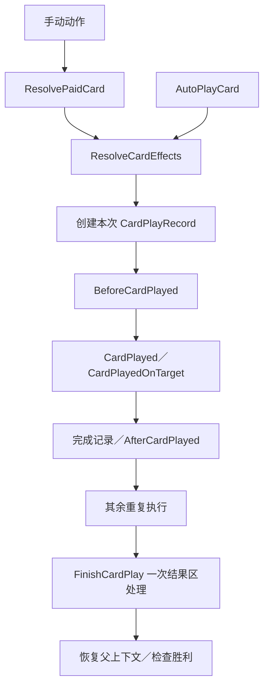

# 当前 base 控制流程与模块

文档类型：解释（Explanation）。本页按纯 DSL base `0.6.1-dsl.39` 描述现行职责，帮助维护者定位一个行为由谁承担。后续改造以[内容与行为重构目标](content-behavior-refactor-goals.md)为准，准确参数查[共享操作参考](../../development/base-spire/reference/operations.md)。旧 C# CardPlayPipeline 等模块已退出生产，不是本页的当前接口。

## 当前调用链

这是现行开发流程的简化图，不是完整原版时序承诺。当前正文由效果订阅响应两个事件，攻击由具体效果直接调用伤害；它尚不具备重构目标中的正文唯一绑定、独立攻击实例与完整伤害结果。玩家死亡会跳过相应后续阶段，具体条件以当前 DSL 为准。

## 职责与入口

| 行为 | 当前主位置 | 已有分工与边界 |
| --- | --- | --- |
| 支付、手动／自动打出、重复与结果区 | [cards/rules/play.spire](../../../mod-the-spire/base-spire/cards/rules/play.spire) | 手动与自动进入 ResolveCardEffects；保存／恢复 CurrentPlay 和 CurrentCard，PlayDepth 延后胜利检查 |
| 定义变量、升级和独有正文／监听 | [cards/rules/card-definition.spire](../../../mod-the-spire/base-spire/cards/rules/card-definition.spire)、所属卡牌文件 | 普通伤害已统一读 CardBaseDamage；部分独有模板在卡牌文件，通用模板仍通过事件拼正文 |
| 抽牌、重洗及通知 | [cards/rules/draw.spire](../../../mod-the-spire/base-spire/cards/rules/draw.spire) | DrawCards 逐张走 DrawOne，复用容量、阻止与 ReshuffleDiscard；生成入手不是抽牌 |
| 选择、消耗、克隆和动态伤害 | [cards/rules/operations.spire](../../../mod-the-spire/base-spire/cards/rules/operations.spire) | 使用原生 decide；仍有 DamageScale 分派、私有字段和手工复制列表，需要按目标拆归属 |
| 永久获得与战斗副本 | [cards/rules/permanent-deck.spire](../../../mod-the-spire/base-spire/cards/rules/permanent-deck.spire) | RunDeck 与战斗卡分离，PermanentSource 指向来源；当前获得入口是开发范围，完整来源修正未恢复 |
| 批量自动打出 | [cards/rules/ironclad-effects.spire](../../../mod-the-spire/base-spire/cards/rules/ironclad-effects.spire) | 当前 AutoplayTopEffect 逐张取出并立即执行；不能当作源“先收集整个批次”的实现 |
| 伤害与敌方行动 | [combat/damage.spire](../../../mod-the-spire/base-spire/combat/damage.spire)、[combat/enemy-turn.spire](../../../mod-the-spire/base-spire/combat/enemy-turn.spire) | 分别处理敌我与属性修正；没有完整 AttackCommand 和 DamageResult 对等能力 |
| 回合、历史及战斗结束 | [combat/lifecycle.spire](../../../mod-the-spire/base-spire/combat/lifecycle.spire) | 开发状态门控和阶段通知；正常 Run 结算未迁移，不由卡牌叶定义整局胜利 |
| Power 定义与实例生命周期 | [powers/rules](../../../mod-the-spire/base-spire/powers/rules/lifecycle.spire)、所属 Power 模块 | 定义驱动施加／改量／移除，私有状态随 Power 清理；完整来源／实例策略仍缺 |
| 遗物和 Power 的通知／修正 | [统一监听契约](effect-listeners.md) | instances 筛选、instance_order、失效复核与 pure 折叠共用设施；主流程不恢复具体内容分支 |
| 营火和奖励 | [rooms/rest-site.spire](../../../mod-the-spire/base-spire/rooms/rest-site.spire)、[rewards/index.spire](../../../mod-the-spire/base-spire/rewards/index.spire) | 独立开发访问操作，复用资源与永久牌操作；不等于正常地图／事件／跨幕链已经存在 |

私有状态必须属于 Engine 实体；局部变量与 decide 由同一执行栈保存、暂停和恢复。Host 只负责协议、加载和公开投影，不编排另一份卡牌／房间运行链。

## 维护者如何判断修改范围

使用已有操作的内容，优先修改其主文件与必要登记。需要新攻击边界、伤害来源、复制策略或访问阶段时，先进入[重构目标](content-behavior-refactor-goals.md)对应目标，再补该领域契约与一个真实消费者。拆文件、增加模板或通过开发检查都不能代替源行为校准；完整环境与独立对拍状态只看[主清单](../../review/tofix/README.md)。
