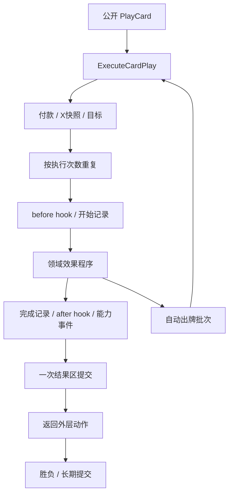

# Base 共享控制流程与职责边界

文档类型：解释（Explanation）。本页解释 base 如何借鉴本地 sim 的命令、出牌和生命周期分工。生产由 `CombatSlicePackage` 进入 `Compilation/CombatPackageComposer` 接入，[Orchestration 模块](../../../mod-the-spire/base-spire/BaseSpire/Slice/Orchestration/CardPlayPipeline.cs)生成冻结 Engine IR，Session 执行它。任务状态只在[主清单](../../review/tofix/README.md#env-t06)，实现范围由[规格](base-orchestration/spec.md)定义，验证证据见[实施复核](../../review/records/2026-10-10/base-orchestration-2026-10-10.md)。

## 借鉴的分工

移动选牌由[CardSelectionProcedures](../../../mod-the-spire/base-spire/BaseSpire/Slice/Orchestration/CardSelectionProcedures.cs)独立拥有候选、数量和暂停/恢复IR；实际移动、消耗事件仍复用牌区命令。它不拥有付款、出牌结果或终局。作者例子在独立的[选牌卡源](../../../mod-the-spire/base-spire/BaseSpire/ContentSource/selection-cards.spire)，新卡组合无需增加AuthorStep字符串或net逐卡处理。

| sim 落点 | base 的实现职责 |
| --- | --- |
| [CombatEngine](../../../reference/sts2-sim/src/Sts2Sim.Core/Combat/CombatEngine.cs) | 玩家动作最外层拥有战斗结束及长期提交；嵌套出牌不会提前终局 |
| [CardModel](../../../reference/sts2-sim/src/Sts2Sim.Core/Models/CardModel.cs) | `CardPlayPipeline` 安排付款、目标、执行次数、before/start/body/finish/after与结果区 |
| [AutoPlayCmd](../../../reference/sts2-sim/src/Sts2Sim.Core/Commands/AutoPlayCmd.cs) | `AutoPlayProcedures` 先收集一批牌，再调用同一个 `ExecuteCardPlay` |
| [CardPileCmd](../../../reference/sts2-sim/src/Sts2Sim.Core/Commands/CardPileCmd.cs) / [CardCmd](../../../reference/sts2-sim/src/Sts2Sim.Core/Commands/CardCmd.cs) | 牌区命令统一处理抽牌、重洗、消耗、克隆、真实替代和生成 |
| [PlayerCombatState](../../../reference/sts2-sim/src/Sts2Sim.Core/Entities/Players/PlayerCombatState.cs) | Engine事件实体记录每次执行，生命周期模块清理回合历史与战斗计数 |
| [RunEngine](../../../reference/sts2-sim/src/Sts2Sim.Core/Runs/RunEngine.cs) | Run/地图/房间/奖励继续由独立接入拥有，不交给卡牌效果 |

这里借鉴职责和时序，不引用 sim 的运行时、async 调度器或可变战斗对象。规则依据由同版本 `sts2/` 源码裁决；参考侧保持独立，顺序随机模式、有意偏离及完整原版对拍仍需对应证据。

## 实际模块

这些模块只持编译期符号、源定义及生成 IR 的函数，不持 Session 或隐藏的 C# 游戏状态。

| 模块（`BaseSpire/Slice/Orchestration/`） | 唯一职责 | 不承担 |
| --- | --- | --- |
| `CardSchema` / `CardDefinitions` | 实例字段、定义初始化、升级、长期副本与克隆策略 | 出牌调度、奖励选择 |
| `CardPileProcedures` | 移动/消耗、克隆、创建变形替代实例及保留索引 | 费用、终局 |
| `CardDrawProcedures` | 单张抽牌、重洗、容量、阻止抽牌、继续条件 | 每张卡效果 |
| `CardGenerationRules` | 从显式完整池取定义、生成实例、升级/临时免费、满手转弃牌 | 自动缩减角色池 |
| `CardPlayContext` | 一次执行的卡、owner、策略和局部槽位 | 全局Run、可变运行态 |
| `CardPaymentRules` | 可支付查询、已付X快照、付款、一次性牌规则 | 效果或牌区 |
| `CardEffectDispatcher` | 定义/变体分派、正式目标策略、调用领域程序编译器 | 付款/出牌记录/结算 |
| `CardLegacyValues` | `.author` 的 Amount/grow 兼容 | 正式逐效果程序 |
| `CardResultRules` | 全部效果之后选择弃牌/消耗，调用共享牌区命令 | 提前判胜利 |
| `CardPlayPipeline` | 同一牌的一次付款/目标、多次效果执行、一次结果提交 | 每张卡专用实现 |
| `AutoPlayProcedures` | 抽牌堆顶部批次、嵌套批次隔离、免费出牌/强制消耗 | 第二份出牌链 |
| `CardPlayHistory` / `CardEventDispatch` | 开始/完成事件、具名hook分派 | 借牌区冒充历史 |
| `CombatLifecycle` | 回合历史/摘要清理，换房销毁战斗牌及重置掉血计数 | 清理长期牌组 |
| `PowerRuleRuntime` | 已注册机制的生命周期编译与Engine内计数 | 每张卡或Power内容ID白名单 |

房间在 `Slice/` 的 `MapRoomWiring`、`RestSiteWiring`、`TreasureRoomWiring`、`RewardWiring` 中编排。地图选择进入真实房型；营火复用升级契约；宝箱在Engine集合中管理源共享随机袋、独立稀有度与金币抽取及持有实例；奖励模块决定普通/Boss奖励参数并关闭奖励。Boss奖励关闭只写幕完成，整局胜利仍由整局终局规则决定。无需为卡牌作者加载这些房间模块。

营火和宝箱通过[RoomCompileContext](../../../mod-the-spire/base-spire/BaseSpire/Slice/RoomCompileContext.cs)消费同一Run/长期符号，并共用访问守卫和关闭指令。它不持游戏状态；地图进入、奖励及Boss幕完成回调仍各有主责。扩展路径见[房间操作指南](how-to-add-a-room.md)和[准确接口](room-compile-reference.md)。

### 重洗的源预排序（`StableShuffle`）

源 `CardPileCmd.Shuffle`（`sts2/src/Core/Commands/CardPileCmd.cs:864-876`）在洗牌前先 `combined.StableShuffle(...)`：[ListExtensions](../../../sts2/src/Core/Extensions/ListExtensions.cs) 把合并后的牌堆**先按 `CardModel.CompareTo` 排序**（`ModelId.Entry` 序数，再 `CurrentUpgradeLevel`），再做降序 Fisher–Yates。[CardDrawProcedures](../../../mod-the-spire/base-spire/BaseSpire/Slice/Orchestration/CardDrawProcedures.cs) 的 `Reshuffle` 是普通抽牌与效果抽牌共用的唯一重洗入口，按同一顺序执行：清已知位置 → 弃牌堆逐张并入抽牌堆 → 源预排序 → 一次 `ShuffleCollection`（流条数不变）。

- 排序键是卡实例上的**隐藏编译辅助元数据** `SourceOrderKey`（`ENTRY@升级等级`）。Entry 由**声明名**按 `StringHelper.Slugify` 还原，不是内容 id 的逆向转写（两者不恒等）；`CardDefinitions` 的 `Fields`/`New`/`Copy`/`Upgrade` 是写出它的唯一入口，新增创建、复制或升级路径必须一并写出，否则重洗读空值直接失败。
- 排序由纯计算资产 `SourceStableShuffleOrder`（[SourceStableShuffle](../../../mod-the-spire/base-spire/BaseSpire/Slice/SourceStableShuffle.cs)）给出：对下标数组用源比较器调用 `List<T>.Sort(...)`，因此 ≥16 张同键实例的并列次序与源的内省排序逐位一致（稳定排序在实测的重复实例输入里约 3/4 与其不同）。IR 每一步只取"目标顺序第 k 张当前的下标"并把该牌移到末尾，不新增运行态、不消耗随机数。
- 后端按 `asset.Entry` 分派：受控切片与对拍使用 `SourceWeightedPickBackend`，`BaseSpireComputeBackend` 的 default 分支逐字转发到它，两条会话路径因此一致。
- 局部检查：`BaseSpire.Slice.Tests --reshuffle-only`（键口径、源置换、创建/复制/升级路径、10 张 ENV-T04 case 与 17 张同键的端到端牌序）。卡类型新增隐藏字段、`DrawCards` 多了计算与移动指令，规则身份与公开构建身份随之变化，需要统一迁移基线。

`Effects/EffectCompileScope` 管词法计数和当前牌绑定。进入内层块创建子环境，离开后恢复外层；分支不会改变兄弟环境。`CardEffectExpressions` 在每个使用位置读取活状态，`CardEffectCompiler` 只编译效果。

## 共用出牌时序

`ExecuteCardPlay(Card, SourcePile, Auto, ForceExhaust, Executions)` 是 base 的内部过程。来源枚举来自 `CardEffectPile`（Hand/Draw/Discard/Exhaust/InPlay），费用与目标捕获一次。每次效果执行产生独立事件，重复同一个实体也能计数；结果区只移动一次。内部过程不是宿主可提交动作，签名变化需 base 构建身份迁移。旧 `.author` 的目标步骤由兼容适配器保留，正式领域程序在重复开始前共用目标。

公开 `PlayedThisTurn` 保留唯一牌实例及首次出现顺序，目标决策挂起时仍可见本次开始打出的牌。规则的 finished 查询读取 `CardPlayHistory` 的完成事件，不再排除当前实例的全部旧执行。内部历史种类不进入公开投影；若将来公开完整执行历史，应另做公开契约，不能把唯一牌集合宣称为完整事件流。

本回合打过的牌在重洗后仍获身份授权，避免公开历史引用指向观察中不存在的实体。授权不公开抽牌位置，回合和战斗生命周期负责撤销。普通可见成员与授权可见成员取并集；同一实例不能重复计入牌堆。

自动出牌先把所有选中牌移入在场区，再按顺序执行。批次身份和待执行项在 Engine 实体里，嵌套调用不共享 C# 队列。子牌付款策略是免费，X读取进入子牌时可用能量；父牌X在付款时已保存。末杀后，父余效、hook和结果区仍执行；剩余批次项不再执行牌体，并完成结果区清理。外层动作最后才提交胜负。

## 局部扩展为什么可行

Pillage 只声明攻击后 `drawUntil`；Havoc/Cascade 只声明 `autoPlay`。作者不实现重洗、容量、随机目标、费用、历史或收尾。PrimalForce 复用变形命令，定义不再改写旧实例。扩展已有原语时可只改 `.spire` 和行为案例；新增共享能力才涉及对应领域节点、编译分支、命令模块和一处能力绑定。

公共规则包构建已按[编译模块参考](package-compilation-reference.md)拆开；根入口安排顺序，敌人、能力、房间和奖励各由显式依赖模块编译。未迁移的选择叶走显式兼容接口。完整角色生成池与其他原版能力也未因此完成。明确接口能减少需要理解的关系，但不能把文件拆分或检查通过直接换算成 token/训练吞吐改善；同任务上下文和性能实测见阶段证据。

按职责定位和运行检查见[base开发指南](base-development-guide.md)。在规则上写内容见[modding指南](modding-guide.md)，通用设计方法见[可维护规则集指南](maintainable-rule-sets.md)。
