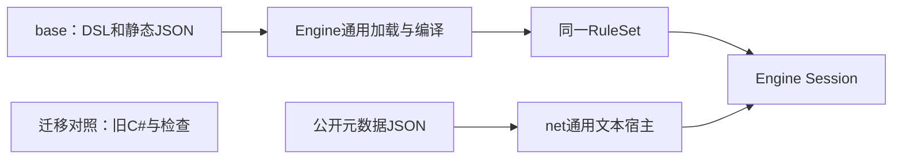

# 目录与迁移设计

关联[规格](spec.md)。本设计回应DB-R01～R13；实现顺序及验证见[任务](tasks.md)。本文定义长期目标目录，尚未迁移的规则文件不建立空占位；设计前工作区事实见[纠偏记录](../../../review/records/2026-10-18/base-dsl-migration-checkpoint-2026-10-18.md)，首批实现证据见[交付记录](../../../review/records/2026-10-18/base-dsl-native-cutover-2026-10-18.md)。

## 目录决策

根目录为`mod-the-spire/base-spire/`。包内仅保留`.spire`和`.json`；面向人的说明在本文和项目文档入口，C#检查与工具在包外。目录采用小写英文和连字符。内容文件名以现有稳定ID的短名为准，目录和文件重命名不改内容ID。

```text
base-spire/
  package.json                   包身份、根入口、能力范围和数据文件引用
  base.spire                     唯一默认DSL装配入口
  shared/                        跨领域的最小公共类型／查询；不汇集全部玩法
  combat/
    index.spire                  战斗域装配
    schema.spire                 战斗状态和事件
    block.spire                  格挡规则
    damage.spire                 伤害规则
    turns.spire                  回合流程
  cards/
    index.spire
    schema.spire
    rules/                      出牌、抽牌、选择、牌区与附着等共享规则
    ironclad/<card-id>.spire
    silent/<card-id>.spire
    regent/<card-id>.spire
    necrobinder/<card-id>.spire
    defect/<card-id>.spire
    colorless/<card-id>.spire
    status/<card-id>.spire
    curse/<card-id>.spire
    generated/<card-id>.spire
  powers/
    index.spire
    schema.spire
    rules/                      施加、叠加、衰减、移除与通用触发
    shared/<power-id>.spire
    ironclad/<power-id>.spire    其他角色同类目录按实际内容建立
  relics/
    index.spire
    schema.spire
    rules/                      实例生命周期及共享触发模板
    shared/the-abacus.spire
    ironclad/<relic-id>.spire
    catalog.json                完整源身份和资格依据，不存可执行效果
  potions/
    index.spire
    rules/
    <potion-id>.spire
    pool.json
  enemies/
    index.spire
    rules/
    shared/<enemy-id>.spire
    act-1/<enemy-id>.spire       后续幕同类目录
  encounters/<act-id>.json      源阵容与顺序，行为由敌人DSL定义
  rooms/
    index.spire
    battle.spire
    shop.spire
    rest-site.spire
    treasure.spire
    unknown.spire
  events/
    index.spire
    rules/                      访问、选项、结束和战斗挂起等共享能力
    shared/<event-id>.spire
    act-1/<event-id>.spire
  maps/                         地图模型与生成DSL；静态拓扑／池可用JSON
  rewards/                      生成、选择、领取与关闭DSL
  characters/<character-id>.spire
  run/                          开局、切幕、胜负及永久提交DSL
  public/
    projection.spire           公开投影与规则可表达的观察政策
    metadata.json              复用net现有通用文本提供方元数据格式
```

这是一张长期归属图。只有实际内容或完整源目录需要时才建立文件，不创建空行为、占位`.spire`或虚假的索引来凑齐树。尚未迁移的领域通过包能力和源目录明确说明。

## 查找与归属规则

| 要做什么 | 主位置 | 允许的跨域依赖 |
| --- | --- | --- |
| 找某个遗物 | `relics/<来源组>/<id>.spire`；完整源查catalog | 使用relics规则及combat／cards／run等已公开DSL过程 |
| 找某个Power | `powers/<来源组>/<id>.spire` | 使用powers共享规则；敌人引用同一Power，不复制定义 |
| 找力量牌这类Power类型卡牌 | `cards/<角色>/<id>.spire` | 卡牌的类型不决定能力定义归属；其施加能力仍在powers |
| 修改敌人专属Power | 主定义仍在powers，可在`powers/enemies/`归组 | enemies通过稳定ID引用；从敌人定义可以直接追到能力文件 |
| 修改事件／商店／营火 | events或rooms的具体文件 | 资格与访问收尾归来源模块；获得物品、资源和牌组调用所属域 |
| 增加普通内容 | 所属领域的具名文件及显式index | 组合现有模板时不改Engine、Host或C#效果表 |

`shared`按来源归组，不按稀有度归组；稀有度是可变元数据，变化不应迫使移动文件。角色专属内容归角色组。跨幕敌人和事件归shared；幕资格与池顺序由静态清单维护。一个内容只有一个主定义。

## 装配、数据与支持范围

`package.json`只描述包，不执行规则。拟定字段为format、id、version、language、entry、public_metadata、supported_scopes、unsupported_scopes及catalog引用。格式须有严格schema；entry和各数据引用均相对包根解析，不能越过包边界。最终字段拼写在实现任务中与解析器和正负例同时落实；本文件没有宣称此manifest已经可被现有Host读取。

默认入口`base.spire`声明版本、启动入口和同包文件顺序；领域`index.spire`列出本域参与编译的规则和内容。显式索引取代文件系统glob作为语义顺序来源。新增内容需登记一次index；包检查发现未被引用的可执行内容时报告遗漏。

JSON仅允许静态标识、数值数据、资格证据、源摘要、列表顺序、能力说明和现有公开元数据。可执行effects、conditions、hooks和DSL字符串属于DSL文件。旧`relics.json`的效果列表不能原样保留为新内容执行器输入。

首批拟使用独立开发身份`base-spire-dsl-relic-draw-dev-v1`，并使用新包版本；名称不是完整单人支持承诺。原dev／dev-map／dev-run／Ironclad／full范围在迁完前均明确未支持。原角色与内容源分母继续登记，公开支持目录只列实际可执行项。

## 同包源文件组合的选择

现有imports用于不同namespace包之间的依赖，加载器拒绝多个文件声明同一包；模板也不支持把外部实体类型作为配置参数注入。base的实体、事件和相互引用过程需要在同一符号空间先声明再绑定。

选定方向是通用同包`includes`片段组合：先解析并保留源定位，再合并同namespace声明，最后统一绑定／链接；它不新增执行器或游戏语义。现有实现仅是先行实验，须按T02复核后才能作为正式能力结论。

| 方案 | 处理 |
| --- | --- |
| 每文件一个imports包 | 保留用于真正的库边界；不强迫一个游戏实体图拆成大量包及跨namespace依赖 |
| 同包includes | 用于领域文件组织；支持前向引用、规范化路径去重和循环检测；顶层属性由根入口拥有 |
| 直接拼接字符串 | 不采用；容易丢失原文件定位并混淆头部、声明及启动顺序 |
| C#扩展把领域效果直接生成IR | 不作为普通玩法实现方案；不能满足纯DSL及子集要求 |

includes拟沿用core/0.3的文本层能力，Engine IR执行版本不因文件组合单独变化。须验证旧输入身份和语义不受影响，文档化Compile／BindInto不隐式读文件、只由LoadFiles解析相对引用。片段不能改namespace、版本、imports或start；重复符号仍报错，不能被文件去重掩盖。

## 生产切换与依赖边界



旧源、旧检查和原始内容可放在包外的迁移对照目录，并登记Git来源及未提交修改。生产solution／项目引用、Compile Link、资源嵌入和运行时反射加载均不得指向它；对照目录不是兼容执行入口。将代码移出base但继续由Host调用，仍判为未完成。

Host复用已有`text-rules`与声明派生公开目录，不新增逐游戏ID规则。未支持CLI场景在创建Session之前返回非零，拟采用退出码3；参数格式错误仍为2。协议内未支持能力复用0.2的`unsupported_capability`，不得包装为`backend_fault`。默认参数也必须经过能力检查，不退回旧scope。

旧C#绑定的检查先保留代码和验收意图，再逐项登记去向：迁成DSL行为检查、保留通用协议检查、或因原范围退出生产而暂缺。新的迁移门槛与原完整对拍门槛分别报告；不得通过批量移走测试让原完整suite“通过”。

## 首链与审阅走查

首链包含DSL的Player／Card／Relic状态、遗物获得／移除／有效性过滤、真实牌堆转移与洗牌、AfterShuffle发出／订阅、共享无加成格挡，以及TheAbacus内容配置和公开观察。并非只把数值6移到文本。实际状态、字段寿命和错误边界在T03实施前从旧契约与源码逐项核对。

| 走查 | 设计回答 | 当前发现与处置 |
| --- | --- | --- |
| 人要找power或relic | 直接进入同名领域、来源组、稳定ID文件 | 先前C#分层目录不采用为目标；旧文件只作对照 |
| 作者增加同机制新遗物 | 新DSL配置引用已有模板，再登记index与必要公开目录 | 需要T03／T04真实加载和修改演练证明，文档不能代替证据 |
| 用户启动旧正常Run | 创建Session之前明确拒绝 | T04要求在创建Session前拒绝，且以真实公开路径验证 |
| 文件分散后报错 | 错误回到具体DSL片段；根入口决定顺序 | includes实验已有检查，仍须复核重复声明、旧身份与片段边界 |
| 切换丢失原版范围 | 源目录、旧合同与未迁移清单保留 | 首链成功不能关闭完整ENV或297件遗物合同 |

这是负责人自查，未声称独立评审。用户已决定纯DSL与直接切换；设计编制时阻挡生产交付的是实现和证据缺口，不是再次等待该授权。

## 设计编制时的风险与准备度（2026-10-18）

以下记述实施前的风险；后续结果见交付记录。编制时base目录为空，旧引用和solution变动未集成，迁移对照的tools忽略问题已通过白名单解决但尚未形成提交，属于未完成工作区。T00先保存来源与所有改动，T01固定包边界；不得把这个中间状态作为可运行交付。

语言表达能力不足时停止对应机制的实现，提交通用最小文本复现，回到语言设计；不以C#回调绕过。原版随机或复杂地图计算尚未迁移时保留未支持，不能改参考、缩池或使用固定结果填补。

设计已说明目录、依赖和验收方法；T02语言实验、T03首链DSL和T04公开加载仍缺生产证据。进入每个实现任务前，先确认该任务要求、接口、风险与预期检查齐备。规格变化先回写spec／plan，再变更对应任务。


## T01实施契约（2026-10-18）

通用包加载放在Engine的Packages组件，由Host和开发工具共同调用；该组件只检查文件边界、manifest、静态源目录与源码引用，不认识遗物效果或STS流程。manifest采用`engine-dsl/package@1`，字段固定为format、id、version、language、entry、public_metadata、default_scope、supported_scopes、unsupported_scopes、catalogs、random_profile。未知字段、重复JSON键、非DSL／JSON文件、逃出包根的路径和未声明数据文件拒绝。包摘要覆盖实际源码与静态数据，不包含每局seed。

源目录采用`engine-dsl/source-catalog@1`：kind、source_baseline、entries；每行只存id、name、source_path、source_sha256、pools、eligibility、evidence和definition。definition为空表示源身份尚未迁入DSL，不计可执行支持；源池采用同格式的静态members列表保留顺序。源资格及完整范围不因纯包切换而缩小。公开元数据继续使用现有通用text-rules格式，嵌套字段须严格校验；JSON不承担任何效果程序。

首批入口用`base-spire-dsl-relic-draw-dev-v1`：开发牌堆仅用于观察真实抽牌／重洗链，不宣称原版起始牌组或卡牌效果。实际随机使用Engine默认版本化profile，原版随机布局与自动出牌尚未迁移，明确报未支持。公开目录与源目录分别报告，诊断用牌实例不计入原版卡牌已迁移数量。


## T05检查与对拍门槛

原完整对拍命令保持非零未支持，并按原suite保留每个case ID和分母。Actions新增明确命名的`migration`检查，验证纯包依赖边界、旧检查去向，以及旧suite确实返回未支持；它不声明独立对拍通过。`core`／`base`／`net`各运行当前迁移范围的实际行为检查，日志和摘要写明与旧完整范围的区别。不得使用continue-on-error把原对拍命令包装为成功。

旧base检查按文件和原场景名称登记到迁移证据清单，保留SHA256与后续去向；同文件动态参数化场景标记为动态，不能把源码扫描名称数量当成已执行数量。旧Net的snapshot／control／formal路径组保留原验收意图；通用wire和text-rules组继续实际执行，新的纯包公开路径补真实stdio验证。


静态原始遭遇／幕清单采用`engine-dsl/source-data@1`保存：format、kind、source_path、source_sha256、data；data仅为不执行的源数据快照，递归拒绝可执行字段。这样保留原池顺序和幕清单，而不是只保留名称。通用包加载不解释这些数据中的玩法。源代码中的generic／mock池成员也保留为明确的source-helper身份，不静默省略、不当成可玩内容。

## 内容子集与证据编码

source-catalog中非空definition指向的内容文件，只允许core/0.3头部与一个或多个`use`声明；模板参数类型、未知参数和表达式由既有DSL模板绑定器检查。实体、过程、动作和订阅只能放在共享规则文件，不能混进内容配置；包加载器按声明种类检查，不增加游戏效果分支或第二套解析器。低层规则与内容配置同属Engine DSL，Spire内容配置是其严格子集。

冻结检查清单的SHA256使用UTF-8、LF规范化后的源文本，避免Git检出换行改变迁移证据。它证明保留了哪些原检查和suite定义，不证明这些检查已经执行。
