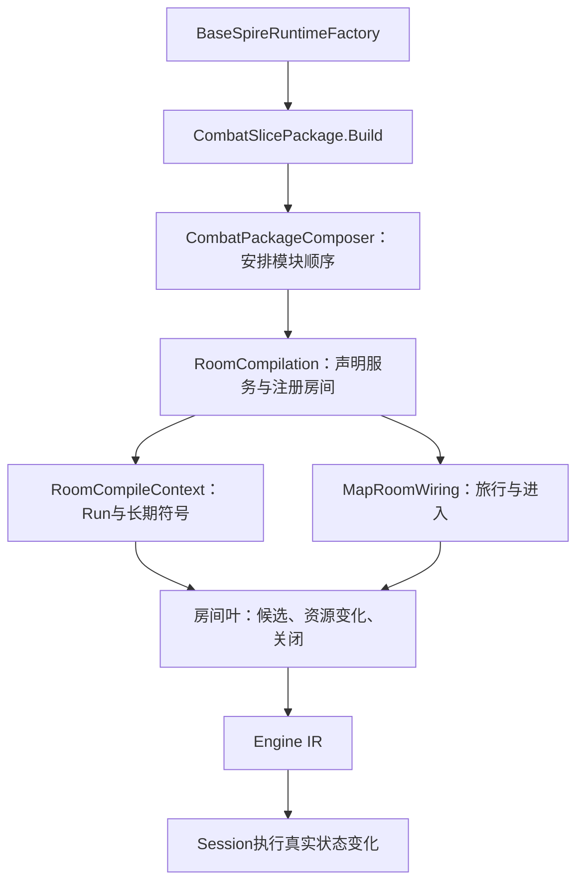

# 实现并接入一个地图房间

文档类型：操作指南（How-to）。面向已有明确房间机制目标的开发者，将房间叶接入正式工厂。首次学习从[房间动作教程](first-base-room.md)开始；目录职责见[base组织结构](base-architecture.md)。当前任务、认领和验收只查[主清单本项](../../review/tofix/README.md#env-t09)。

本页和[房间接口参考](room-compile-reference.md)是房间包的短入口。只读派单指定的原版源方法及目标模块；组包器由接线负责人处理，缺接口时提交具体缺口。

## 1. 运行一个完整的房间动作

从仓库根目录运行：

```powershell
dotnet run --project docs/examples/base-room/BaseRoomExample.csproj --artifacts-path .artifacts/parallel/room-example
```

预期输出：

```text
start: Gold=10, MapPhase=5
close: Gold=17, MapPhase=2
remaining_actions=0
```

这是受控编译/运行例子。宿主预置一个宝箱类型节点，未执行真实开局、地图生成、库存初始化或随机抽取，因此不作为原版宝箱验收。

打开[ExampleRoom.cs](../../../docs/examples/base-room/ExampleRoom.cs)。完整房间叶只有一个 `Register`：

```csharp
public static void Register(EnginePackageBuilder package, RoomCompileContext room)
{
    var body = package.ActionBody(package.Action("TakeExampleGold"));
    var run = room.CurrentRun(body);
    body.Role("player");
    body.Requires(room.At(body, run, MapRoomWiring.TreasurePhase, "Treasure"));
    body.Body(
        body.SetField(run, room.Gold, body.Add(body.Field(run, room.Gold), body.Const(7L))),
        room.CloseVisit(body, run));
}
```

`room` 保存编译期符号。上述方法生成Engine IR，金币和阶段存在Session的Engine状态中。`Requires`同时检查阶段和真实节点类型；关闭后同一动作不再合法。本例没有随机行为。

## 2. 按机制补齐房间叶

复用[营火](../../../mod-the-spire/base-spire/BaseSpire/Slice/RestSiteWiring.cs)或[宝箱](../../../mod-the-spire/base-spire/BaseSpire/Slice/TreasureRoomWiring.cs)中与本包相同的部分。按顺序实现：

1. 声明本次访问所需的字段、候选集合及过程；在进入指令中重置访问标记。
2. 根据原版方法安排真实库存生成与抽取。派单须给流名、池来源和调用顺序；不得用补抽或C#随机数对齐游标。
3. 为每个公开操作登记 `ActionBody`、`Role`、`Candidates` 和 `Requires`。购买守卫同时检查阶段、库存、金币和容量。
4. 将永久资源变化写入 `RoomCompileContext` 绑定的Run/长期集合。战斗副本中的临时变化不直接冒充长期获得。
5. 完成本访问的选择与资源提交，再调用 `CloseVisit`。多次购买的房间在离店时关闭，不在每次购买后关闭。

本上下文仅统一Run、长期牌组与访问守卫/关闭；药水、遗物、卡牌配方和商店库存仍以显式依赖传入。其准确入口见[资源接缝](room-compile-reference.md#资源接缝)。商店是"多次购买、离店才关闭"的现成例子：[ShopRoomWiring](../../../mod-the-spire/base-spire/BaseSpire/Slice/ShopRoomWiring.cs) 在进入时一次性生成库存（`Enter`），把每个商品的 `Sold`/`Unsupported`/`UnsupportedReason` 都写在 Engine 字段里，只有 `LeaveShop` 调 `CloseVisit`。

普通的不可购买状态要在`Requires`或候选查询中排除，使玩家仍可选择其他商品或离店。`Fail`表示规则故障并终止Session，不用于金币不足、商品售罄或栏位已满的常规反馈。一个动作只能登记一个`Candidates`查询；需要第二个选择时，复用正式决策过程，不能连续调用两次覆盖前一个参数域。

## 3. 由负责人接入正式入口

接线分三处，各处只查相应符号附近：

| 操作 | 入口符号 | 负责人需要确认 |
| --- | --- | --- |
| 绑定模块依赖 | [RoomCompilation.RoomServices](../../../mod-the-spire/base-spire/BaseSpire/Slice/Compilation/RoomCompilation.cs) | 使用同一Run字段、长期牌组、地图和库存实例 |
| 进入本房间 | `MapRoomEntry` + `MapRoomWiring.RegisterChooseMapPoint` | 在组合处增加入口处理器，具体进入指令留在房间模块；未支持节点保留明确失败 |
| 注册公开操作 | [RoomCompilation.Rooms](../../../mod-the-spire/base-spire/BaseSpire/Slice/Compilation/RoomCompilation.cs) | 只注册一次；公开集合用途由base语义声明并经Host派生 |

房间服务返回类型是`RoomServicesBindings`，定义在`Compilation/CompilationBindings.cs`。新增该分组的服务由`RoomServices`创建、`Rooms`消费；只有另引入依赖组或改变构建顺序时才改`CombatPackageComposer`。奖励声明及Boss奖励关闭回调由`RewardCompilation.Rewards`拥有，不放入房间关闭操作。

不要为一个房间重新创建Run、随机服务或Session调度器。不要把关闭奖励、关闭房间和整局终局合并；Boss奖励关闭后的幕完成由现有奖励回调拥有。

## 横向扩展问号事件

问号房（`MapPointType.Unknown`）已经**真的接线**：判定实际房型、复用已有房间入口、消费源事件队列、
进入独立事件模块、真实选择/写回/关闭后继续地图。三个共享模块各有归属：

| 模块 | 归属 | 拥有什么 |
| --- | --- | --- |
| [UnknownRoomWiring](../../../mod-the-spire/base-spire/BaseSpire/Slice/Rooms/Unknown/UnknownRoomWiring.cs) | 问号概率与房型判定 | 四个非事件赔率（float32 位型）、源黑名单、判定资产 `base-spire:UnknownMapPointOddsRoll` |
| [UnknownRoomEntry](../../../mod-the-spire/base-spire/BaseSpire/Slice/Rooms/Unknown/UnknownRoomEntry.cs) | 问号入口 | 复用 `MapRoomEntry.Standard` 的战斗/精英/宝箱/商店入口；事件走生命周期 + 目录分派 |
| [EventVisitLifecycle](../../../mod-the-spire/base-spire/BaseSpire/Slice/Rooms/Events/EventVisitLifecycle.cs) | 事件访问生命周期 | 源事件队列消费（资格/已访问跳过）、`EventsVisited` 计数、当前事件身份、事件级随机资产 |

源身份与模块 ID 的转换只在 [EventSourceIdentity](../../../mod-the-spire/base-spire/BaseSpire/Slice/Rooms/Events/EventSourceIdentity.cs)
一处：模块 ID 逐字等于源事件类名（`Models/Events/&lt;Name&gt;.cs`），改名/加前缀都会让运行期分派落空，
因此那里在建包期就拒绝不在源池里的名字。地图节点类型保持 `Unknown`，判定结果写在 `Run.ActualRoomType`；
`Run.MapPhase` 的事件相位是 `MapRoomWiring.EventPhase` = 8。

### 新增一个具体事件（已有能力）

1. 在 `Slice/Rooms/Events/` 新建一个继承 `ChoiceEventModule` 的文件：`Id` 用
   `EventSourceIdentity.ModuleId("源类名")`，`Enter` 里做进入该事件的**一次性**工作（源 `BeginEvent`/`CalculateVars`），
   `Choices`提供`EventChoice`选项、效果和可选资格条件；共享编译器生成Role、访问守卫和关闭/死亡尾。
   - 需要事件级随机数时用 `EventVisitState.Random.NextInt(scope, "源类名", min, max)`：它对应源
     `EventModel.BeginEvent` 给每个事件建的独立 Rng（引擎流 `base-spire:event:&lt;SLUG&gt;`，建局时按源池全量种好）。
   - 本页的金币一类"本页数值"写进 `EventVisitState.EventPageGold`，选项效果从它取值。
   - 源里覆盖了 `EventModel.IsAllowed` 的事件，额外实现 `IEventEligibility`（队列跳过用的就是它）。
   - 使用`effects.GainGold`、`DamageOutsideCombat`、`HealLivingPlayer`组合资源操作，不直接改金币/生命字段。普通选项默认Finish；多页选项用`EventCompletion.Continue`保留访问。
   - 未支持的源选项保留身份并**显式失败**，不静默省略。特殊自定义交互仍可实现`IEventRoomModule`，按对应机制连接。
2. 在 [EventModules](../../../mod-the-spire/base-spire/BaseSpire/Slice/Rooms/Events/EventModules.cs) 的列表里加一项。
   注册处只列模块：不加逐事件 switch、不改 `EventRoomCatalog` 或房型判定。
3. 源身份没实现的**不要**登记：`RunEventQueue` 仍按源池全量生成并洗牌，选中未实现身份时
   `EventRoomCatalog.Enter` 显式失败（不缩池、不换事件、不伪造离场）。

一个使用已有能力的选项可以直接写成：

```csharp
protected override IReadOnlyList<EventChoice> Choices(EventCompileContext context) =>
    [new("TakeMyGold", effects => effects.GainGold(7))];
```

正式装配提供带`RunResources`能力的`EventCompileContext`。源时序和当前支持范围见[事件领域契约](event-domain/spec.md)。新增共享机制先补对应规格与判别案例；单纯组合已有能力引用该规格，不为每个事件新建流程和测试框架。

受控例子（两个独立模块的选项隔离/永久写回/关闭、重复 ID 拒绝、未注册事件显式失败）仍然可跑：

```powershell
dotnet run --project docs/examples/base-events --artifacts-path .artifacts/parallel/event-example
```

真实问号流程的局部判别与固定 seed 证据：

```powershell
dotnet run --project mod-the-spire/base-spire/BaseSpire.Slice.Tests --artifacts-path .artifacts/parallel/unknown-room-checks -- --unknown-room-only
```

该组覆盖：固定 seed `ENV-T03-SEED-L` 的第一次判定（独立复算的 Event/`SunkenStatue`/金币量）、源
float32 赔率累加与命中复位、Shop 黑名单、判成战斗/精英/宝箱/商店时复用真实入口与守卫、
未实现身份具名失败、源身份转换、已访问身份跳过与访问计数（共 10 项）；受控包另测资格跳过与
"走满一轮允许重复"。准确签名见[横向注册接口](room-compile-reference.md#横向注册地图入口与事件)。

## 4. 验证本包

开发时选择受影响分组。现有例子：

```powershell
dotnet run --project mod-the-spire/base-spire/BaseSpire.Slice.Tests --artifacts-path .artifacts/parallel/room-checks -- --rest-site-only
dotnet run --project mod-the-spire/base-spire/BaseSpire.Slice.Tests --artifacts-path .artifacts/parallel/room-checks -- --treasure-room-only
dotnet run --project mod-the-spire/base-spire/BaseSpire.Slice.Tests --artifacts-path .artifacts/parallel/room-checks -- --shop-flow-only
```

依次验证受控营火边界、受控宝箱边界和**正式商店**（`BaseSpireScope.DevMap` 工厂建会话，从地图 `ChooseMapPoint` 的 Shop 分支进店；覆盖 14 格库存顺序、`Shops` 27 抽/`Rewards` 14 抽、买不起/满栏/不可买被候选与守卫拒绝后仍能离店、买卡/买药水/买遗物长期写回、删牌走正式 `Decide` 只删选中的那个、观察不重建货架）。新房间优先验证真正区分行为的获得/扣款/容量/选择/离店路径，按根[测试取舍](../../../AGENTS.md#测试取舍全仓库强制)执行。

正式集成按根约定串行完成构建和受影响门槛，再通过[公开运行路径](../net-the-spire/how-to-run-public-game.md)从正常开局到达本房间。受控例子、本地检查、正常公开可达和独立双侧分别记账。

## 派单时携带的短包

负责人先核对接口并提供以下内容，执行者无需重推全部依赖：

```text
任务：主清单中的ID与本次机制目标
修改：目标房间文件；公共接线由谁修改
原版：关键方法/版本/必要分支；随机抽取顺序
接口：RoomCompileContext + 本机制额外依赖的准确签名
起点：ExampleRoom.Register 或已交付的同类房间叶
状态：哪些字段属于Run、库存或本次访问；谁负责关闭
验证：一个局部命令 + 正常公开到达路径 + 本包完成条件
```

## 调用关系



关系图用于定位职责；准确签名以[接口参考](room-compile-reference.md)及链接源码为准。开局池与随机布局由初始化包拥有，房间作者不重做初始化。
