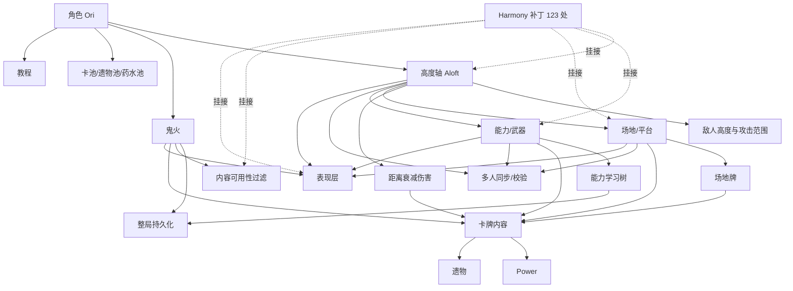

# OriMod（Ori 角色 mod）内容理解

> 目的：为下一轮"把 OriMod 添加的内容细分成可处理模块"的讨论提供共同底稿。本文只描述**这个 mod 添加了什么、由什么构成、彼此怎么依赖**，不做可移植性判断（那部分见 [orimod-portability-2026-10-01.md](../../review/records/2026-10-01/orimod-portability-2026-10-01.md)）。
>
> 来源：`reference/orimod/src`（创艺工坊发布版 `1.0.0` 的反编译源码）与 `reference/orimod/OriMod.json`。
>
> 你对 mod 本身比我熟，所以第 3 节每一条都标了**我的把握程度**，第 6 节列了需要你校正的地方。

---

## 0. 阅读范围与置信度

| 掌握程度 | 范围 |
| --- | --- |
| **逐行读过** | `Ori/Characters/OriCharacter.cs`、`Ori/Aloft/AloftCombatState.cs`、`Ori/Aloft/OriAloftGlobalRules.cs`、`Ori/Aloft/OriDistanceDecayDamageHook.cs`、`Ori/Placements/OriPlatformPlacementState.cs`、`Ori/Cards/` 的抽象基类与约 15 张代表卡、`Ori/Powers/AbstractOriPower.cs` 与 `AfterimagePower`、`Ori/Hooks/`、`OriMod/OriModCode/MainFile.cs` |
| **结构化清点** | 122 张卡（cost/type/rarity/target/关键字/标签/机制耦合，见 [inventory.txt](../../../tools/orimod-decompile/verify/inventory.txt)）、32 个 Power、19 个遗物、29 个场地状态、8 个能力、5 个鬼火 |
| **仅看文件清单与类型名** | `Ori/Abilities/Rendering/**`、`Ori/Placements/**` 的大部分具体状态、`OriMod/PseudoNativeAnimations/**`、`Ori/CombatSync/**` 的具体消息体、`Ori/Tutorials/**` |
| **未做** | 未逐张读完全部效果体；`OriMod.pck` 只解出了 `localization/`（其余贴图/场景/音频未解包）；未做游戏内实际运行对照 |

**本地化已解出**：`reference/orimod/pck/OriMod/localization/{zhs,eng}/`，共 12 张表（cards / powers / relics / card_keywords / characters / events / placements / enchantments / ancients / ori_messages / ori_tutorials / settings_ui）。中英对照整理在 [localization-zh-en.md](../../../tools/orimod-decompile/verify/localization-zh-en.md)。**中文文案是理解机制的重要补充**——自然语言描述和代码实际行为有出入时（高度规则尤其明显），以代码为准。

清点脚本：[tools/orimod-decompile/inventory.ps1](../../../tools/orimod-decompile/inventory.ps1)。

---

## 1. 一句话概括

> OriMod 添加了一个新角色 **Ori**，并**把《杀戮尖塔 2》的战斗空间从"一排站位"改造成了一条垂直轴**：角色有高度，**每打出一张牌就会自动下坠一段**，伤害随垂直距离衰减，克制下坠的牌才有资格留在高处；场景里会存在**占据某个高度的平台与场地**，敌人也有各自的高度和攻击范围；此外还有一套动作游戏式的**能力/武器系统**（跳跃、冲刺、重击、四把武器）和一层整局进度（能力学习树 + 鬼火收集）。

一句话抓住核心：**高度（Aloft）是这个 mod 的第二个资源轴，而且是会被卡牌消耗的资源。**

依据：[OriAloftGlobalRules.cs:26-34](../../../reference/orimod/src/Ori/Aloft/OriAloftGlobalRules.cs#L26-L34)（每次出牌后 `-3` 高度）、[OriDistanceDecayDamageHook.cs:23-85](../../../reference/orimod/src/Ori/Aloft/OriDistanceDecayDamageHook.cs#L23-L85)（伤害按高度差衰减）。

---

## 2. 内容总量（实测）

| 内容域 | 具体数量 | 位置 |
| --- | --- | --- |
| 角色 | **1** | `Ori/Characters/OriCharacter.cs` |
| 卡牌 | **122 张玩家可见牌** + 6 个抽象基类；另有 **4 张隐藏的能力伤害源牌**（在 `Ori/Abilities/`），卡牌类合计 **126** | `Ori/Cards/**`、`Ori/Abilities/*AbilityCard.cs` |
| Power | **32**（+1 抽象基类 + 5 个面板渲染类型） | `Ori/Powers/**` |
| 遗物 | **19**（+2 抽象基类 + 2 个网络 Action） | `Ori/Relics/**` |
| 具体怪物 | **0** | `Ori/Monsters/` 只有 1 个抽象基类 + 4 个辅助类型 |
| 具体药水 | **0** | 只有空的 `OriPotionPool` |
| 事件 | **1**（`TemperamentEvent`） | `Ori/Events/` |
| 场地状态 | **29** | `Ori/Placements/**` |
| 能力 | **8** | `Ori/Abilities/OriAbilityRegistry.cs:8-18` |
| 鬼火 | **5** | `Ori/Wisps/OriWispId.cs` |
| 自定义关键字 | **27** | `Ori/Cards/OriKeywords.cs` |
| 自定义卡牌标签 | **10** | `Ori/Cards/OriCardTags.cs` |
| 卡池 | **4**（1 主池 + 1 场地池 + 1 特殊池 + 1 抽象视觉池） | `Ori/CardPools/**` |
| 教程 | 2 篇（战斗基础、武器切换） | `Ori/Tutorials/**` |
| Harmony 补丁 | **123 处 / 34 个类** | `OriMod/OriModCode/Patches/**` |

**这个 mod 没有具体怪物和具体药水**——它的"内容"重心是角色 + 卡牌 + Power + 遗物，外加一整套自建玩法层。

---

## 3. 逐模块理解

### 3.1 角色与卡池骨架　`[把握：高]`

[OriCharacter.cs](../../../reference/orimod/src/Ori/Characters/OriCharacter.cs) 继承 `PlaceholderCharacterModel`（BaseLib）：

| 项 | 值 |
| --- | --- |
| 起始生命 | 65 |
| 起始牌组 | 4×`StrikeOri` + 4×`DefendOri` + `Lightness` + `AncientForce` |
| 起始遗物 | `KurosFeather` |
| 卡池 / 遗物池 / 药水池 | `OriCardPool` / `OriRelicPool` / `OriPotionPool` |
| 规则相关覆写 | `AfterRoomEntered` → `OriWispRoomProgression.AfterRoomEntered`（鬼火进度） |
| 其余覆写 | 全部是表现：Spine 动画状态机、角色立绘/图标/场景路径、配色、多人指向手臂贴图 |

3 个内容卡池（[OriCardPool.cs](../../../reference/orimod/src/Ori/CardPools/OriCardPool.cs) 等）都只是 `IsShared => false` 的标记类，区分点是**卡池归属**：

- `OriCardPool` — 主卡池
- `OriFieldCardPool` — 场地牌专用池（`AbstractOriFieldCard` 带 `[Pool]` 且 `CanBeGeneratedByModifiers => false`）
- `OriSpecialCardPool` — 特殊/概念牌池

### 3.2 卡牌内容　`[把握：中高——结构高，逐张语义中]`

131 个文件里 **122 个是具体卡牌**（其余 6 个抽象基类、3 个非卡牌文件），按 mod 自己的基类分成五族：

| 族 | 基类 | 数量 | 主要目录 | 特征 |
| --- | --- | --- | --- | --- |
| 主卡组 | `AbstractOriCard` | 92 | `Cards/` | 常规卡 |
| 场地牌 | `AbstractOriFieldCard` | 8 | `Cards/Fields/`（7 个） | 打出后放置一个场地对象；`CanBeGeneratedByModifiers => false`；自动带 `Field` 标签（[AbstractOriFieldCard.cs:16-25](../../../reference/orimod/src/Ori/Cards/AbstractOriFieldCard.cs#L16-L25)） |
| 特殊牌 | `AbstractOriSpecialCard` | 9 | `Cards/Special/`（7 个） | 跨池的特殊卡 |
| 概念牌 | `AbstractOriConceptCard` | 11 | `Cards/Special/Concepts/` | **不可打出的展示牌**：稀有度 `Event`、`CanBeGeneratedInCombat => false`、`OnPlay` 被 sealed 成空、自动带 `ConceptCard` 关键字（[AbstractOriConceptCard.cs](../../../reference/orimod/src/Ori/Cards/AbstractOriConceptCard.cs)） |
| 内部牌 | `AbstractOriInternalCard` | 2 | `Cards/Special/` | `MarkPoint`、`MeteoritePoint`，被系统生成的标记牌 |

> **目录与基类不是一一对应**：`FieldCampfire` 是场地牌但放在 `Cards/` 根目录。按目录数是 `Cards/` 95 + `Fields/` 7 + `Special/` 9 + `Concepts/` 11 = 122。

**另有 4 张隐藏牌**在 `Ori/Abilities/`：`SpiritEdgeAbilityCard`、`SpiritArcAbilityCard`、`LightHammerAbilityCard`、`LightSpearAbilityCard`。它们继承 `AbstractOriInternalCard`，`OnPlay` 直接抛异常（[SpiritEdgeAbilityCard.cs:43-46](../../../reference/orimod/src/Ori/Abilities/SpiritEdgeAbilityCard.cs#L43-L46)），作用是**给能力提供伤害数值来源**（`IOriAbilityDamageSource` + `IOriDistanceDamageRuleSource`）。本地化里有它们的名字（精灵之刃 / 精灵弧击 / 光锤 / 光矛），因为它们要作为能力的悬停提示显示。

#### 11 张概念牌（中文名与描述）

本地化表已从 `OriMod.pck` 解出（见 [localization-zh-en.md](../../../tools/orimod-decompile/verify/localization-zh-en.md)）。这 11 张的完整文案是：

| 类名 | 中文名 | 中文描述 |
| --- | --- | --- |
| `BizarreAdventure` | 奇妙冒险 | 你生成的放置物都会放置两次，但位置随机。 |
| `HoppingIsCute` | 蹦蹦跳跳显得可爱 | 每当你穿过一名敌人，刷新[gold]跳跃[/gold]的使用次数。 |
| `KingFromAbove` | 王从天降 | [gold]高度[/gold]低于160不能打出。坠落至地面。对所有敌人造成{Damage:diff()}点伤害。本回合进入[gold]审判[/gold]。 |
| `MightyOriDescends` | 猛奥下山 | 每当你切换武器时，抽{Cards}张牌。 |
| `Mirage` | 海市蜃楼 | 获得{StrengthPower:diff()}点[gold]力量[/gold]。你看到的放置物的位置都将是错误的。 |
| `NightProwl` | 夜行 | 所有玩家从[gold]高度[/gold]面板上消失。任何玩家穿过另一名玩家时，偷取其{Energy:energyIcons()}。 |
| `SevenSwordsUnite` | 七剑合璧 | 若同时有不少于四名玩家位于[gold]高度[/gold]160以上，召唤麒麟为你们作战。 |
| `ShadowCloak` | 暗影斗篷 | 本场战斗，你不再受任何场地、放置物影响。 |
| `SunMoonIsle` | 场地：日月岛 | 奇/偶数回合开始时，上/下半场地的玩家获得{Energy:energyIcons()}，其他区域的玩家失去{Energy:energyIcons()}。 |
| `SuperBash` | 超级猛击 | 你现在可以[gold]猛击[/gold]其他玩家，使其获得等量的反向位移。 |
| `Tempering` | 淬炼 | 本回合内每受到一次攻击，下个回合开始时获得{Charges:diff()}次[gold]精灵之刃[/gold]使用次数。 |

**这批牌是尚未实现的后续内容草稿**（代码里 `OnPlay` 被 sealed 成空、`CanBeGeneratedInCombat => false`、不可升级除费用外无行为）。但它们的文案反过来确认了几件事：本 mod 的**高度轴 / 放置物 / 跳跃 / 猛击 / 武器切换 / 审判**正是设计主线；其中 4 张（`NightProwl`、`SevenSwordsUnite`、`SuperBash`、`SunMoonIsle`）是纯多人玩法，1 张（`ShadowCloak`）是全局规则豁免。

#### 一条孤儿本地化条目

`ORI-SPIRIT_DREAM`（**精灵之梦**）在 `zhs/cards.json` 里有名字，但源码里**没有任何对应类**——是已删或尚未加入的内容。（对照 122 个卡牌类：全部都有本地化条目，无遗漏。）

**自定义关键字 27 个**（[OriKeywords.cs](../../../reference/orimod/src/Ori/Cards/OriKeywords.cs)），可粗分四组：

- 机制轴：`Aloft`、`Momentum`、`Bash`、`UpAttack`、`DownAttack`、`MeleeAttack`、`RangedAttack`
- 武器限定：`WeaponSwitch`、`SpiritEdgeOnly`、`SpiritArcOnly`、`MeleeWeaponOnly`、`RangedWeaponOnly`
- 场地：`FieldForest`、`FieldCampfire`、`FieldOcean`、`FieldDesert`、`FieldWellspring`、`FieldDarkness`、`FieldVoid`、`FieldSnowslide`、`SubstantialField`
- 其他：`ConceptCard`、`Judgment`、`Temperament`、`Return`、`Reset`、`LastLight`

**自定义标签 10 个**（[OriCardTags.cs](../../../reference/orimod/src/Ori/Cards/OriCardTags.cs)）：`NoAloftAutoFall`、`AttackUp`、`AttackDown`、`AttackAuto`、`NonDecayWithDistance`、`Placement`、`Field`、`Special`、`MeleeAttack`、`RangedAttack`。

> 注意标签和关键字有**大量重名但不同用途**（`MeleeAttack`/`RangedAttack` 两处都有）。关键字参与结算，标签用于查询——这一点和你确认一下。

**机制耦合度**（正则统计 122 张具体卡）：

| 分类 | 数量 |
| --- | --- |
| 同时引用自有系统与自有 Power/关键字 | 54 |
| 只引用自有系统（浮空/场地/能力/鬼火） | 10 |
| 只引用自有 Power/关键字 | 35 |
| **两者都不引用** | **23** |

涉及的子系统：`AloftSystem` 34 张、场地 27 张、`OriPlacementStateSystem` 23 张、`OriAbilitySystem` 18 张、`EnemyAloftSystem` 6 张、鬼火 3 张。

### 3.3 Power　`[把握：中]`

32 个具体 Power，几乎全部继承 `AbstractOriPower`。关键结构观察：

- `AbstractOriPower` 同时实现 `IOriAbilityUsedHook` 和 `IOriHookListener`（[AbstractOriPower.cs:12](../../../reference/orimod/src/Ori/Powers/AbstractOriPower.cs#L12)）——**每个 Power 都先天接入了 mod 的能力钩子和 mod 自己的钩子分发器**，即使它不覆写任何方法。
- 覆写的是**游戏 Power 模型的生命周期虚方法**，不是数据表。例如 [AfterimagePower.cs:47-53](../../../reference/orimod/src/Ori/Powers/AfterimagePower.cs#L47-L53) 覆写 `AfterSideTurnEnd` 来移除自己，并实现 `IAloftChangedListener` 在高度变化时结算。
- Power 类型分布：绝大多数 `PowerType.Buff` + `PowerStackType.Counter`；只有 `SinkingPower` 是 `Debuff`，`BindingPower`/`CardWheelPower`/`OverchargePower`/`RebirthLockPower`/`SeraphPower`/`WispsWillPower` 是 `Single`（不可叠）。
- 与浮空强耦合的：`AfterimagePower`、`AntigravityPower`、`ClamberPower`、`DignifiedPower`、`ForestStrengthPower`、`ShadowCraftPower`、`SinkingPower`。
- 5 个 `PanelRange*` 文件不是 Power，是场地面板的渲染配置类型。

### 3.4 遗物　`[把握：中]`

19 个，分两条继承线：

- `AbstractOriRelic` → `CustomRelicModel` + `IOriAbilityUsedHook` + `IOriHookListener`
- `AbstractFeatherRelic` → `AbstractOriRelic`，羽毛系列（`KurosFeather`、`BurningFeather`）

稀有度分布：Common 1、Uncommon 5、Rare 5、Shop 1、Event 3、Ancient 2、Starter 2（+ 2 个未标注）。

耦合：5 个引用浮空、6 个引用自有 Power/关键字、2 个引用能力、1 个引用场地、1 个引用鬼火。但**全部 19 个都经由 `AbstractOriRelic` 挂在能力钩子上**。

### 3.5 高度轴 —— Aloft　`[把握：高]`

26 个文件，是整个 mod 的地基。

**状态**（[AloftCombatState.cs:12-30](../../../reference/orimod/src/Ori/Aloft/AloftCombatState.cs#L12-L30)），以战斗状态为键的 `ConditionalWeakTable`：

```
PlayerState { int Aloft; int Momentum; ulong MovementRevision; }   // 逐玩家
Dictionary<Player, PlayerState> Players;
HashSet<Player> EndedPlayers;
Dictionary<Creature, int> EnemyHeights;                            // 逐敌人
```

**三条核心规则**：

1. **自动下坠**（[OriAloftGlobalRules.cs:26-34](../../../reference/orimod/src/Ori/Aloft/OriAloftGlobalRules.cs#L26-L34)）：每次有牌被打出后，如果角色是"浮空角色"且这张牌没带 `NoAloftAutoFall` 标签，那么动量清零并下降 3（`AloftChangeKind.CardFall`）。
2. **距离衰减伤害**（[OriDistanceDecayDamageHook.cs](../../../reference/orimod/src/Ori/Aloft/OriDistanceDecayDamageHook.cs)）：伤害按攻击者与目标的高度差做**乘法**衰减 `max(0, 1 - decay/100)`。例外：`RangedAttack` 与 `NonDecayWithDistance` 标签不受衰减；`Tread` 用专门的参考高度；原生浮空敌人（`IsNativeAloftEnemy`）豁免。
3. **移动计划与阻挡**（`AloftChangePlan` + `IAloftTraversalModifier`）：下降/移动先生成一个计划，沿途有平台时可以 `StopAt(Height)` 拦住。`AloftPathTraversal` 负责"路径是否穿过某高度"和"沿方向排序"。

**API 面**：`AloftSystem`（36 KB，主 API：读写高度/动量、`ChangeAsync`、`IsSupportedByGround`、`DidReachGround`、`ShouldAutoFall`、`IsFallKind`、`GetTreadReferenceAloft`）、`EnemyAloftSystem`（18 KB，敌人高度、衰减计算、攻击范围、原生浮空敌人）。

**扩展接口**：`IAloftChangedListener`、`IAloftChangeModifier`、`IAloftTraversalModifier`、`IAloftSurfaceProvider`、`IOriGroundDistanceModifier`、`IOriEnemyAloftChangedHook`。

**同步/快照**：`AloftCombatSnapshot` + `AloftCombatSnapshotCodec`、`SyncEnemyAloftAction` / `NetSyncEnemyAloftAction`、通过 `AloftSystemPatches` 挂钩 `CombatState.AddPlayer` / `CombatManager.Reset` / `NCombatRoom.*` 做生命周期绑定。

### 3.6 场地 —— Placements　`[把握：中]`

51 个文件、29 个具体场地状态。这是 mod 在战斗里引入的**第二类实体**。

**实例模型**（[AbstractOriPlacementState.cs:22-70](../../../reference/orimod/src/Ori/Placements/AbstractOriPlacementState.cs#L22-L70)）：

| 维度 | 字段 |
| --- | --- |
| 身份 | `InstanceId`、`PlacementKindId`、`Scope`（`World` 等）、`IsUniqueInScope` |
| 数值 | `Height`、`Amount`、`InitialAmount`、`EffectiveRange`、`BottomHeight`/`TopHeight` |
| 规则 | `CanBeReached`、`CanBeBashed`、`IsField` |
| 表现 | `PanelColor`、渲染/悬停优先级、范围填充样式、悬停提示文本 |

**家族**（从文件名与关键字推断，待你校正）：

- **场地（Field）**：Forest、Campfire、Ocean、Desert、Wellspring、Darkness、Void、Snowslide、AncientLight —— 对应 9 个 `Field*` 关键字，由 `Cards/Fields/` 的牌放置
- **平台**：`OriPlatformPlacementState` —— 实现 `IOriPlatformPlacement` + `IAloftTraversalModifier`，下降经过它时停住（[OriPlatformPlacementState.cs:24-37](../../../reference/orimod/src/Ori/Placements/OriPlatformPlacementState.cs#L24-L37)）
- **场景物件**：Stove、SmallHouse、Sentry、SpiritWell、SpiritLink、LightCatcher、Dream、CollectionEnergy、CollectionLife、EyeOfTheStorm、SpringPlants、Shwd、ForestHeart

**配套机制**：`OriPlacementIdentityAllocator`（实例 ID）、`OriPlacementCollection`/`OriPlacementRegistry`/`OriPlacementTypeRegistry`、`OriPlacementOrdering`（顺序）、`OriPlacementDisplays`（渲染描述）、`OriPlacementSnapshot`（存档）、`OriCombatPlacementInitializer`。

**钩子**：`IOriPlacementSideTurnEndHook`、`IOriEnemyAloftChangedHook`、`IOriDashRuleOverride`、`IOriBashablePlacement`。

### 3.7 能力与武器 —— Abilities　`[把握：中高]`

96 个文件。这里有三个容易混淆的东西，我分开说：

**(a) 能力（8 个）**：`OriAbilityId` 位标志 —— `Jump`、`Dash`、`Bash`、`Launch`、`SpiritEdge`、`SpiritArc`、`LightHammer`、`LightSpear`（[OriAbilityId.cs](../../../reference/orimod/src/Ori/Abilities/OriAbilityId.cs)）。

能力**不是卡牌**，是动作游戏式的即时招式：由输入触发（[JumpAbilityHandler.cs:46-63](../../../reference/orimod/src/Ori/Abilities/JumpAbilityHandler.cs#L46-L63) 里监听 `MegaInput.peek`）、有每回合可用次数（`GetMaxCount`）、有刷新条件（如落地时 `Refresh`）、入队成 `OriUseAbilityAction` 网络动作、有图标与显示顺序。

**(b) 武器（4 把）**：`SpiritEdge`、`SpiritArc`、`LightHammer`、`LightSpear` 同时是"武器"。`OriWeaponSequence.ResolveNext` 实现环形切换（[OriWeaponSequence.cs:8-31](../../../reference/orimod/src/Ori/Abilities/OriWeaponSequence.cs#L8-L31)）；配合 `WeaponSwitch` 关键字、`OriSwitchWeaponAction`、存进存档的 `PreferredWeapon`。有专门的教程（`OriWeaponSwitchTutorial`）。

**(c) 能力牌（4 张）**：`SpiritEdgeAbilityCard`、`SpiritArcAbilityCard`、`LightHammerAbilityCard`、`LightSpearAbilityCard`——把能力和卡牌连起来的桥。

**运行时状态**：`OriAbilityStateModifier` + `OriAbilityRuntimeRegistry`/`OriAbilityRuntimeSet`——逐玩家的 owned / temporary grant / temporarily disabled / permanently unlocked 四类掩码，加上使用计数。`OriAbilityAvailability` 表达可用性。

**钩子**：`IOriAbilityUsedHook`（Power 和遗物靠它响应能力使用）、`IOriAbilityUseProvider`、`OriAbilityActivationGate`。

### 3.8 能力学习与整局进度　`[把握：中]`

- **学习计划**：`OriAbilityLearningPlan` 按"幕"生成，`OriAbilityLearningLocation` 是地图上的落点，`OriAbilityLearningMilestone` 是里程碑，`OriAbilityLearningSchedule`/`OriAbilityLearningProgress` 管进度。生成用命名 RNG：`new Rng(seed, $"ori_ability_learning_v1:act_{actIndex}")`（[OriAbilityLearningMapProgression.cs:62](../../../reference/orimod/src/Ori/Abilities/OriAbilityLearningMapProgression.cs#L62)）。
- **地图集成**：`OriAbilityLearningMapProgression` 挂钩地图生成，`OriLocalAbilityTreeEventController` + `NOriAbilityTreeEventScreen` 是能力树界面，`OriAbilityLearningMapPatches` 补 `NMapScreen`。
- **持久化**：`OriAbilityPlayerRunSaveData`（`UnlockedMask` / `WispMask` / `PreferredWeapon` / 逐能力快照），实现 `IPacketSerializable`；`OriAbilityPersistence` / `OriAbilityLearningPersistence` 负责存取。
- **主机权威**：`OriAbilityNetworkBridge` + 一族 `*Message`/`*Request` 类型；非主机不能直接改持久状态（[OriAbilitySystem.cs:96-106](../../../reference/orimod/src/Ori/Abilities/OriAbilitySystem.cs#L96-L106)）。

### 3.9 鬼火 —— Wisps　`[把握：中]`

5 种：`Voice`、`Memory`、`Strength`、`Eyes`、`Golden`（[OriWispId.cs](../../../reference/orimod/src/Ori/Wisps/OriWispId.cs)）。

- **每种鬼火绑定一张牌**：`OriWispDefinition(Id, MessageType, CardType, CardProvider)`（[OriWispDefinition.cs](../../../reference/orimod/src/Ori/Wisps/OriWispDefinition.cs)）——`ForestVoice`/`ForestMemory`/`ForestStrength`/`ForestEyes` 等卡显然对应这里。
- **获得即成长**：`MaxHpGainOnGrant = 5`（[OriWispSystem.cs:13](../../../reference/orimod/src/Ori/Wisps/OriWispSystem.cs#L13)），并获得对应卡。
- **进度持久化**：`WispMask` 存进整局存档，`OriWispRuntimeRegistry`/`OriWispState` 管运行时，只能整局进行中授予，且客户端不能给远端玩家授予。
- **房间推进**：`OriWispRoomProgression.AfterRoomEntered`（由角色覆写调用）。
- **内容可用性过滤**：`OriWispCardAvailability` + 3 个补丁改战斗牌池 / 卡牌奖励池 / 商店库存（`CardFactory.GetForCombat`、`CardCreationOptions.GetPossibleCards`、`Hook.ModifyMerchantCardPool`）。

### 3.10 事件与教程　`[把握：低—中]`

- 事件：仅 `TemperamentEvent`（`CustomEventModel`）——和 `Temperament` 这张牌、`Temperament` 关键字同名，我推测三者是一套（事件 → 获得/解锁 → 卡牌行为）。**需要你确认。**
- 教程：17 个文件，两篇内容（战斗基础、武器切换），有 `OriTutorialService`/`Controller`/`RequestQueue`/`Progress`（进度持久化）+ 全息 UI `NOriTutorialFtue`。

### 3.11 多人同步与校验　`[把握：低—中]`

16 个文件，是一套**自定义战斗状态的快照/共识协议**，不只是补丁：

- 协议消息：`OriCombatSnapshotMessage` / `RequestMessage` / `ReadyMessage` / `CommitMessage` / `CorrectionSnapshotMessage`
- 状态载体：`OriCombatCustomSnapshot`、`OriCombatSyncState`、`OriCombatEpoch`
- 校验与分歧：`OriCombatStateChecksum` + `OriCombatStateChecksumDiagnostics`，配合 `OriCombatChecksumPatch`、`OriCombatStateDivergencePatch`
- 时序协调：`OriCombatCustomStateCoordinator`（战斗开始前等待自定义状态就绪，[OriAloftGlobalRules.cs:21-24](../../../reference/orimod/src/Ori/Aloft/OriAloftGlobalRules.cs#L21-L24) 会调它）、`OriCombatSyncNetworkBridge`
- 重连：`OriCombatRejoinPersistence`
- 另有 `Ori/Combat/OriCardTransferCmd.cs`：把牌转给其他玩家（被 `HandToHand` 使用）

同时有多张 `CardMultiplayerConstraint.MultiplayerOnly` 卡（`Binding`、`EmbraceTheLight`、`HandToHand`、`SwitchPlaces`、`WispFlight`）。

### 3.12 表现层与补丁　`[把握：中]`

- `OriMod/PseudoNativeAnimations/`：4 个子系统——`OriMessages`（仿原版的消息/字幕/提示动画）、`OriBossHealthBar`（Boss 血条覆盖层）、`OriCombatImpacts`（命中特效）、`OriAbilityAudio`（能力音效）。
- `OriMod/OriModCode/Visuals/`：`OriAloftPanel`（高度面板）、`OriAbilityAimArrow`、`OriCursorTrailManager`、`OriEnergyCounter`、`OriCharacterFlipHelper`、暂停侧栏、光标 VFX。
- 补丁 34 类 / 123 处，按语义：**约 20 类 / 65 处是规则语义**（浮空 9、能力 10、场地 11、格挡前吸收 5、森林之心 6、鬼火可用性 5、校验 2、其他），**约 12 类 / 32 处是表现**（字体、标题/运行音乐、光标、暂停菜单、Boss 血条、标题图标、UI 音效、Spine 动画）。
- 入口 `MainFile`（[MainFile.cs:47-61](../../../reference/orimod/src/OriMod/OriModCode/MainFile.cs#L47-L61)）：注册 3 张本地化表、注册教程、注册 mod 配置、注册鬼火 run hook、扫描并应用全部 Harmony 补丁、`ScriptManagerBridge.LookupScriptsInAssembly`、预热图片缓存。

---

## 4. 系统依赖关系



**关键判断**：高度轴（Aloft）是根，敌我高度、距离伤害、平台、能力全部挂在它上面；场地和 Ability 是并列的两大子系统；卡牌内容是最上层消费者。**这决定了切分顺序——`Aloft` 不能和其它模块并行处理。**

---

## 5. 我建议的模块切分草案（待你修正）

按"能否独立处理 + 依赖方向"切，我建议先分成 **12 个模块**，并标注彼此的先后关系：

| # | 模块 | 包含 | 依赖 | 我判断的独立性 |
| --- | --- | --- | --- | --- |
| M1 | 角色与卡池骨架 | `OriCharacter` 数据、4 个池、起始牌组/遗物 | 无 | 可独立 |
| M2 | 关键字与标签体系 | 27 个关键字、10 个标签的**规则语义**注册 | 无 | 可独立，但语义分散在各模块 |
| M3 | 高度轴核心 | `AloftCombatState`、`AloftSystem`、自动下坠、移动计划、路径穿越 | 无 | **地基，必须最先** |
| M4 | 敌人高度与攻击范围 | `EnemyAloftSystem`、`IOriNativeAloftMonster`、范围可视 | M3 | 依赖 M3 |
| M5 | 距离伤害修正 | `OriDistanceDecayDamageHook`、武器/射程标签豁免、`Tread` 参考高度 | M3、M4 | 依赖 M3/M4 |
| M6 | 场地/世界对象 | 29 个场地状态、身份分配、集合/顺序、快照、放置 API | M3 | 依赖 M3，规模大 |
| M7 | 能力与武器 | 8 个能力、4 把武器、输入、动作队列、使用计数 | M3 | 依赖 M3 |
| M8 | 能力学习与整局进度 | 学习计划/里程碑/地图集成/能力树界面/存档 | M7 | 依赖 M7 |
| M9 | 鬼火 | 5 种鬼火、授予流程、内容可用性过滤 | M1 | 可相对独立 |
| M10 | 卡牌/Power/遗物内容本体 | 122 张卡、32 个 Power、19 个遗物 | M2–M9 | **全部依赖上面，最后做** |
| M11 | 多人同步与校验 | 自定义状态协调、校验和、分歧、消息族 | M3/M6/M7 | 可整体取舍 |
| M12 | 教程与表现层 | 教程、UI/VFX/音频/字体/音乐、约 32 处表现补丁 | 全部 | 可整体取舍 |

**三个需要你拍板的切分问题：**

1. **M2（关键字/标签）该独立还是打散？** 27 个关键字里，`Aloft`/`Momentum`/`UpAttack`/`DownAttack` 属于 M3，`Field*` 属于 M6，`SpiritEdgeOnly` 等属于 M7。独立成一个模块便于统一处理"自定义关键字"这个能力，但语义会跨模块。我倾向独立成"自定义关键字/标签的注册机制"，语义实现仍留在各模块。
2. **M5 是否可以并进 M3？** 距离衰减是纯伤害修正，逻辑独立但语义紧贴 M3。
3. **M10 是否可以再按"牌族"细分？** 92 主牌 + 8 场地牌 + 9 特殊牌 + 11 概念牌 + 2 内部牌，牌族之间的机制耦合差别很大（概念牌根本不可打出）。

---

## 6. 需要你确认的点

以下是我**推断但不确定**的地方，请你校正：

1. ~~**概念牌（11 张）到底是什么？**~~ **已确认：是日后考虑加入的牌的设计草稿**（用户确认 + 本地化文案佐证，见 §3.2）。它们目前不可打出、无行为。
2. **`Temperament` 这条线**：`TemperamentEvent`（事件）+ `Temperament`（卡）+ `Temperament`（关键字）+ 可能有 `Ori/Afflictions`？它们是一套吗？做什么用的？
3. **关键字 vs 标签的重名**：`MeleeAttack` / `RangedAttack` 在 `OriKeywords` 和 `OriCardTags` 里都存在。是两条独立语义（一个用于显示、一个用于查询），还是历史遗留？
4. **武器与能力的边界**：`SpiritEdge`/`SpiritArc`/`LightHammer`/`LightSpear` 我归到"能力+武器"同一模块。它们和 `Jump`/`Dash`/`Bash`/`Launch` 在使用方式上是否本质不同（例如前者需要"持有武器"而后者是纯位移）？
5. **场地（Placement）的分类**：我从关键字推断出"场地 / 平台 / 场景物件"三类。`Field*` 关键字有 9 个但我只看到 9 个 `Field*` 卡和 8 个场地状态，数量和对应关系对吗？
6. **鬼火与 `Forest*` 卡**：我推测 `Voice/Memory/Strength/Eyes` 分别对应 `ForestVoice`/`ForestMemory`/`ForestStrength`/`ForestEyes`，`Golden` 对应哪张？`WispEverlasting`/`WispFlight`/`WispsWill` 又是什么关系？
7. **`Ori/CombatSync` 的必要性**：如果我理解正确，这部分只在多人下有意义。单人训练环境下是否可以整块丢掉？
8. **`Ori/Events/` 只有 1 个文件**：是 mod 只加了 1 个事件，还是事件在别处定义（例如场景 `.tscn` 里）？

---

## 7. 我还没搞清 / 需要进一步阅读的部分

按对模块切分的影响排序：

1. `AloftSystem.cs`（36 KB）我只读了被引用处，没通读——里面可能还有我没识别的机制（例如 `Momentum` 与 `UpAttack`/`DownAttack` 的关系）。
2. `EnemyAloftSystem.cs`（18 KB）同上：敌人的"原生浮空"是什么，攻击范围怎么参与结算。
3. 29 个场地状态只读了 1 个，`Amount`/`EffectiveRange`/`Scope` 的具体语义不清楚。
4. 8 个能力的具体效果（只有 `Jump` 读过）。
5. `OriPlacementHelper`、`CardWheel`、`Renzokuken`、`Midair` 等卡的实际玩法。
6. `OriMod.pck` 只解出了 `localization/`。场景（`.tscn`/`.scn`）、贴图、音频仍未解包——里面可能还有规则相关信息（例如场景内嵌的数值）。

> **待办（下一步）**：把"高度"与"技能"两个机制的**实际代码行为**重新用自然语言描述一遍。当前卡牌文案对高度行为的描述不准确，不能作为规则依据。

---

## 8. 对"高度 + 技能是两个核心扩展机制"的判断

我认同这个划分，也是我通读后的结论：**其余内容（卡牌、Power、遗物、场地具体种类、鬼火）都是这两个机制的消费者**。但两者"容易实现"的程度差别很大，需要分开说。

### 8.1 技能机制：同意"容易"，但成本不在 DSL 上

**同意容易**：一个技能的语义就是"消耗一次使用次数，执行一段效果"，效果部分完全落在现有 DSL 能力之内，不需要新原语。

**但有两处不是 DSL 能覆盖的**：

1. **技能是新的外部动作类型。** 现在的 `PlayerAction` 只有 6 种（`PlayCardAction` / `UsePotionAction` / `EndTurnAction` / `ChooseOptionAction` / `ChooseCardAction` / `ConfirmCardSelectionAction`，[State.cs:1036-1042](../../../archive/legacy-sts/core-the-spire/Core.TheSpire.Legacy/Legacy/State.cs#L1036-L1042)），合法动作在 [Environment.cs:341-405](../../../archive/legacy-sts/core-the-spire/Core.TheSpire.Legacy/Legacy/Environment.cs#L341-L405) 逐类枚举，`Step` 还会拿它做合法性校验。加技能 = 新增一个 `PlayerAction` 子类 + 在枚举与分发里加分支 + 决定它是否与打牌共享回合内时序。**这改变了 AI 的动作空间**（编码器、策略头、动作掩码都要跟着动），是接口变更而不是内容变更。
2. **每回合使用次数与刷新条件需要状态位和刷新时点**：`state` 目前只有 combat/run 两个作用域和 `int`，够用；但"落地时刷新跳跃"这类条件需要一个能在高度变化时触发的钩子——那属于高度模块。

**结论**：技能本身容易；它的成本是环境动作契约的一次扩展，以及少量新钩子。这两件事都不需要动 DSL 语法。

### 8.2 高度机制：同意"状态不复杂"，但难点不在状态的描述

**同意状态不复杂**：核心状态就是"每个玩家 3 个 int（高度/动量/移动版本号）+ 每个敌人 1 个 int（高度）"（[AloftCombatState.cs:12-30](../../../reference/orimod/src/Ori/Aloft/AloftCombatState.cs#L12-L30)）。用现有 `state` 声明写 `scope = combat, type = int` 就能表达数值本身。

**但以下四件事是状态的"消费者"，目前 DSL 都表达不了**：

| # | 高度机制的实际行为 | 现有 DSL 的缺口 |
| --- | --- | --- |
| 1 | **逐实体维度**：敌人各有高度 | `state` 是 `(modId, key) → int`，**没有实体维度**（[State.cs:689-692](../../../archive/legacy-sts/core-the-spire/Core.TheSpire.Legacy/Legacy/State.cs#L689-L692)） |
| 2 | **数值由高度差计算**：伤害 = f(攻方高度 − 守方高度) | `scaled` 只有 `base + perCount × count`；12 个计数源里没有"某实体的自定义数值"，且缺 `min`/`clamp`（[primitives.md §4](../../dsl/0.0.1/primitives.md)） |
| 3 | **移动会被拦截**：下降经过平台时停住（`AloftChangePlan.StopAt`） | 没有"移动计划 + 沿途拦截"的概念；现有钩子是固定的 10 个 `IRuleHook` 方法 |
| 4 | **目标按高度筛选/排序**：路径穿过的敌人、按高度排序逐个结算 | `TargetSelector` 是 7 个封闭枚举（`None/Self/FirstEnemy/SelectedTarget/AllOpponents/RandomEnemy/OtherAllies`），无法表达"满足高度条件的敌人按高度排序" |

**结论**：把高度**存下来**确实不复杂；让它**驱动规则**需要动三处模型——实体维度状态、可组合的数值表达式、带谓词与排序的目标查询。这三处也正是 [架构审阅 §3](../../review/records/2026-10-01/core-base-architecture-dsl-2026-10-01.md) 已经点名的结构问题（"缺少统一的类型化数值表达式"、"目标块承诺高于运行模型"），不是为 OriMod 新造的需求。

### 8.3 一句话

**技能 = 动作空间的扩展（局部、可控、值得先做）；高度 = 状态模型与表达式/查询能力的扩展（触及内核，是真正的门槛）。** 两者都"概念上简单"，但简单的是概念，不是改动面。

### 8.4 更正：以上缺口针对旧 DSL 后端，通用引擎已具备这些能力

§8.1/§8.2 列出的缺口，描述的都是**旧 DSL 后端**（`.spire` + `Content.cs`/`State.cs`/`Effects.cs`/`Environment.cs`），base-spire 的 122 张卡目前走这条。工作区同期落地了第二套后端 `core-the-spire/Core.TheSpire/Engine/`（通用规则引擎），本项目的四条判断在那套后端上的实际情况是：

| 判断 | 旧 DSL 后端 | 通用引擎 |
| --- | --- | --- |
| 注册新的外部动作 | ❌ `PlayerAction` 是封闭 record 层级 + 硬编码枚举 | ✅ `package.Action(name)` + `Role`/`Requires`/`Candidates`/`Body`；`LegalActions` 遍历 `RuleSet.Actions` 通用枚举 |
| 场景初始化注册变量并绑定实体 | ❌ `state` 只有 combat/run 两个作用域、仅 `int`、无实体维度 | ✅ 实体类型字段 + `ExtensibleFields`（后加载的包用 `Extends` 追加字段）；`OnSessionStart` + `CreateEntity(..., initializers)` 初始化 |
| 伤害责任链上的 patch 点 | ⚠️ `IRuleHook` 固定 10 个方法 + 约 46 个事件名 | ⚠️ 事件 + 带优先级的订阅机制齐备，但**当前伤害过程在扣血之后才发 `DamageDealt`，且载荷是标量**；要真正拦截需把伤害过程改成"先发携带可变字段的事件 → 订阅者改写 → 发出者回读 → 再应用"（或整体 `Overrides` 该过程） |
| 目标按条件筛选/排序 | ❌ `TargetSelector` 7 个封闭枚举 | ✅ `Query` 有 `Where`/`Sort`/`Take`/`Skip`/`First`/`Count`/`Exists`/`Aggregate`；算术含 `Minimum`/`Maximum` |
| `min`/`clamp` 值原语 | ❌ 缺 | ✅ 已有 |

验证状态：`Engine` 检查 32/32、`base-spire` 切片检查 21/21 通过；其中 [SliceChecks.cs:150-162](../../../mod-the-spire/base-spire/BaseSpire.Slice.Tests/SliceChecks.cs#L150-L162) 直接验证了"第二个包扩展 `base-spire` 的 `Player` 类型并追加字段"，`Monster`/`Player`/`Power` 均已标 `ExtensibleFields`。

**因此 §5 的模块切分需要重做一次的前提变成**：先决定内容落在哪套后端。若走通用引擎，M3（高度）、M7（能力）就是"注册一个新包"，而不是"改内核"；真正的待决项变成下面三条（来自同期审计 [core-the-spire-completeness-audit-2026-10-01.md](../../review/records/2026-10-01/core-the-spire-completeness-audit-2026-10-01.md)）：

1. **动作只能有一个候选域** —— 单域（选一个敌人）没问题；"先选模式再选目标"这类双域动作要把第二个域放进过程体用 `RequestDecision`。
2. **没有会话级整体快照/恢复** —— 训练侧的 fork/重放需要它。
3. **取整语义未定** —— 旧后端"双重 `Floor`"与 sts2"末端单次截断"尚未选定；距离衰减是乘法阶段，落定前会直接影响结果。

---

## 9. DSL 规范阅读索引

按"检阅能否支撑需求"的用途排序：

### 必读（作者语言与能力边界）

| 文档 | 行数 | 用途 |
| --- | --- | --- |
| [dsl-usage.md](../../dsl/0.0.1/dsl-usage.md) | 216 | **新版作者约定，权威**。文件头、花括号、normal/upgraded 完整版本、`target` 选择器、`hooks` 子块、后读覆盖规则 |
| [primitives.md](../../dsl/0.0.1/primitives.md) | 151 | **效果原语目录**，从编译器推导。明确标出 25 个"旧语法可用、新语法写不出"的原语，以及"疑似遗漏的映射" |
| [dsl-usage-current.md](../../dsl/0.0.1/dsl-usage-current.md) | 223 | 旧语法（`package … { }` + 方括号集合 + 函数调用）当前可编译写法；Power/敌人/药水仍用旧语法 |
| [content-dsl.md](../../dsl/0.0.1/content-dsl.md) | 152 | 原语的含义与运行时语义（与 primitives 互为表里） |
| [combat-dsl-design.md](../../dsl/0.0.1/combat-dsl-design.md) | 71 | 战斗 DSL 的设计意图 |
| [run-card-custody-design.md](../../dsl/0.0.1/run-card-custody-design.md) | 42 | 整局牌托管设计 |

### 需要一起看（"设计目标"与"已实现"的分界）

| 文档 | 行数 | 用途 |
| --- | --- | --- |
| [spec.md](../../design/spec.md) | — | 项目主规范；§138 明确"支持范围 = 能映射到内容注册/DSL/受控 hook 的 mod" |
| [core-the-spire/generic-tabletop-engine-design.md](../../design/core-the-spire/generic-tabletop-engine-design.md) | 240 | **通用引擎目标契约（未实现）**。schema/procedure/ComputeAsset 属于这一份，不是本版已接受语法 |
| [core-the-spire/spec.md](../../design/core-the-spire/spec.md) | 27 | core 的范围 |
| [mod-the-spire/spec.md](../../design/mod-the-spire/spec.md) | 19 | 内容包范围 |
| [core-base-architecture-dsl-2026-10-01.md](../../review/records/2026-10-01/core-base-architecture-dsl-2026-10-01.md) | 94 | **架构与 DSL 审阅**。§3 逐条列了 DSL 的结构问题，§5 给了内容完成度实测 |
| [core-dsl-review-adoption-2026-10-01.md](../../review/records/2026-10-01/core-dsl-review-adoption-2026-10-01.md) | 50 | 上述审阅的采纳与处置结论 |

### 代码即规范（文档与实现冲突时的最终依据）

| 文件 | 用途 |
| --- | --- |
| [DslSource.cs](../../../core-the-spire/Core.TheSpire/Engine/DslSource.cs) | 词法与语法树：声明 Kind 只是标识符，**种类由编译器限定**（2026-10-03 路径级移动，原在 `Legacy/`；命名空间不变） |
| [SpireCombatDslCompiler.cs](../../../archive/legacy-sts/core-the-spire/Core.TheSpire.Legacy/Legacy/SpireCombatDslCompiler.cs) | `card` / `cardPool` / `potion`；`PositionalFields` 决定新语法能写哪些原语（第 418-438 行） |
| [SpireCombatBehaviorDslCompiler.cs](../../../archive/legacy-sts/core-the-spire/Core.TheSpire.Legacy/Legacy/SpireCombatBehaviorDslCompiler.cs) | `power` / `enemy` / `affliction`；触发器与事件参数（第 41-48、284-344 行） |
| [StateVariableDefinition.cs](../../../archive/legacy-sts/core-the-spire/Core.TheSpire.Legacy/Legacy/StateVariableDefinition.cs) | `state` 声明：`scope` = combat/run，`type` = int |
| [Content.cs](../../../archive/legacy-sts/core-the-spire/Core.TheSpire.Legacy/Legacy/Content.cs) | 运行时的强类型定义：`CardDefinition`（钩子在第 225-239 行）、`RelicDefinition`（第 186 行，**无行为字段**）、`PowerTrigger`（第 1131-1133 行）、`IRuleHook`（第 2420-2438 行） |
| [Effects.cs](../../../archive/legacy-sts/core-the-spire/Core.TheSpire.Legacy/Legacy/Effects.cs) | `TargetSelector`（第 269 行）、`DamageProperties`（第 271 行）、全部效果节点 |
| [State.cs](../../../archive/legacy-sts/core-the-spire/Core.TheSpire.Legacy/Legacy/State.cs) | `PlayerAction` 族（第 1036-1042 行）、mod 状态读写（第 689-692 行） |
| [Environment.cs](../../../archive/legacy-sts/core-the-spire/Core.TheSpire.Legacy/Legacy/Environment.cs) | 合法动作枚举（第 341-405 行）、`Step` 校验（第 482 行） |
| [Runs.cs](../../../archive/legacy-sts/core-the-spire/Core.TheSpire.Legacy/Legacy/Runs.cs) | `CharacterDefinition`（第 192 行）、`IRunHook`（第 339-355 行） |

### 实例（比文档更能说明"现在能写成什么样"）

- [ironclad-cards.spire](../../../mod-the-spire/base-spire/BaseSpire/ContentSource/ironclad-cards.spire)（99 KB，96 张卡）
- [ironclad-powers.spire](../../../mod-the-spire/base-spire/BaseSpire/ContentSource/ironclad-powers.spire)、[enemies.spire](../../../mod-the-spire/base-spire/BaseSpire/ContentSource/enemies.spire)（47 KB）
- [state.spire](../../../mod-the-spire/base-spire/BaseSpire/ContentSource/state.spire)（4 条 `state` 声明示例）
- [BaseSpirePackage.cs](../../../archive/legacy-sts/mod-the-spire/base-spire/BaseSpire.Legacy/BaseSpirePackage.cs)：角色注册（第 212 行）、遗物行为（`IRuleHook` 实现，第 411-537 行）

> **检阅时优先看三处**：`primitives.md §2/§3/§4` 的三张表（能写什么）、`Content.cs` 的 `CardDefinition` 钩子清单（6 个）与 `PowerTrigger`（11 个）、`Effects.cs` 的 `TargetSelector`（7 个）。这三处直接决定 §8.2 表格里的四个缺口是否成立。
