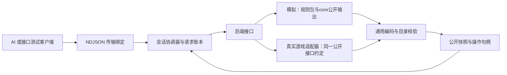

# net-the-spire 架构

模拟 Host 加载纯 DSL manifest，从规则声明派生公开目录与 Profile，转发合法动作和原生决策。具体支持的类型与决策见[协议](../../areas/net/reference/protocol.md)和[客户端参考](../../areas/net/reference/public-client.md)，正常 Run、有序多选及独立比较按[GitHub Issues](https://github.com/QingXiang22/auto-the-spire/issues/28)安排。

## 1. 组件与依赖

模块职责：`Net.TheSpire.Contracts` 保存协议类型与序列化校验；`Net.TheSpire` 保存公开投影与会话控制；`Net.TheSpire.Host` 负责 manifest 加载和 stdio 入口；`Net.TheSpire.Tests` 保存接口检查。生产 net 类库不依赖具体游戏规则，base 的装配属于 Host。

| 组件 | 拥有的数据与责任 | 禁止承担的责任 |
| --- | --- | --- |
| PublicCatalogBuilder | 从规则提供方的公开声明派生目录，核对版本与编码能力 | 从内部State反射公开字段，要求mod在net再写一份声明表 |
| IGameBackend | 启动/附着、推进到稳定边界、报告状态和能力 | 暗示所有后端都能重置、复制 |
| IPublicObservationSource | 提供当前有效的已知事实和公开标识 | 用完整隐藏排列直接代替当前可知事实 |
| SnapshotProjector | 已裁剪公开视图的协议编码、引用绑定、类型与结构校验 | 重做可见性判定、读取隐藏状态补值或按卡名选择字段 |
| CandidateBinder | 当前公开候选到内部动作的映射，只对当前版本有效 | 将 HandIndex 等暴露为外部执行参数 |
| SessionCoordinator | 单写者、版本核对、执行/快照原子发布和状态转换 | 将传输成功当作动作完成 |
| RequestLedger | request_id、载荷指纹、pending/最终响应 | 在无可靠去重记录时重试真实动作 |
| StdioHost | 帧解析、上限、关联 request_id、stderr 诊断 | 改变 DTO/游戏语义或写混合 stdout 日志 |

## 2. 当前已知信息的来源

必须先对每个训练配置建立“公开机制 → 当前字段/位置 → 提供方来源 → 验证场景”的映射。内核已有公开摘要就复用；确实缺少公开已知位置时，在环境提供方增加当前可知状态及其规则更新，不放到 AI、不新增供 AI 重放的历史协议。

映射格式、状态、来源定位和公开事实充分性审计见[约定资产第5节](../../areas/net/spec/contract-artifacts.md#5-机制覆盖与观察充分性审计)。N-02 前建立机制清单/可信来源，N-02 交付更新与失效实现及机制验证记录，N-05 验收覆盖完整，E2 前完成 V-15。它不是 AI 的知识模型，也不能用 fixtures 自证真实来源。

例如置顶、抽牌、洗牌、随机插牌各自改变的是当前可知位置。实现应通过规则层的明确结果或可信适配信号更新这些事实，不能读取完整牌序后全标为known。发现所需事实缺失，先交规则提供方补声明和规则更新；只有现有通用组合无法表达时才附最小复现交负责人判断core缺口。net不另写一套卡牌规则模拟。真实适配器如何形成这些当前事实由其内部决定，但不能依赖AI传来过往事件。

先使用明确覆盖的开发场景，列出未支持的公开约束。特殊“知道某牌位于前两张之一”不是确定位置，本协议暂不表达；该机制需新结构设计或被排除在当前训练配置之外，而非悄悄丢失。目录结构可扩展不等于每种规则都已适配。

## 3. 候选生成与原子发布

模拟后端读取`LegalAction.Definition`的类型化参数和`Bindings`中的合法参数元组，通用编码后保存 `(session_id, observation_id, candidate_id) → ActionDefinition与参数`。暂停时读取`PendingDecision`并保存合法回答的绑定，调用`Answer`续接原操作。net不按出牌/结束回合等名字生成动作，不另查牌区推算合法性；AI不能提交任意自造参数。

当前wire的piles是STS适配结构，其用途、位置及归属来自规则提供方，不能倒逼core内置牌区。通用集合已有的数量、成员和公开顺序必须有明确表示，不能因未标注为pile而消失。候选、成员、字段按公开键规范排序后发布；约定来源为[统一规范资产](../../areas/net/spec/contract-artifacts.md)，C#/Python不分别定义DTO。协议表达范围与内核不同，不能由派生 Profile 推断所有决策都已支持。

投影完成后校验每个候选的引用、目录和可执行性，再一次性发布不可变快照及绑定表。step 在同一会话执行门内核对版本并使用保存的动作；期间不重新按旧索引猜当前动作。非玩家自动结算推进到下一个真正选择边界，选牌暂停属于这个边界。

模拟 Host 从0开始分配会话内观察版本，每次实际完成的控制动作或应答推进一次，包括没有实体字段写入的决策和空动作。重复 observe、返回账本缓存及拒绝请求保持当前版本；候选绑定与快照使用同一版本。实体存储的 StateVersion 仍由 Engine 管理，不充当公开控制边界版本。版本达到安全整数上限时，在执行新动作前返回 capacity_exceeded。派生 backend_profile_id 包含 settled-control-boundary-v1，客户端按新标识重新绑定，wire 结构不变。

同会话的第二个控制请求直接 session_busy，不在无界队列中积压过期动作。observe 在 settling 返回状态；读不到半成品快照。不同会话可独立运行；首版 stdio 客户端串行，后续吞吐扩展用多个独立 worker，避免并发改一个规则状态。

## 4. ID、可见性与扩展

公开实例 ID 用不携带隐藏信息的映射。对内部 ID 不能仅假设安全：若其创建顺序泄漏隐藏排列/预生成内容，则以公开出现顺序或另一可审计机制映射；只给已经可识别的公开实体分配句柄。公开标识是否仍可跟踪取决于规则，不因洗牌而虚构新的标识，也不因为内部可跟踪就暴露玩家不可识别的对应关系。

[公开句柄映射](../../../net-the-spire/Net.TheSpire/Projection/PublicSnapshotProjector.cs)在会话与观看者范围内保持稳定。绑定属于 net 引用层，不能成为 AI 的历史知识缓存；句柄编号分布、排序和默认选择不得透露隐藏创建顺序。

原版/mod的通用公开声明以规则包和所选投影为源，公开ID按统一编码约定生成；字段形状与动作参数不在net逐项手写。仅不可推导的内容标识、集合用途、位置单位及终局解释由规则提供方补充。公开条件仍由规则提供方执行；AI的Manifest只消费结果。新增可见内容可扩目录，无法表示的新值结构需要协议升级，不能自动序列化任意插件对象。

有药水等机制的包/Profile需提供玩家可见实例、槽位/容量、可用状态与合法候选。优先复用实体/字段/关系；药水不是卡牌，不为借用位置结构塞进卡牌Pile。仅改变声明集合时通过目录/规则/Manifest标识区分新Gym，旧无药水Gym保持显式版本；不能因旧默认目录固定而省略已支持机制的可见状态。

## 5. 传输、失效与性能

首版采用 stdio 子进程使 C# 环境与 Python 消费端独立。优点是无需部署服务，可直接捕获输入/输出做约定检查；代价是完整 JSON 快照复制和编码开销。先测投影、序列化、编码、评分、动作结算各项耗时，再决定是否加批量或二进制绑定，不预设网络框架能解决性能问题。

去重与失效严格依[协议生命周期](../../areas/net/reference/protocol.md#5-生命周期与恢复)。进程活跃期间账本缓存至关闭；这需要容量上限并在超限前拒绝。对真实外部动作，无法凭 C# 锁实现跨系统事务；必须按能力验证版本/完成信号，未确认时 uncertain。模拟规则异常可能已经推进部分状态，此时隔离会话，不把失败回滚视为默认能力。

会话日志记录标识、request_id、观察版本、状态转换、候选数量和各阶段耗时；公开快照与内部调试日志分别存储。内部规则诊断可供规则检查，但不能被训练客户端、轨迹事实或模型特征读取。操作日志不自动形成 AI 的历史输入。

## 6. 设计取舍与验证

完整快照取代增量事件：增加传输量，但首阶段无需历史同步、断点补包或 AI 知识维护。完整候选取代命令生成：候选规模增大时有成本，但保证动作语义由游戏后端拥有。先支持本机单控制者：简化执行所有权，不承诺远程服务特性。

验收优先检查隐藏顺序不影响公开输入、当前已知位置正确、重发只推进一次及过期动作不推进。再检查模拟固定种子重放与 C#/Python wire 一致；完整原版和真实后端另有差分验证记录。详见[共同验收](../../specs/ai-net/verification.md)。未解决核心依赖在当前任务或 PR 中说明，不以改 AI 编码器绕开。

## 7. 公开声明与适配边界

模拟目录从 RuleSet／Projection 与必要静态元数据派生，动态事实和候选来自内核公开输出。net 不重写合法条件、可见性或具体内容效果。缺失的通用投影和决策能力须先明确需求，再同步协议、schema、两端 codec 与检查；未支持的类型显式拒绝。

真实游戏适配器是独立后端，应对齐同一公开事实与操作语义。接入前核对可见性、动作确认及 NoSL，不借模拟进程能力推断真实游戏支持重置、种子或重放。具体适配工具的研究和实施留在对应 Issue。
