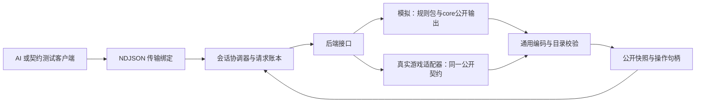

# net-the-spire 架构设计

本体适配器主要参考[本地BMingSY/sts2-ai-mcp](../../../reference/sts2-ai-mcp/README.md)，范围与职责见[第8节](#8-bmingsy本体适配器参考)。本体适配不作为模拟主线的前置依赖。

> 2026-10-04实施提示：已有stdio/账本/目录及持久公开句柄修复直接复用，下文2026-10-03公开ID“缺口”是历史时点，不重新派做缓存。当前按[ENV实现约束](../environment-implementation-constraints.md)接base统一配置Session和正式公开Profile，新增[协议0.2](protocol.md#7-env正式环境的02扩展)字符串seed启动。Net.TheSpire保持只依赖core/contracts，base组合留Host，不新增STS控制规则。

2026-10-07职责修订：规则包与内核拥有模拟侧公开语义，net通用编码并发布；真实游戏适配器对齐同一契约。手写Profile是当前实现，迁移目标与源码依据见[第7节](#7-2026-10-07公开语义透传的源码核对与接续)。该决定不改变已发布wire版本，也不重开冻结内核。

| 项目 | 内容 |
| --- | --- |
| 状态与版本 | IN_REVIEW；v0.1，2026-10-01；实现方案待评审 |
| 负责人、读者 | 项目维护者；net/core 接口实现者、真实适配器作者 |
| 范围与变化 | 将占位接口细化为可实施组件、投影和会话执行方案；不修改游戏规则 |
| 决策与依据 | [规范](spec.md)、[协议](protocol.md)和当前 C# 内核；建议 .NET 9 模拟提供方及本机 stdio 绑定 |
| 证据与下一步 | 静态阅读，无后端运行证明；先完成公开数据与适配测试，再扩展控制范围 |

## 1. 组件与依赖

建议目录：`net-the-spire/Net.TheSpire.Contracts/` 放纯 DTO/目录/序列化校验；`Net.TheSpire/` 放会话、公开投影及模拟适配；`Net.TheSpire.Host/` 放 stdio 入口；`Net.TheSpire.Tests/` 放可执行契约检查。沿用仓库 .NET 9/C#，不用网络服务框架。真实后端另包实现同一接口，在该阶段前不创建空壳大量项目。布局为设计提案，不表示已经注册 solution。

| 组件 | 拥有的数据与责任 | 禁止承担的责任 |
| --- | --- | --- |
| PublicCatalogBuilder | 从规则提供方的公开声明派生目录，核对版本与编码能力 | 从内部State反射公开字段，要求mod在net再写一份声明表 |
| IGameBackend | 启动/附着、推进到稳定边界、报告状态和能力 | 暗示所有后端都能重置、复制 |
| IPublicObservationSource | 提供当前有效的已知事实和公开身份 | 用完整隐藏排列直接代替当前可知事实 |
| SnapshotProjector | 已裁剪公开视图的协议编码、引用绑定、类型与结构校验 | 重做可见性判定、读取隐藏状态补值或按卡名选择字段 |
| CandidateBinder | 当前公开候选到内部动作的映射，只对当前版本有效 | 将 HandIndex 等暴露为外部执行参数 |
| SessionCoordinator | 单写者、版本核对、执行/快照原子发布和状态转换 | 将传输成功当作动作完成 |
| RequestLedger | request_id、载荷指纹、pending/最终响应 | 在无可靠去重记录时重试真实动作 |
| StdioHost | 帧解析、上限、关联 request_id、stderr 诊断 | 改变 DTO/游戏语义或写混合 stdout 日志 |

## 2. 当前已知信息的来源

必须先对每个训练配置建立“公开机制 → 当前字段/位置 → 提供方来源 → 验证场景”的映射。内核已有公开摘要就复用；确实缺少公开已知位置时，在环境提供方增加当前可知状态及其规则更新，不放到 AI、不新增供 AI 重放的历史协议。

映射格式、状态、来源定位和公开事实充分性审计见[契约资产第5节](contract-artifacts.md#5-机制覆盖与观察充分性审计)。N-02 前建立机制清单/可信来源，N-02 交付更新与失效实现及机制证据，N-05 验收覆盖完整，E2 前完成 V-15。它不是 AI 的知识模型，也不能用 fixtures 自证真实来源。

例如置顶、抽牌、洗牌、随机插牌各自改变的是当前可知位置。实现应通过规则层的明确结果或可信适配信号更新这些事实，不能读取完整牌序后全标为known。发现所需事实缺失，先交规则提供方补声明和规则更新；只有现有通用组合无法表达时才附最小复现交负责人判断core缺口。net不另写一套卡牌规则模拟。真实适配器如何形成这些当前事实由其内部决定，但不能依赖AI传来过往事件。

先使用明确覆盖的切片，列出未支持的公开约束。特殊“知道某牌位于前两张之一”不是确定位置，本协议暂不表达；该机制需新结构设计或被排除在当前训练配置之外，而非悄悄丢失。目录结构可扩展不等于每种规则都已适配。

## 3. 候选生成与原子发布

模拟后端读取`LegalAction.Definition`的类型化参数和`Bindings`中的合法参数元组，通用编码后保存 `(session_id, observation_id, candidate_id) → ActionDefinition与参数`。暂停时读取`PendingDecision`并保存合法回答的绑定，调用`Answer`续接原操作。net不按出牌/结束回合等名字生成动作，不另查牌区推算合法性；AI不能提交任意自造参数。

当前wire的piles是STS适配结构，其用途、位置及归属来自规则提供方，不能倒逼core内置牌区。通用集合已有的数量、成员和公开顺序必须有明确表示，不能因未标注为pile而消失。候选、成员、字段按公开键规范排序后发布；契约来源为[统一规范资产](contract-artifacts.md)，C#/Python不分别定义DTO。现有协议表达范围与内核不同，按第7节落实迁移，不假定替换Profile即可覆盖所有决策。

投影完成后校验每个候选的引用、目录和可执行性，再一次性发布不可变快照及绑定表。step 在同一会话执行门内核对版本并使用保存的动作；期间不重新按旧索引猜当前动作。非玩家自动结算推进到下一个真正选择边界，选牌暂停属于这个边界。

同会话的第二个控制请求直接 session_busy，不在无界队列中积压过期动作。observe 在 settling 返回状态；读不到半成品快照。不同会话可独立运行；首版 stdio 客户端串行，后续吞吐扩展用多个独立 worker，避免并发改一个规则状态。

## 4. ID、可见性与扩展

公开实例 ID 用不携带隐藏信息的映射。对内部 ID 不能仅假设安全：若其创建顺序泄漏隐藏排列/预生成内容，则以公开出现顺序或另一可审计机制映射；只给已经可识别的公开实体分配句柄。公开身份是否仍可跟踪取决于规则，不因洗牌而虚构新的身份，也不因为内部可跟踪就暴露玩家不可识别的对应关系。

2026-10-03历史缺口：当时`PublicInstanceId`直接发射内部实例序号；W-02随后交付会话/观看者内持久映射。当前[PublicSnapshotProjector.InstanceRefs](../../../net-the-spire/Net.TheSpire/Projection/PublicSnapshotProjector.cs)提供公开句柄，该能力在本次迁移中复用。该绑定归net控制/引用层，不是AI历史知识。检查允许一致的不透明句柄换名，但公开编号分布、规范顺序或默认选择不得透露隐藏创建先后。

原版/mod的通用公开声明以规则包和所选投影为源，公开ID按统一编码约定生成；字段形状与动作参数不在net逐项手写。仅不可推导的内容身份、集合用途、位置单位及终局解释由规则提供方补充。公开条件仍由规则提供方执行；AI的Manifest只消费结果。新增可见内容可扩目录，无法表示的新值结构需要协议升级，不能自动序列化任意插件对象。

有药水等机制的包/Profile需提供玩家可见实例、槽位/容量、可用状态与合法候选。优先复用实体/字段/关系；药水不是卡牌，不为借用位置结构塞进卡牌Pile。仅改变声明集合时通过目录/规则/Manifest身份区分新Gym，旧无药水Gym保持显式版本；不能因旧默认目录冻结而省略已支持机制的可见状态。

## 5. 传输、失效与性能

首版采用 stdio 子进程使 C# 环境与 Python 消费端独立。优点是无需部署服务，可直接捕获输入/输出做契约检查；代价是完整 JSON 快照复制和编码开销。先测投影、序列化、编码、评分、动作结算各项耗时，再决定是否加批量或二进制绑定，不预设网络框架能解决性能问题。

去重与失效严格依[协议生命周期](protocol.md#5-生命周期与恢复)。进程活跃期间账本缓存至关闭；这需要容量上限并在超限前拒绝。对真实外部动作，无法凭 C# 锁实现跨系统事务；必须按能力验证版本/完成信号，未确认时 uncertain。模拟规则异常可能已经推进部分状态，此时隔离会话，不把失败回滚视为默认能力。

会话日志记录身份、request_id、观察版本、状态转换、候选数量和各阶段耗时；公开快照与内部调试日志分别存储。内部规则诊断可供规则检查，但不能被训练客户端、轨迹事实或模型特征读取。操作日志不自动形成 AI 的历史输入。

## 6. 设计取舍与验证

完整快照取代增量事件：增加传输量，但首阶段无需历史同步、断点补包或 AI 知识维护。完整候选取代命令生成：候选规模增大时有成本，但保证动作语义由游戏后端拥有。先支持本机单控制者：简化执行所有权，不承诺远程服务特性。

验收优先检查隐藏顺序不影响公开输入、当前已知位置正确、重发只推进一次及过期动作不推进。再检查模拟固定种子重放与 C#/Python wire 一致；完整原版和真实后端另有差分证据。详见[共同验收](../ai-net-verification.md)。未解决核心依赖可报告到 `docs/review/tofix`，不以改 AI 编码器绕开。

## 7. 2026-10-07公开语义透传的源码核对与接续

本节记录静态核对与实施边界，设计决定已确认，生产迁移尚未交付。状态、认领和排期只维护主清单的ENV-T03；不另建公开接口任务体系。

### 7.1 什么可以直接派生，什么需要规则提供方补充

| 对外内容 | 现有依据 | net应承担的工作与实际缺口 |
| --- | --- | --- |
| 实体、字段、枚举与引用类型 | [RuleSet](../../../core-the-spire/Core.TheSpire/Engine/RuleSetData.cs)、[FieldDefinition](../../../core-the-spire/Core.TheSpire/Engine/Schema.cs)及所选Projection | 从允许公开的声明派生目录，按字段Shape编码。当前[PublicKindRule/PublishedField](../../../net-the-spire/Net.TheSpire/Projection/PublicVocabulary.cs)再次登记字段名、类型及类别表；这些可推导部分应移除手写维护 |
| 当前值、可见成员和关系 | [ParticipantView](../../../core-the-spire/Core.TheSpire/Engine/Projection.cs) | 保留每项公开事实，编码公开引用与集合结构。当前Profile还能Skip视图中的字段/集合/关系；旧受限场景可以保留显式身份，正式出口不能凭映射表缩减规则发布的事实 |
| 主动操作与参数 | [ActionDefinition](../../../core-the-spire/Core.TheSpire/Engine/Schema.cs)、[LegalAction.Bindings](../../../core-the-spire/Core.TheSpire/Engine/Scheduler.cs) | 通用绑定到Submit。当前[PublicSnapshotProfile.RequireAction](../../../net-the-spire/Net.TheSpire/Projection/PublicSnapshotProfile.cs)依赖手写动作表，新mod声明会因未登记而失败 |
| 结算中的选择 | [DecisionRequest/DecisionAnswer](../../../core-the-spire/Core.TheSpire/Engine/Scheduler.cs)、[DecisionResponseKind](../../../core-the-spire/Core.TheSpire/Engine/Ir.cs) | 依Kind和数量约束编码，回答交Answer。当前[BuildDecisionAnswers](../../../net-the-spire/Net.TheSpire/Projection/PublicSnapshotProjector.cs)仅支持EntityRef且Minimum=Maximum=1，不能宣称已透传全部决策 |
| 内容身份、集合用途及位置语义 | 通用字段/集合已有值和权限；内容目录、pile/group归属及已知位置字段角色目前由[SlicePublicProfile](../../../net-the-spire/Net.TheSpire/Projection/SlicePublicProfile.cs)解释 | 这些信息不能仅凭字段名称推导，应由base/mod的不可变构建元数据给出一次。已知位置的值和失效仍由包程序维护，net只读取对应公开事实 |
| 终局、规则与能力身份 | [TerminalOutcome](../../../core-the-spire/Core.TheSpire/Engine/Scheduler.cs)、RuleSet身份及规则提供方构建描述 | 终局ID/类型化字段直接编码；胜负解释和范围证据由提供方给出。catalog摘要及协议能力由net派生，不能根据终局名字猜Victory或重新推导规则身份 |

现有[PublicValueKind](../../../net-the-spire/Net.TheSpire/Projection/PublicVocabulary.cs)只覆盖整数、十进制、布尔、类别和实体引用；内核还有String、Participant、List及Binding等字段形状。公开String不能自动冒充有限类别，List不能丢弃；Participant作为决策的回答值也不等于调用者身份。遇到当前范围实际使用的不可编码结构，需要同步更新协议资产与双端codec。内部作用域或任意作者对象不因此成为公开载荷。

决策还存在输出描述的差距：当前DecisionRequest带Kind、候选和数量/数值界限，但没有枚举类型ID，不能单靠RuleSet可靠确定Enum回答对应哪张成员表。此项不能被写成“只删net映射即可完成”；实际需要时先确定公开请求缺少的信息，由负责人判断提供方补充方式或core兼容维护。多选和整数范围也不能靠枚举所有组合或截断候选来伪装支持，协议应保留真实约束。本轮不为尚未使用的形状新增核心接口。

### 7.2 声明来源与依赖方向

模拟侧的来源是所选RuleSet/Projection与该构建的不可变补充元数据，动态来源是同一稳定边界的Observe/LegalActions/PendingDecision/Terminal。元数据只补通用声明缺少的语义，不照抄实体/字段/动作清单，也不承载另一份可变游戏状态。

core保持通用C#声明与IR，不引用net DTO。base/mod只声明游戏语义，不能为了登记公开能力反向依赖net。Host组合规则提供方与net，必要的协议转换在这里接入；Net.TheSpire保持core/contracts依赖。现有SDK能提供的声明先直接读取，缺少游戏解释时由base工厂随构建返回只读信息，不以新增核心facade作为前置条件。具体元数据接口须在ENV-T03接入时落实，当前没有已发布的新API或DSL语法。

对真实游戏，适配器从本体形成相同公开事实与操作含义，控制器将绑定转换成真实操作。它与模拟侧共享契约及编码规则；两侧的种子、附着、恢复等能力可不同，describe必须如实声明。接口相同不表示两侧行为一致已通过对拍。

### 7.3 ENV-T03内的实施与完成条件

1. 接管base工厂返回的已配置、未Start会话，启动一次；复用既有句柄、账本和版本核对，保留0.1旧场景兼容，交付既定0.2字符串seed接口。
2. 以所选规则集/投影生成公开目录及通用动作编码，拆除正式路径对SlicePublicProfile逐项声明表的依赖。只读补充元数据补内容与结构含义，未知名字不触发STS特例。
3. 对M01/T05实际使用的字段、集合与决策逐项核对表达能力；确需扩展wire时同步文档、C#/Python/schema、身份和载荷证据，不能沿用旧版本静默增加值类型。其余内核形状按明确能力声明处理，不要求在当前包实现任意桌游出口。
4. 用一个仅在规则包增加公开字段和合法Action的扩展例验证：net生产源码无需新增注册行，目录/observe出现对应内容，step执行正确；新增内部块不自动成为外部操作。构造过期候选、重发和隐藏状态变化，确认旧保证保持。真实本体控制留既有后续范围，不新增空适配器。

迁移完成需要正常开局的describe/catalog/start/observe/step公开证据，以及新增声明的实际加载和执行证据；纯文档、反射列出字段或测试编译通过均不算已完成透传。完整ENV出口与源对拍仍按原验收合同进行。

### ENV-T03地图诊断材料边界（2026-10-11）

`Run.MapDraws`保存地图随机重放词表，属于诊断材料。普通 `observe` / `step` / 公开轨迹和正常catalog不发布它；地图节点/边、可见房型、游标和合法选点仍从规则投影派生。

实现时由base声明 `MapDraws` 为隐藏字段，net沿既有通用派生规则处理，不能按该字段名字硬过滤或另算地图。诊断材料仍保留在Engine权威状态，本地工具/SDK的显式诊断读取可用；此包不新增公共wire操作或为诊断暴露整个State。修改可见性必须更新实际构建/catalog身份与适用C#/Python/schema证据。旧0.1兼容按既有契约，正式0.2目录随规则变更；合法选择、公开句柄、重复提交和随机消费保持可核对。

负责人协调C仅在 `BaseSpire/Slice/MapRoomWiring.cs` 的MapDraws字段声明增加 `visibility: FieldVisibility.Hidden` 及必要邻近注释；该文件其他逻辑与base公共规则包构建器由A维护。此授权是单字段跨线接口，不授权C改玩法、药水、随机算法或DSL。

### ENV-T03公开声明闭合与旧切片后端装配（2026-10-12）

`describe.capabilities.supported_structures[].declaration_ids`必须落在**同一运行时**`get_catalog`已发布的公开ID里（`docs/contracts/net/0.1/invariants.md`的I-71/I-84，0.2沿用同一规则）。四类结构的ID空间：

| 结构 | 登记的公开ID | 不漏、不冒充 |
| --- | --- | --- |
| `Entity` | `kind.KindId`（`net:kind:<引擎类型>`） | 映射表键（`base-spire:Player`）只是映射键，不是目录声明ID |
| `Relation` | 已发布关系的`TypeId`（`net:relation:…`） | `Disposition.Published`为空的引擎关系不发；它没有`relation_type`，发布后就会产生无法解析的引用 |
| `LegalAction` | 各动作的`ActionTypeId`（`net:action:…`）加net自声明的`net:action:net.answer_decision` | 应答类型出现在wire的合法候选里（暂停期），目录也发布它，因此必须一并登记 |
| `TerminalResult` | 各终局的`ReasonId`（`net:reason:…`） | 同上，不用空数组掩盖缺失 |

`Pile`/`Sequence`/`Group`沿用各自`pile_type`/`sequence_type`/`group_type`的公开ID。列表按公开ID的UTF-8字节序去重排序，使同一目录无论注册顺序如何都产出同一份声明。

旧切片/作者场景的宿主组装：`ControlHost`/`ControlSession`带一个**可选**`IComputeBackend`参数，由组合层注入规则包声明资产所需的后端（`Net.TheSpire.Host`的`legacy-slice`分支与测试场景传`BaseSpireComputeBackend.Instance`）。通用控制层不认识任何游戏ID或玩法，只把实例转交引擎；不传时保持旧行为（执行该资产时报`Unsupported`，链接期只检查声明）。正式路径不走这个接口：后端由`ISessionSource`/base工厂在建会话时装好，控制入口只唤醒它一次。

实机证据与前后对比见[本包交接](../../review/tofix/dsh-host-declarations-close-handoff-2026-10-12.md)。

## 8. BMingSY本体适配器参考

2026-10-11：用户将主要参考项目放入 `reference/sts2-ai-mcp/`，本地HEAD为 `5d1d36b24337d7dd27fe125682e4c51fb9f76aa0`。参考[项目README](../../../reference/sts2-ai-mcp/README.md)、[决策窗口设计](../../../reference/sts2-ai-mcp/docs/ai-mcp-v2-design.md)和[API草案](../../../reference/sts2-ai-mcp/docs/ai-mcp-v2-api.md)。源码和真实游戏版本仍需按具体适配包核对；主清单维护排期，本节只定义实现方法。

本项目自行实现本体适配器。BMingSY用于定位游戏入口与研究结算行为；公共协议、实体与动作语义以本项目契约为准，模拟和本体使用同一Python消费接口。参考仓库保持只读，不进入core/base生产依赖，不把FastMCP工具格式或LLM摘要变成第二套AI状态模型。

| 参考位置 | 借鉴范围 | 本项目职责 |
| --- | --- | --- |
| `STS2AIMCP/Game/DecisionWindowService.cs` | current/wait/act、decision/action绑定、新稳定边界发布 | net统一观察版本、候选句柄及原子发布；不沿用跨窗口手牌索引 |
| `STS2AIMCP/Game/GameThread.cs` | 捕获游戏线程并调度工作 | 本体模块在主线程读取/核验对象和提交游戏动作 |
| `STS2AIMCP/Game/GameActionService.cs` | TryManualPlay、动作队列结算、选牌暂停、房间动作入口 | 每种界面上下文组织候选与执行，通用请求账本管理去重和结果查询 |
| `STS2AIMCP/Game/GameStateService.cs` | 活动界面、牌/能力/敌人及选择对象定位 | 本体提供玩家当前可见事实；隐藏状态、未知牌序和RNG不直接序列化 |
| `STS2AIMCP/Server/HttpServer.cs` | 本机传输与生命周期 | 传输只包装公共契约；模拟训练维持直接规则步进 |

接入位置：现有ControlSession直接持有core Session和PublicSnapshotProjector，尚未完成通用双后端抽取。真实适配开工时，将请求账本、观察版本和候选绑定与模拟执行分开；模拟侧继续消费core公开输出，本体侧消费游戏对象。保持冻结core和已发布wire契约，不为未来接口先建空项目。

稳定边界以动作队列、玩家输入和界面就绪共同判定。参考中的500ms快照静止条件只作本体过渡辅助，不能进入模拟训练的每步等待。选牌弹窗本身是合法回答边界；父动作暂停时先发布选择，回答后再跟踪余效，不能等待父动作完成才允许回答。超时不撤销已提交动作，客户端查询原request，不重复点击。

最小完整包先附着现有单人战斗，发布公开状态及完整合法候选，执行出牌/目标/结束回合，处理中途选牌及续接，识别胜负；同时验证过期拒绝和同request重发只提交一次。随后按奖励、地图、商店、事件等上下文扩大覆盖。正式验收绑定实际游戏版本、动作轨迹与未验证范围；社区源码存在不代替客户端实测。
