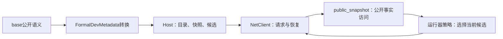

# 从公开接口启动并推进游戏

文档类型：教程（Tutorial）。面向第一次编写公开客户端的开发者。本教程用真实Host完成启动与三次公开候选提交；然后使用整局运行器推进已支持流程。当前验收只看[主清单T03](../../review/tofix/README.md#env-t03)。

本页与[客户端接口参考](public-client-reference.md)即可开始；只有缺少具体公开字段或动作时才进入Host实现。

## 1. 选择已构建的Host

从仓库根目录执行。将`HOST_DLL`替换为负责人提供的已构建文件路径：

```powershell
$publicHostDll = 'HOST_DLL'
Test-Path -LiteralPath $publicHostDll
```

结果应为`True`。负责人提供对应构建/范围与验证证据；示例直接运行DLL，不触发共享项目构建。不使用旧轨迹中的构建身份或候选ID。

## 2. 启动并提交三次当前候选

```powershell
python -X utf8 docs/examples/public-run/first_action.py --host-dll $publicHostDll --seed ACT1-BASIC-10 --max-actions 3
```

输出包括实际接受的seed、会话ID、每步观察ID、状态和操作名，最后为：

```text
step_limit: tutorial stopped; no whole-run conclusion
```

预期退出码为`3`，表示教程按步数停止。操作序列由选定构建发布的候选决定。本例取首候选，目的是展示接口；它不证明能够通关。完整代码在[first_action.py](../../../docs/examples/public-run/first_action.py)。

例子使用的核心调用如下：

```python
description = client.describe()["result"]
profile = description["capabilities"]["scenario_profiles"][0]["id"]
started = client.start(description["identity"], profile, seed=seed)["result"]
snapshot = started["snapshot"]
chosen = candidates(snapshot)[0]
snapshot = client.step(started["session_id"], snapshot["observation_id"],
                       chosen["candidate_id"])["result"]["snapshot"]
```

完整例子检查每个响应的`ok`。启动返回`{session_id, seed, snapshot}`；提交返回的快照在`result.snapshot`内。两者都不是Python的内部Engine对象。

## 3. 读取需要的公开事实

导入[public_snapshot.py](../../../net-the-spire/client/public_snapshot.py)：

```python
from public_snapshot import candidates, field, find_entity, sequence, pile_visible, relation_targets

run = find_entity(snapshot, "Run")
gold = field(run, "Gold")
deck_refs = sequence(snapshot, "LongTermDeck")
hand_refs = pile_visible(snapshot, "HandPile")
children = relation_targets(snapshot, "MapChildren")
offered = candidates(snapshot, "ChooseMapPoint")
```

字段不是`known`时，`field`返回`None`。公开可见成员不代表完整隐藏牌堆。`deck_refs`和`hand_refs`是本会话的公开引用，可用`entity_of(snapshot, ref)`查实体。单一base范围可以用短名；多个mod可能同名时使用运行期目录中的完整公开ID。

## 4. 处理选择和终止

每次提交之后重新取快照和候选；旧观察的`candidate_id`不得复用。动作中途需要目标或选牌时，公开出口会提供`net.answer_decision`候选，仍用相同的`step`方法提交。`status=decision`本身不能区分普通动作与中途选择，检查候选类型。

| 观察/结果 | 客户端处理 |
| --- | --- |
| `status=terminal` | 读取`terminal_result.outcome`；`win/loss/other`分别记录，死亡也是整局结论 |
| 公开`Run.ActCompleted=true` | 幕完成开发边界；不写成整局胜利 |
| 自设步数上限 | 记录未完成，退出控制 |
| Host拒绝或未知操作 | 记录原错误/候选与边界；不伪造完成 |
| `OutcomeUnknown` | 保留原请求ID并停止推进；NetClient已执行恢复查询，调用者不得盲目重发 |

## 5. 运行已支持的整局流程

```powershell
python -X utf8 -u net-the-spire/client/run_game.py --host-dll $publicHostDll --scope dev-map --seed ACT1-BASIC-10 --output .audit/public-run-example --max-actions 600 --use-potions
```

查看输出目录的`summary.json`确定终局或停止原因，`frames.ndjson`保存原始帧。具体策略与选项见[运行器说明](../../../net-the-spire/client/run_game.md)。运行器已经复用同一个快照访问模块。

新增决策只改`FixedOrderPolicy`的相应分支，消费当前公开候选；连接恢复、公开句柄生成和游戏结算分别由NetClient、Host和base规则拥有。房间接入后，负责人再用新DLL复放，旧DLL运行结果不升级为新构建证据。

## 6. 在商店里做一次公开交互

商店是正常流程里的一个房间（公开`Run.MapPhase=7`）。运行器默认**安全离店**：走进商店后直接提交公开`LeaveShop`，不买东西。要买一件或删一张，用显式选项：

```powershell
# 买公开 Price/Slot 最小的一张卡，然后离店
python -X utf8 -u net-the-spire/client/run_game.py --host-dll $publicHostDll --scope dev-map `
  --seed SEED-TEXT --output .audit/shop-buy-example --max-actions 400 --use-potions `
  --shop-policy buy --shop-buy-kind card

# 删一张（默认删候选里第一张长期牌；也可 --shop-remove-card 2 或 --shop-remove-card-id strike），再离店
python -X utf8 -u net-the-spire/client/run_game.py --host-dll $publicHostDll --scope dev-map `
  --seed SEED-TEXT --output .audit/shop-remove-example --max-actions 400 --use-potions `
  --shop-remove --shop-remove-card-id strike

# 只在一个声明了商店动作的 Host 上才进店；auto 会读公开目录决定
python -X utf8 -u net-the-spire/client/run_game.py --host-dll $publicHostDll --scope dev-map `
  --seed SEED-TEXT --output .audit/shop-room-example --max-actions 400 --shop-room auto --shop-policy buy
```

`--shop-room auto`（默认）在**进入地图节点之前**读取 `get_catalog` 的 `declarations.action_types`。五个商店动作（`BuyShopCard`/`BuyShopRelic`/`BuyShopPotion`/`RemoveShopCard`/`LeaveShop`）全部声明后，才把 `Shop` 视为已接入的房型。宿主没有声明这些动作时，例如构建尚不支持商店，仍返回 `unsupported_map_room`，不改整局状态。`--shop-room enter` 强制进店，可用于检查宿主对未接入房型返回的具体错误。

商店的具体事实都在公开快照里，客户端不重判规则：

```python
from public_snapshot import sequence, field, entities_of, candidates

offers = sequence(snapshot, "ShopOffers")            # 货架顺序（公开）
first = entities_of(snapshot)[offers[0]]
print(field(first, "Kind"), field(first, "Price"), field(first, "Sold"), field(first, "Unsupported"))
buyable = candidates(snapshot, "BuyShopCard")        # Engine 已经过滤好：已售/不可买/买不起都不在候选里
```

买不起、满药水栏、已售、不可买都由Engine的候选域与守卫决定：候选里没有就说明当前买不到，客户端不要自己算价格或容量。删牌会先暂停在`net.answer_decision`上问"删哪张长期牌"，候选就是公开`LongTermDeck`实例，仍然用同一个`step`提交。`summary.json`里的`shop_catalog`、`shop_room_entry`、`shop_events`、`shop_shelf_final`记录了这次访问的判定理由、整条公开货架与长期变化。

想核对"旧候选不能配新观察复用"这条公开契约，加`--probe-rejected-candidate`（通常配`--shop-policy buy`）：第一次真实买卡后，运行器用刚消费掉的旧`candidate_id`配当前`observation_id`重发一次`step`，再把结果写进输出目录的`rejected-candidate-probe.json`。预期宿主返回`ok=false`（具名`illegal_candidate`）、`no_advance.advanced=false`（公开事实逐字段不变）、`leave_available_after_rejection.available=true`（仍可离店）；宿主接受或状态推进时运行器立即按故障停止（退出码4）。这个反例只读当前公开快照，不生成候选、不猜参数。

## 调用关系



客户端开发从右侧三个节点入手。源码导航和响应结构见[接口参考](public-client-reference.md)，无需先重读全部Host或base规则包构建器。
