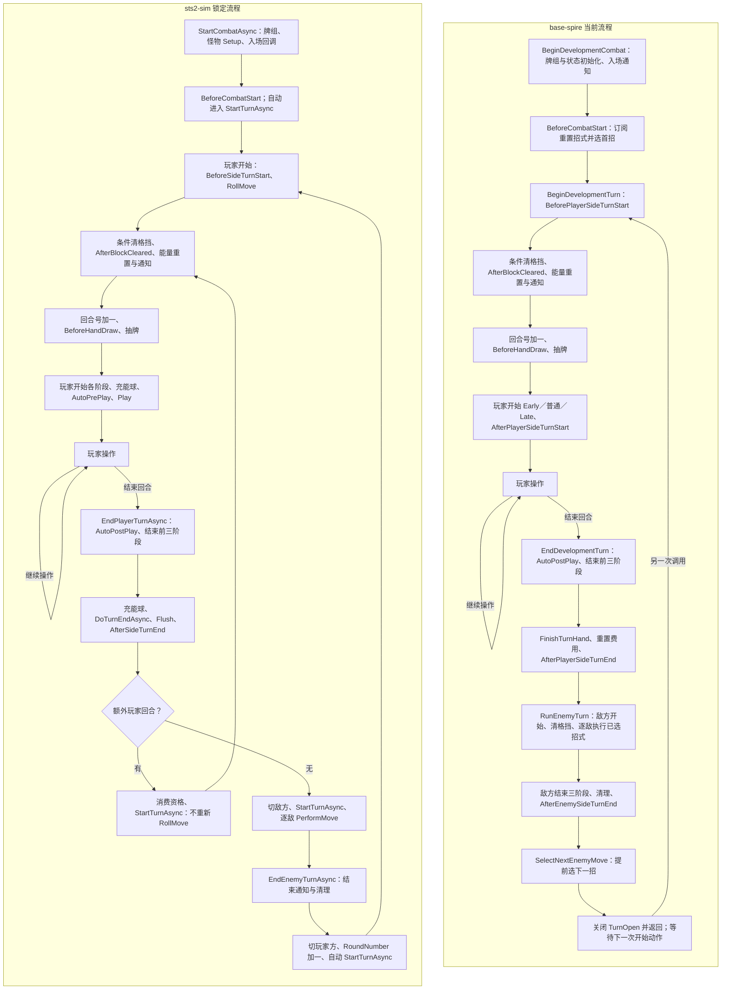
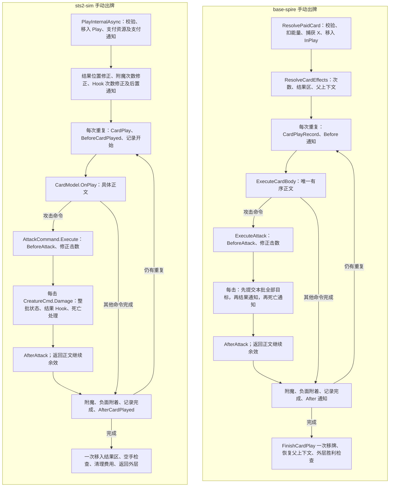
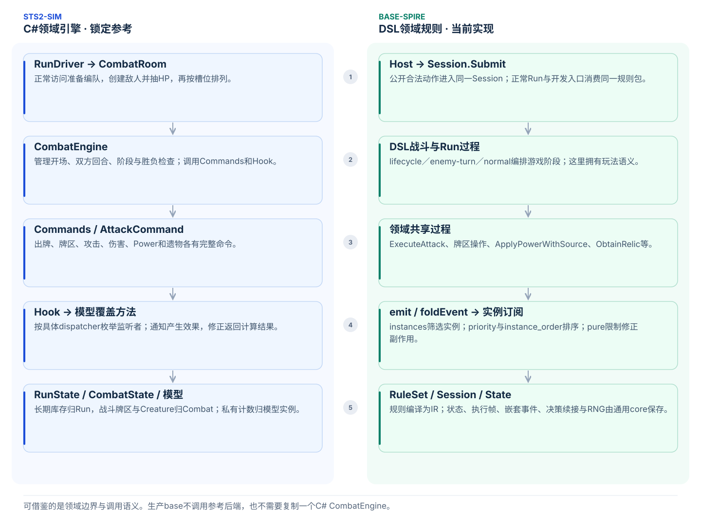
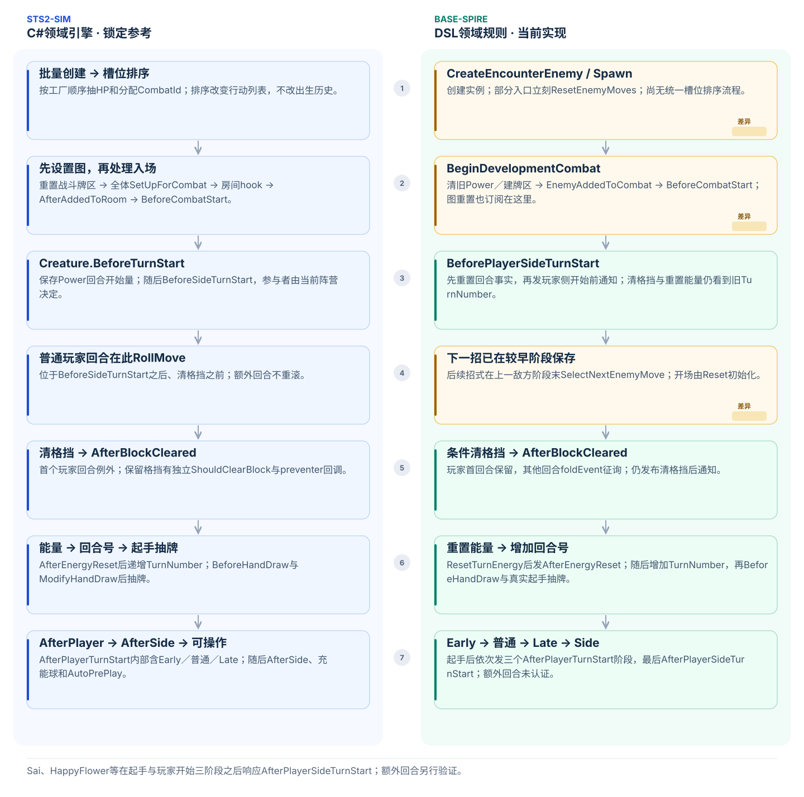
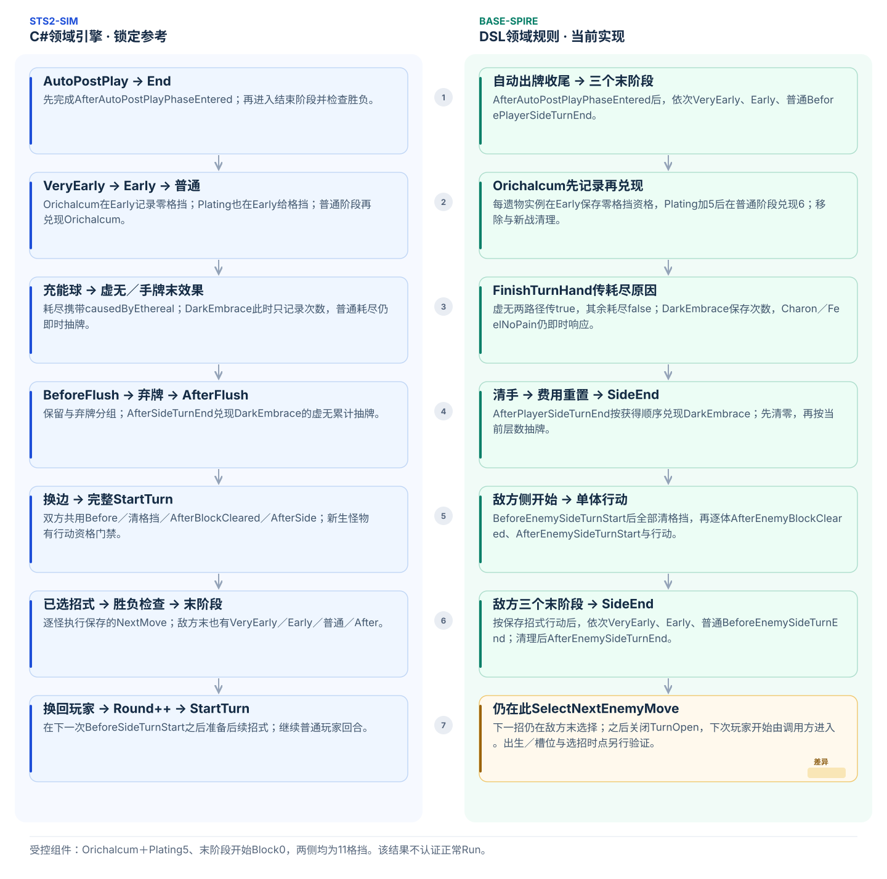
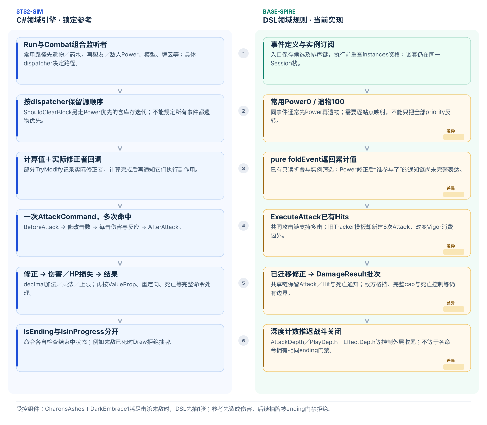
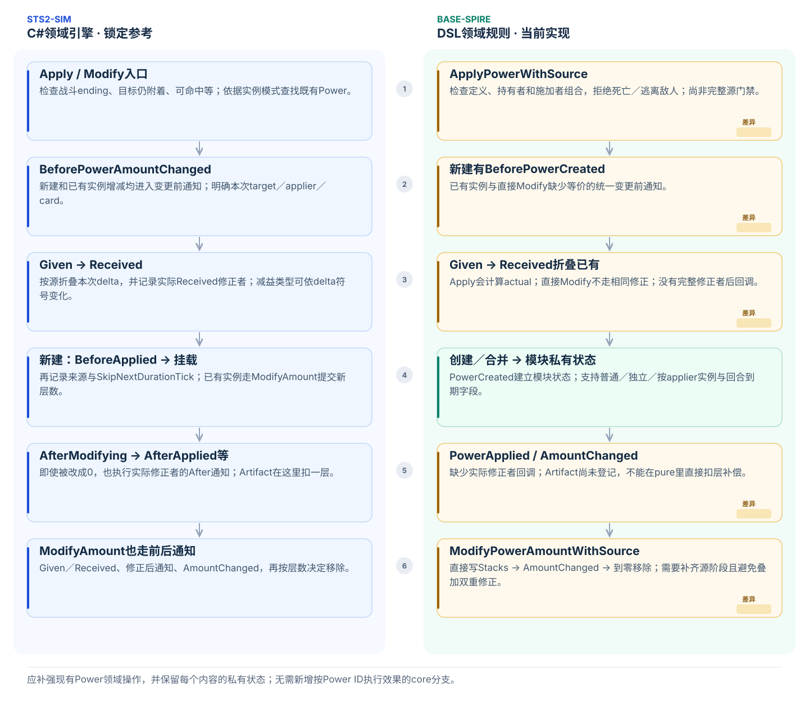
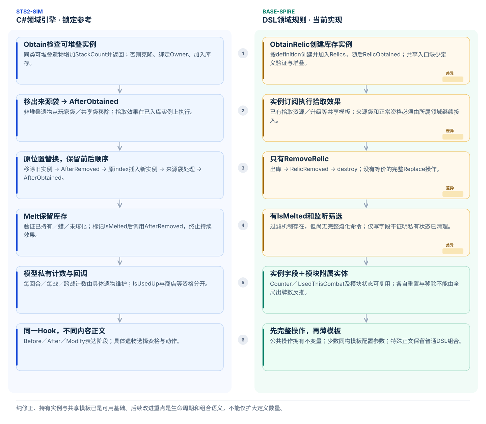

# 战斗引擎与效果生命周期对照

文档类型：解释（Explanation）。面向需要审阅共享玩法、迁移遗物／Power，以及判断效果应放在哪个阶段的开发者。

人工阅读可先打开[交互图文](combat-engine-comparison.html)：六个主题分别展示架构、开始阶段、结束阶段、监听与攻击、Power和遗物。点击节点可定位锁定源码，支持突出差异、导出SVG和打印全部图文。审查或实施前先读本文的[战斗内部调用与源码定位](#战斗内部调用与源码定位)和[差异与修改方案](#差异与修改方案)，其中区分当前代码、建议行为和验证条件。

本文比较[锁定sts2-sim](../../../../reference/README.md)的提交`611cea2b498ee1eba3743d185c210c6b2a4624a6`（声明版本v0.111.0），以及base-spire提交`2a9b96ef17c2866d66069d0765f64fe56a802c68`（包版本`0.7.0-dsl.73`）。图中展示这两个版本的主要路径；差异节点表示当前实现边界，不表示已修复。具体接口仍查[操作参考](../reference/operations.md)和[Power参考](../reference/powers.md)。

本文是有界源码对照，不是全内容符合性报告。继续工作前读取实际 manifest 与[参考锁定清单](../../../../reference/baselines/sts2-sim.json)，核对下面列出的符号；包版本相同也不能替代源码核对。源码变化时同步改文字、流程图及受影响的交互图。当前仍仅开放开发 scope；部分正常首战和事件战斗复用名称含 `Development` 的过程，不能据名称判断是否有正常消费者，也不能据局部可达性声称支持完整 Run。

## 战斗内部调用与源码定位

下表中的参考路径均相对于锁定 checkout 的 `src/Sts2Sim.Core/`。本地源码不存在时按[参考恢复说明](../../../../reference/README.md)准备；不要把未纳管的本地 checkout 当成正式文档链接，也不要改动参考源码以适配 DSL。

| 阶段 | sts2-sim 源符号 | base-spire 实际入口 |
| --- | --- | --- |
| 入战与玩家开始 | `Combat/CombatEngine.cs`：`StartCombatAsync`、`StartTurnAsync`、`SetupPlayerTurnAsync` | [lifecycle.spire](../../../../mod-the-spire/base-spire/combat/lifecycle.spire)：`BeginDevelopmentCombat`、`BeginDevelopmentTurn`；[normal.spire](../../../../mod-the-spire/base-spire/run/normal.spire)：`EnterNormalMapPoint` |
| 玩家结束与手牌 | `Combat/CombatEngine.cs`：`EndPlayerTurnAsync`、`DoTurnEndAsync` | `lifecycle.spire::EndDevelopmentTurn`；[piles.spire](../../../../mod-the-spire/base-spire/cards/rules/piles.spire)：`FinishTurnHand` |
| 敌人行动与换边 | `Combat/CombatEngine.cs`：`ExecuteEnemyTurnAsync`、`EndEnemyTurnAsync`、`NotifySideSwitch`；`Models/MonsterModel.cs`：`RollMove`、`PerformMove` | [enemy-turn.spire](../../../../mod-the-spire/base-spire/combat/enemy-turn.spire)：`RunEnemyTurn`；[move-graph.spire](../../../../mod-the-spire/base-spire/enemies/rules/move-graph.spire)：`ResetEnemyMoves`、`PerformEnemyMove`、`SelectNextEnemyMove` |
| 一次出牌与重复 | `Models/CardModel.cs`：`PlayInternalAsync`、`PlayAfterObserverStartedAsync` | [play.spire](../../../../mod-the-spire/base-spire/cards/rules/play.spire)：`ResolvePaidCard`、`ResolveAutoCard`、`ResolveCardEffects`、`FinishCardPlay` |
| 攻击与逐击伤害 | `Commands/Builders/AttackCommand.cs::Execute`；`Commands/CreatureCmd.cs`：`Damage`、`DamageSingle`、`ResolvePotentialDeath`、`ResolveConfirmedDeath` | [attacks.spire](../../../../mod-the-spire/base-spire/combat/attacks.spire)：`ExecuteAttack`；[damage-results.spire](../../../../mod-the-spire/base-spire/combat/damage-results.spire)：`ResolveEnemyDamage`、`ResolvePlayerDamage`、`PublishDamageBatch` |
| 结束中与结果提交 | `Combat/CombatEngine.cs`：`IsEnding`、`CheckWinCondition`；`Rooms/CombatRoom.cs`：`ResolveOutcomeAsync`、`ResolveVictoryOnceAsync`、`CompleteCombatOnceAsync` | [hook-order.spire](../../../../mod-the-spire/base-spire/combat/hook-order.spire)：`CombatIsEnding`；`lifecycle.spire`：`CheckCombatVictory`、`CheckCombatDefeat`；`normal.spire`：`ClearNormalCombat`、`SettleNormalCombat` |
| 通知及修正派发 | `Hooks/Hook.cs` 的具体站点；`Runs/RunState.cs`、`Combat/CombatState.HookListeners.cs` 的监听枚举 | [hook-order.spire](../../../../mod-the-spire/base-spire/combat/hook-order.spire)、各 DSL 订阅与 [Session.Events.cs](../../../../core-the-spire/Core.TheSpire/Engine/Session.Events.cs) |

### 当前双方回合循环

实线是各自实际推进关系，不表示左右节点完全等价。图仅展开战斗继续时的主链；末杀、死亡和暂停会在具体命令／阶段边界分流，不能由主链补发后续通知。普通正常首战入口会连续调用 base 的入战与首回合开始，但后续回合仍采用下图的分步动作。

### 出牌、攻击与每击目标批次

先区别一次出牌动作、一次重复执行、一次攻击和一次命中。`AfterCardPlayed` 在双方都处于重复循环内部；一次性移入结果牌区发生在整个重复循环之后，不能把该通知移动到循环外。下图将正文中的非攻击命令省略为直接返回正文；它们仍按所属正文顺序执行。

base 的手动指定目标入口在支付前通过原生 `decide` 暂停；回答后才进入 `ResolvePaidCard`。自动出牌使用自己的目标与支付策略，不应按手动图推断为全部自动操作都免费。具体支持边界见[内容行为要求 G02～G06](../../../design/mod-the-spire/content-behavior-migration.md)。

## 差异与修改方案

以下 CF 编号只定位技术差异，不保存负责人、进度或排期。方案均未因本文而实施；实施须按现有工单授权范围、依赖及最新源码重新核对。已有机制对应[行为要求 G01～G10](../../../design/mod-the-spire/content-behavior-migration.md)，实例监听遵循[统一约定](../../../design/mod-the-spire/effect-listeners.md)。

### CF01：出生、图初始化与选招时点不同

- **现状与依据**：参考 `CombatRoom.Prepare` 按工厂顺序创建并抽 HP 后按槽位排序；`StartCombatAsync` 为全部怪物 Setup 后执行入场回调；普通 `StartTurnAsync` 在 `BeforeSideTurnStart` 后、清格挡前 `RollMove`。base 部分生成入口已 `ResetEnemyMoves`，`BeforeCombatStart` 订阅再重置并选首招，后续在 `RunEnemyTurn` 末尾 `SelectNextEnemyMove`。详见上表源码和[敌人领域约定](../../../design/mod-the-spire/enemy-turn/spec.md)。
- **影响**：入场 Power 或开始通知改变条件节点时，提前选招会读旧状态；重复重置可能重放历史或消费随机。固定轮转一致不能排除这些差异。
- **方案**：按[#127](https://github.com/QingXiang22/auto-the-spire/issues/127)分离创建、出生状态、图初始化和选招，保留稳定出生标识与行动槽位两种顺序；将普通选招移入 DSL 玩家开始的准确站点，再去掉旧末阶段准备。首招、已准备招、击晕恢复和额外回合分别定义，不能直接移动一次调用而保留重复重置。
- **验证**：比较创建顺序与槽位不同的编队、入场状态决定首招、开始通知改变分支，以及 Whistle 首招前击晕／恢复。核对每个通知边界的节点、历史、实际随机调用与完整流状态；不重设游标、不补抽。

### CF02：下一回合由谁推进属于接口选择

- **现状与依据**：base `EndDevelopmentTurn` 执行敌方回合后关闭 `TurnOpen` 并返回，下一次 `BeginDevelopmentTurn` 是另一次公开动作。参考 `EndEnemyTurnAsync` 换边并增加 `RoundNumber`，立即 `StartTurnAsync`；`EndPlayerTurnAsync` 还可分流到额外玩家回合。
- **影响**：把两边的 `EndTurn` 返回状态直接比较，会分别得到“等待开始”和“下一玩家行动阶段”。这是一项显式开发接口差异，不能直接判为所有内容效果错误，也不能把额外开始动作漏出比较协议。
- **方案**：先在正常战斗的行为约定确定稳定返回边界，再在 base DSL 编排换边与下一玩家回合。开发分步入口若仍有消费者，单独保留其明确语义；比较适配器只能记录声明的动作映射，不能代执行遗漏的游戏效果。Host 和 core 不增加自动游戏推进器。若改变公开动作及返回边界，同步迁移 net 客户端、候选、脚本和随机／事件比较。
- **验证**：从一次真实结束回合直到下一合法玩家动作，比较敌人行动次数、玩家回合号、能量、手牌、阶段通知和随机消费；额外回合不执行敌人行动、不重选普通招式；结束中或死亡不再开启新回合。

### CF03：开始阶段与敌方行动资格尚未接齐

- **现状与依据**：参考 `StartTurnAsync` 调用生物开始处理、条件清格挡及 `AfterPreventingBlockClear`，还有充能球和 `AutoPrePlay`。base 当前开始主链没有全部对应阶段；`RunEnemyTurn` 直接清活动敌人格挡，行动筛选没有参考 `SpawnedThisTurn` 和死亡后保留生物的完整语义。已有玩家 `ShouldClearBlock` 不代表敌方拥有同样修正路径。
- **影响**：阻止清格挡、入场当回合是否行动、额外回合及角色专属消费者可能落在错误阶段。普通 Ironclad 组件不能证明这些分支符合。
- **方案**：在 `lifecycle.spire`、`enemy-turn.spire` 及拥有状态的领域补齐实际消费者所需的阶段和资格；不同侧的清格挡查询应带明确持有者，先完整处理参与者再发布后置通知。与 CF01／CF02 共用换边定义；充能球、召唤／复活和其他角色的恢复须有独立授权，不能仅新增空事件便宣称支持。
- **验证**：第一回合保留格挡、阻止清格挡的后置回调、多个敌人先全部清格挡再行动、同侧新增实例及各回合类型；未支持消费者保持明确拒绝。检查 `AfterEnergyReset` 读取旧回合号、起手后开始通知读取新回合号。

### CF04：支付、结果位置和次数捕获不完全相同

- **现状与依据**：base `ResolvePaidCard` 先扣能量，再移入 `InPlay`；`ResolveCardEffects` 先 `ModifyPlayCount`，再计算有限的结果区策略。参考 `PlayAfterObserverStartedAsync` 先移入 `Play`，再支付能量／星星并发支付通知，再修正结果位置及通知实际修正者，随后经过附魔和 Hook 修正重复次数。参考完成出牌后还有空手检查。
- **影响**：移牌与支付监听读取到的能量不同；结果区修正者、次数修正者及其后置副作用可能错序或缺失。两边都有重复循环和一次结果移牌，不代表这些捕获点相同。
- **方案**：在 `cards/rules/play.spire` 按 G02／G05 定义资格、费用读取、移牌、实际支付与通知、结果位置、次数的准确顺序；保持每次操作独立的支付／原始 X 快照和父执行。通知执行真实副作用，pure 修正只计算值；星星等新资源按消费者单独纳入范围。手动、自动、已付费批次分别迁移，不能把免费策略扩至全部自动路径。
- **验证**：移入 Play 的监听读取支付前能量、支付后监听读取实际扣除量；修正结果位置后改变次数的非交换场景；X 值、重复支付一次、嵌套自动批次、暂停续接、空手反应。两侧期望分别由锁定源码执行产生，不由 DSL 自算。

### CF05：回合末效果牌的依赖与结束中检查需逐点比较

- **现状与依据**：base `FinishTurnHand` 固定虚无／效果牌名单，先耗尽普通虚无牌，再逐张完整处理效果牌，然后 Flush。参考 `DoTurnEndAsync` 还有充能球前置，并为效果牌建立移入 Play 与前一张结果的依赖；headless 下移牌可先于上一张效果完成。参考 `EndPlayerTurnAsync` 在多个位置 `CheckWinCondition`；base 有外层深度保护，但 `FinishTurnHand` 内部分支检查的是 `CombatActive`／HP，不能将它当作 `CombatIsEnding`。
- **影响**：第一张末杀或嵌套移动其他效果牌时，后续牌的所在牌区与通知资格可能不同；只比较最终弃牌堆会漏掉差异。现有虚无原因和 DarkEmbrace 延迟抽牌已接入，不应回退为即时抽牌。
- **方案**：保持原快照和 `causedByEthereal`，按参考实际依赖重建“收集、入 Play、效果、结果、Flush”的 DSL 批次；不用墙钟延时模拟动画。逐站点定义结束中行为和胜负提交位置，不能简单将所有判断替换成统一提前返回。
- **验证**：两张末效果牌，首张末杀／抽牌／移动后张，普通虚无与效果虚无混合、耗尽反应重洗、BeforeFlush 末杀、DarkEmbrace 在侧结束延迟抽牌；比较中间牌区、通知序列及随机调用，而非仅最终状态。

### CF06：伤害批次形状对应，完整修正与死亡链仍有缺口

- **现状与依据**：双方都是每击先提交全部目标，再结果反应，最后死亡处理。参考 `CreatureCmd.DamageSingle` 还包含伤害修正、`BeforeDamageReceived`、HP 损失分阶段修正、承伤转移；`Damage` 在死亡处理前发布破格挡、HP 变化、伤害给予／接收等 Hook。base `ResolveEnemyDamage`／`ResolvePlayerDamage` 和结果通知仅承载已迁移部分，数值仍有四位整数中间值；`PublishDamageDeath` 未提供完整防死链。
- **影响**：批次顺序一致不能证明修正精度、承伤者、死亡防止、通知参与者一致；直接伤害与真正攻击也不能共用隐含来源。
- **方案**：按 G03～G05 扩充现有伤害操作和结果来源，保留每击目标与逐结果顺序；每项缺失修正、后置通知和数值策略先写输入／输出，再接真实消费者。死亡事实、阻止死亡、确认死亡和移除分开；暂停的防死／复活内容不因本文自动恢复。共用原 Engine 数值能力，通用缺口另给最小复现。
- **验证**：群体同击致死、反击杀死攻击者、全挡／破挡／超杀、非交换乘法与取整、无加成攻击和直接伤害、实际来源与 Feed 收益；承伤转移和防死仅在获准实现后补独立用例。逐结果保存请求值、最终值、实际失血、承受者和事件顺序。

### CF07：结束中、失败和胜利提交不是同一个边界

- **现状与依据**：base `CombatIsEnding` 以活动敌人和玩家生命判断；`CheckCombatVictory` 还要求死亡／逃离事实，且等待 `DamageDepth`、`AttackDepth`、`PlayDepth`、`EffectDepth` 全部退出；`CheckCombatDefeat` 在玩家伤害发布路径提交。参考 `IsEnding` 使用玩家存活、主要敌人与 `ShouldStopCombatFromEnding`；`CheckWinCondition` 在显式边界提交。两侧不能用一个 Bool 互相替代。
- **收尾对应**：base 胜利为 `CombatEnded → ClearNormalCombat → CombatVictoryEarly → CombatVictory → SettleNormalCombat`；参考为 `CheckWinCondition → CombatRoom.ResolveOutcomeAsync → AfterCombatEnd → ClearCombatForVictory → AfterCombatVictory（Early／普通）→ 奖励生成`。base 失败先关闭状态，再玩家死亡通知、Power 清理、`CombatEnded`、失败访问提交；参考 `ResolveOutcomeAsync` 不走胜利收尾，退出房间另负责解除战斗关联，不能机械补发胜利链。
- **方案**：在[战斗结束约定](../../../design/mod-the-spire/combat-end/spec.md)和 Run 约定分开定义结束条件、命令资格、死亡提交和房间收尾；恢复主要敌人／阻止结束机制时保留开发空场不自动判胜的显式范围。沿准确外层边界恰好一次清理与提出奖励，不允许更早清空出牌／攻击引用。保持已有 Feed 末杀收益和 ending 时拒绝抽牌／格挡／耗尽等各自源规则。
- **验证**：末杀正文余效、AfterAttack／AfterCardPlayed 反应、嵌套末杀、玩家与最后敌人同批死亡、全部逃离、空开发场、重复结果提交；扩展主要敌人机制时加入次要敌人仍存活与阻止结束场景。分别核对结果确定、结束通知、清理和奖励边界，不只比较 `Won`。

### CF08：监听枚举与有效资格需按 dispatcher 逐个核对

- **现状与依据**：base 的通用事件执行器固定候选并在调用前复核实例资格，参考各 Hook 的枚举路径和快照方式不完全相同；参考本身也有已声明的模型资格简化。已接 Run／Direct 两类排序不表示所有新通知都可复用同一排列。
- **方案**：新增或修改阶段时注明源 Hook 的枚举函数、是否快照、过滤条件与本次 payload；内容私有状态继续归所属模块。若锁定源与通用 Session 的资格语义发生可观察冲突，先给最小消费者及双方轨迹，按当前核心约定协调；不能把 core 改成遗物专用调度器，也不能把源改成理想化行为来消除差异。
- **验证**：交换库存／Power 获得顺序，同定义双实例、执行中移除／新增后续监听者、嵌套和暂停；分别比较 Run 与 Direct 站点。Observe／LegalActions 仍不得写状态或消费随机。

### 实施约束与验证安排

按所属领域确定依赖：CF01 的出生与选招、CF02 的换边和返回边界、CF07 的结束中定义会影响 CF03／CF05 的阶段接入；不能只改末端内容数值补偿上游顺序。CF04／CF06 修改共享出牌或伤害操作时，须保留既有批次、嵌套、来源与实例隔离。此处说明技术依赖，不指定执行顺序或恢复暂停任务。

每次实现都应保留双方原始阶段名称、稳定实例对应、通知顺序、完整牌区和逐流随机轨迹；声明清楚双方动作映射及返回边界。受控输入与正常可达路径分别验证；调试观察不能进入公开 AI 输入。缺例、缺维度、未支持和首差保留非零，不删原 suite、不缩小来源池、不重写参考或期望值制造通过。

本页仅修改文档时运行 `python tools/ci/check.py docs`。后续实现按[验证指南](../how-to/verify-and-debug.md)选择 base／net／migration 组及定向双侧场景；[差异工具说明](../../../../tools/differential/README.md)列出的现有组件命令只证明各自范围。新增场景必须实际接入比较器并执行，不能把已有命令或本文方案当作修复验证。任何方案都不以局部组件一致替代完整正常 Run 或真实客户端保真。

## 两侧的职责与状态

sts2-sim把战斗领域直接写在C#模型与命令中：`RunDriver`通过`CombatRoom`准备本场状态；`CombatEngine`推进阶段；`Commands`执行完整操作并调用`Hook`；具体遗物、Power、怪物或卡牌覆盖模型方法响应。模型可以继续调用命令，形成嵌套效果。长期库存属于Run，战斗参与者和牌区属于Combat，内容私有计数属于模型实例。

base-spire把这些领域规则放在DSL：Host提交公开动作，通用`Session`执行已编译规则；Run与combat过程编排阶段；共享过程处理攻击、牌区、Power与库存；内容通过实例订阅参与通知或只读修正。可变状态、执行帧、随机流和决策续接由core管理。两侧都需要完整领域操作，承载它们的语言与模块位置不同。

迁移时应保留输入、状态变化、事件时点、实例寿命与随机消费。无需复制一个生产C#战斗引擎，也无需把每个C#模型机械地变成一个DSL模板。规则继续放在base，core不增加按游戏内容ID执行效果的分支。

源码入口：[参考CombatEngine](https://github.com/iRyougi/sts2-sim/blob/611cea2b498ee1eba3743d185c210c6b2a4624a6/src/Sts2Sim.Core/Combat/CombatEngine.cs)、[当前DSL生命周期](../../../../mod-the-spire/base-spire/combat/lifecycle.spire)、[Session事件执行器](../../../../core-the-spire/Core.TheSpire/Engine/Session.Events.cs)。

## 开场与玩家回合开始

参考的正常准备先按工厂顺序创建全部怪物，抽取HP并分配`CombatId`，随后按槽位排列行动列表。进入战斗后重置玩家与牌区，为全部怪物设置招式图，执行房间准备回调与`AfterAddedToRoom`，再发布`BeforeCombatStart`。出生历史、行动顺序和入场效果不是同一个排序问题。

参考普通玩家回合的主要顺序为：保存各Power的回合开始量，`BeforeSideTurnStart`，为怪物`RollMove`，按条件清格挡与`AfterBlockCleared`，重置能量与`AfterEnergyReset`，增加`TurnNumber`，起手抽牌，`AfterPlayerTurnStart`，`AfterSideTurnStart`，充能球和自动出牌阶段，胜负检查，再允许操作。`AfterPlayerTurnStart`的dispatcher内部依次调用Early、普通和Late；额外回合不按普通路径重新选招。

当前DSL的`BeginDevelopmentCombat`清理旧战斗状态与准备牌区，发布敌人入场和`BeforeCombatStart`；部分生成入口已提前重置招式图，开场订阅又会重置。普通玩家回合先`BeforePlayerSideTurnStart`，按条件清格挡及`AfterBlockCleared`，重置能量与`AfterEnergyReset`，此时仍是旧回合号；再增加回合号，发布`BeforeHandDraw`并抽牌，随后依次Early、普通、Late和`AfterPlayerSideTurnStart`。

Sai、HappyFlower等当前按明确阶段与实例获得顺序响应。选招仍在上一敌方阶段末，出生／槽位与选招时点尚需独立迁移；不能由普通开始阶段的组件一致推断全部编队流程已符合。

源码入口：[参考CombatRoom](https://github.com/iRyougi/sts2-sim/blob/611cea2b498ee1eba3743d185c210c6b2a4624a6/src/Sts2Sim.Core/Rooms/CombatRoom.cs)、[参考Hook](https://github.com/iRyougi/sts2-sim/blob/611cea2b498ee1eba3743d185c210c6b2a4624a6/src/Sts2Sim.Core/Hooks/Hook.cs)、[当前敌方流程](../../../../mod-the-spire/base-spire/combat/enemy-turn.spire)。

## 回合末与敌方阶段

参考在自动出牌收尾后进入结束阶段，依次发布VeryEarly、Early与普通末阶段通知，处理充能球、虚无与手牌末效果，再执行`BeforeFlush`、保留／弃牌、`AfterFlush`、`AfterSideTurnEnd`。随后换边进入敌方完整开始生命周期，依次执行已选招式与胜负检查，再进入敌方末阶段。换回玩家后增加Round，下一次普通玩家开始阶段才准备后续招式。

当前DSL在自动出牌收尾后依次发布VeryEarly、Early、普通`BeforePlayerSideTurnEnd`，调用`FinishTurnHand`，重置回合费用，再`AfterPlayerSideTurnEnd`。敌方先侧开始前通知、全部清格挡、逐体清格挡后通知及侧开始，再逐体行动；三个结束前阶段、清理与`AfterEnemySideTurnEnd`之后仍选择下一招。下一次玩家开始由调用方推进；额外回合未认证。

Orichalcum在Early按每个遗物实例记录零格挡资格，允许Plating增加5格挡，再在普通阶段兑现6点。当前DSL已保存并清理这份私有资格，组件结果与参考均为11；移除、熔化和新战避免旧资格泄漏。

耗尽操作和`CardExhausted`保留`causedByEthereal`：两条回合末虚无路径为true，其他正文／出牌／选牌／强制耗尽为false，不能从虚无关键词推断原因。DarkEmbrace按实例累计虚无次数，在持有者`AfterPlayerSideTurnEnd`先清零再按当前层数抽牌；普通耗尽仍即时抽牌。CharonsAshes和FeelNoPain接收原因但继续即时伤害／格挡。

源码入口：[参考DarkEmbrace](https://github.com/iRyougi/sts2-sim/blob/611cea2b498ee1eba3743d185c210c6b2a4624a6/src/Sts2Sim.Core/Models/Powers/DarkEmbracePower.cs)、[参考Orichalcum](https://github.com/iRyougi/sts2-sim/blob/611cea2b498ee1eba3743d185c210c6b2a4624a6/src/Sts2Sim.Core/Models/Relics/Orichalcum.cs)、[当前牌区操作](../../../../mod-the-spire/base-spire/cards/rules/operations.spire)。

## 监听顺序、攻击与战斗结束

参考常用的`RunState.IterateHookListeners`先枚举玩家遗物与药水，再组合Combat监听者；Combat通常按盟友、敌人枚举Power、怪物及玩家专属牌区等。具体dispatcher可以选择不同路径，例如`ShouldClearBlock`使用Power先于库存的路径。因此不存在适用于所有通知的“遗物一定先于Power”规则。参考对不同模型的有效资格检查也有已声明的简化，不能把它理想化为全部模型都会严格重查库存。

当前`Session`在事件入口保存候选与排序键，按`priority`、`instance_order`和声明顺序执行，调用前重查实例存在及筛选资格。base按站点显式选择Run或Direct次序：常用广播先库存再玩家Power／牌与敌方，ShouldClearBlock等Direct路径Power先于库存。各阶段独立快照；期间移除／新增按执行器资格处理。

通知允许副作用和嵌套效果；`pure foldEvent`只计算值。当前Power改量用隐藏上下文记录Received实际参与者，再单独通知它们执行副作用。Artifact在这一阶段消费层数，修正为0也保留参与记录，不在pure计算中写状态。

攻击以整次Attack为边界，再包含多个Hit。旧七敌人已迁移到招式图，Tracker用`EnemyAttack`创建一次八击Attack，Vigor作用全部八击后消费；Vigor3时双方伤害均为32。攻击前后通知、每击伤害、反应与结果继续复用完整操作。

战斗结束有不同含义。当前DSL用深度计数推迟外层结算，并为Draw、GainBlock、Exhaust与Power改量加入源ending门禁；已进入的监听快照仍可继续，后续命令各自判断。Feed末杀仍增加最大生命并治疗，但收尾自耗尽被拒绝。正常整局认证与其他命令的未支持边界仍独立。

源码入口：[参考RunState](https://github.com/iRyougi/sts2-sim/blob/611cea2b498ee1eba3743d185c210c6b2a4624a6/src/Sts2Sim.Core/Runs/RunState.cs)、[参考AttackCommand](https://github.com/iRyougi/sts2-sim/blob/611cea2b498ee1eba3743d185c210c6b2a4624a6/src/Sts2Sim.Core/Commands/Builders/AttackCommand.cs)、[当前攻击过程](../../../../mod-the-spire/base-spire/combat/attacks.spire)、[通知与修正规格](../../../design/mod-the-spire/effect-listeners.md)。

## Power的完整变更

参考施加Power时先判断战斗状态、目标附着与可命中资格，寻找已有实例。新建和层数变更都需要经过变更前通知、Given／Received修正，记录实际Received修正者，再提交实例与层数；新建还有`BeforeApplied`。计算完成后通知实际修正者，即使最终变化为0也可能消费其他Power；非零时再处理新建后的通知、层数变化及必要移除。实例模式、来源、回合到期状态也属于这条生命周期。

当前`ApplyPowerWithSource`、叠加与`ModifyPowerAmountWithSource`共用一次变更流程：变更前通知、Given加法／乘法、Received参与记录、提交实例／层数、修正者After与后置通知、按层数移除。每次操作拥有独立隐藏上下文，嵌套／暂停不覆盖父操作；保留施加者、来源、实例模式与持续时间事实。

新建原始0量不发布通知；已有实例0量仍经过修正与参与者后置。Artifact已登记，按本次增量判断debuff，将其改0并在修正后扣一层，即使没有新Power也消费。Apply叠加不会再执行两遍修正。负Strength与负减益的类型按符号和定义判断。

共同生命周期不应接管所有内容私有计数：Vigor关心本次Attack及开始层数，DarkEmbrace关心虚无耗尽次数；这些状态继续归内容模块。公开标志、来源与通用到期机制才进入共享结构。

源码入口：[参考PowerCmd](https://github.com/iRyougi/sts2-sim/blob/611cea2b498ee1eba3743d185c210c6b2a4624a6/src/Sts2Sim.Core/Commands/PowerCmd.cs)、[参考ArtifactPower](https://github.com/iRyougi/sts2-sim/blob/611cea2b498ee1eba3743d185c210c6b2a4624a6/src/Sts2Sim.Core/Models/Powers/ArtifactPower.cs)、[当前Power生命周期](../../../../mod-the-spire/base-spire/powers/rules/lifecycle.spire)。

## 遗物的库存与持续效果

参考`Obtain`先处理已有可堆叠实例，否则克隆遗物、绑定Owner、加入库存、移出对应来源袋，再执行`AfterObtained`。`Replace`在旧位置插入新实例，并依次处理旧实例移除回调、来源袋和新实例获得回调。`Melt`有自身资格判断，保留库存实例并标记熔化，再调用移除效果；它与真正出库不是同一个操作。

当前`ObtainRelic`创建实例、加入`Relics`并发出`RelicObtained`；拾取模板和持续监听已有可复用基础。`RemoveRelic`出库、通知并销毁，但还没有完整Replace／Melt流程，获得操作的定义验证、堆叠及来源袋关系也需补齐。已有`IsMelted`筛选不能替代熔化生命周期。

遗物计数的寿命需要逐项确认：Nunchaku跨战保留计数，Kunai／Shuriken有回合计数，首次受伤类遗物有每战状态。模板可以复用“相同阶段＋相同正文＋配置参数”，不能只因都带Counter就统一重置。监听顺序还受库存位置影响，因此替换不能简单写成Remove后末尾Obtain。

源码入口：[参考RelicCmd](https://github.com/iRyougi/sts2-sim/blob/611cea2b498ee1eba3743d185c210c6b2a4624a6/src/Sts2Sim.Core/Commands/RelicCmd.cs)、[当前遗物生命周期](../../../../mod-the-spire/base-spire/relics/rules/lifecycle.spire)、[当前拾取模板](../../../../mod-the-spire/base-spire/relics/rules/content-lifecycle.spire)。

## 怎样选择可复用的逻辑

先确认源调用方的阶段、参与者、有效资格和结束中检查，再读Hook与内容正文，最后核对DSL操作、实例顺序与私有状态。共享操作负责完整状态变化；模板负责已证明同构的内容正文。

| 复用位置 | 适合的职责 | 必须保留的差异 |
| --- | --- | --- |
| 完整攻击操作 | 一次Attack、多次Hit、伤害反应与结果 | 攻击与命中边界、提前死亡、Vigor消费 |
| Power变更操作 | 前置检查、修正、提交、实际修正者通知、移除 | 实例模式、来源、变化符号与内容私有状态 |
| 生成并加入牌区 | 创建实例、持有者与牌区关系、通知 | 临时牌／永久牌、公开性、复制语义 |
| 遗物库存操作 | 获得、堆叠、替换、熔化及回调 | 来源袋、原位置、库存保留与监听资格 |
| 已有查询与值构造 | 进阶数值、结构化意图、有效成员筛选 | 完整来源池、槽位顺序、随机消费 |
| 参数化内容模板 | 同一站点、同一条件、同一正文 | 计数寿命、延迟兑现、特殊强制招式回调 |

怪物招式图与单次多击见[#126](https://github.com/QingXiang22/auto-the-spire/issues/126)，出生、槽位与选招顺序见[#127](https://github.com/QingXiang22/auto-the-spire/issues/127)。遗物／Power的后续工作由[#128](https://github.com/QingXiang22/auto-the-spire/issues/128)组织。这里解释当前机制与复用边界，任务状态以Issue为准。

结构扫描、定义登记、组件比较与正常Run可达性是不同判断。本地`no-energy-gain`没有按当前源类直接对应，需单独说明来源与用途；不能把名称对应或条目数量当成行为完成度。人工构造的组合可以发现真实缺陷，但不能替代正常Run比较，也不能据主路径图推导额外回合、复活、角色专属流程或全部遗物／Power都已支持。
