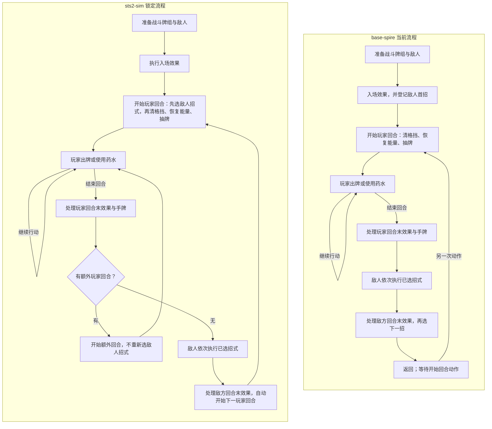
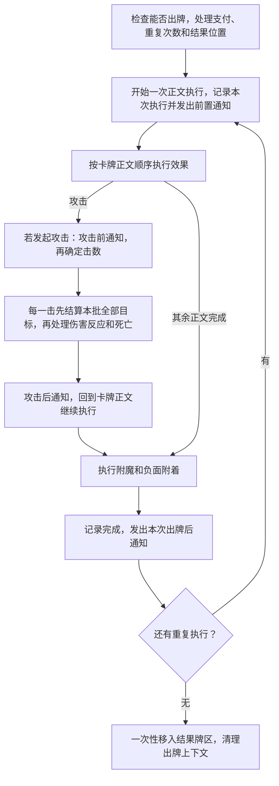

# 战斗引擎与效果生命周期对照

文档类型：解释（Explanation）。本文沿着一场战斗，比较 base-spire 和 sts2-sim 怎样进入战斗、执行出牌、结束回合，以及处理胜负。先看流程，再看差异为什么会影响结果，最后查具体改法和源码。

两边都有玩家行动、敌人行动和战斗收尾。当前最明显的差别有两处：base 在敌方回合末选好下一招，sts2-sim 到玩家回合开始才选；base 执行完敌方回合后等待一次“开始回合”动作，sts2-sim 会自动开始下一玩家回合。出牌内部还有支付、修正和通知顺序的差别。

本文的源码基线见[文末索引](#战斗内部调用与源码定位)。下文的修改方案尚未实施。base 目前开放开发 scope，并支持部分正常首战和事件战斗，完整 Run 仍未开放。部分正常入口也会调用名称含 `Development` 的过程。

## 一场战斗怎样流转

先看战斗没有结束时的一轮循环。图里的“回合开始效果”包括清格挡、恢复能量、抽牌和遗物／Power 的反应；这些步骤的先后顺序在下一节展开。出牌和阶段效果都可能中途造成胜负，届时转入战斗收尾。

两边的玩法由不同模块推进。sts2-sim 用 C# 的 `CombatEngine` 调用模型和命令；base 把相应流程写在 DSL，由 core 的同一个 `Session` 执行。下面讨论的修正都属于 base 玩法流程，Host 负责转交动作和公开观察。

## 入战与玩家回合开始

进入战斗时，需要先把玩家的永久牌组变成战斗牌组，准备敌人的状态，再执行入场效果。sts2-sim 会先按工厂顺序创建全部敌人、抽取 HP 和分配标识，然后按槽位排列行动列表。因此，“谁先出生”和“谁先行动”是两种顺序。base 的部分生成入口会初始化招式图，战斗开始通知又会重置一次，这部分还没有完全对齐。

选招的时间也不同。sts2-sim 在每个普通玩家回合开始时，先发出“本方回合开始前”通知，再为敌人选招；base 的后续招式已经在上个敌方回合结束时选好。如果开始通知改变了选招条件，两边读到的状态就可能不同。入场效果决定首招时，同样需要先完成入场，再判断首招条件。

选招之后，玩家开始阶段的主要顺序如下。`Early`、普通和 `Late` 是三个依次执行的通知阶段。

| 顺序 | sts2-sim | base 当前实现 |
| --- | --- | --- |
| 1 | 保存 Power 的回合开始层数，发开始前通知 | 清理部分回合记录，发开始前通知 |
| 2 | 为敌人选招；额外回合跳过 | 此处不选招 |
| 3 | 按条件清格挡，再发清格挡后通知 | 首回合跳过清空，其他回合查询是否清空，再发通知 |
| 4 | 重置或补充能量，再发能量重置后通知 | 已有对应流程 |
| 5 | 回合号加一，发抽牌前通知，再抽起手牌 | 已有对应流程 |
| 6 | 玩家开始 Early、普通、Late，再发本方开始后通知 | 已有对应阶段 |
| 7 | 充能球开始效果、自动出牌前阶段，检查胜负后允许行动 | 尚未接齐这些阶段 |

回合号增加的位置值得单独注意：清格挡和恢复能量时，监听者读到的还是旧回合号。HornCleat 在第二玩家回合清格挡后触发，此时源代码读取的是 `TurnNumber == 1`；到抽牌和玩家开始后通知时，回合号才是 2。移动回合号更新的位置，会让这种遗物早一回合或晚一回合触发。

## 打出一张牌会发生什么

理解出牌时，要分清四层：一次出牌动作可以重复执行正文；一次正文可以发起多次攻击；一次攻击又可以有多击，每击命中一个或多个目标。

例如，同一张牌执行两遍，只支付一次费用，但每遍都有自己的执行记录和出牌前后通知。卡牌留在正在执行的牌区，全部重复完成后才移入弃牌堆、耗尽堆或其他结果位置。两边都采用这套主要结构。

这张图只表示共同结构。玩家死亡、目标失效等情况仍按具体阶段处理。手动指定目标时，base 会先暂停让玩家选目标，回答后才支付；自动出牌另有目标和支付策略。

目前出牌准备的具体顺序还有差异：

| 操作 | base | sts2-sim |
| --- | --- | --- |
| 移牌与支付 | 先扣能量，再通过带移牌通知的操作移入执行区 | 同步移入执行区，不发异步移牌通知；再支付资源并发出对应通知 |
| 结果位置与重复次数 | 先修正次数，再按当前有限策略确定结果牌区 | 先修正结果位置，再经过附魔和 Hook 修正次数，并通知实际参与修正的效果 |
| 出牌完成 | 移入结果区、清理费用并恢复父出牌上下文 | 移入结果区后还检查空手，再清理临时费用 |

参考的手动出牌调用同步 `CardPileCmd.Add`，不会发布普通 `AddAsync` 的 `AfterCardChangedPiles`。正数能量支付后才发布 `AfterEnergySpent`，此时卡已经在执行区。base 当前多出移牌通知，并且缺少对应的支付通知，所以只交换扣费与移牌的位置还不够。次数修正与结果位置修正如果会产生后续效果，交换它们的顺序也可能改变结果。

### 一次攻击怎样处理多个目标

两边都先结算某一击的全部目标，再执行这一批伤害的反应，最后处理死亡。这样，群体攻击打死第一个目标时，死亡反应不会提前干扰同一击里其他目标的扣血。下一击再重新判断目标和攻击者是否有效。

这里已有完整的攻击与命中区分。比如 Tracker 的八击是一整次攻击，Vigor 在攻击开始时保存层数，让八击都受到加成，攻击结束后再消费；现有组件场景中，Vigor 3 时两边伤害均为 32。

伤害内部仍有未对齐的部分。sts2-sim 还有失血修正、承伤转移、破格挡反应和死亡阻止等路径；base 只迁移了其中一部分，伤害乘法还使用四位整数中间值。攻击边界相同，不代表这些数值和反应都已相同。直接伤害也可能没有攻击或卡牌来源，应保留操作实际传入的来源。

## 结束回合，怎样轮到敌人

玩家结束回合后，两边都先执行自动出牌收尾，再依次发出 VeryEarly、Early 和普通结束前通知。之后才处理虚无牌、带回合末效果的手牌，以及剩余手牌的保留或弃置。最后发出本方结束后通知。

这些阶段会直接影响组合结果。Orichalcum 在 Early 阶段记住“当时格挡为零”，到普通阶段才给 6 格挡；中间 Plating 已经给了 5 格挡，所以这个组合得到 11。若等到普通阶段才检查是否为零，就只能得到 5。

虚无耗尽也要保留原因。DarkEmbrace 对普通耗尽即时抽牌，对虚无造成的耗尽则累计次数，等本方结束后再抽。两条回合末虚无路径都传入 `causedByEthereal=true`；CharonsAshes 和 FeelNoPain 仍按自己的规则即时伤害或给格挡。当前 base 已接入这项区别。

回合末效果牌还有需要核对的细节：base 目前逐张完成“移入执行区、执行效果、移入结果区”；sts2-sim 会先安排移牌，再让每张效果等待前一张结果。因此，首张牌末杀或移动后面的牌时，中间牌区可能不同，只比较最后的弃牌堆看不出来。

轮到敌人后，要先处理敌方开始效果和全体格挡，再按顺序执行已保存的招式。base 目前直接清除活动敌人的格挡；sts2-sim 还查询是否应当清除，并处理新加入怪物本回合是否能行动、死亡后仍保留的生物等资格。这些分支尚未全部迁移。

敌方结束后的返回位置也不同：base 停在等待“开始回合”动作的状态；sts2-sim 已经换边、增加轮次并开始下一玩家回合。比较两边的“结束回合”时，必须先约定比到哪里。额外玩家回合则是另一条分支：sts2-sim 不执行敌人行动，也不重新选择普通招式；base 尚未完整支持。

## 最后一个敌人倒下以后

敌人生命归零时，当前卡牌或监听者可能还没执行完。Feed 就是例子：末杀后仍要增加最大生命并治疗；收尾时的自身耗尽则会被结束中的规则拒绝。把“末杀”直接当成“立刻停止所有效果”，会丢掉前半段收益。

base 用执行深度记录伤害、攻击、出牌和外层效果是否仍在处理。胜利提交要等这些调用退回外层。sts2-sim 也区分“已经满足结束条件”和“正式结束战斗”，但它在明确的动作、回合等位置调用胜负检查。

胜利后的主要收尾可以对应起来：

| 阶段 | base | sts2-sim |
| --- | --- | --- |
| 确认胜利 | 外层 `CheckCombatVictory` | `CheckWinCondition`，随后由房间处理结果 |
| 通知战斗结束 | `CombatEnded` | `AfterCombatEnd` |
| 清理战斗临时状态 | `ClearNormalCombat` | `ClearCombatForVictory` |
| 通知胜利 | `CombatVictoryEarly`、`CombatVictory` | `AfterCombatVictory` 内的 Early、普通阶段 |
| 进入奖励 | `SettleNormalCombat` 提出奖励 | 房间生成奖励 |

胜利条件还不完全相同。base 要求场上没有活动敌人，并且发生过死亡或逃离；这样，空的开发战斗不会自动获胜。sts2-sim 检查的是主要敌人，还允许效果阻止战斗结束。这部分要随对应玩法补齐。

失败另走死亡处理。base 先写失败状态、关闭回合与战斗，再发玩家死亡通知，移除应失效的 Power，最后提交失败访问。sts2-sim 不执行胜利通知和奖励链，房间退出时还会解除战斗关联。修正胜利流程时应同时保留这个区别。

## 差异与修改方案

下面区分三种工作：改变错误的执行时点、补上尚未支持的机制，以及确定公开动作应当返回在哪个阶段。它们需要不同的修改和验证；这些方案都还没有因本文而实施。

### 让敌人在正确的时点选招

在 `lifecycle.spire` 的普通玩家开始通知之后、清格挡之前准备敌人招式，并移除 `enemy-turn.spire` 末尾的旧准备调用。同时整理 `move-graph.spire` 的初始化：创建敌人、设置招式图、执行入场效果和选择首招应分开，避免首招被重复重置。出生标识和行动槽位也要分别保存。具体工作见[#127](https://github.com/QingXiang22/auto-the-spire/issues/127)。

验证时，需要让入场效果决定首招，或让开始通知改变下一招条件，再比较两边实际选中的招式、历史和随机消费。Whistle 在首招前击晕、执行一次空招后恢复，以及额外回合跳过普通选招，都应保留各自行为。固定轮转结果相同，只能证明固定轮转场景。

### 确定“结束回合”返回在哪个阶段

先确定正常战斗的公开操作是否应当像 sts2-sim 一样，返回时已经准备好下一玩家回合。若采用这个行为，就在 base DSL 中连续编排敌方结束和下一玩家开始，并同步修改 net 候选、客户端脚本及比较工具的动作映射。开发分步入口若还有使用者，可保留它明确的分步语义。

验证终点应是同一个可行动状态：敌人只行动一次，下一回合的能量、手牌、回合号和通知顺序一致；额外回合跳过敌人，死亡后不再开启回合。Host 和比较适配器不应补执行 DSL 漏掉的玩法。

### 补齐开始阶段与敌人行动资格

在生命周期和敌方回合规则中，补上实际内容需要的清格挡查询、阻止清格挡后的通知，以及换边和行动资格。处理多个敌人时，先完成全体开始处理，再按保存的行动顺序执行。玩家回合号仍在能量通知之后、抽牌之前增加。

用首回合保留格挡、阻止清格挡和多敌先清格挡后行动的场景检查顺序。充能球、额外回合、召唤或复活需要各自的状态和真实内容；没有实现时保持未支持，不能只加一个空通知便记为完成。其他角色及暂停内容的恢复另按对应工单授权。

### 对齐出牌支付和修正的顺序

调整 `cards/rules/play.spire`，按参考顺序处理资格与费用读取、移入执行区、实际支付和通知、结果位置修正、重复次数修正。区分同步执行区移入与普通异步移牌，保留各自的通知资格。为每次出牌保留原始 X、实付资源和父执行，重复执行只付款一次。手动、免费自动和已付费批次分别迁移；星星等新资源按对应内容纳入范围。

检查移牌监听读到支付前能量、支付通知收到实际扣除量，并让结果位置修正与次数修正产生可区分的后果。再覆盖嵌套自动出牌、X 值、暂停续接和空手反应。修改值的查询保持只读，需要消耗层数等副作用时另发通知。

### 保留回合末效果牌之间的依赖

修改 `FinishTurnHand` 的批次处理，按参考分别安排名单收集、移入执行区、正文执行、结果移牌和最终弃牌。保留已经固定的候选以及虚无耗尽原因，使用执行依赖表达先后关系，无需加入动画延时。

最有用的判别是两张回合末效果牌：第一张末杀、抽牌或移动第二张时，第二张应在哪个牌区、还会不会执行。还要检查虚无耗尽反应引起重洗、弃牌前通知末杀，以及 DarkEmbrace 在本方结束后抽牌。此处不能只看 `CombatActive`；生命仍大于零且尚未提交胜利，也可能已经处于结束中。

### 补伤害反应、精度和死亡处理

继续扩充已有的伤害与结果操作，保留“同一击先扣完全部目标，再通知，最后处理死亡”的顺序。逐项补齐所需的失血修正、破格挡、伤害给予／接收通知和数值计算；请求伤害、实际失血、超杀、承受者和来源应能分别读取。防死、确认死亡与移除也应分开处理，暂停的防死／复活内容不由这次文档修改恢复。

比较群体同击致死、反击杀死攻击者、全挡、破挡、超杀和多次乘法的取整结果；检查真正攻击、无加成攻击和直接伤害的通知资格。Feed 的收益要能追到本次致死结果。承伤转移等机制获准实现后，再加入对应的独立场景。

### 分开结束条件与胜负提交

在战斗结束和 Run 约定中，分别确定何时进入结束中、哪些命令还能执行、何时确认死亡，以及何时清理状态和生成奖励。主要敌人和阻止结束的规则接入后，再扩充当前判定，同时保留空开发场的显式行为。清理要发生在最后一个仍需要出牌、攻击引用的效果之后，奖励只能提出一次。

重点检查末杀后的正文和出牌后反应、嵌套末杀、玩家与最后敌人同批死亡、全部敌人逃离，以及重复提交结果。每个场景分别观察结果确认、结束通知、清理和奖励，不能只看最终胜负值。抽牌、格挡、耗尽和其他命令的结束中资格仍按各自来源规定。

### 按每个通知核查监听顺序

新增阶段时，查清对应 Hook 从哪里枚举监听者、是否固定名单，以及执行前检查哪些资格。base 当前通用事件会固定候选，并在调用前复核实例；参考不同通知的做法并不一致，它本身也有已声明的资格简化。已有两种监听排序不能直接套用于全部通知。

交换遗物和 Power 的获得顺序，或让一个反应移除／新增后续监听者，可以检验这些差别。还应保留同定义双实例、嵌套与暂停场景。若差异来自通用执行器语义，先提供最小例子和双方轨迹，再按核心约定处理。

## 补充：遗物和 Power 怎样参与这些阶段

遗物和 Power 通过通知参与流程。例如，“攻击前”通知让 Vigor 保存本次攻击的层数，“攻击后”再消费。读取修正值的函数则只计算结果，不直接扣层数、抽牌或消费随机。base 用只读修正计算数值，另外通知实际参与者执行副作用。

监听顺序要看具体通知。参考常见的 Run 路径先枚举遗物与药水，再接战斗监听；清格挡等 Direct 路径会先处理 Power。base 用优先级、实例顺序和声明顺序表达这些差别。每个阶段分别固定候选，移除或新增实例时再按执行器的资格规则处理。具体约定见[通知与修正监听](../../../design/mod-the-spire/effect-listeners.md)。

### Power 变更

当前 base 的新建、叠加和直接改量共用一条流程：变更前通知，施加方和接收方修正，提交层数，通知实际修正者，再发变更后的通知并按规则移除实例。它还保存施加者、来源和实例模式；嵌套操作各有自己的临时上下文。

Artifact 说明了为什么要记录“谁参与了修正”：它把减益增量改成零，之后仍要扣掉自身一层，即使没有创建新 Power。原始增量为零的新建请求不发通知；对已有实例的零量修改仍会经过修正和后置处理。负 Strength 和负减益按定义与符号分别判断。

共享流程负责这些操作，内容自己的记忆仍留在所属模块。例如 Vigor 记本次攻击，DarkEmbrace 记虚无耗尽次数。完整接口见[Power 参考](../reference/powers.md)。本地 `no-energy-gain` 还没有按当前来源类直接对应，需要单独说明来源和用途。

### 遗物库存与计数

sts2-sim 的获得操作处理堆叠、持有者、来源袋和获得后效果；替换会保留旧库存位置；熔化则保留库存实例、标记熔化并移除效果。base 目前已有获得、移除和有效实例筛选，但完整堆叠、替换、熔化以及来源袋关系仍待补齐。只有 `IsMelted` 字段，不能代替整个熔化操作。

库存位置会影响监听顺序，因此替换不能简单写成“移除旧遗物，再把新遗物加到末尾”。计数的寿命也应由内容决定：Nunchaku 跨战保留，Kunai／Shuriken 按回合计数，首次受伤类遗物有每战状态。模板适合复用相同阶段、条件和正文，不适合把所有计数一律清零。相关工作由[#128](https://github.com/QingXiang22/auto-the-spire/issues/128)组织。

## 战斗内部调用与源码定位

本文对照 base-spire `2a9b96ef17c2866d66069d0765f64fe56a802c68`，包版本 `0.7.0-dsl.73`，以及[锁定 sts2-sim](../../../../reference/baselines/sts2-sim.json) `611cea2b498ee1eba3743d185c210c6b2a4624a6`，声明游戏版本 v0.111.0。源码变化后需要重新核对本文；版本号相同也不能代替源码比较。

参考路径均相对于 `src/Sts2Sim.Core/`。缺少本地 checkout 时按[参考恢复说明](../../../../reference/README.md)准备。下表便于读完流程后定位实现。

| 要查的行为 | sts2-sim 源符号 | base-spire 入口 |
| --- | --- | --- |
| 入战、玩家开始、结束与换边 | `Combat/CombatEngine.cs`：`StartCombatAsync`、`StartTurnAsync`、`SetupPlayerTurnAsync`、`EndPlayerTurnAsync`、`ExecuteEnemyTurnAsync`、`EndEnemyTurnAsync`、`NotifySideSwitch` | [lifecycle.spire](../../../../mod-the-spire/base-spire/combat/lifecycle.spire)、[enemy-turn.spire](../../../../mod-the-spire/base-spire/combat/enemy-turn.spire) |
| 出生、首招与后续招式 | `Rooms/CombatRoom.cs::Prepare`；`Models/MonsterModel.cs`：`RollMove`、`PerformMove` | [move-graph.spire](../../../../mod-the-spire/base-spire/enemies/rules/move-graph.spire)：`ResetEnemyMoves`、`PerformEnemyMove`、`SelectNextEnemyMove`；[normal.spire](../../../../mod-the-spire/base-spire/run/normal.spire)：`EnterNormalMapPoint` |
| 出牌、重复和结果移牌 | `Models/CardModel.cs`：`PlayInternalAsync`、`PlayAfterObserverStartedAsync` | [play.spire](../../../../mod-the-spire/base-spire/cards/rules/play.spire)：`ResolvePaidCard`、`ResolveAutoCard`、`ResolveCardEffects`、`FinishCardPlay` |
| 回合末手牌 | `Combat/CombatEngine.cs::DoTurnEndAsync` | [piles.spire](../../../../mod-the-spire/base-spire/cards/rules/piles.spire)：`FinishTurnHand` |
| 攻击、伤害和死亡 | `Commands/Builders/AttackCommand.cs::Execute`；`Commands/CreatureCmd.cs`：`Damage`、`DamageSingle`、`ResolvePotentialDeath`、`ResolveConfirmedDeath` | [attacks.spire](../../../../mod-the-spire/base-spire/combat/attacks.spire)、[damage-results.spire](../../../../mod-the-spire/base-spire/combat/damage-results.spire) |
| 结束中与胜负收尾 | `CombatEngine`：`IsEnding`、`CheckWinCondition`；`CombatRoom`：`ResolveOutcomeAsync`、`ResolveVictoryOnceAsync`、`CompleteCombatOnceAsync` | [hook-order.spire](../../../../mod-the-spire/base-spire/combat/hook-order.spire)：`CombatIsEnding`；`lifecycle.spire`：胜利／失败检查；`normal.spire`：`ClearNormalCombat`、`SettleNormalCombat`；四个深度字段为 `DamageDepth`、`AttackDepth`、`PlayDepth`、`EffectDepth` |
| 通知顺序与执行资格 | `Hooks/Hook.cs`、`Runs/RunState.cs`、`Combat/CombatState.HookListeners.cs` | `hook-order.spire` 和 [Session.Events.cs](../../../../core-the-spire/Core.TheSpire/Engine/Session.Events.cs)；排序键为 `priority`、`instance_order` 和声明顺序 |
| Power 与遗物 | `Commands/PowerCmd.cs`、`Commands/RelicCmd.cs` 及具体模型 | [Power 生命周期](../../../../mod-the-spire/base-spire/powers/rules/lifecycle.spire)、[遗物生命周期](../../../../mod-the-spire/base-spire/relics/rules/lifecycle.spire)、[拾取模板](../../../../mod-the-spire/base-spire/relics/rules/content-lifecycle.spire) |

逐步跟踪原生参考时可从[锁定 CombatEngine](https://github.com/iRyougi/sts2-sim/blob/611cea2b498ee1eba3743d185c210c6b2a4624a6/src/Sts2Sim.Core/Combat/CombatEngine.cs)进入。签名和长期行为要求分别见[操作参考](../reference/operations.md)、[内容行为约定 G01～G10](../../../design/mod-the-spire/content-behavior-migration.md)和[战斗结束约定](../../../design/mod-the-spire/combat-end/spec.md)。怪物招式图与多击操作另见[#126](https://github.com/QingXiang22/auto-the-spire/issues/126)。

需要更细的图时，打开[交互图文](combat-engine-comparison.html)，可以按主题看源码、突出差异、导出 SVG 和打印。静态图分别为[职责与状态](assets/combat-engine/overview.svg)、[入战和回合开始](assets/combat-engine/turn-start.svg)、[回合末和敌方](assets/combat-engine/turn-end.svg)、[监听与终局](assets/combat-engine/effects.svg)、[Power](assets/combat-engine/power.svg)、[遗物](assets/combat-engine/relic.svg)。

## 修改后怎样判断结果

先比较同一个动作返回位置，再看每个阶段的状态。只看战斗最终胜负，无法判断选招、支付、移牌和监听是否按正确顺序执行。

- 保留双方的阶段名称、实例对应、通知顺序、完整牌区，以及每条随机流的调用和状态；缺失维度与真实差异继续报告失败，不改参考源码、重设游标或补抽来配齐结果。
- 保存父子出牌、攻击和批次关系；暂停后从原位置继续，不重付费、不重取候选，也不重放已完成通知。两个实例、两局状态分别检查。
- 单独验证正常可达路径与人工构造场景。已有组件一致只证明它明确比较的范围；来源条目、已加载定义、实际行为和正常 Run 可达性分别报告。完整来源池和原有必测用例继续保留。
- 检查公开观察和合法候选仍然只读，不消耗随机；内部状态和调试轨迹只用于核对，不进入公开 AI 输入。

选招、换边和结束中定义会影响其他阶段，修改这些公共规则时需一起审阅受影响的内容。玩法继续写在 base DSL；若发现通用 Engine 能力不足，先给最小复现，再按核心约定处理。

纯文档修改运行 `python tools/ci/check.py docs`。玩法修改按[验证指南](../how-to/verify-and-debug.md)选择 base、net、migration 和定向场景；现有[差异工具](../../../../tools/differential/README.md)的组件命令只证明各自范围。方案、静态对照和组件通过都不能替代完整 Run 验收，也不能单独证明与真实客户端一致。
