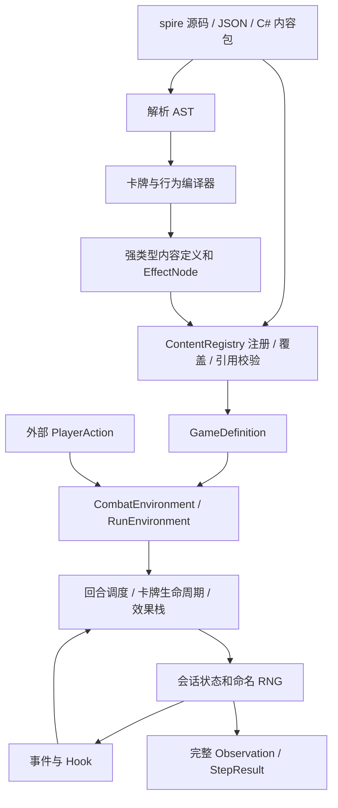

# core-the-spire / base-spire 架构与 DSL 审阅（2026-10-01）

> 历史证据（2026-10-03整理）：正文保留原时点结果，历史“下一步”不再作为当前派单指令。本报告归属W-02、W-04、W-06、W-08，未结项转入[当前清单](../../tofix/README.md)；移入records不表示修复或验收通过。逐份归属见[记录索引](../README.md)。

> 评审意见的后续采纳、修正与设计落点见[本轮 core/DSL 处置](core-dsl-review-adoption-2026-10-01.md)。下文源码探针、内容计数与性能记录保持原审阅时点，不代表目标架构已实现。

> **后续需求澄清：** 用户要求 core 是能描述多类桌游的通用引擎，领域类型和具体规则全部由游戏包提供，并允许 Lua 计算扩展。本文按 STS 规则内核讨论 core 可保留伤害/牌区/回合机制的建议已不符合这个新边界；新设计见 [通用桌游引擎设计稿](../../../design/core-the-spire/generic-tabletop-engine-design.md)。执行重入、查询写权限和已测分配等事实仍有效，本报告未因需求变化被整体关闭或归档。

## 评估范围与结论

评估对象是当前工作区的 `core-the-spire` 和 `mod-the-spire/base-spire`。用户所说的 base-the-spire 按仓库实际目录 base-spire 理解。HEAD 为 `3ad3fec`，工作区已有未提交 DSL 迁移与文档改动；这些文件未被本次审阅修改。本报告优先评价架构是否支持后续扩展与训练，不以修复当前测试失败替代架构评估。

**当前架构可以作为战斗模拟器的基础，但还不适合直接作为长期稳定、可扩展、高吞吐的训练内核。建议保留状态/定义分离、强类型效果和可暂停执行，先调整执行契约、DSL 中间表示和规则包边界，再扩大内容迁移。无需整体重写，也不建议立即转 ECS 或引入通用脚本 VM。**

目前最主要的风险是：内容扩展依赖内核内多处同步修改；查询与执行权限交叉；C# 扩展会重入结算器；DSL 表面表达能力高于实际中间表示；训练调用被完整观察、事件记录和对象分配绑定。文件长度是这些职责聚集的结果，单纯拆文件不能解决。

## 1. 当前架构及值得保留的部分



- `GameDefinition` 与会话运行态分离，外部拿不到可变 `GameState`；稳定卡牌实例 ID、运行与战斗状态分域是合理选择。
- `.spire` 在内容加载时编译为强类型效果树，step 不解析 DSL。效果解释器里的类型分派本身不是明显架构错误。
- `PendingEffects` 使用末端入栈/出栈，选择暂停保留执行上下文；`CardPlayFrame` 支持嵌套自动出牌。同步、确定顺序的调度适合复现与训练。
- `ContentRegistry` 支持显式覆盖、包注册失败回滚、复合规则引用校验；这些能力比简单 JSON 加载器更完整。
- 地图生成放在 base-spire 的 C# 中，遭遇目录使用 JSON，各种复杂算法不必强行迁进 DSL。

依据：[Content.cs](https://github.com/QingXiang22/auto-the-spire/blob/0aca7d1a26f3ad42d5b8657bc794cd0b12f85ba8/archive/legacy-sts/core-the-spire/Core.TheSpire.Legacy/Legacy/Content.cs)、[State.cs](https://github.com/QingXiang22/auto-the-spire/blob/0aca7d1a26f3ad42d5b8657bc794cd0b12f85ba8/archive/legacy-sts/core-the-spire/Core.TheSpire.Legacy/Legacy/State.cs)、[CombatCardPlay.cs](https://github.com/QingXiang22/auto-the-spire/blob/0aca7d1a26f3ad42d5b8657bc794cd0b12f85ba8/archive/legacy-sts/core-the-spire/Core.TheSpire.Legacy/Legacy/CombatCardPlay.cs)、[Effects.cs](https://github.com/QingXiang22/auto-the-spire/blob/0aca7d1a26f3ad42d5b8657bc794cd0b12f85ba8/archive/legacy-sts/core-the-spire/Core.TheSpire.Legacy/Legacy/Effects.cs)、[StandardActMapGenerator.cs](https://github.com/QingXiang22/auto-the-spire/blob/0aca7d1a26f3ad42d5b8657bc794cd0b12f85ba8/archive/legacy-sts/mod-the-spire/base-spire/BaseSpire.Legacy/StandardActMapGenerator.cs)。

## 2. 优先调整的架构问题

### A1：结算器与 C# 扩展的执行契约冲突，优先级高

`EffectExecutionContext.Execute`（第 89 行）调用 `EffectExecutor.Execute`，后者立即 `Drain` 整个待执行栈。外层执行器正在处理 `CustomEffect` 时，handler 再调用一次命令便会进入另一次 Drain。结果是 handler 尚未返回，外层后续效果和卡牌生命周期已经可以被执行。

本次独立探针：外层效果为 `sequence(custom(handler), gainBlock(20))`；handler 顺序调用 `GainBlock(1)`、`GainBlock(2)`。实际格挡事件为 **`[1, 20, 2]`**，而按 handler 是一个有序子步骤的直觉应为 `[1, 2, 20]`。handler 若涉及选择暂停，同步 C# 调用栈也无法作为可保存的恢复位置。

这说明 DSL 与 native handler 没有共享一致的“返回效果/提交命令/恢复 continuation”契约，不是加一条卡牌分支能彻底解决的问题。

**建议：** 单一调度器负责推进；扩展返回效果计划，或者通过只入队的受控接口提交有序子帧。需要边执行边读状态的复杂扩展，提供显式可恢复步骤，而不是在任意 C# 调用栈中暂停。不要把普通 Execute 改成另一种同样隐含的 Drain 行为。

### A2：查询上下文仍有写权限，复现与缓存缺少前提

`ObserveSession` 会计算敌人意图；意图经 `CalculateDamage` 调用 `ModifyVulnerableMultiplier`。该 Hook 得到的 `RuleHookContext` 同时提供 `SetInt`、`SetRunInt`。因此接口允许一次观察写入玩法状态。现有 base-spire 是否这样使用不是本项判断前提；问题在于合法扩展接口没有隔离权限。

同时 `TakePowerEventAmountCountSource`、`TakePowerTurnEventAmountCountSource` 在读取“计数源”时取走累计值。表达式求值与消费状态没有清楚分开，使后续预览、缓存、重排或多次求值更难安全实现。

**建议：** 查询和修正函数使用只读上下文；状态变更、RNG 消费和累计值消费使用显式命令。声明并验证 Observe/LegalActions 的只读、无随机消费契约。只读接口能防止通过该接口改状态，不能替代对 native handler 外部副作用的协作约定。

依据：[Environment.cs:264](https://github.com/QingXiang22/auto-the-spire/blob/0aca7d1a26f3ad42d5b8657bc794cd0b12f85ba8/archive/legacy-sts/core-the-spire/Core.TheSpire.Legacy/Legacy/Environment.cs#L264)、[State.cs:593](https://github.com/QingXiang22/auto-the-spire/blob/0aca7d1a26f3ad42d5b8657bc794cd0b12f85ba8/archive/legacy-sts/core-the-spire/Core.TheSpire.Legacy/Legacy/State.cs#L593)、[EffectExecutionContext.cs](https://github.com/QingXiang22/auto-the-spire/blob/0aca7d1a26f3ad42d5b8657bc794cd0b12f85ba8/archive/legacy-sts/core-the-spire/Core.TheSpire.Legacy/Legacy/EffectExecutionContext.cs)、[Effects.cs:1300](https://github.com/QingXiang22/auto-the-spire/blob/0aca7d1a26f3ad42d5b8657bc794cd0b12f85ba8/archive/legacy-sts/core-the-spire/Core.TheSpire.Legacy/Legacy/Effects.cs#L1300)。

### A3：通用机制与原版默认策略没有充分分开

base-spire 已承载卡牌、怪物、遗物 Hook 与地图算法；但原版数值策略仍分布在 core：卡牌奖励稀有度与 pity 更新、三选一卡数量、升级赔率、宝箱金币/遗物稀有度、营火 30% 治疗等。部分 Hook 可以修正最终值，但不等于内容包能完整提供这些策略。

“core 是 STS 规则内核”可以合理包含伤害、牌区、回合和资源的稳定机制，不必做成任意卡牌游戏引擎。可是项目规范明确把原版全局配置交给 base-spire；两种边界需要选定并落实，不能一边宣称内容无关，一边要求 mod 绕过核心中的原版策略。

**建议：** 把奖励参数、初始资源、容量限制等稳定参数集中为规则定义；对确实存在算法差异的奖励、可用性、地图生成等提供少量明确策略接口。base-spire 提供原版默认实现，core 执行通用流程与约束。不要为每个常量增加一个接口。

依据：[CardRewards.cs](https://github.com/QingXiang22/auto-the-spire/blob/0aca7d1a26f3ad42d5b8657bc794cd0b12f85ba8/archive/legacy-sts/core-the-spire/Core.TheSpire.Legacy/Legacy/CardRewards.cs)、[Runs.cs:925](https://github.com/QingXiang22/auto-the-spire/blob/0aca7d1a26f3ad42d5b8657bc794cd0b12f85ba8/archive/legacy-sts/core-the-spire/Core.TheSpire.Legacy/Legacy/Runs.cs#L925)、[CombatLimits](https://github.com/QingXiang22/auto-the-spire/blob/0aca7d1a26f3ad42d5b8657bc794cd0b12f85ba8/archive/legacy-sts/core-the-spire/Core.TheSpire.Legacy/Legacy/State.cs#L1089)、[项目 spec](../../../design/spec.md)。

### A4：Power 与事件模型正在积累特例

`PowerDefinition` 同时承载 `Trigger`、`Lifecycle`、`Events`、`CardRule`、多种倍率/上限、禁止操作 flags、层数变化与到期链接。卡牌监听又有另一套生命周期入口；遗物由 C# Hook 订阅字符串事件。并非这些能力都不合理，而是新增机制很容易继续追加字段、枚举和专用分支。

`GameState.Emit` 既保存日志，也遍历 Hook 和所有实体 Power 来安排反应效果。日志输出与游戏规则事件存在直接耦合，不能简单关闭事件记录来优化训练。

**建议：** 明确“只读规则修正”“生命周期回调”“提交效果的反应事件”三类职责；共享类型化事件、过滤与确定顺序规范。保留热路径中力量/敏捷等明确能力，其他订阅尽量组合。先统一契约，再逐步建立每会话的活动监听索引，保留监听快照和执行时重新检查的语义。不要直接换成异步消息总线。

依据：[PowerDefinition](https://github.com/QingXiang22/auto-the-spire/blob/0aca7d1a26f3ad42d5b8657bc794cd0b12f85ba8/archive/legacy-sts/core-the-spire/Core.TheSpire.Legacy/Legacy/Content.cs#L48)、[State.Emit](https://github.com/QingXiang22/auto-the-spire/blob/0aca7d1a26f3ad42d5b8657bc794cd0b12f85ba8/archive/legacy-sts/core-the-spire/Core.TheSpire.Legacy/Legacy/State.cs#L411)、[CombatCardEvents.cs](https://github.com/QingXiang22/auto-the-spire/blob/0aca7d1a26f3ad42d5b8657bc794cd0b12f85ba8/archive/legacy-sts/core-the-spire/Core.TheSpire.Legacy/Legacy/CombatCardEvents.cs)。

### A5：训练和复现需要的状态能力尚未成为架构契约

命名 RNG 有种子与调用计数，但没有整体导出/恢复 API；执行帧、暂停选择、房间状态也没有完整快照/恢复或 fork 契约。观察不包含全部调度状态，所以 Observation 不能直接用作可恢复状态。

`GameDefinition.Version` 只拼接包 ID/版本；`BaseSpirePackage(deadlyEnemies, toughEnemies)` 不改变包版本。本次实测普通和两种难度均启用的定义都为 `base-spire@0.1.0`，尽管内容规则不同。该字段可以作为包清单版本，但不能独自承担复现用规则集身份。

**建议：** 规则集身份包含包顺序、内容/规则配置、DSL/IR 版本与 native 扩展版本；建立 RNG 状态、实例、执行帧和 pending choice 的可恢复格式。纯 rollout 训练可稍后优化 fork；计划做搜索或反事实评估时应更早实现。暂不引入持久化全量对象图或复杂写时复制。

依据：[RandomStreams.cs](https://github.com/QingXiang22/auto-the-spire/blob/0aca7d1a26f3ad42d5b8657bc794cd0b12f85ba8/archive/legacy-sts/core-the-spire/Core.TheSpire.Legacy/Legacy/RandomStreams.cs)、[GameSession](https://github.com/QingXiang22/auto-the-spire/blob/0aca7d1a26f3ad42d5b8657bc794cd0b12f85ba8/archive/legacy-sts/core-the-spire/Core.TheSpire.Legacy/Legacy/State.cs#L1046)、[GameDefinition.Version](https://github.com/QingXiang22/auto-the-spire/blob/0aca7d1a26f3ad42d5b8657bc794cd0b12f85ba8/archive/legacy-sts/core-the-spire/Core.TheSpire.Legacy/Legacy/Content.cs#L2385)、[BaseSpirePackage.Info](https://github.com/QingXiang22/auto-the-spire/blob/0aca7d1a26f3ad42d5b8657bc794cd0b12f85ba8/archive/legacy-sts/mod-the-spire/base-spire/BaseSpire.Legacy/BaseSpirePackage.cs#L358)。

## 3. DSL 设计评价

**合理之处：** 内容 ID 有命名空间；效果执行顺序明确；具名字段比位置参数更易审阅；有源码位置；在加载时拒绝不合法内容；禁用无界 while 有利于可控执行。花括号还是函数调用不是核心矛盾。

**主要问题是语言语义和中间表示尚未一致。**

1. **新语法仍绕到旧位置参数。** `LowerNamedCall`、`PositionalFields`、`CompileEffect/CheckShape`、引用校验、运行时 switch 和 JSON 节点定义各自维护原语的一部分。原语目录已有 25 个“旧语法可用、新语法不可写”的项目。这是语法层与运行能力分离维护的结构性成本。
2. **缺少统一的类型化数值表达式。** 固定伤害、变量伤害、计数缩放伤害、格挡伤害分别成为 `AttackEffect`、`AttackCardVariableEffect`、`ScaledAttackEffect`、`AttackUsingBlockEffect`。效果和计算方式的组合会继续增生专用原语。某些领域操作值得独立命名，但普通“伤害数值从哪里来”不应每次都扩展指令集。
3. **目标块承诺高于运行模型。** `ParseVersionTarget` 最终得到 `TargetSelector` 枚举；本次探针中 `selectOne(from=context.allies, where=alive)` 也是 `SelectedTarget`。而合法打牌动作的 `SelectedTarget` 候选来自敌人。编译后失去候选域，单人情况下仍需要明确拒绝、映射自身或保留查询域。
4. **完整版本语义与运行时继承模型冲突。** DSL 要求 normal/upgraded 完整且不继承；运行时 `ResolveExhaustEffect`、`ResolvePlayListener` 等却使用 `upgraded ?? normal`。探针中基础版有 onExhaust、升级版 hooks 为空，升级实例仍取得基础钩子。修复一个钩子不足以统一所有版本字段。
5. **重复赋值策略缺少诊断。** “配置后写覆盖、执行保序”可以作为明确契约保留；建议对重复配置产生带两个位置的 warning，并支持显式覆盖意图。否则手工编辑和生成内容都容易静默丢掉整个 play/hooks 块。无需改变当前已定的覆盖语义。
6. **运行限制并不等于没有 while。** 有限 repeat 可以一次入栈大量帧，事件反应和 native 重入也可形成循环。应定义每次推进的结算预算、诊断轨迹和合法循环处理方式；预算超限是显式失败，不得悄悄截断规则结果。

建议的 DSL 流水线为：

```text
旧语法 AST ─┐
            ├─ 名称解析 + 字段签名 + 类型检查 → 同一规范 IR → 链接与验证 → 执行器
新语法 AST ─┘
```

IR 至少区分纯数值表达式、纯谓词、目标查询/选择契约和会变更状态的指令。具名参数直接按原语 schema 编译，不再先制造旧位置调用。原语 schema 统一字段、必需项、类型、默认值和文档；运行处理仍可以使用明确的 C# 类型分派，不必为每个节点引入反射调用。

作者仍可写现在的完整版本块；编译结果应是两个独立完整 `CardVersionDefinition`，运行时直接选版本。如果未来希望减少作者重复，可以显式提供模板/继承，在编译期展开为完整版本，不把隐式继承继续带进运行时。

不要把 DSL 扩展为随意脚本语言：复杂地图算法保留 C#；普通攻击数值、目标过滤、条件与选择应可组合；难以表达的机制走版本化、可恢复的扩展步骤。原语种类多少不是唯一标准，应看一个新内容需要改哪些核心契约。

依据：[dsl-usage.md](../../../dsl/0.0.1/dsl-usage.md)、[primitives.md](../../../dsl/0.0.1/primitives.md)、[SpireCombatDslCompiler.cs:290](https://github.com/QingXiang22/auto-the-spire/blob/0aca7d1a26f3ad42d5b8657bc794cd0b12f85ba8/archive/legacy-sts/core-the-spire/Core.TheSpire.Legacy/Legacy/SpireCombatDslCompiler.cs#L290)、[Content.cs:275](https://github.com/QingXiang22/auto-the-spire/blob/0aca7d1a26f3ad42d5b8657bc794cd0b12f85ba8/archive/legacy-sts/core-the-spire/Core.TheSpire.Legacy/Legacy/Content.cs#L275)。

## 4. 效率评价与实测边界

类型化预编译、共享内容定义、命名 RNG 和末端效果栈使执行基础合理。当前 API 尚未为高频训练充分区分“改变状态”和“生成观察”：`Step` 先通过完整 `LegalActions` 集合判断一个动作，再总是生成完整 Observation 和事件数组。观察复制全部牌区、Power/变量/意图与部分重复的卡牌 ID/实例表示。

此外，`Emit` 逐事件扫描实体 Power；全局 `HasBeforeCardPlayListeners/HasAfterCardPlayListeners` 根据已注册内容判断，实际局内没有该监听牌时也可能扫描所有牌区。单局牌数较少，这不自动构成严重瓶颈，但会随训练量和复杂机制累计。

本次运行 .NET 9.0.10、Windows、Release、关闭分层 JIT，固定十张 Ironclad 起始牌与单个 DampCultist，预热后各三个样本：

| 公共 API 场景 | 耗时范围 | 每次线程累计分配 |
| --- | --- | --- |
| Observe：静止十张手牌、一个敌人 | 3.49–4.96 μs | 4,312 B |
| LegalActions：同一静止状态 | 1.96–2.07 μs | 1,872 B |
| Step(EndTurn)：十张牌组、不打牌、连续 1000 回合 | 28.36–32.76 μs | 约 36,851 B |

玩家生命被放大以避免提前结束；结束回合第一轮后通常是五张手牌。原始数据与可重跑工具见 [results](https://github.com/QingXiang22/auto-the-spire/blob/0aca7d1a26f3ad42d5b8657bc794cd0b12f85ba8/archive/legacy-sts/tools/core-architecture-audit/results-2026-10-01.jsonl) 与 [工具说明](https://github.com/QingXiang22/auto-the-spire/blob/0aca7d1a26f3ad42d5b8657bc794cd0b12f85ba8/archive/legacy-sts/tools/core-architecture-audit/README.md)。

这只能说明简单场景下耗时较低、公共 API 分配可观。它不是纯结算器测量、没有复杂 Power/多敌/选牌/网络/序列化/AI 推理，不能外推真实训练吞吐。分配量不是保留内存大小；本次未做 CPU/GC profile，也未测状态复制或批量环境。

**建议顺序：**

1. 增加单动作合法性验证，避免提交一个动作时必须生成全部候选对象。
2. 状态推进与观察投影分开；保留便于调用的 Step 包装，但训练可请求必要字段、固定编码或写入调用方缓冲区。
3. 规则事件调度与诊断日志留存分开；需要玩法历史的规则用结构化状态或明确历史索引，不可直接删日志。
4. 建立真实战斗分布的 benchmark/profile，再决定活动监听索引、内容稠密 ID、数组表示和帧复用是否值得。监听索引必须维持原顺序及动态进入/离开快照语义。
5. 每会话单线程结算，跨会话并行；共享只读定义时，native handler 的可变局内状态必须放入会话。

当前证据不足以说“core 已经高效”，也不足以说“C# 或对象式状态必须推倒”。最先解决的应是允许训练绕开无用观察/日志的接口边界。

## 5. 完成度：可运行基础与目标之间的距离

运行时实际成功加载的 base-spire 内容为：96 个卡牌定义、81 个 Power、89 个敌人定义、63 个遭遇、6 个药水、11 个遗物、1 个角色、0 个 RunEvent；Ironclad 单人池 85 张。敌人数是定义数，不是 89 种全部已经行为等价。卡牌总数包含状态牌、池外定义等，不能作为原版全卡牌覆盖率。

| 领域 | 设计目标 | 解析/注册状态 | 行为验证范围 |
| --- | --- | --- | --- |
| 通用战斗骨架 | 单人、多敌、选择续接、确定结算 | 已建立并有可执行检查 | 多个切片已有检查；当前官方 runner 整体失败 |
| 内容/Mod 接口 | 同一接口组合规则包 | 加载/显式覆盖/引用校验已建立 | native 顺序探针揭示执行契约问题 |
| Ironclad | 完整单人卡池及效果 | 85 张单人池实际加载 | 名单齐全不等于所有组合规则已验证 |
| 其他角色/物品 | 完整单人内容 | 仅 1 角色、6 药水、11 遗物注册 | 不能宣称全原版 |
| 整局 | 地图、房间、战斗、奖励到终局 | 流程骨架已建立 | base-spire 无事件；标准路线仅 Overgrowth 绑定遭遇池，Hive/Glory 未绑定；尚无完整商店动作流程 |
| 训练基础 | 观察/动作、恢复、吞吐 | 有公共环境 API | 无完整恢复/fork 契约；仅本报告简单 API 短测 |

核心机制可评价为“具备可扩展的原型基础”；base-spire 可评价为“Ironclad 与敌人内容迁移较多、整局仍是切片”。不提供无分母、无机制权重的总百分比。

## 6. 推荐推进路线与验收

1. **先固定执行和纯查询契约。** native handler 子效果必须按统一顺序执行；任何公开观察/合法动作查询不得改玩法状态或 RNG；嵌套自动出牌与暂停续接保持原上下文。用区分顺序的组合场景验证，而非只断言最后血量。
2. **再建立规范 IR 与统一原语签名。** 新旧语法分别编译到同一类型化模型；完整升级版本不隐式继承；目标查询保留候选域；数值表达可以组合。用原语签名覆盖、等价内容的新旧前端对照和无效输入验证。
3. **整理 core/base 边界。** 原版默认参数/策略由 base 提供，core 保留状态约束与通用调度。用一个改变奖励策略和一个新增目标/数值表达的独立规则包验证扩展成本。
4. **补规则集身份和可恢复状态。** 对难度、包顺序与规则内容产生可区分身份；从选牌暂停点恢复后保持事件、随机流和最终状态一致。搜索用途再验证 fork 的隔离。
5. **建立训练性能入口与基线。** 区分纯推进、完整观察、编码、事件留存成本，包含多敌、重放、生成、选择和 Power 链；据 profile 定向优化。之后再大规模补其他角色和物品。

不建议同步进行全面架构重写和全量内容迁移；这样很难判断差异来自规则还是结构。保留现有内容作为迁移回归样本，逐条替换内部契约。

## 7. 验证、交接与未验证风险

- 构建：执行了 `dotnet build AutoTheSpire.sln`；明确留存的 `dotnet build AutoTheSpire.sln --no-restore` 结果为成功，0 警告、0 错误。
- `dotnet run --project core-the-spire/Core.TheSpire.Tests`：失败。首个错误在 `CombatSliceTests.cs:498`，裸 `AttackEffect` 期望与实际 `SequenceEffect` 不一致；runner 随异常退出，后续检查本次未获得全量结果。没有把旧报告里的失败数量当作今天的清点。
- `dotnet run --project tools/core-architecture-audit -c Release`：初次内容/契约探针成功，性能会话因试图超出敌人定义最大生命而失败；工具随后改用正常敌人生命。修正后完整运行成功，内容加载、三类契约探针和三组性能样本均有输出。
- 关闭分层 JIT 后 `dotnet run --project tools/core-architecture-audit -c Release --no-build`：成功，最终原始结果保存为 JSONL。
- `git diff --check`：执行时退出 0；已有文件报告 LF/CRLF 提示，无空白错误。新增文件另行核对。
- 未运行真实游戏差分、全部规则方法隔离执行、复杂战斗性能、GC/CPU profile、批量训练或状态分支性能。本报告架构判断基于源码与有限契约探针。

本次新增本报告、`tools/core-architecture-audit` 的项目/源码/说明/结果；未改生产代码和已有未提交文件，未提交 Git。探针保留在 tools，便于后续架构调整时重跑。本报告列出的架构问题解决并验证后再归档。
