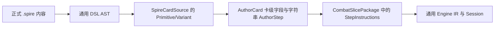

# base-spire 开发耗时与 token 成本审阅（2026-10-09）

本次负责人审阅回应用户对 base-spire 开发速度和设计复杂度的疑问。实际存在可避免的成本：依赖未就绪的会话提前启动、长上下文反复阅读与压缩、地图结果反复重算，以及切片组包器承担正式环境的大量职责。源规则的精确核对确有必要，但不能据此解释全部开销。

当前认领、依赖和阶段仍只维护[主清单](../../tofix/README.md)。本报告记录诊断与改良建议，归属 ENV-T03/04/05 的执行流程、ENV-T07 的规则复用及负责人维护；建议不构成新的生产认领或 core 解冻决定。

## 1. 执行记录显示的成本

取四份完整 DSH 结果，按唯一事件记录的 `assistant/message.data.usage` 求和。`totalTokens = inputTokens + outputTokens + cacheReadTokens`；缓存读取必须单列，不能把总量当成同价的新增 token 或实际账单。时长为会话首末事件差，包括执行和等待，不等于纯编码工时；并行会话时长也不能直接当墙钟时长。

| 会话交付 | 记录跨度 | 工具调用 | 新增输入 token | 输出 token | 缓存读取 token | 报告总量 |
| --- | ---: | ---: | ---: | ---: | ---: | ---: |
| A 连续攻击修复，局部验收 | 97.8 分钟 | 252 | 1,020,317 | 303,419 | 12,608,640 | 13,932,376 |
| A 奖励准备，只交设计 | 16.1 分钟 | 142 | 379,913 | 88,470 | 3,980,928 | 4,449,311 |
| B 地图独立对拍，子包验收 | 20.7 分钟 | 150 | 419,363 | 99,431 | 7,590,016 | 8,108,810 |
| C 公开奖励准备，无生产交付 | 12.8 分钟 | 69 | 390,387 | 64,747 | 2,973,568 | 3,428,702 |

A/C 两个准备会话合计 28.9 会话分钟、7,878,013 报告 token，其中缓存读取 6,954,496，新增输入加输出 923,517。它们有准备材料，但没有奖励生产实现或公开轨迹交付。前置仍在执行时启动依赖会话，最终结束而没有自动续跑，是本轮可明确归因的调度损耗；负责人此前的派单方式对此负责。

工具输出正文分别约 60.4、58.1、51.0、28.7 万字符。A 修复调用压缩工具 24 次，奖励准备 15 次，C 准备 6 次；A 奖励准备读取 `CombatSlicePackage.cs` 六次，其中一次 `SpireCardSource.cs` 返回约 5.1 万字符。这些是上下文反复搬运的证据，字符数不换算为账单 token，也不能把每次分段读取都认定为重复劳动。

原始结果和可复算统计：

- [四会话成本摘要](../../../../.audit/base-development-cost-2026-10-09/dsh-cost-summary.json)。
- [A 修复完整结果](../../../../.audit/dsh-env-t05-consecutive-attack-2026-10-08/review-result-2026-10-09.json)。
- [A 准备](../../../../.audit/dsh-supervisor/review-2026-10-09-progress/a-result.json)、[B 对拍](../../../../.audit/dsh-supervisor/review-2026-10-09-progress/b-result.json)、[C 准备](../../../../.audit/dsh-supervisor/review-2026-10-09-progress/c-result.json)。

## 2. 实测：地图反复重算是验证耗时的具体原因

使用复制的既有 Debug DLL 做隔离探针，引用程序集而非生产 ProjectReference，独立 obj/bin，不占用正在执行的 A 奖励包构建目录。程序集摘要、探针源码及完整输出见[快照](../../../../.audit/base-development-cost-2026-10-09/snapshot.json)、[探针](../../../../.audit/base-development-cost-2026-10-09/Program.cs)、[结果](../../../../.audit/base-development-cost-2026-10-09/probe-result.json)。这是冻结快照上的诊断测量，不是当前奖励实现验收或 Release 性能声明。

| 测量项 | alpha | beta |
| --- | ---: | ---: |
| seed | `t05-map-alpha` | `t05-map-beta` |
| 实际地图随机 payload 数 D | 292 | 265 |
| 节点 V / 边 E | 51 / 65 | 61 / 72 |
| 当前路径的 Replay 调用数 D+V+E | 408 | 398 |
| 正式会话 Start | 15.26 秒 | 8.58 秒 |
| 只重放完整地图一次，20 次均值 | 93.77 毫秒 | 59.33 毫秒 |
| 所有随机前缀重放，3 次均值 | 3.52 秒 | 0.35 秒 |
| 模拟节点/边取值所需 V+E 次完整重放，3 次均值 | 11.23 秒 | 8.09 秒 |

微测分开运行，受 JIT、GC 和机器负载影响，不能严格相加或宣称已经取得某个优化倍数；但是反复重算的数量与主要开销已经成立。

[MapRoomWiring.SetupSteps](../../../../tools/base-migration-baseline/BaseSpire/Rooms/MapRoomWiring.cs)（约 337 行起）每抽一个 payload 就拼接字符串并调用 Generate，直到源算法能完成；这样维持逐字 RNG 消费，原因合理。但[计算后端](../../../../tools/base-migration-baseline/BaseSpire/Maps/SourceActMapCompute.cs)的 `ExecuteCell` / `ExecuteEdge`（238、258 行）又分别对完整词表调用 Replay。已求出的图为了取每个节点和边被重新生成一次。

前缀字符串拼接/解析本身累计扫描 D(D+1)/2 个词，另有各前缀的算法成本；最终物化又增加 (V+E) 次完整生成。这不是生成地图所必需的工作。

优先改良实验应让 Generate 完成时交出可复用的不可变地图计算结果，节点/边读取该结果。例如用现有 Compute 字符串输出承载最终结构，再由通用 IR 物化为 Engine 实体/关系；先验证现有冻结接口可实现，不预设必须新增 core 能力。玩法状态与 RNG 权威仍留 Engine，不能改成额外随机来源、固定预算预抽或隐藏 RunState。

改良验收：两 seed 的地图事实、顺序、RNG 字数/摘要与独立对拍保持一致；完整生成不再随节点/边逐个重复；重新记录同一构建下的 Start 与 Slice/net 耗时。优化幅度以实施后的证据为准。

## 3. 组包器与中间表示增加修改负担

审阅时 base 生产 C# 共 35 文件、约 18,216 行。[CombatSlicePackage.cs](../../../../tools/base-migration-baseline/BaseSpire/Composition/CombatSlicePackage.cs)为 4,753 行；[正式工厂](../../../../tools/base-migration-baseline/BaseSpire/SinglePlayer/BaseSpireRuntimeFactory.cs)32–69 行仍用它装配正式规则。类型、牌/能力 lowering、战斗生命周期、房间、长期状态和地图接线在同一组包上下文内共享大量局部符号。

一个具体的跨层例子是 Feed：[SpireCardSource.cs](../../../../tools/base-migration-baseline/BaseSpire/Cards/SpireCardSource.cs)约 1247 行将 `onFatal.gainMaxHp` 转成 `AuthorStep("on_fatal_gain_max_hp:n")`；组包器约 2855 行再用 `StartsWith`、切片和 `long.Parse` 转成 IR。部分其他效果也用冒号串承载目标、能力 ID 和数值。这样新增机制要核对作者语法、字符串协议、lowering 与运行时结算，而中间层没有完整类型约束。

这说明存在维护风险，不能仅凭文件长就断言它解释了全部 token。较小的改良路径是随现有 ENV-T07 或下一个真实机制包，抽出明确输入/输出的领域 lowering 和战斗/房间生命周期组装；对受影响步骤使用具名、类型化数据，保持现有 DSL、内容 ID、IR 语义和源调用顺序。不要先全面重写语言或把同一巨型作用域机械分文件。

本轮连续攻击问题还暴露冻结 core 的通用查询缺口：挂起期间守卫的 CallPure 无法完成，随后只读查询升级为会话 Fault。base 用等价 IR 修复了公开路径，但通用缺口应按已有负责人维护证据裁决，避免各内容包重复绕行；不能将这次诊断扩成核心架构重做。详情见[既有复核](dsh-supervisor-review-2026-10-09.md)。

## 4. 测试反馈慢，重复组包却不是主因

[FormalSliceFixture.NewFormal](../../../../tools/base-migration-baseline/BaseSpire.Slice.Tests/Shared/FormalSliceFixture.cs)每次重新加载正式切片并建 RuleSet；生产工厂则已经缓存不可变内容，同一工厂可以创建多局独立 Session，不能说生产每局都重新解析内容。

探针测得冷工厂约 294 毫秒、热工厂约 45 毫秒、Formal BuildRuleSet 约 51 毫秒。因此组包复用有价值，但在本轮测量中优先级低于地图重算。测试源码有 35 个 `FormalSliceFixture.NewFormal` 和 16 个 `new BaseSpireRuntimeFactory` 调用点；这不是运行时调用计数。

[测试入口](../../../../tools/base-migration-baseline/BaseSpire.Slice.Tests/Program.cs)固定 RunAll，缺少定向筛选和逐项耗时。最近修复日志出现三次较长 Slice 运行：265.57 秒失败、258.72 秒失败、259.38 秒通过；最终 net 118.68 秒，root build 2.8 秒、Engine 1.08 秒。这些实际记录说明主要时间在运行期验证和重跑，不在编译。前面的失败含身份 golden 等真实变化后的收口，不能全部称为无必要测试，但发现一个前置错误就无法运行末尾新检查，反馈效率可以改善。

建议加入按机制/名称筛选和逐项耗时，让调试先跑可区分本机制语义的检查，最终仍串行执行既有全量门槛；合理复用不可变规则，同时让 Session、状态与 RNG 保持每局独立。身份 golden 与行为断言分开解释，语义变化后有依据地更新身份，不能为通过测试随手覆盖。

## 5. 建议的改良顺序与诊断边界

1. **执行流程立即收敛。** 前置验收后再启动依赖生产会话；准备只给明确、可结束的只读小包。执行者收到短任务边界、必要来源和具体 case，工具先搜符号再读局部，日志优先交机器摘要/首差，原文留 artifacts；压缩不是无限扩大输入的替代品。当前 A 接续已采用前置结束后单独启动的方式。
2. **先消除地图最终结果重算，并给测试增加筛选/计时。** 这是已实测、可独立验证的小改动方向，比先优化组包缓存更有依据。
3. **随真实机制抽取领域 lowering 与生命周期模块。** 以一个机制证明新结构降低跨层改动和阅读量，再扩展；复用现有 ENV-T07 范围，避免另起全量重构。
4. **保存可执行的源时序证据。** 奖励核对需要覆盖构造/Populate 阶段、池顺序和动态 RNG 消费；先用小向量和源调用链固定这些事实，随后供实现/对拍/公开出口复用。本轮 A 设计中 potion roll 与 gold 的顺序、固定 11 次抽数及零升级概率结论均曾有错误，文字设计并不能代替源语义验证。

本报告未测量整个历史累计账单、每项源规则的工时或新模型之间的质量差异，因此不给“所有开发慢了几倍”或“换模型即可解决”的结论。已确认的问题足以支持先做上述小实验，暂不足以支持推翻通用 Engine 目标。

本次交付为诊断和文档维护。隔离探针构建/运行通过，`git diff --check` 通过。初次全仓 doc-check 发现正在执行的 A 奖励接续交接有 5 处相对链接错误；通过 `dsh-remote-operator` skill 向原 A 会话反馈后，执行者修正链接，复查 309 份 Markdown / 0 问题。反馈证据见[协调记录](../../../../.audit/base-development-cost-2026-10-09/a-doc-links-steer-result.json)，最终检查见[doc-check 日志](../../../../.audit/base-development-cost-2026-10-09/doc-check.log)。没有把生产规则全量套件或 Release 性能记为本轮通过。生产状态以主清单与实际交接为准。

## 6. 修改跨层专项复核

用户随后要求先处理心智负担与可解耦边界。本节只审阅结构和给出迁移方案，地图性能沿用前文证据。本次读取期间 A 奖励包继续写入，当前源码摘要保存在[源码快照](../../../../.audit/base-development-cost-2026-10-09/cross-layer/source-snapshot.json)；执行探针仍引用第 2 节已复制的旧 DLL，二者分开标识。不能把探针当作正在交付的奖励构建复核。

### 6.1 语义被压平，导致修改向其他层扩散

当前卡牌路径为：

关键问题在 C→D。前端已经读到每个原语的独立 Amount/Target/PowerId，随后却折叠为卡级 NormalAmount/PowerId/Stacks 及步骤名；运行时步骤再读共享字段。模型带有切片原型的限制：固定步骤与尾部条件段分开存、同一卡上的多个效果争用同一组参数槽。正式入口不读取 `.author`，却继续依赖这个切片模型。

实测例子见[隔离探针源码](../../../../.audit/base-development-cost-2026-10-09/cross-layer/Program.cs)与[完整结果](../../../../.audit/base-development-cost-2026-10-09/cross-layer/result.json)。

| 正式 DSL 输入 | 声明/解析/降级 | 实际结果 |
| --- | --- | --- |
| 攻击 3，然后尾部条件分支施加能力 | 1 / 1 / 1 | 已有支持形状，作为前端对照 |
| 固定步骤施加力量，然后条件分支施加易伤 | 1 / 1 / 0 | 明确拒绝：卡级 power/stacks 只有一对，不能表示两处 |
| 条件分支后继续攻击 | 1 / 1 / 0 | 明确拒绝：if 只能一个且位于最后 |
| 攻击 3，再攻击 7 | 1 / 1 / 1 | 步骤为 target/damage/damage；NormalAmount=3；实际扣血 6，预期 10 |
| 攻击 3，再攻击 3 | 1 / 1 / 1 | 实际扣血 6，作为运行时对照 |
| 单次攻击 10 | 1 / 1 / 1 | 实际扣血 10，作为运行时对照 |

三条运行时对照均为受控合成牌：原始敌人 HP 38、Block 0、初始 Power 实例 0；走正式卡牌前端→现有组包器→Engine Submit/目标决策，并非真实整局或源游戏对拍。`3+7` 的偏差是当前表达已接受却丢失逐效果参数的反例，不表示已加载原版某张牌一定命中此形状。[作者约定](../../../dsl/0.0.1/dsl-usage.md)82–93 行明确要求执行块保留重复效果与各自参数，因此此反例不是作者写法违规。已纳入现有 ENV-T06，未增加新生产包。

对应源码位置按本节快照：

- `SpireCardSource.ReadVariant` 约 649–706 行提取卡级 amount/power；`StepsFrom` 约 1227 行把原语转换成 AuthorStep。
- `SliceAuthorFrontend.cs` 289 行的 `AuthorStep(string Kind, int Count)`；318 行起的 AuthorCard 平铺普通/升级字段。
- `CombatSlicePackage.StepInstructions` 约 2713 行起，damage 读取卡实例的 amount 字段；Feed 等步骤又解析字符串参数。

新组合需要修改前端补齐规则、卡级字段及各处取值逻辑，这种连动源于表示结构。继续添加特殊前缀只能补某种形状，不能解除此约束。

### 6.2 共享局部作用域和结算责任扩大影响范围

`CombatSlicePackage.Build` 的 lowering、字段、伤害过程、牌实例创建、hook 与房间结算通过大量局部函数共享符号。一个函数声明上的参数没有体现它实际捕获的全部依赖，调用者必须阅读同一大作用域才能知道副作用。

既有 `StepInstructions` 曾在效果链内部挂 BattleEndTail，从而在末杀时截断 Feed 余效、after_card_played、结果牌区与永久写回。当前代码已把判定放到外层动作末尾；这次旧错误说明“单个效果完成”与“完整动作结算完成”必须有不同责任边界。它不是本轮新增未修缺陷。

`MapRoomWiring` 和本轮正在编写的 `RewardWiring` 已有独立组包边界，说明可以沿现有结构渐进抽取。奖励模块传入卡字段生成函数、已有 Run 字段与集合，是具体依赖接缝；不过其卡级 AuthorCard 和 MapPhase 仍与旧模型绑定，不能仅凭新文件就宣布已充分解耦，也不能把尚在执行的奖励包视为已验收。

### 6.3 公开语义还有一处人工同步

`BasePublicSemanticsBuilder.CollectionIntents` 集中按集合名登记公开用途；声明新增集合时还需同步该表。应把集合声明及其公开用途放在同一领域模块，由正式组包汇总并继续校验。先复用现有语义描述类型即可，无需新插件注册框架。

Host 的 `BaseSpireFormalSource` 及现有通用 net 出口已按同工厂/规则声明接线，是可以保留的分层边界。需要新增跨模块验证，不等于每增加一张牌都应修改 Host、协议或比较器。B 的独立规则实现必须保持独立，不能为了复用而直接调用 base 效果 lowering；可共享的是输入配置/案例身份与公共契约。

### 6.4 建议的解耦结构和迁移顺序

正式 `.spire` 经现有 AST 后，应生成保留顺序的、不可变的领域效果节点：例如 Damage(Target, AmountExpr)、ApplyPower(Target, PowerId, StacksExpr)、If(Condition, Then, Else)、Repeat(CountExpr, Body)。每个节点保有自己的参数、嵌套结构和来源位置，AmountExpr 在源规定的执行位置读取实例状态；不能全部提前求值，否则前一效果改变资源后，后一效果仍会读旧值。

这些节点是编译输入，实际玩法状态、选择续接、随机流与执行仍归 Engine。领域编译器负责把节点译成既有通用 IR；卡级字段只保留真正的实例状态和元数据。牌、药水、hook 可通过小而明确的上下文复用这个编译器，不再通过替换“默认 amount 字段”来复用切片步骤。

组包器最终负责声明/链接顺序和模块装配；战斗动作外层统一负责全部效果、hook、结果牌区处理完成后的胜负与长期提交；房间模块负责进入、返回及阶段。抽出的依赖参数限于对应机制所需的字段/集合/过程符号，避免传入一个包含全部内容和运行状态的巨大 context。

| 修改类型 | 应当影响的生产边界 |
| --- | --- |
| 调整数值、组合已有效果、普通/升级差异 | 内容声明；相应行为案例，不修改通用编译器/组包器 |
| 新增领域效果原语 | 领域节点/前端映射及其 IR lowering；必要的语言扩展本就有这几个职责 |
| 调整末杀/hook/牌区结算时序 | 战斗动作生命周期模块；不逐牌打补丁 |
| 新增房间机制或奖励 | 对应房间/奖励模块及明确的 Run/卡实例接口；公开用途随声明交付 |
| 改正式公开协议 | net 契约与适配；不混入普通卡牌内容修改 |

建议先以逐效果 damage 参数和上述 `3+7` 反例作纵向样本：建立最小领域节点→lowering 接缝，完成普通/升级与重复效果区分，再接条件/能力组合。先证明新组合不再需要新增卡级共享槽、字符串协议或组包器特判，再迁移受影响路径；旧 `.author` 可在诊断入口适配同一模型，正式模型不再依赖它的表示上限。随后抽战斗生命周期与同模块公开语义。优先级与认领仍归主清单，不把这些建议自动派给正在执行奖励包的 A。

验收应检查：反例成为 10、已有对照保持 6/10；固定与条件效果各自参数正确、条件位置和嵌套顺序保留；暂停/末杀/hook/重复播放不提前结算；相同构建规则及 RNG 轨迹的变化有依据；新增一张组合牌只改内容与案例。机械拆分文件、增加服务定位器或重写全部 DSL 都不能替代这些条件。

本节执行了隔离探针，成功运行并得到上述反例；探针成功不代表被测规则通过。生产规则未修改，未运行生产全量门槛；后续实施必须在 A 文件主责与构建顺序协调后进行。
