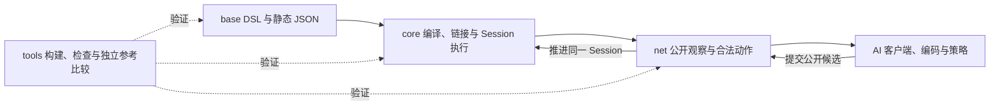

# 项目架构总览

文档类型：解释（Explanation）。本页面向需要判断修改归属的贡献者，说明规则、执行、公开接口与工具如何连接。产品要求见[项目规格](../specs/project.md)，准确核心行为见[核心接口要求](../specs/core-engine-baseline.md)，当前支持范围以包 manifest 和对应提交的 CI 为准。

## 从规则到公开动作

base 声明游戏规则；core 执行声明；net 为外部调用者发布当前公开状态并把候选提交回同一会话；AI 消费这份公开协议。独立参考依赖留在 tools，生产规则不借用参考答案。

| 要改变什么 | 所属模块与阅读入口 |
| --- | --- |
| 卡牌、伤害、Power、遗物、敌人、房间和 Run 的行为 | `mod-the-spire/base-spire/`；[base 开发手册](../areas/base/README.md) |
| 通用类型、DSL 编译、IR、执行、选择续接、随机与观察能力 | `core-the-spire/`；[core 开发入口](../areas/core/README.md) |
| Host、公开观察、合法动作、协议与客户端 | `net-the-spire/`；[net 开发入口](../areas/net/README.md) |
| 公开输入编码、概率输出、采样与评价 | `ai-the-spire/`；[AI 开发入口](../areas/ai/README.md) |
| 构建、CI、开发辅助和独立参考比较 | `tools/`；[工具清单](../../tools/README.md) |

## 维护边界

通用内核不按卡牌、遗物或房间 ID 执行玩法分支。规则包构建后不可变，每局状态由 Session 独立管理；游戏实例关系、生命周期、事件顺序和随机流由规则与共享操作明确组织。细节分别查[base 架构](../design/mod-the-spire/base-architecture.md)、[控制流程](../design/mod-the-spire/control-flow-modules.md)及[核心决定](../design/core-the-spire/core-architecture-decisions.md)。

公开投影和候选是外部接口的依据。内部 State、RNG 和诊断信息不自动成为 AI 输入；局部行为检查、独立比较与正常整局分别验收，要求见[完整环境规格](../specs/environment.md)。
