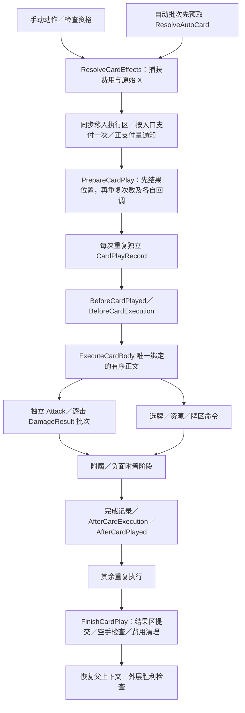

# 当前 base 控制流程与模块

文档类型：解释（Explanation）。本页按纯 DSL base `0.7.0-dsl.81` 描述现行职责，源码基线见[双侧对照](combat-engine-comparison.md)。调用签名见[行为操作参考](../areas/base/reference/card-behavior.md)，来源顺序与限制见[迁移约定](../areas/base/spec/behavior.md)。旧 C# CardPlayPipeline 等模块不进入生产。

## 当前调用链

图省略具体存活门禁；准确条件以 DSL 为准。付款、原始 X 与结果区属于出牌序列，每次重复另有执行标识；一次执行可以发出多次攻击，一次攻击可以有多段与多目标。直接伤害不因当前正在出牌就自动取得卡来源。

## 职责与入口

| 行为 | 主位置 | 分工与边界 |
| --- | --- | --- |
| 支付、重复、上下文与结果区 | [play](../../mod-the-spire/base-spire/cards/rules/play.spire)、[play-preparation](../../mod-the-spire/base-spire/cards/rules/play-preparation.spire) | 唯一正文分派、显式 play、父执行、支付与结果快照；嵌套时保存／恢复 CurrentPlay |
| 正文、基础变量与私有能力 | 所属卡牌文件、[定义模板](../../mod-the-spire/base-spire/cards/rules/card-definition.spire) | 每定义绑定 ExecuteCardBody 和 ReadCardDamage；外部 Before／After 通知不收集主效果 |
| 攻击与结果 | [attacks](../../mod-the-spire/base-spire/combat/attacks.spire)、[damage-results](../../mod-the-spire/base-spire/combat/damage-results.spire) | 每击先提交本批目标，再结果通知、死亡通知；直接群伤有独立DamageBatch，DamageDepth／AttackDepth／PlayDepth共同保护外层结算 |
| 抽牌与自动批次 | [draw](../../mod-the-spire/base-spire/cards/rules/draw.spire)、[autoplay](../../mod-the-spire/base-spire/cards/rules/autoplay.spire) | 抽牌复用阻止、容量及重洗；自动批次先收集，嵌套批次不抢父成员 |
| 费用、牌区与回合末手牌 | [costs](../../mod-the-spire/base-spire/cards/rules/costs.spire)、[piles](../../mod-the-spire/base-spire/cards/rules/piles.spire) | 独立费用来源／寿命，区分移动、主动弃牌与耗尽；动态关键词与整批 flush |
| 永久牌、复制与附魔 | [permanent-operations](../../mod-the-spire/base-spire/cards/rules/permanent-operations.spire)、[attachments](../../mod-the-spire/base-spire/cards/rules/attachments.spire) | 永久／战斗副本分开；复制、升级与移除协议；依附投影保护隐藏牌标识 |
| Power 与其他能力监听 | [Power生命周期](../../mod-the-spire/base-spire/powers/rules/lifecycle.spire)、[统一监听约定](../areas/base/spec/effect-listeners.md) | 显式来源、shared／per-applier／independent 实例匹配、修正参与者与后置通知；stackType 与实例模式分别按[Power参考](../areas/base/reference/powers.md)解释 |
| 资源、访问与奖励 | [resources](../../mod-the-spire/base-spire/combat/resources.spire)、[visits](../../mod-the-spire/base-spire/events/rules/visits.spire)、[rewards](../../mod-the-spire/base-spire/rewards/index.spire) | 共享完整领域调用；访问拥有页面／状态／返回位置，普通事件不直接改 Player.Room |
| 回合、历史及战斗结束 | [lifecycle](../../mod-the-spire/base-spire/combat/lifecycle.spire)、[normal](../../mod-the-spire/base-spire/run/normal.spire) | 正常与开发入口共用阶段；EndTurn 自动推进到下一玩家回合或战斗结束，途中决定由 Session 暂停；正常胜利进入奖励／访问返回，失败独立提交 |

所有可变状态、局部变量、挂起点和续接均在同一 Engine Session。Host 只负责声明派生、候选应答与公开投影，不编排第二份玩法。

普通回合按 `BeforePlayerSideTurnStart → 选招 → 清格挡 → 能量重置 → 回合号增加 → 起手抽牌 → Early／普通／Late → AfterPlayerSideTurnStart` 推进。敌方回合末不选招；下一玩家开始过程负责后继招式。胜利等待伤害、攻击、出牌和外层效果退回，再通知结束、清理、通知胜利及结算访问；玩家死亡先执行死亡通知与 Power 移除，退出外层后提交失败，不执行胜利链。

新增内容先复用对应领域命令；存在新源语义时补约定与一个能区分错误的消费者。当前目标与未验证范围只在[GitHub 任务清单](https://github.com/QingXiang22/auto-the-spire/issues/28)维护，不把开发范围通过记为完整原版一致。
