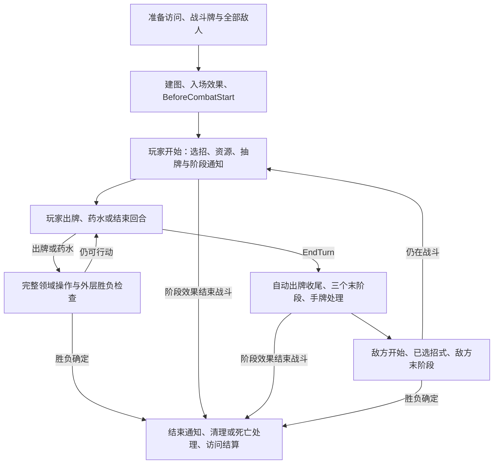
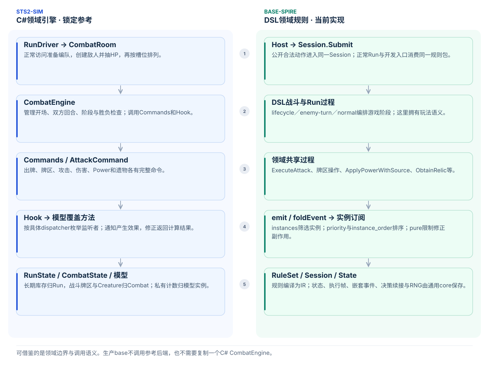
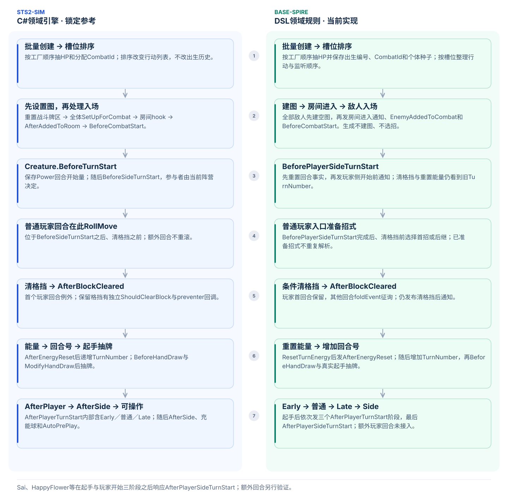
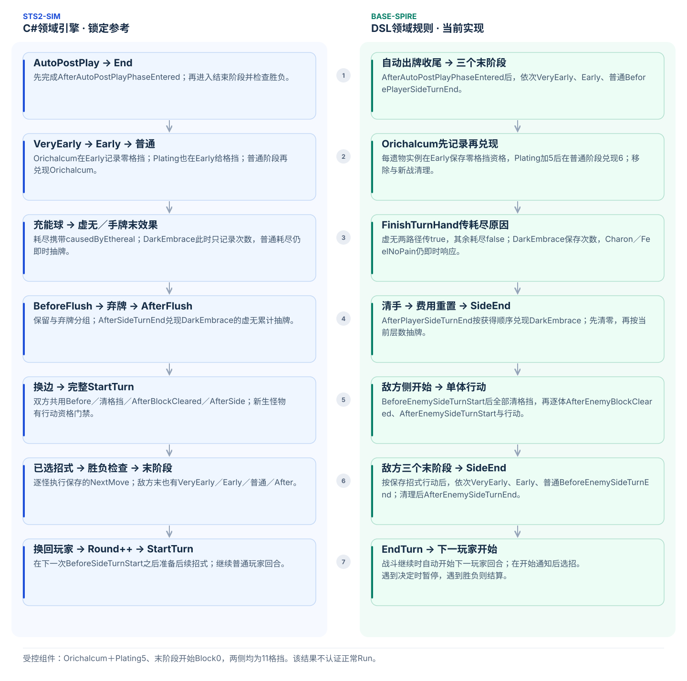
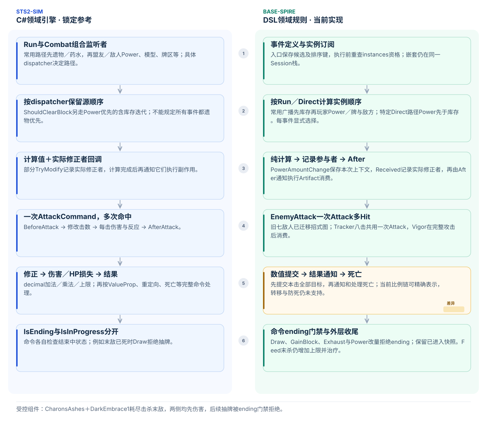
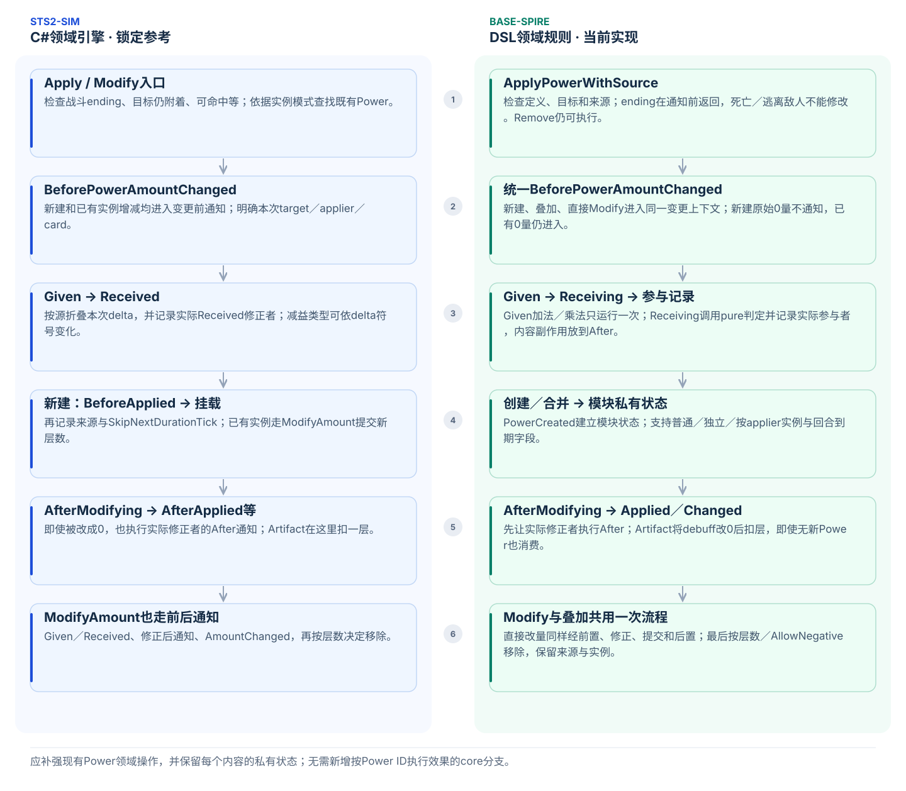
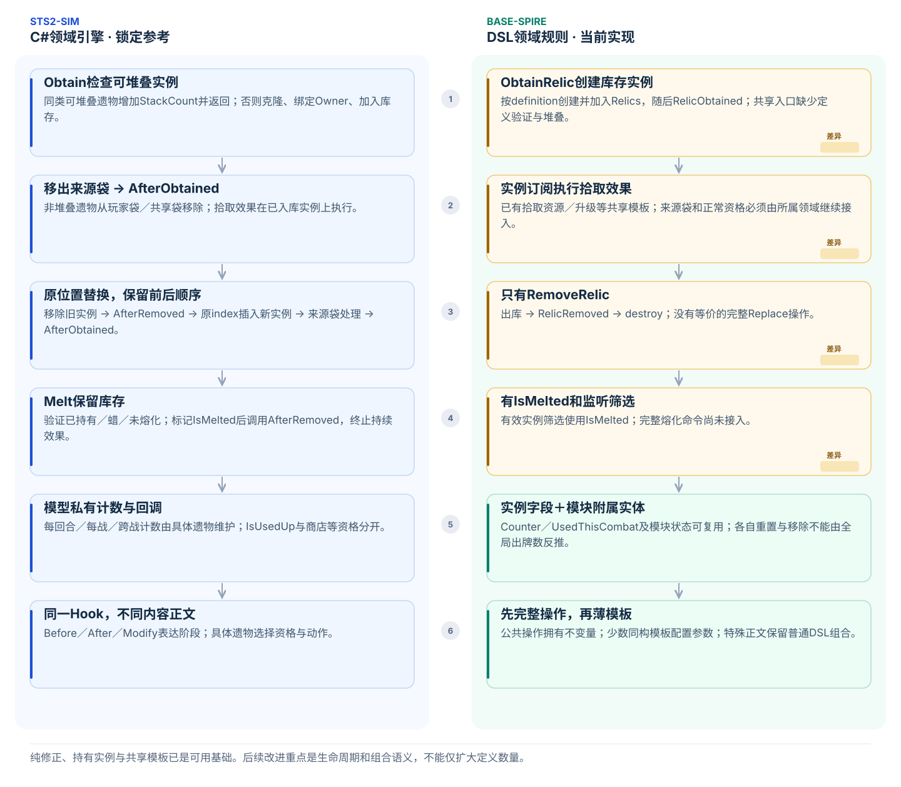

# 战斗引擎与效果生命周期对照

文档类型：解释（Explanation）。面向需要审阅共享玩法、迁移遗物／Power，以及判断效果应放在哪个阶段的开发者。

当前判断是保留通用 Session 与 DSL 领域规则的分工，优先改善正常 Run 的批量内容接入。普通回合选招、EndTurn 自动换回玩家、出牌支付与修正顺序已在当前代码中实现，不再列为待建框架。尚未实现的异步交错、异常补偿和其他内容族分别说明，不作为所有内容扩充的前置条件。

本文比较[锁定sts2-sim](../../reference/README.md)的提交`611cea2b498ee1eba3743d185c210c6b2a4624a6`（声明版本v0.111.0），以及base-spire提交`ca18b97a92d322a861f1a0f4614316ce4247e63b`（包版本`0.7.0-dsl.81`）。这是源码审阅，不是本次运行的符合性报告；文中的组件数值仅说明已有判别场景。具体接口仍查[操作参考](../areas/base/reference/operations.md)和[Power参考](../areas/base/reference/powers.md)。

[交互图文](combat-engine-comparison.html)按六个主题提供源码节点、差异显示和SVG导出。图只展示主要路径；完整判断以下文及领域规格为准。

## 一场战斗的主路径

正常 Run 与开发入口使用同一套战斗规则。当前 EndTurn 会连续完成玩家末阶段、敌方阶段和下一玩家开始；遇到决定由 Session 保存续接，遇到胜负则转入结算。Host 不负责补一次“开始回合”。

图中的胜负节点概括不同收尾路径，不表示各个命令共享同一种结束中资格。额外回合、复活和未加载内容也不能从主路径推出支持。

## 两侧的职责与状态

sts2-sim把战斗领域直接写在C#模型与命令中：`RunDriver`通过`CombatRoom`准备本场状态；`CombatEngine`推进阶段；`Commands`执行完整操作并调用`Hook`；具体遗物、Power、怪物或卡牌覆盖模型方法响应。模型可以继续调用命令，形成嵌套效果。长期库存属于Run，战斗参与者和牌区属于Combat，内容私有计数属于模型实例。

base-spire把这些领域规则放在DSL：Host提交公开动作，通用`Session`执行已编译规则；Run与combat过程编排阶段；共享过程处理攻击、牌区、Power与库存；内容通过实例订阅参与通知或只读修正。可变状态、执行帧、随机流和决策续接由core管理。两侧都需要完整领域操作，承载它们的语言与模块位置不同。

迁移时应保留输入、状态变化、事件时点、实例寿命与随机消费。无需复制一个生产C#战斗引擎，也无需把每个C#模型机械地变成一个DSL模板。规则继续放在base，core不增加按游戏内容ID执行效果的分支。

源码入口：[参考CombatEngine](https://github.com/iRyougi/sts2-sim/blob/611cea2b498ee1eba3743d185c210c6b2a4624a6/src/Sts2Sim.Core/Combat/CombatEngine.cs)、[当前DSL生命周期](../../mod-the-spire/base-spire/combat/lifecycle.spire)、[Session事件执行器](../../core-the-spire/Core.TheSpire/Engine/Session.Events.cs)。

## 开场与玩家回合开始

参考的正常准备先按工厂顺序创建全部怪物，抽取HP并分配`CombatId`，随后按槽位排列行动列表。进入战斗后重置玩家与牌区，为全部怪物设置招式图，执行房间准备回调与`AfterAddedToRoom`，再发布`BeforeCombatStart`。出生历史、行动顺序和入场效果不是同一个排序问题。

参考普通玩家回合的主要顺序为：保存各Power的回合开始量，`BeforeSideTurnStart`，为怪物`RollMove`，按条件清格挡与`AfterBlockCleared`，重置能量与`AfterEnergyReset`，增加`TurnNumber`，起手抽牌，`AfterPlayerTurnStart`，`AfterSideTurnStart`，充能球和自动出牌阶段，胜负检查，再允许操作。`AfterPlayerTurnStart`的dispatcher内部依次调用Early、普通和Late；额外回合不按普通路径重新选招。

当前DSL创建阶段仅保存敌人与内容私有状态。`BeginDevelopmentCombat`清理旧战斗状态与准备牌区，按槽位整理行动顺序，为全部敌人建空图，再发布正常房间进入、敌人入场和`BeforeCombatStart`。普通玩家回合先`BeforePlayerSideTurnStart`，通知完成后准备敌人招式，再按条件清格挡及`AfterBlockCleared`，重置能量与`AfterEnergyReset`，此时仍是旧回合号；再增加回合号，发布`BeforeHandDraw`并抽牌，随后依次Early、普通、Late和`AfterPlayerSideTurnStart`。

Sai、HappyFlower等当前按明确阶段与实例获得顺序响应。普通玩家BeforeSideTurnStart之后、清格挡之前准备敌人首招或后继；出生稳定编号与槽位行动顺序分开保存，图初始化先于入场效果。额外回合和全部编队仍需各自消费者与验证，不能由普通开始阶段的组件一致推断。

源码入口：[参考CombatRoom](https://github.com/iRyougi/sts2-sim/blob/611cea2b498ee1eba3743d185c210c6b2a4624a6/src/Sts2Sim.Core/Rooms/CombatRoom.cs)、[参考Hook](https://github.com/iRyougi/sts2-sim/blob/611cea2b498ee1eba3743d185c210c6b2a4624a6/src/Sts2Sim.Core/Hooks/Hook.cs)、[当前敌方流程](../../mod-the-spire/base-spire/combat/enemy-turn.spire)。

## 回合末与敌方阶段

参考在自动出牌收尾后进入结束阶段，依次发布VeryEarly、Early与普通末阶段通知，处理充能球、虚无与手牌末效果，再执行`BeforeFlush`、保留／弃牌、`AfterFlush`、`AfterSideTurnEnd`。随后换边进入敌方完整开始生命周期，依次执行已选招式与胜负检查，再进入敌方末阶段。换回玩家后增加Round，下一次普通玩家开始阶段才准备后续招式。

当前DSL在自动出牌收尾后依次发布VeryEarly、Early、普通`BeforePlayerSideTurnEnd`，调用`FinishTurnHand`，重置回合费用，再`AfterPlayerSideTurnEnd`。敌方先侧开始前通知、全部清格挡、逐体清格挡后通知及侧开始，再逐体行动；三个结束前阶段、清理与`AfterEnemySideTurnEnd`之后不选招。公开`EndTurn`在战斗继续时调用`BeginDevelopmentTurn`，该过程准备后继招式并开启下一玩家回合；额外回合未认证。

Orichalcum在Early按每个遗物实例记录零格挡资格，允许Plating增加5格挡，再在普通阶段兑现6点。当前DSL已保存并清理这份私有资格，组件结果与参考均为11；移除、熔化和新战避免旧资格泄漏。

耗尽操作和`CardExhausted`保留`causedByEthereal`：两条回合末虚无路径为true，其他正文／出牌／选牌／强制耗尽为false，不能从虚无关键词推断原因。DarkEmbrace按实例累计虚无次数，在持有者`AfterPlayerSideTurnEnd`先清零再按当前层数抽牌；普通耗尽仍即时抽牌。CharonsAshes和FeelNoPain接收原因但继续即时伤害／格挡。

`FinishTurnHand`已有Infection等末效果的串行处理。参考`DoTurnEndAsync`独立启动每张效果牌的入区Task，正文等待自身入区与前一张结果；当前DSL逐张完成整条过程。人工暂停首张效果时，两边中间牌区可能不同，这是已知调度边界；不能因此把常规内容批次改造成通用并发调度工程。真实内容需要该交错时，再提出具体输入和可观察差异。

源码入口：[参考DarkEmbrace](https://github.com/iRyougi/sts2-sim/blob/611cea2b498ee1eba3743d185c210c6b2a4624a6/src/Sts2Sim.Core/Models/Powers/DarkEmbracePower.cs)、[参考Orichalcum](https://github.com/iRyougi/sts2-sim/blob/611cea2b498ee1eba3743d185c210c6b2a4624a6/src/Sts2Sim.Core/Models/Relics/Orichalcum.cs)、[当前牌区操作](../../mod-the-spire/base-spire/cards/rules/operations.spire)。

## 监听顺序、攻击与战斗结束

参考常用的`RunState.IterateHookListeners`先枚举玩家遗物与药水，再组合Combat监听者；Combat通常按盟友、敌人枚举Power、怪物及玩家专属牌区等。具体dispatcher可以选择不同路径，例如`ShouldClearBlock`使用Power先于库存的路径。因此不存在适用于所有通知的“遗物一定先于Power”规则。参考对不同模型的有效资格检查也有已声明的简化，不能把它理想化为全部模型都会严格重查库存。

当前`Session`在事件入口保存候选与排序键，按`priority`、`instance_order`和声明顺序执行，调用前重查实例存在及筛选资格。base按站点显式选择Run或Direct次序：常用广播先库存再玩家Power／牌与敌方，ShouldClearBlock等Direct路径Power先于库存。各阶段独立快照；期间移除／新增按执行器资格处理。

通知允许副作用和嵌套效果；`pure foldEvent`只计算值。当前Power改量用隐藏上下文记录Received实际参与者，再单独通知它们执行副作用。Artifact在这一阶段消费层数，修正为0也保留参与记录，不在pure计算中写状态。

攻击以整次Attack为边界，再包含多个Hit。旧七敌人已迁移到招式图，Tracker用`EnemyAttack`创建一次八击Attack，Vigor作用全部八击后消费；Vigor3时双方伤害均为32。攻击前后通知、每击伤害、反应与结果继续复用完整操作。

战斗结束有不同含义。当前DSL用深度计数推迟外层结算，并为Draw、GainBlock、Exhaust与Power改量加入源ending门禁；已进入的监听快照仍可继续，后续命令各自判断。Feed末杀仍增加最大生命并治疗，但收尾自耗尽被拒绝。正常整局认证与其他命令的未支持边界仍独立。

胜利在外层退出后依次写结果、关闭战斗、发布结束通知、`ClearNormalCombat`、发布胜利通知、`SettleNormalCombat`提出奖励。玩家死亡则先`PlayerDied`和移除应消失的Power，保留死亡回调所需的战斗与外层引用；执行深度退出后才写失败和结算访问，不走胜利奖励链。当前胜利条件仍是无活动敌人且已有死亡／逃离事实；参考区分主要敌人并查询阻止结束的Hook，相关召唤／防止结束消费者尚未接入。

源码入口：[参考RunState](https://github.com/iRyougi/sts2-sim/blob/611cea2b498ee1eba3743d185c210c6b2a4624a6/src/Sts2Sim.Core/Runs/RunState.cs)、[参考AttackCommand](https://github.com/iRyougi/sts2-sim/blob/611cea2b498ee1eba3743d185c210c6b2a4624a6/src/Sts2Sim.Core/Commands/Builders/AttackCommand.cs)、[当前攻击过程](../../mod-the-spire/base-spire/combat/attacks.spire)、[通知与修正规格](../areas/base/spec/effect-listeners.md)。

## 出牌与数值表示

当前`ResolveCardEffects`与参考`CardModel.PlayAfterObserverStartedAsync`的主要顺序一致：捕获费用与X值，同步移入执行区，支付，正数实付能量才通知`AfterEnergySpent`，然后修正结果位置、重复次数并执行各自回调。同步入区不发布普通异步移牌通知。每次重复有独立出牌记录，整次序列只支付和提交结果区一次；之后检查空手、清理费用并恢复父上下文。这些流程应继续复用，星星及其他未迁移资源另按真实内容接入。

伤害命令的一击先提交本批所有目标的数值，再通知结果并处理死亡；Attack、Hit、DamageBatch和CardPlay不能合并成一个计数。当前10000缩放能精确表示已核对的实际乘法链及上限，不需仅因参考使用decimal就先重写数值引擎。任意mod比例、重复实例或新增HP修正仍须重新核对，详见[伤害规格](../areas/base/spec/combat-damage.md)。

源码入口：[参考CardModel](https://github.com/iRyougi/sts2-sim/blob/611cea2b498ee1eba3743d185c210c6b2a4624a6/src/Sts2Sim.Core/Models/CardModel.cs)、[当前出牌](../../mod-the-spire/base-spire/cards/rules/play.spire)、[准备与修正](../../mod-the-spire/base-spire/cards/rules/play-preparation.spire)。

## Power的完整变更

参考施加Power时先判断战斗状态、目标附着与可命中资格，寻找已有实例。新建和层数变更都需要经过变更前通知、Given／Received修正，记录实际Received修正者，再提交实例与层数；新建还有`BeforeApplied`。计算完成后通知实际修正者，即使最终变化为0也可能消费其他Power；非零时再处理新建后的通知、层数变化及必要移除。实例模式、来源、回合到期状态也属于这条生命周期。

当前`ApplyPowerWithSource`、叠加与`ModifyPowerAmountWithSource`共用一次变更流程：变更前通知、Given加法／乘法、Received参与记录、提交实例／层数、修正者After与后置通知、按层数移除。每次操作拥有独立隐藏上下文，嵌套／暂停不覆盖父操作；保留施加者、来源、实例模式与持续时间事实。

新建原始0量不发布通知；已有实例0量仍经过修正与参与者后置。Artifact已登记，按本次增量判断debuff，将其改0并在修正后扣一层，即使没有新Power也消费。Apply叠加不会再执行两遍修正。负Strength与负减益的类型按符号和定义判断。

共同生命周期不应接管所有内容私有计数：Vigor关心本次Attack及开始层数，DarkEmbrace关心虚无耗尽次数；这些状态继续归内容模块。公开标志、来源与通用到期机制才进入共享结构。

源码入口：[参考PowerCmd](https://github.com/iRyougi/sts2-sim/blob/611cea2b498ee1eba3743d185c210c6b2a4624a6/src/Sts2Sim.Core/Commands/PowerCmd.cs)、[参考ArtifactPower](https://github.com/iRyougi/sts2-sim/blob/611cea2b498ee1eba3743d185c210c6b2a4624a6/src/Sts2Sim.Core/Models/Powers/ArtifactPower.cs)、[当前Power生命周期](../../mod-the-spire/base-spire/powers/rules/lifecycle.spire)。

## 遗物的库存与持续效果

参考`Obtain`先处理已有可堆叠实例，否则克隆遗物、绑定Owner、加入库存、移出对应来源袋，再执行`AfterObtained`。`Replace`在旧位置插入新实例，并依次处理旧实例移除回调、来源袋和新实例获得回调。`Melt`有自身资格判断，保留库存实例并标记熔化，再调用移除效果；它与真正出库不是同一个操作。

当前`ObtainRelic`创建实例、加入`Relics`并发出`RelicObtained`；拾取模板和持续监听已有可复用基础。`RemoveRelic`出库、通知并销毁，但还没有完整Replace／Melt流程，获得操作的定义验证、堆叠及来源袋关系也需补齐。已有`IsMelted`筛选不能替代熔化生命周期。

遗物计数的寿命需要逐项确认：Nunchaku跨战保留计数，Kunai／Shuriken有回合计数，首次受伤类遗物有每战状态。模板可以复用“相同阶段＋相同正文＋配置参数”，不能只因都带Counter就统一重置。监听顺序还受库存位置影响，因此替换不能简单写成Remove后末尾Obtain。

源码入口：[参考RelicCmd](https://github.com/iRyougi/sts2-sim/blob/611cea2b498ee1eba3743d185c210c6b2a4624a6/src/Sts2Sim.Core/Commands/RelicCmd.cs)、[当前遗物生命周期](../../mod-the-spire/base-spire/relics/rules/lifecycle.spire)、[当前拾取模板](../../mod-the-spire/base-spire/relics/rules/content-lifecycle.spire)。

## 怎样选择可复用的逻辑

先确认源调用方的阶段、参与者、有效资格和结束中检查，再读Hook与内容正文，最后核对DSL操作、实例顺序与私有状态。共享操作负责完整状态变化；模板负责已证明同构的内容正文。

| 复用位置 | 适合的职责 | 必须保留的差异 |
| --- | --- | --- |
| 完整攻击操作 | 一次Attack、多次Hit、伤害反应与结果 | 攻击与命中边界、提前死亡、Vigor消费 |
| Power变更操作 | 前置检查、修正、提交、实际修正者通知、移除 | 实例模式、来源、变化符号与内容私有状态 |
| 生成并加入牌区 | 创建实例、持有者与牌区关系、通知 | 临时牌／永久牌、公开性、复制语义 |
| 遗物库存操作 | 获得、堆叠、替换、熔化及回调 | 来源袋、原位置、库存保留与监听资格 |
| 已有查询与值构造 | 进阶数值、结构化意图、有效成员筛选 | 完整来源池、槽位顺序、随机消费 |
| 参数化内容模板 | 同一站点、同一条件、同一正文 | 计数寿命、延迟兑现、特殊强制招式回调 |

怪物招式图与单次多击见[#126](https://github.com/QingXiang22/auto-the-spire/issues/126)，出生、槽位与选招顺序见[#127](https://github.com/QingXiang22/auto-the-spire/issues/127)。遗物／Power的后续工作由[#128](https://github.com/QingXiang22/auto-the-spire/issues/128)组织。这里解释当前机制与复用边界，任务状态以Issue为准。

结构扫描、定义登记、组件比较与正常Run可达性是不同判断。本地`no-energy-gain`没有按当前源类直接对应，需单独说明来源与用途；不能把名称对应或条目数量当成行为完成度。人工构造的组合可以发现真实缺陷，但不能替代正常Run比较，也不能据主路径图推导额外回合、复活、角色专属流程或全部遗物／Power都已支持。

## 架构调整的范围与触发条件

下表是架构判断，不是新增排期。工作顺序与范围仍由[固定计划](https://github.com/QingXiang22/auto-the-spire/issues/28)控制，只能由人类项目管理者明确提出修改；agent可以记录阻塞和建议，不能据本页重排或加设前置验收。

| 对照发现 | 调整建议 | 实施边界 |
| --- | --- | --- |
| 参考RoomFactory按房间类型取队列中的遭遇，再由遭遇定义创建怪物；当前EnterNormalMapPoint同时包含队列、两种遭遇白名单和具体生成 | 批量接入遭遇时用内容模块绑定生成过程，Run只保留房间／访问编排；复用现有dispatch与招式图、攻击操作 | 不修改完整来源池或重抽成已实现内容；不引入Host游戏ID分支或JSON效果程序 |
| 正常与开发入口已有共同战斗过程，但命名仍带Development | 保留共同实现，明确公开动作和分步开发入口的返回位置；随相关修改再整理命名 | 不复制第二套生命周期，不把全局改名设为内容前置任务 |
| 遗物Obtain／Remove已有公共入口，来源袋、堆叠、Replace／Melt仍不完整 | 宝箱／商店等真实调用方需要时补对应库存操作，私有计数留在内容模块 | 不因为存在IsMelted字段就声称熔化完成，也不提前补齐所有遗物生命周期 |
| 参考CardPileCmd入战监听失败会移除新牌、回滚生成计数并通知已执行监听者中止；DSL失败终止Session | 保留明确未支持边界；出现获准消费者后再讨论局部补偿能力 | 这是特定命令的补偿，不是整局事务；不添加吞异常、默认成功或全状态快照回滚 |
| Task交错与任意decimal语义超出当前已核对消费者 | 保持单一续接栈与当前已证明适用的数值表示，按真实语义缺口扩展 | 人工挂起案例或无消费者的混合伤害批次不自动阻塞日常批量内容 |

房间和遭遇依据：[参考RoomFactory](https://github.com/iRyougi/sts2-sim/blob/611cea2b498ee1eba3743d185c210c6b2a4624a6/src/Sts2Sim.Core/Rooms/RoomFactory.cs)、[正常Run入口](../../mod-the-spire/base-spire/run/normal.spire)。局部补偿依据：[参考CardPileCmd](https://github.com/iRyougi/sts2-sim/blob/611cea2b498ee1eba3743d185c210c6b2a4624a6/src/Sts2Sim.Core/Commands/CardPileCmd.cs)的`EnterCombatInternal`；当前失败含义见[运行时状态模型](runtime-state-model.md)。

未知房间的类型可能要先消费来源随机才能确定是否支持；此时失败会保留已发生的消费，不能承诺“所有unsupported_capability都无副作用”。提交前的非法输入拒绝与执行中的未支持内容分别按[Run指南](../areas/base/how-to/run-and-rooms.md)处理，不增加隐式回滚或重试。

验证以本次改变的共享机制或内容批次为单位。复用既有判别场景，不为每张同构卡／每个遗物重复运行完整比较；无关诊断按[测试精简工单](https://github.com/QingXiang22/auto-the-spire/issues/174)处理，保留差异记录与专门运行方式。只有实际改动、失败或新消费者暴露问题时才扩大检查；本页文档修正只运行文档检查，不声称重新通过玩法或完整Run验收。
